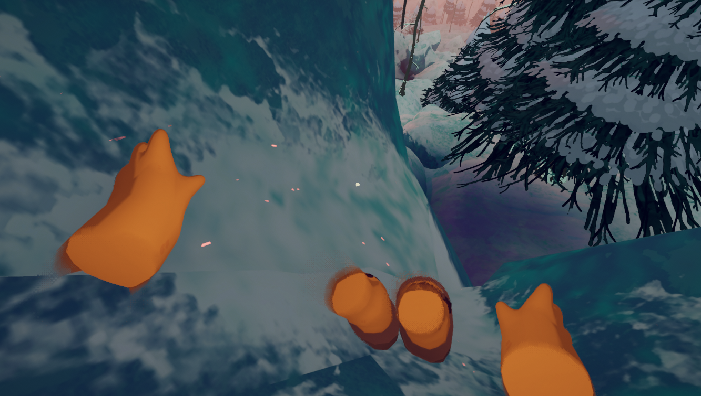

# How to play

*[PEAK](Peak%20%28game%29.md)* is a game that is mostly learned through experimentation and trial and error. The players are nudged in certain directions by the  [Guidebook](Guidebook.md) found at the start of any run at the [Crash Site](https://peak.wiki.gg/wiki/Crash_Site), and in bits and pieces by collecting [Scoutmaster Myres](Scoutmaster%20Myres.md)' diary [pages](Scroll.md#Torn_pages).

When starting a new game lobby from the main menu, players are dropped into the [Airport](Airport.md) where they can [customize](https://peak.wiki.gg/wiki/Customization) their individual [Scout](Scout.md) appearances, test out the game [mechanics](https://peak.wiki.gg/wiki/Category%3AMechanics) and physics by climbing a [rock wall](Airport.md#Climbing_Wall), and then start their adventure by [boarding](Airport.md#Kiosks) the plane. Starting a new run allows the player to select the [difficulty level](Ascents.md) by pressing the "up" and "down" buttons in the boarding pass UI.

The game can be played solo or with friends. By default, *[PEAK](Peak%20%28game%29.md)* supports up to 4 people in a given lobby, but this limit can be extended with the help of [modifications](Modifications.md) such as [PEAK Unlimited](https://thunderstore.io/c/peak/p/glarmer/PEAK_Unlimited/).

The run begins when the plane you've just boarded [crashes](https://peak.wiki.gg/wiki/Crash_Site) into the [Shore](Shore.md). Your objective is to climb the [mountain](Island.md) by moving through several [biomes](https://peak.wiki.gg/wiki/Biomes) and finally reaching the [Peak](Peak%20%28biome%29.md) of the mountain. You'll encounter many [hazards](Hazards.md) on your way up, but you will also find useful [equipment](Equipment.md) that will help you on your journey. Keep in mind that the island [changes every 24 hours](Island.md) for all players.

## Controls

The controls can also be viewed in-game on the pause screen (). As of [1.30.a](1.30.a.md), you can change control bindings.

| Mouse and Keyboard | Action |
| --- | --- |
| Keyboard w.pngKeyboard a.pngKeyboard s.pngKeyboard d.png | Move |
| Mouse move.png | Aim |
| Mouse left.png | Climb / Use Item |
| Mouse right.png | Helping Hand / Alt Use Item |
| Keyboard e.png | Interact |
| Keyboard q.png | Drop / Throw (Hold) |
| Keyboard space.png | Jump |
| Keyboard ctrl.png | Crouch |
| Keyboard shift.png | Sprint / Lunge (While Climbing) |
| Mouse scroll.png | Ping Location |
| Keyboard r.png | Emote |
| Keyboard v.png | Push to talk / Push to mute (depending on the settings) |
| Keyboard 1.pngKeyboard 2.pngKeyboard 3.png | Item Slot |
| Keyboard 4.png | Backpack Slot |
| Key tab.png | Stash Item |
| Mouse scroll.png | Scroll |
| Keyboard t.png | Scroll Forward |
| Keyboard g.png | Scroll Backward |

## Basic gameplay!

### Climbing & Stamina

---

For more info about stamina, see [Stamina](https://peak.wiki.gg/wiki/Stamina).

Extend a helping hand to your friends by pressing .

In order to reach the [Peak](Peak%20%28biome%29.md) and beat the game, you will need to climb the mountain ahead of you. Climbing is accomplished by standing close to a cliff, holding down  **Left Click**, and moving with the movement keys. Pretty much any surface in *[PEAK](Peak%20%28game%29.md)* is climbable with rare exceptions.

Climbing consumes your *[stamina](https://peak.wiki.gg/wiki/Stamina)*. When you run out of stamina, you can no longer climb until it regenerates back. If you run out of stamina mid-climb, you will begin to rapidly slide down and fall, which can be fatal. Performing certain actions, like eating specific foods, rewards you with  [Bonus stamina](Stamina%20bar.md#Bonus_stamina), which is only consumed when you run out of your main stamina.

You can press  **Left Shift** to perform a lunge and give yourself a small vertical boost at the cost of some stamina. If your hands are empty, you can also press  **Right Click** to extend a helping hand to your friends, which will pull them to you once they're close enough (note that this only works if they're climbing and you're above them). Be careful, however, as this will also pull you slightly towards them!

Another thing you can do with your friends to help each other climb is to crouch, let a friend stand on top of you, and then jump. This will give them a vertical boost without consuming their stamina. Your friend can then extend their hand and help you climb up too.

You can also hold  **Left Shift** to sprint while not climbing, but keep in mind that this consumes your stamina.

### Status effects

---

Main article: [Stamina bar](Stamina%20bar.md)

Over the course of your climb you will have many [status effects](Stamina%20bar.md) accumulated in your stamina bar, the majority of which decay over time:

-  [Weight](Stamina%20bar.md#Weight) is gained when carrying [items](Items.md) or other [Scouts](https://peak.wiki.gg/wiki/Scouts) and **does not decay over time**. It can be removed by throwing out (or consuming) carried stuff or mitigated by carrying items with negative weight, such as  [Anti-Rope](Anti-Rope.md),  [Anti-Rope Cannon](Anti-Rope%20Cannon.md),  [Balloon](Balloon.md), and  [Balloon Bunch](Balloon%20Bunch.md).
-  [Hunger](Stamina%20bar.md#Hunger) is **gained naturally over time**. It can be removed by eating [food](Food.md).
-  [Injury](Stamina%20bar.md#Injury) is gained when your [Scout](Scout.md) takes damage from falls or other sources and **does not decay over time**. It must be removed with a healing item, such as  [Bandages](Bandages.md),  [First Aid Kit](First%20Aid%20Kit.md),  [Medicinal Root](Medicinal%20Root.md) and  [Cure-All](Cure-All.md).

Revive unconscious friends with  [First Aid Kits](First%20Aid%20Kit.md) and other healing items.-  [Poison](Stamina%20bar.md#Poison) is gained by touching poisonous objects or eating poisonous [food](Food.md). **It does decay after some time**, but it's better to be removed with some healing items, such as  [Antidote](Antidote.md),  [First Aid Kit](First%20Aid%20Kit.md),  [Medicinal Root](Medicinal%20Root.md) and  [Cure-All](Cure-All.md). Do not underestimate its effects, as there are situations in which you can get a great deal of poison inflicted on you if you're not careful.
-  [Spores](Stamina%20bar.md#Spores) are gained by consuming [Shroomberries](Shroomberry.md), standing inside a [spore cloud](Roots.md#Mushroom_Spore_Clouds) in the [Roots](Roots.md), or by being bitten by a [zombie](Zombie.md). **It does decay after some time, UNLESS you have been bitten by a zombie, in which case it will continue to increase until cured.** It takes the longest to go away on its own out of any status effect (unless playing in multiplayer, where [Thorns](Stamina%20bar.md#Thorns) takes the longest), so avoiding it should be of high priority.
-  [Cold](Stamina%20bar.md#Cold) is gained during [blizzards](Blizzard.md) in the [Alpine](Alpine.md), during nights on [Ascent 5](https://peak.wiki.gg/wiki/Ascent_5) or higher, or when the [Fog](Fog.md) finally reaches you.
-  [Heat](Stamina%20bar.md#Heat) is gained by being burned (e.g. on a [campfire](Campfire.md) or by a  [Scorchberry](Scorchberry.md)) or by being in direct sunlight in the [Mesa](Mesa.md).
-  [Drowsy](Stamina%20bar.md#Drowsy) is gained after consuming certain items ( [Big Lollipop](Big%20Lollipop.md),  [Energy Drink](Energy%20Drink.md),  [Napberry](Napberry.md)) or being hit with a  [Blowgun](Blowgun.md).
-  [Thorns](Stamina%20bar.md#Thorns) are gained by getting hit by a [tumbleweed](Tumbleweed.md) or touching various [cacti](https://peak.wiki.gg/wiki/Cacti) in the [Mesa](Mesa.md), or by consuming a [prickleberry](Prickleberry.md).
-  [Arrow](Stamina%20bar.md#Arrow) is gained by getting shot by an [Arrow Trap](https://peak.wiki.gg/wiki/Arrow_Trap) in [The Citadel](The%20Citadel.md) and **does not decay over time**. You can pull them out, inflicting  [Injury](Stamina%20bar.md#Injury) instead.
-  [Web](Stamina%20bar.md#Web) is gained when a [Spider](Spider.md) touches a [Scout](Scout.md), wrapping them in a web. **It does not decay over time**, as it needs to be manually removed by repeatedly pressing **Jump** .
-  [Flytrap](Stamina%20bar.md#Flytrap) is gained when a [Flytrap](Flytrap.md) grabs a [Scout](Scout.md), trapping and muffling them. **It does not decay over time**, as it needs to be manually removed by repeatedly pressing **Jump** .
-  [Curse](Stamina%20bar.md#Curse) is commonly gained when being revived at an [Ancient Statue](Ancient%20Statue.md) or being targeted by the  [Book of Bones](https://peak.wiki.gg/wiki/Book_of_Bones) and **does not decay over time**. It is usually removed with  [Cure-All](Cure-All.md) or  [Pandora's Lunchbox](Pandora%27s%20Lunchbox.md) (the latter of which is not recommended unless in a dire situation).
-  [Petrify](Stamina%20bar.md#Petrify) is gained after being sacrificed with the  [Ritual Dagger](Ritual%20Dagger.md), using any [Amulet](Amulets.md), or touching [Petrifying Stones](https://peak.wiki.gg/wiki/Petrifying_Stones) and **does not decay over time**. The only way of removing it is to light a [Campfire](Campfire.md). This status effect is unique in that it doesn't affect [Stamina](https://peak.wiki.gg/wiki/Stamina), but rather limits  [Bonus stamina](Stamina%20bar.md#Bonus_stamina).

These effects reduce the amount of stamina you have. If you run out of main stamina completely, you will *pass out, unless you were targeted by the  [Book of Bones](https://peak.wiki.gg/wiki/Book_of_Bones)*. While you are passed out, you will be unable to move or use items, and your friends will be unable to hear you. There is a certain amount of time during which you are still alive and can be revived (either by waiting for temporary status effects to wear off or by your friends). Once this time is over, you will become a [ghost](https://peak.wiki.gg/wiki/Ghost) until somebody resurrects you at an [Ancient Statue](Ancient%20Statue.md) or by using the  [Scout Effigy](Scout%20Effigy.md). Unconscious [Scouts](https://peak.wiki.gg/wiki/Scouts) can also be carried around, which temporarily stops the death timer unless you have over 50  [Spores](Stamina%20bar.md#Spores). Furthermore, if you run out of  [Bonus stamina](Stamina%20bar.md#Bonus_stamina) due to  [Petrify](Stamina%20bar.md#Petrify), you will crystallize shortly after, dying and leaving a statue of your [Scout](Scout.md).

### Inventory & [Backpack](Backpack.md)

---

Items that you pick up by looking at them and pressing the interact key () are stored into your **inventory** slots. You can select any of these three slots by pressing , , and , respectively. Pressing the corresponding key again while the slot is already selected will deselect it and empty your hands. Keep in mind that you cannot climb walls if you're holding anything.

Picking up items with a full inventory is still possible as they will be put into your hands, but you will be unable to store them until you make some room. To drop the current item, simply press . Alternatively, you can hold down  and charge a throw, which you can perform by releasing the key.

Although you cannot change the amount of inventory slots that you have, you can use the  [Backpack](Backpack.md) to extend your storage. The backpack is a special item that goes into its own, special fourth slot (selected by pressing ) and allows you to carry up to 4 additional items. One backpack is always available at the [Crash Site](https://peak.wiki.gg/wiki/Crash_Site), while more can always be found at the [campfire](Campfire.md).

To use the backpack yourself, place it on the ground, look at it, and hold the interact key (). A radial menu with four empty slots will appear. When you are holding an item, hovering over an empty slot and releasing the key will store the held item in the selected slot of the backpack. To retrieve a stored item, open the backpack menu again and select the corresponding slot. To equip the backpack, select the bottom slot with an icon of a  [Backpack](Backpack.md).

Your friends can also use your backpack while you're wearing it without you first having to take it off.

### Communication

---

For more information about emotes, see [Emotes](Emotes.md).

The Emote Wheel

Communication in *[PEAK](Peak%20%28game%29.md)* is essential if you're playing with a group. The game features a **proximity voice chat** with a simulation of echo and the [Doppler effect](https://en.wikipedia.org/wiki/Doppler_effect). By default, it is activated automatically by your voice, but can also be switched to "Push to Talk" or "Push to Mute" in the settings.

Another useful communication tool in the game is the **Ping** system.  **Middle Click** will show a pointing hand at the point you're currently looking at to all players.

You can also **Emote** by opening the *emote wheel* with  and selecting the desired emote. Be careful with the "Play dead" and the "Backflip" emotes as you may fall from a great height because of them, since they can force you into a [ragdoll](https://peak.wiki.gg/wiki/Ragdoll) state!

### Ascents

---

Main article: [Ascents](Ascents.md)

[Ascents](Ascents.md) are the difficulty system of *[PEAK](Peak%20%28game%29.md)*. Two Ascents are available by default: *[Tenderfoot](https://peak.wiki.gg/wiki/Tenderfoot)* and *[Peak](Ascents.md)*. *Peak* is the standard difficulty with no additional modifier, while *Tenderfoot* is intended to provide an easier experience. After beating the game at least once on a given Ascent, the next Ascent is unlocked (with [Ascent 1](https://peak.wiki.gg/wiki/Ascent_1) being the first one), up until [Ascent 8](Ascents.md#Ascent_8), which is the last ascent as of [Patch 2.0.a](2.0.a.md).

Do not be afraid of trying a lower Ascent if you're having trouble beating the game. Randomly generated maps can also introduce a great deal of additional trouble to your playthrough, so feel free to start on a lower difficulty and eventually make your way to [Ascent 8](Ascents.md#Ascent_8)!

### Badges

---

Main article: [Badges](Badges.md)

You can earn [Badges](Badges.md) for completing certain in-game actions. Badges serve as the game's achievement system and are synchronized with your Steam achievements. Earning them unlocks new [cosmetics](Cosmetics.md) for your [Scout](Scout.md).

Badges can be earned on all Ascents including [Tenderfoot](https://peak.wiki.gg/wiki/Tenderfoot), which can make things a lot easier. Most of the badges are obtainable in solo, although some of them can only be earned with the help of other players.

## Challenges & hazards

The difficulty of the [Island](Island.md) depends on multiple factors:

- Your own skill level
- The skill level of your friends
- The generation of the [map](Island.md)
- Which [Ascent](Ascents.md) you're playing on
- The loot from [luggage](Luggage.md)
- How far away you are from your friends
- How fast you're moving up the mountain
- and many more.

The game provides enough tools to combat all these challenges, so don't feel discouraged to try again if you happen to fail!

## Tips & Tricks

A steep foothold in [Alpine](Alpine.md), the depicted player holding the  and  keys.- Always plan your path ahead of time. Finding a good path is a skill that has to be trained. You can usually tell what parts of the terrain can be stood on (the [Shore](Shore.md) will have sand, the [Tropics](Tropics.md) will have grass, etc.), so use that information to your advantage.- Even the smallest and steepest kinds of walkable terrain can be stood on, so long as you continuously hold down the directions opposite where you are bound to slip.
- [Cooking](Cooking.md) your food is really useful, since it doubles the amount of  [Hunger](Stamina%20bar.md#Hunger) restored and multiplies the amount of given  [Bonus stamina](Stamina%20bar.md#Bonus_stamina) by 1.5x (gives 10 if it didn't give any before).
- If you're playing in a group, try to stick together, as the game gives a lot of tools for helping each other. However, if the situation is dire, don't try to be a hero and save your fellow [Scouts](Scout.md) if the risk far outweighs the benefit. After all, they can always be resurrected as long as you make it out alive.- It can be useful to send one [Scout](Scout.md) on a route to see if it's possible, and then save them in case something goes wrong (which it often does) and they fall.
- Use the quirks of map generation to your advantage. There are usually many little walkable surfaces that you can stand on and regenerate your stamina in the middle of a route. Some of these stops may require you to walk in place into the wall not to fall down, but stamina regenerates even while walking, so it's not an issue.
- The  [Rope Spool](Rope%20Spool.md) can be very useful for helping your friends reach higher places.
- Sometimes eating [food](Food.md) solely for its  [Bonus stamina](Stamina%20bar.md#Bonus_stamina) can be necessary for finishing an otherwise impossible climb.
- The [Fog](Fog.md) is usually much less scary than the game makes it out to be. As long as you're moving at a somewhat steady pace, you should be okay. It's often possible to avoid seeing it at all during the entire run if your route is particularly good.
- Fatal  [fall damage](Stamina%20bar.md#Injury) can be clutched by quickly using the  [Pandora's Lunchbox](Pandora%27s%20Lunchbox.md) before passing out. This will randomize your status effects and have a good chance of restoring your health, or at least trading permanent [Injury](https://peak.wiki.gg/wiki/Injury) for some less permanent [effects](https://peak.wiki.gg/wiki/Effects).

## See also

- [Stamina bar](Stamina%20bar.md)
- [Food](Food.md)
- [Equipment](Equipment.md)
- [Biomes](https://peak.wiki.gg/wiki/Biomes)
- [Island](Island.md)
- [Badges](Badges.md)
- [Ascents](Ascents.md)
- [Category:Mechanics](https://peak.wiki.gg/wiki/Category%3AMechanics)
- [Category:Guides](https://peak.wiki.gg/wiki/Category%3AGuides)
