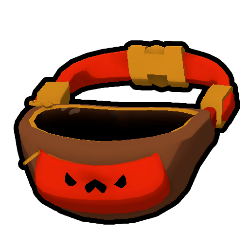

# How to play/es-419

*[PEAK](Peak%20%28game%29_es-419.md)* es un juego en el que se aprende principalmente mediante la experimentación y la prueba y error. Sin embargo, los [Exploradores](Scout_es-419.md) son introducidos a mecánicas básicas gracias a la  [Guía](Guidebook.md) del [Jefe de Tropa Myres](Scoutmaster%20Myres.md), que se encuentra en el [lugar del accidente](Shore_es-419.md#Lugar_del_accidente), y a las [Páginas Arrancadas](Scroll.md#Torn_pages) de su diario, que se encuentran aleatoriamente cerca de [fogatas](Campfire.md).

Al crear una nueva partida, los Exploradores aparecen en el [Aeropuerto](Airport_es-419.md), donde pueden [personalizar](Cosmetics_es-419.md) su apariencia con el  [Pasaporte](Passport.md), probar las [mecánicas](https://peak.wiki.gg/wiki/Mechanics) y físicas de escalado en un [muro de escalada](Airport_es-419.md#Muro_de_escalada), invitar a otros Exploradores interactuando con el [quiosco para invitaciones](Airport_es-419.md#Quioscos), jugar al [básquet](Airport_es-419.md#Cancha_de_básquet) y al [ajedrez](Airport_es-419.md#Tablero_de_ajedrez), tomarse fotos interactuando con la [cabina fotográfica](Airport_es-419.md#Cabina_fotográfica), y empezar la exploración interactuando con el [quiosco de la sala](Airport_es-419.md#Quioscos), donde también pueden seleccionar el [Ascenso (dificultad)](Ascents_es-419.md) de la expedición o el [modo de juego](Custom%20Expedition.md).

*PEAK* puede jugarse en solitario o de a 4 Exploradores como máximo, aunque este límite puede extenderse con el uso de [mods](Modifications.md) como [PEAK Unlimited](https://thunderstore.io/c/peak/p/glarmer/PEAK_Unlimited/).

Una expedición en modo normal empieza cuando el avión en el que ibas a bordo se [estrella](Shore_es-419.md#Lugar_del_accidente) en la [Costa](Shore_es-419.md). Tu objetivo es escalar la [Isla](Island_es-419.md) cruzando diferentes [biomas](Locations_es-419.md#Biomas) y finalmente alcanzar la [Cima](Peak%20%28biome%29.md). Te encontrarás muchos [peligros](Hazards.md) en el camino, así como también [equipamiento](Equipment.md) útil para completar tu objetivo. Ten en cuenta que la Isla [cambia cada 24 horas](Island_es-419.md) de forma global.

## Controles

Los **controles** pueden verse en el menú de pausa del juego (), pulsando el botón "**Reasignar Controles**". A continuación se muestran los controles predeterminados. Estos se usarán como referencia a lo largo de toda la wiki.

| Acción | Controles Predeterminados |
| --- | --- |
| Moverse hacia Adelante | Keyboard w.png |
| Moverse hacia Atrás | Keyboard s.png |
| Moverse hacia la Izquierda | Keyboard a.png |
| Moverse hacia la Derecha | Keyboard d.png |
| Apuntar | Mouse move.png |
| Escalar / Uso Primario de Objeto | Mouse left.png |
| Ayudar / Uso Secundario de Objeto | Mouse right.png |
| Interactuar | Keyboard e.png |
| Soltar / Lanzar (Mantener Pulsado) | Keyboard q.png |
| Saltar | Keyboard space.png |
| Agacharse | Keyboard ctrl.png |
| Correr / Lanzarse (Mientras Escalas) | Keyboard shift.png |
| Marcar Ubicación | Mouse scroll.png |
| Usar Gesto | Keyboard r.png |
| Pulsa para Hablar / Pulsa para Silenciar | Keyboard v.png |
| Espacio de Objeto 1 | Keyboard 1.png |
| Espacio de Objeto 2 | Keyboard 2.png |
| Espacio de Objeto 3 | Keyboard 3.png |
| Espacio de Mochila | Keyboard 4.png |
| Guardar Objeto | Key tab.png |
| Desplazar | Mouse scroll.png |
| Desplazar hacia Adelante | Keyboard t.png |
| Desplazar hacia Atrás | Keyboard g.png |

## Guía básica

### Escalado y Resistencia

---

Para saber más sobre la Resistencia, véase [Resistencia](https://peak.wiki.gg/wiki/Stamina).

Extiende una mano a otros Exploradores pulsando Ayudar ().

**Escalar** es una acción fundamental en *[PEAK](Peak%20%28game%29_es-419.md)*, por lo que no sería raro decir que la gran mayoría de superficies son escalables (La lista de superficies no escalables puede verse aquí). Cuando te acerques a una superficie escalable, la retícula cambiará de color a un amarillo anaranjado, indicando que puedes escalarla. Manteniendo **Escalar** () te agarrarás a dicha superficie y podrás **Moverte** () por ella.

Escalar consume **[Resistencia](https://peak.wiki.gg/wiki/Stamina)**. Cuando te quedas sin Resistencia, no puedes escalar, y si te quedas sin Resistencia mientras escalas, empezarás a caer rápidamente, lo que puede ser mortal. Puedes acumular  [Resistencia Adicional](Stamina%20bar.md#Bonus_stamina) usando o consumiendo objetos específicos, y solo se consume si te quedas sin Resistencia.

Puedes **Lanzarte** () mientras escalas para obtener un pequeño impulso hacia dónde te estás moviendo a costa de consumir más Resistencia. También puedes mantener **Correr** () mientras caminas para correr, y esto también consume Resistencia.

Si tus manos están vacías, puedes mantener **Ayudar** () para extender tu mano hacia adelante y ayudar a [Exploradores](Scout_es-419.md) que estén escalando cerca tuyo a llegar a donde estas. Otra cosa que puedes hacer con otros Exploradores para llegar a lugares altos es agacharte para que uno se suba encima y luego saltar. Esto elevará levemente al Explorador sin consumir su Resistencia.

### Efectos de Estado

---

Para saber más sobre cada Efecto de Estado, véase [Barra de Resistencia](https://peak.wiki.gg/wiki/Stamina_Bar).

Durante tu expedición tendrás varios **Efectos de Estado** limitando tu Resistencia, y es tu deber gestionarlos. La lista a continuación tiene información general y resumida:

- El  [Peso](Stamina%20bar.md#Weight) se obtiene al cargar [objetos](Items_es-419.md) o a [Exploradores inconscientes](Scout_es-419.md#Estado_Inconsciente_y_Muerte). Se puede reducir tirando o consumiendo lo que llevas encima o cargando objetos con peso negativo, como el  [Carrete de Anticuerda](Anti-Rope.md), el  [Globo](Balloon.md) o los  [Globos](Balloon%20Bunch.md).
- El  [Hambre](Stamina%20bar.md#Hunger) incrementa naturalmente con el tiempo, y puede reducirse consumiendo [comida](Food.md).
- La  [Lesión](Stamina%20bar.md#Injury) se obtiene principalmente cayendo desde una gran altura, tocando [lava](Lava.md), estando cerca de explosiones o siendo atacado por ciertos [enemigos](https://peak.wiki.gg/wiki/Enemies), y se puede reducir usando  [Vendas](Bandages.md),  [Kits de Primeros Auxilios](First%20Aid%20Kit.md),  [Raíces Medicinales](Medicinal%20Root.md) o  [Curatodo](Cure-All.md).

Ayuda a Exploradores inconscientes con objetos curativos como el  [Kit de Primeros Auxilios](First%20Aid%20Kit.md).- El  [Veneno](Stamina%20bar.md#Poison) se obtiene principalmente tocando objetos venenosos o consumiendo [comidas](Food.md) venenosas, y se reduce con el tiempo. También se puede reducir usando  [Antídotos](Antidote.md),  [Kits de Primeros Auxilios](First%20Aid%20Kit.md),  [Raíces Medicinales](Medicinal%20Root.md) o  [Curatodo](Cure-All.md).
- Las  [Esporas](Stamina%20bar.md#Spores) se obtienen principalmente consumiendo  [Champibayas](Shroomberry.md), estando dentro de una [nube de esporas](Roots.md#Mushroom_Spore_Clouds) o siendo mordido por un [Zombi](Zombie.md), y se reduce con el tiempo solo si no fuiste mordido por un Zombi. En caso contrario, incrementará lentamente por 60 segundos o hasta que sea reducido. También se puede reducir usando  [Antídotos](Antidote.md),  [Kits de Primeros Auxilios](First%20Aid%20Kit.md),  [Raíces Medicinales](Medicinal%20Root.md) o  [Curatodo](Cure-All.md).
- El  [Frío](Stamina%20bar.md#Cold) se obtiene principalmente estando desprotegido durante una [ventisca](Blizzard.md) o siendo alcanzado por la [niebla](Fog.md), y se reduce con el tiempo. También se puede reducir más rápido usando  [Compresas Calientes](Heat%20Pack.md),  [Linternas](Lantern.md) o  [Curatodo](Cure-All.md).
- El  [Calor](Stamina%20bar.md#Heat) se obtiene principalmente consumiendo  [Bayas Picantes](Scorchberry.md), estando expuesto al [sol abrasador](https://peak.wiki.gg/wiki/Sun) de la [Mesa](Mesa.md) o tocando Fuego o [lava](Lava.md), y se reduce con el tiempo. También se puede reducir más rápido usando  [Bebidas Deportivas](Sports%20Drink.md),  [Bebidas Energéticas](Energy%20Drink.md),  [Leches Enriquecidas](Fortified%20Milk.md),  [Aloe Vera](Aloe%20Vera.md) o  [Curatodo](Cure-All.md).
- El  [Sueño](Stamina%20bar.md#Drowsy) se obtiene principalmente estando dentro de la [penumbra soñolienta](https://peak.wiki.gg/wiki/Sleepy_Gloom), siendo alcanzado por el dardo de una  [Cerbatana](Blowgun.md) o consumiendo ciertos objetos, y se reduce con el tiempo. También se puede reducir más rápido usando  [Bebidas Energéticas](Energy%20Drink.md),  [Candelabros](Candlestick.md),  [Gusanos Madrugadores](The%20Early%20Worm.md) o  [Curatodo](Cure-All.md).
- Las  [Espinas](Stamina%20bar.md#Thorns) se obtienen siendo golpeado por un [estepicursor](Tumbleweed.md), tocando o agarrando [cactus](https://peak.wiki.gg/wiki/Cacti) o consumiendo [Bayas Espinosas](Prickleberry.md), y se reducen con el tiempo. Al ser espinas físicas que se muestran en el cuerpo del [Explorador](Scout_es-419.md), estas se pueden quitar **Interactuando** () con ellas, tanto a uno mismo como a otro Explorador. También se puede reducir usando  [Curatodo](Cure-All.md).
- Las  [Flechas](Stamina%20bar.md#Arrow) se obtienen cruzando delante de una [trampa de flechas](https://peak.wiki.gg/wiki/Arrow_Trap), y al ser flechas físicas que se muestran en el cuerpo del [Explorador](Scout_es-419.md), estas se pueden quitar **Interactuando** () con ellas, tanto a uno mismo como a otro Explorador. Al quitarlas, infligirán  [Lesión](Stamina%20bar.md#Injury).
- La  [Telaraña](Stamina%20bar.md#Web) se obtiene siendo atrapado por una [Araña](Spider.md), y se reduce únicamente **Saltando** () repetidamente.
- La  [Atrapamoscas](Stamina%20bar.md#Flytrap) se obtiene siendo atrapado por una [Atrapamoscas](Flytrap.md), y se reduce únicamente **Saltando** () repetidamente.
- La  [Maldición](Stamina%20bar.md#Curse) se obtiene principalmente reviviendo por medio de una [Estatua Antigua](Ancient%20Statue.md) o transformándose en un [Esqueleto Viviente](Scout_es-419.md#Esqueleto_Viviente), y se puede reducir usando  [Mandrágoras Cocinadas](Mandrake.md) o  [Curatodo](Cure-All.md).
- La  [Petrificación](Stamina%20bar.md#Petrify) se obtiene principalmente siendo sacrificado con una  [Daga de Ritual](Ritual%20Dagger.md), usando cualquier [amuleto](Amulets.md) o tocando [rocas petrificantes](https://peak.wiki.gg/wiki/Petrifying_Stones), y se reduce únicamente al encender una [fogata](Campfire.md). Este efecto de estado es el único que no afecta a la [Resistencia](https://peak.wiki.gg/wiki/Stamina), sino que limita la  [Resistencia Adicional](Stamina%20bar.md#Bonus_stamina).

Si la [Barra de Resistencia](https://peak.wiki.gg/wiki/Stamina_Bar) se llena de efectos de estado, quedarás [inconsciente](Scout_es-419.md#Estado_Inconsciente_y_Muerte), a menos que seas un [Esqueleto Viviente](Scout_es-419.md#Esqueleto_Viviente), en cuyo caso morirás instantáneamente. Estando inconsciente, no podrás moverte, usar objetos ni hablar, y habrá un tiempo límite en donde podrás recuperarte, ya sea esperando a que algunos efectos de estado se reduzcan con el tiempo o a que un Explorador te ayude. Si el temporizador de muerte se acaba, morirás y te convertirás en un [Fantasma](Scout_es-419.md#Fantasma) hasta que te revivan por medio de una [Estatua Antigua](Ancient%20Statue.md) o usando una  [Efigie de Explorador](Scout%20Effigy.md). Los Exploradores inconscientes pueden ser llevados por otros Exploradores en el **Espacio de Mochila** (), lo que pausará su temporizador de muerte siempre y cuando tengas menos de  **50** [Esporas](Stamina%20bar.md#Spores). Caso contrario, al terminar el temporizador de muerte te convertirás en un [Zombi](Zombie.md). Además, si la Barra de  [Resistencia Adicional](Stamina%20bar.md#Bonus_stamina) se llena de  [Petrificación](Stamina%20bar.md#Petrify), te cristalizarás lentamente, muriendo y dejando una estatua.

### Inventario

---

Los [objetos](Items_es-419.md) que recojas **Interactuando** () con ellos se guardan en tu **inventario**. Tu inventario tiene 3 espacios, que puedes seleccionar mediante sus respectivos controles. Seleccionar un espacio que contiene un objeto colocará dicho objeto en tus manos, y volver a seleccionar el mismo espacio lo guardará. Ten en cuenta que no puedes escalar si tienes un objeto en tus manos.

Si recoges un objeto con el inventario lleno, este se colocará en tus manos, pero no podrás guardarlo hasta liberar un espacio. Si seleccionas otro espacio, soltarás automáticamente el objeto que tengas en las manos. Puedes **Soltar** () un objeto en tu mano o mantener **Soltar** () para cargar fuerza y lanzar el objeto al dejar de pulsar.

Puedes ampliar tu inventario llevando una  [Mochila](Backpack.md) o  [Riñonera](Fanny%20Pack.md) en el **Espacio de Mochila** (). La Mochila tiene 4 espacios de inventario, y siempre hay una disponible en el [lugar del accidente](Shore_es-419.md#Lugar_del_accidente) y en cada [fogata](Campfire.md). La Riñonera tiene 2 espacios de inventario, y puede encontrarse en [maletas](Luggage.md).

Para usar una Mochila, **Interactúa** () con ella para abrir un menú radial con 4 espacios de inventario y un espacio con una Mochila. Mientras tengas un objeto en la mano, selecciona un espacio vacío de la Mochila para guardarlo allí. Para sacar un objeto, selecciona el espacio que lo contiene. Para equipar la Mochila, selecciona el espacio con la Mochila. La Riñonera funciona exactamente igual. Ten en cuenta que no puedes acceder a Mochilas o Riñoneras que estén en tus manos, en las manos de otro [Explorador](Scout_es-419.md) o en tu espalda, pero puedes acceder a Mochilas o Riñoneras que estén en la espalda de otro Explorador.

### Comunicación

---

Para saber más sobre los gestos, véase [Gestos](Emotes.md).

Las dos páginas de gestos.

La **comunicación** en *[PEAK](Peak%20%28game%29_es-419.md)* es esencial si estás jugando en tropa. El juego cuenta con un **chat de voz de proximidad** que simula eco y el [efecto Doppler](https://es.wikipedia.org/wiki/Efecto_Doppler). Por defecto, el chat de voz funciona por activación por voz, pero puede cambiarse a "Pulsa para Hablar" o "Pulsa para Silenciar" en el menú de pausa (), pulsando el botón "**Ajustes**" y dirigiéndose a la sección "**Sonido**".

Otra acción útil para comunicarse es **Marcar Ubicaciones** (), lo que mostrará a todos los [Exploradores](Scout_es-419.md) una mano apuntando a la superficie que estabas viendo.

También puedes usar **[Gestos](Emotes.md)** manteniendo **Usar Gestos** (), lo que abrirá un menú radial con 8 gestos y una flecha. Al seleccionar un gesto y dejar de pulsar, el Explorador empezará a realizar el gesto seleccionado. Al hacer clic en la flecha, se mostrarán otros 8 gestos diferentes. Ten cuidado al realizar los gestos "Hacerse el muerto" y "Voltereta hacia atrás", ya que el primer gesto hace que el Explorador entre en [Estado Ragdoll](Scout_es-419.md#Estado_Ragdoll) por 3 segundos y el segundo gesto tiene una probabilidad del 50% de hacer que el Explorador entre en Estado Ragdoll por 1 segundo.

### Ascensos

---

Artículo principal: [Ascensos](Ascents_es-419.md).

Los **[Ascensos](Ascents_es-419.md)** son el sistema de dificultad de *[PEAK](Peak%20%28game%29_es-419.md)*, y por defecto dos Ascensos están desbloqueados: *[Pies Blandos](Ascents_es-419.md#Pies_Blandos)* y *[Cima](Ascents_es-419.md#Cima)*. *Cima* es la dificultad estándar, sin modificadores adicionales, mientras que *Pies Blandos* ofrece una experiencia más sencilla, con más Resistencia al escalar, menos  [Hambre](Stamina%20bar.md#Hunger) con el tiempo y sin [límite de tiempo](Fog.md). Al escapar de la [Isla](Island_es-419.md) en un Ascenso, se desbloqueará el siguiente junto con una [banda](Cosmetics_es-419.md#Bandas), hasta alcanzar el *[Ascenso 8](Ascents_es-419.md#Ascenso_8)*, el último Ascenso.

### Insignias

---

Artículo principal: [Insignias](Badges_es-419.md).

Las **[Insignias](Badges_es-419.md)** son el sistema de logros de *[PEAK](Peak%20%28game%29_es-419.md)*, y están sincronizadas con tus logros de [Steam](https://es.wikipedia.org/wiki/Steam). Se consiguen al completar ciertos objetivos o realizar ciertas acciones en una expedición, y desbloquean [cosméticos](Cosmetics_es-419.md) para tu [Explorador](Scout_es-419.md). Las Insignias pueden conseguirse en cualquier [Ascenso](Ascents_es-419.md), incluido *[Pies Blandos](Ascents_es-419.md#Pies_Blandos)*. La mayoría de las Insignias se pueden conseguir expedicionando solo, pero algunas requieren ir de expedición con una tropa.

## Desafíos

La dificultad de una expedición depende de múltiples factores:

- El nivel de habilidad y conocimiento de PEAK de los [Exploradores](Scout_es-419.md).
- Qué tan cooperativos son los Exploradores entre sí.
- La generación de la [Isla](Island_es-419.md).
- El [Ascenso](Ascents_es-419.md) seleccionado.
- Los [objetos](Items_es-419.md) de las [maletas](Luggage.md).
- Los [enemigos](https://peak.wiki.gg/wiki/Enemies) que te encuentres.

El juego brinda las herramientas necesarias para combatir todos estos desafíos, ¡así que no te rindas si fallas! Cada expedición es diferente, incluso en la misma Isla.

## Trucos y consejos

- Planea tu camino antes de escalar. Encontrar buenos caminos es una habilidad que lleva práctica. La mayoría de las veces puedes saber en qué partes del terreno puedes caminar debido a su textura. En la [Costa](Shore_es-419.md), por ejemplo, habrá arena donde puedas caminar, y roca donde tengas que escalar.- Puedes pararte incluso en las superficies caminables más inclinadas si te **Mueves** () en la dirección de dicha superficie.
- [Cocinar](Cooking.md) comida es muy útil, ya que duplica el  [Hambre](Stamina%20bar.md#Hunger) que reduce, aumenta en 1.5x la  [Resistencia Adicional](Stamina%20bar.md#Bonus_stamina) que otorga y en algunos casos anula Efectos de Estado.
- Si están jugando en grupo, traten de no separarse, ya que el juego brinda muchas herramientas para ayudarse entre sí. Sin embargo, no intentes ser el héroe y salvar a otros [Exploradores](Scout_es-419.md) si el riesgo es mayor que el beneficio. Recuerda que puedes revivirlos siempre que llegues a una [Estatua Antigua](Ancient%20Statue.md) con vida o encuentres una  [Efigie de Explorador](Scout%20Effigy.md).- Puede ser útil enviar al Explorador más sano o hábil a probar una ruta para saber si es posible avanzar por ella, ya que luego puede ayudar a los demás a subir.
- Aprovecha las peculiaridades de la generación de la Isla a tu favor. Hay muchas superficies en las que parece imposible pararse, pero caminar contra la superficie puede mantenerte en el lugar, ayudándote a regenerar [Resistencia](https://peak.wiki.gg/wiki/Stamina).
- El  [Carrete de Cuerda](Rope.md) puede ser muy útil para ayudar a otros Exploradores a llegar a lugares que no podrían normalmente.
- A veces, consumir [comida](Food.md) solo para obtener  [Resistencia Adicional](Stamina%20bar.md#Bonus_stamina) es necesario para poder escalar distancias que serían imposibles sin ella.
- La [niebla](Fog.md) suele ser mucho menos aterradora de lo que el juego la hace parecer. Siempre y cuando te muevas a un ritmo constante, no debes preocuparte por ella. A veces es posible no verla durante toda la expedición si tus caminos y decisiones son excepcionalmente buenas.
- Puedes salvarte de la  [Lesión](Stamina%20bar.md#Injury) de una caída fatal usando una  [Lonchera de Pandora](Pandora%27s%20Lunchbox.md) antes de quedar [inconsciente](Scout_es-419.md#Estado_Inconsciente_y_Muerte). Esto cambiará aleatoriamente tus [Efectos de Estado](https://peak.wiki.gg/wiki/Status_effects) y hay una buena probabilidad de que reduzca gran parte de la Lesión o, al menos, lo reemplace con Efectos de Estado que se reduzcan con el tiempo. También puedes usar otros objetos curativos antes de quedar inconsciente para reducir la Lesión, pero la  [Lonchera de Pandora](Pandora%27s%20Lunchbox.md) es mejor en ciertas situaciones ya que tiene un tiempo de uso muy corto.

## Véase también

- [Barra de Resistencia](Stamina%20bar.md)
- [Objetos](Items_es-419.md)
- [Comida](Food.md)
- [Biomas](Locations_es-419.md#Biomas)
- [Isla](Island_es-419.md)
- [Insignias](Badges_es-419.md)
- [Ascensos](Ascents_es-419.md)
- [Categoría:Mecánicas](https://peak.wiki.gg/wiki/Category%3AMechanics)
- [Categoría:Guías](https://peak.wiki.gg/wiki/Category%3AGuides)
