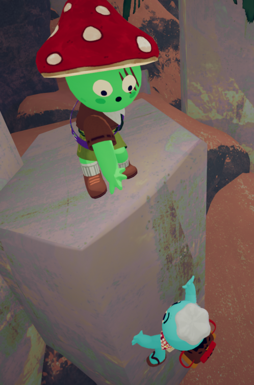
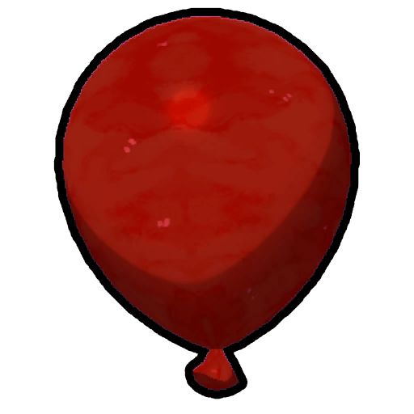
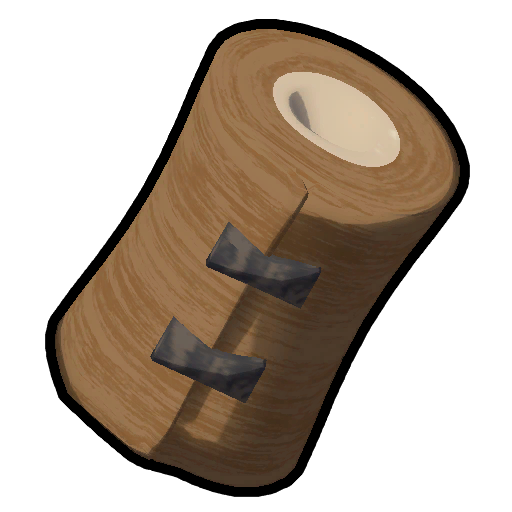
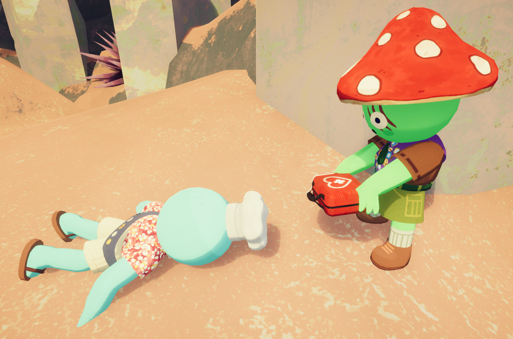
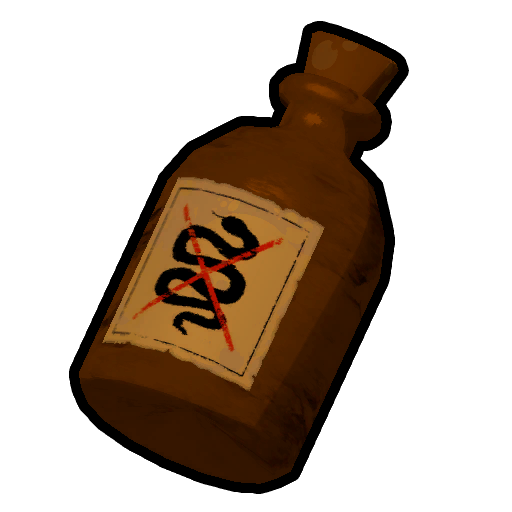
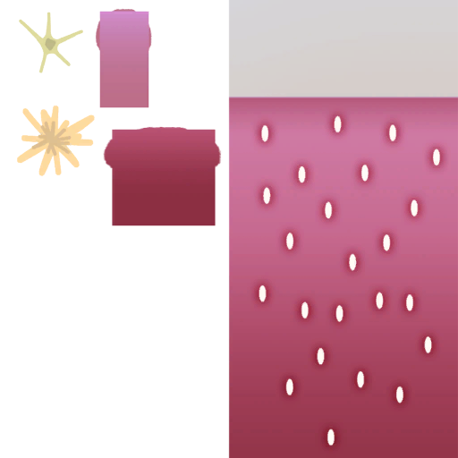

# How to play/ru

PEAK — это игра, которую игроки осваивают преимущественно путем экспериментов, метода проб и ошибок. Направление действий подсказывает [Руководство](Guidebook.md), доступное в начале каждой игры на [месте крушения](https://peak.wiki.gg/wiki/Crash_Site), а также разбросанные по карте [страницы из дневника](Scroll.md) [скаутмастера Майерса](Scoutmaster%20Myres.md), которые можно найти по ходу игры.

При создании нового лобби в главном меню игроки попадают в аэропорт. Там можно настроить внешний вид своего скаута, опробовать игровые механики и физику (например, полазив по скалодрому), а затем начать приключение, поднявшись на борт самолета. Перед началом вылазки игрок может выбрать уровень сложности, используя кнопки «вверх» и «вниз» в интерфейсе посадочного талона.

В PEAK можно играть как в одиночку, так и с друзьями. По умолчанию лобби рассчитано максимум на четырёх человек, однако этот лимит можно увеличить с помощью модификаций, таких как [PEAK Unlimited](https://thunderstore.io/c/peak/p/glarmer/PEAK_Unlimited/).

Игра начинается с того, что самолет, на который вы только что сели, терпит крушение у побережья. Ваша цель — подняться на вершину горы, преодолев несколько биомов. На пути вам встретится немало опасностей, но вы также найдете полезное снаряжение, которое поможет в восхождении. Помните, что остров меняется каждые 24 часа для всех игроков.

## Управление

Управление можно посмотреть в игре в меню паузы (). С версии 1.30.a, можно изменять назначение клавиш.

| Мышь и клавиатура | Действие |
| --- | --- |
| Keyboard w.pngKeyboard a.pngKeyboard s.pngKeyboard d.png | Движение персонажа |
| Mouse move.png | Движение камерой |
| Mouse left.png | Подъем по горе/Использовать предмет |
| Mouse right.png | Протянуть руку помощи/Альт. использование предмета |
| Keyboard e.png | Взаимодействовать |
| Keyboard q.png | Выложить/Бросить (Зажать) предмет |
| Keyboard space.png | Прыжок |
| Keyboard ctrl.png | Присесть |
| Keyboard shift.png | Бег/Рывок (во время подъема) |
| Mouse scroll.png | Поставить метку (указать пальцем) |
| Keyboard r.png | Колесо эмоций |
| Keyboard v.png | Нажать для разговора / Нажать для заглушения (в зависимости от настроек) |
| Keyboard 1.pngKeyboard 2.pngKeyboard 3.png | Слот предмета |
| Keyboard 4.png | Слот рюкзака |
| Key tab.png | Убрать предмет |
| Mouse scroll.png | Прокрутка |
| Keyboard t.png | Прокрутить вперёд |
| Keyboard g.png | Прокрутить назад |

## Основной геймплей

### Лазание и выносливость

Протяните другу руку помощи, нажав  **ПКМ**.

Чтобы достичь [Пика](Peak%20%28biome%29.md) и пройти игру, вам придётся взобраться на гору, которая перед вами. Чтобы лазать, встаньте рядом со скалой, зажмите  **ЛКМ** и двигайтесь с помощью клавиш передвижения. Практически по любой поверхности в *[PEAK](Peak%20%28game%29.md)* можно лазать, за редкими исключениями.

Лазание тратит вашу *[выносливость](https://peak.wiki.gg/wiki/%D0%92%D1%8B%D0%BD%D0%BE%D1%81%D0%BB%D0%B8%D0%B2%D0%BE%D1%81%D1%82%D1%8C)*. Если она закончится, вы больше не сможете лазать до тех пор, пока она не восстановится обратно. Если же выносливость заканчивается в процессе лазания, вы начнёте быстро скользить вниз и упадёте, что может нанести летальный урон. Некоторые действия, например поедание некоторой еды, дают вам  [Дополнительную выносливость](Stamina%20bar.md#Bonus_stamina), которая начинает тратиться только после того, как закончится основная.

Вы можете нажать  **Левый Shift**, чтобы совершить рывок и получить небольшой толчок вверх ценой небольшого количества выносливости. Если у вас ничего нет в руках, вы можете нажать  **ПКМ** и помочь другу забраться, протянув ему руку. Это притянет его к вам, если он достаточно близко (при этом друг должен лезть, а вы должны быть сверху). Будьте осторожны, ведь вас тоже немного притянет к нему!

Другой способ помочь другу — присесть, дать ему встать на вас, а затем прыгнуть. Это даст другу толчок вверх и при этом не потратит вашу выносливость. Далее, ваш друг может также помочь вам забраться, протянув вам руку помощи.

Вы также можете удерживать  **Левый Shift** чтобы бежать, но имейте в виду, что бег также тратит выносливость.

## Статусы и эффекты

В ходе игры на шкале выносливости накапливается множество статусных эффектов, большинство из которых со временем истощаются:

-  [Вес](Stamina%20bar.md#Weight) получается когда у вас в инвентаре находятся вещи или вы несете другого игрока без сознания на спине, этот статус **не убывает со временем** и может быть убран только при освобождении инвентаря путем их выброса или использования. Эффект не будет засчитываться у вещей с отрицательным весом, такими как  [АнтиВеревка](Anti-Rope%20Spool.md), [АнтиВеревочная пушка](Anti-Rope%20Cannon.md),  [Шарик](Balloon.md),  [Связка Шариков](Balloon%20Bunch.md)
-  [Голод](Stamina%20bar.md#Hunger) **получается сам со временем.** Может быть убрано съев [еду](Food.md)
-  [Повреждения](Stamina%20bar.md#Injury) получаются когда ваш Скаут получает урон от падения и прочих прочих источников, **статус не уходит со временем**. Его можно убрать исцеляющими вещами как  [Повязки](Bandages.md),  [Аптечка](First%20Aid%20Kit.md),  [Лечебный корень](Medicinal%20Root.md) и  [Панацея](Cure-All.md)

Оживляйте друзей без сознания с помощью  [Аптечек](First%20Aid%20Kit.md) и остальных исцеляющих вещей-  [Яд](Stamina%20bar.md#Poison) дается при касании ядовитых объектов или при употреблении отравленной еды. Эффект **уходит со временем,** но лучше всего будет использовать исцеляющие вещи, такие как  [Аптечка](First%20Aid%20Kit.md),  [Противоядие](Antidote.md),  [Лечебный корень](Medicinal%20Root.md) и  [Панацея](Cure-All.md). Не стоит недооценивать его последствия, так как есть ситуации, в которых вы можете получить много яда, нанесенного вам, если вы не будете осторожны.
-  [Обморожение](Stamina%20bar.md#Cold) дается во время бури в [Высокогорье](Alpine.md), во время ночи в [Восхождении 5](Ascents.md) или выше, или когда Туман настигает вас.
-  [Жар](Stamina%20bar.md#Heat) получается, будучи сожженным (например стоя на [Костре](Campfire.md) или съев  [Пламенику](Scorchberry.md)) или стоя на солнце в [Столовой горе](Mesa.md).
-  [Колючки](Stamina%20bar.md#Thorns) получается при ударе от [Перекати Поля](Tumbleweed.md) или при касании разных [кактусов](https://peak.wiki.gg/wiki/Cacti) в [Столовой Горе](Mesa.md) или при употреблении  [Шипники](Prickleberry.md)
