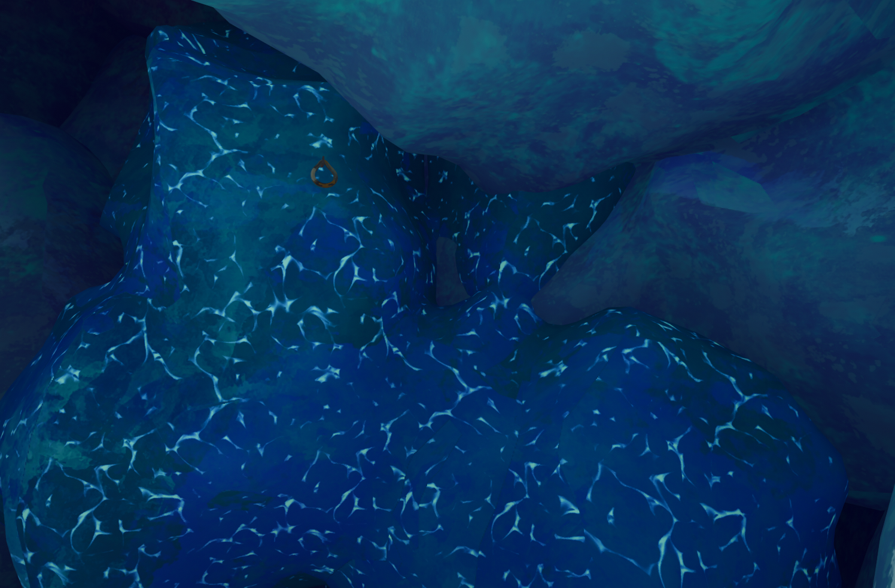

# Ice Rocks

Ice Rock

General
Type
Environmental hazard
Biome- [Alpine](Alpine.md)

**Ice Rocks** are an environmental hazard in the [Alpine](Alpine.md). They apply  [Cold](Stamina%20bar.md#Cold) to Scouts standing on them or climbing them.

While *standing* on an Ice Rock, the player will receive  **2.5** [Cold](Stamina%20bar.md#Cold) every **1.75 seconds** (~1.43 Cold every second). While *climbing* on an Ice Rock, the player will receive  **2.5** [Cold](Stamina%20bar.md#Cold) every **0.525 seconds** (~4.76 Cold every second).
