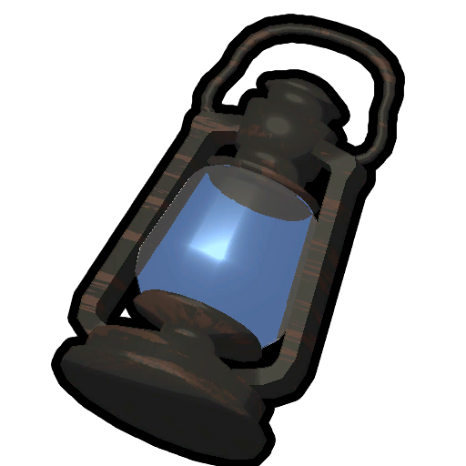
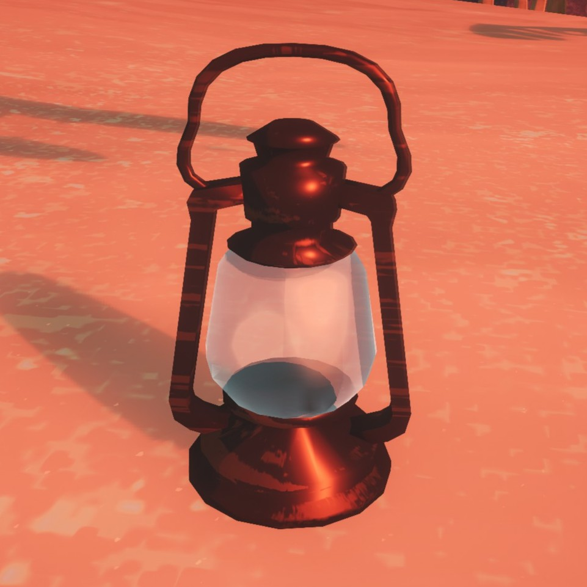
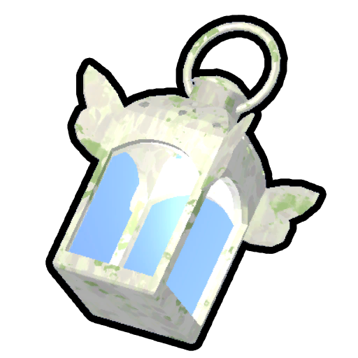

# Lantern

Lantern

[Item type](Items.md)- [Equipment](Equipment.md)
Rarity
[Epic](https://peak.wiki.gg/wiki/Epic)
Biome- [Tropics](Tropics.md)
- [Alpine](Alpine.md)
Source- [Crash Site](https://peak.wiki.gg/wiki/Crash_Site)
- [Regular Luggage](https://peak.wiki.gg/wiki/Regular_Luggage)
- [Big Luggage](https://peak.wiki.gg/wiki/Big_Luggage)
Weight
 **5**
Base Status Effects
Cold
-150

Close-up of the Lantern

The **Lantern** is an [equipment](Equipment.md) item in *[PEAK](Peak%20%28game%29.md)*. One lantern can be found in the [Crash Site](https://peak.wiki.gg/wiki/Crash_site), with more lanterns potentially being found in [luggages](Luggage.md) in the [Tropics](Tropics.md) and [Alpine](Alpine.md). While lit, all scouts within **7.2 meters** of the lantern recover  **2.5** [Cold](Stamina%20bar.md#Cold) each second. The Lantern can be lit for up to **60 seconds** before running out of fuel.

A Lantern will stay lit when dropped or when placed into a dropped backpack. It is automatically extinguished if it is put away, if the containing backpack is picked up, or if it is taken out of a containing backpack.

[Cooking](Cooking.md) a lantern while it has remaining fuel will cause it to explode, dealing up to  **20** [Injury](Stamina%20bar.md#Injury) to scouts within **4.8 meters**, depending on their distance.

## See also

-  [Faerie Lantern](Faerie%20Lantern.md)

## Patch history

 **[1.0](1.0.md) (2025-06-16):** Introduced.
 **[1.40.a](1.40.a.md) (2025-11-05):** Cooking a lantern will cause it to explode.
 **[2.0.a](2.0.a.md) (2026-08-11):** Changed the grip of lantern
