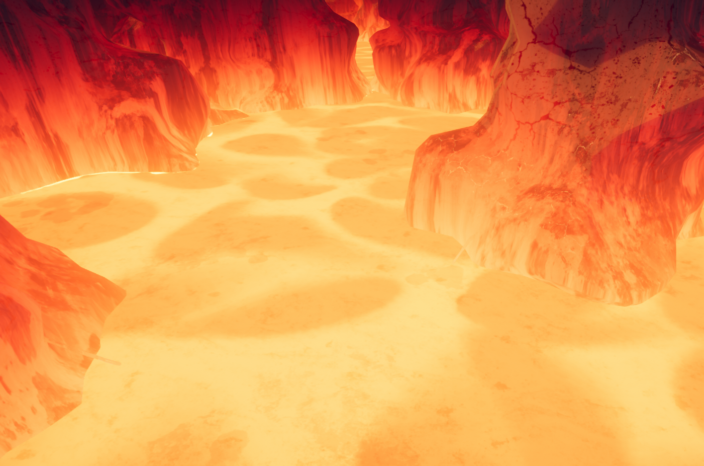
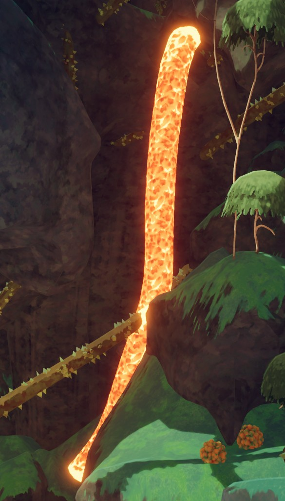
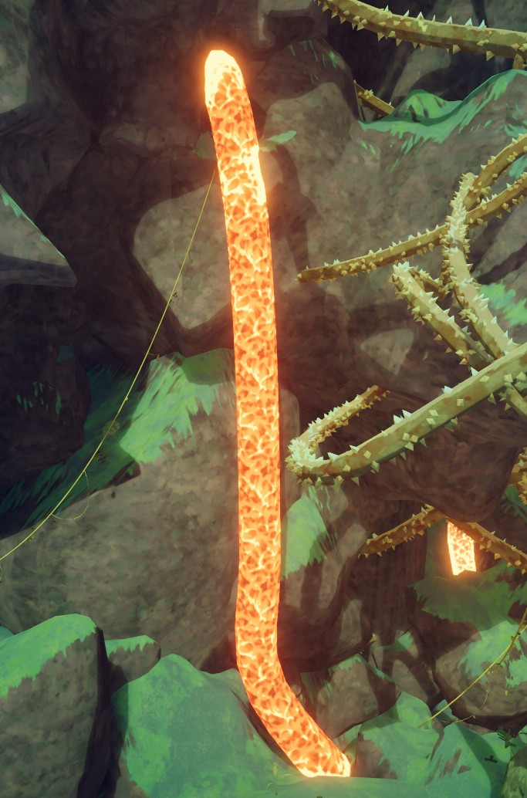
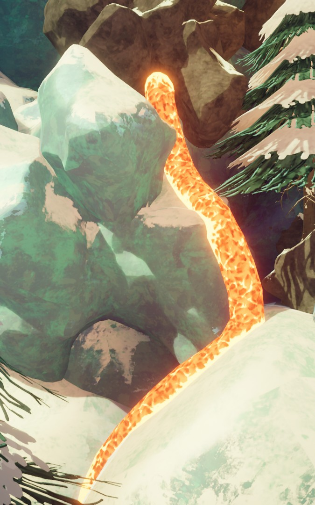

# Lava

Lava

General
Type
Environmental hazard
Biome- [Tropics](Tropics.md)
- [Alpine](Alpine.md)
- [Caldera](Caldera.md)
- [The Kiln](The%20Kiln.md)

**Lava** in *[PEAK](Peak%20%28game%29.md)* is an environmental hazard which deals  [Heat](Stamina%20bar.md#Heat) damage and  [Injury](Stamina%20bar.md#Injury). It appears in large pools in the [Caldera](Caldera.md) and [The Kiln](The%20Kiln.md), and in the form of [Lava Tubes](https://peak.wiki.gg/wiki/Lava_Tube) in the [Tropics](Tropics.md) and [Alpine](Alpine.md).

Pools of lava can [cook](#Cooking) items that are sufficiently close.

## Variations

### Caldera

The lava in the [Caldera](Caldera.md) follows a **71.75-second** tidal cycle. The rocks visually change their appearance as the lava gets closer, though this is a purely cosmetic effect since the damage is defined by the player's distance to the lava's surface.

### The Kiln

[The Kiln](The%20Kiln.md)'s lava will start to rise **3 minutes** after lighting the [campfire](Campfire.md), and will take **20 minutes** to rise to the top of the volcano.

### Lava rivers

**Lava rivers** (also known as *lava tubes*) may occasionally spawn in the [Tropics](Tropics.md), [Alpine](Alpine.md), and [The Kiln](The%20Kiln.md).

Despite their appearance, lava rivers do not share physical properties with lava found in pools. They can also be climbed, and [items](Items.md) do not sink in them.

## Damage mechanics

Players in direct contact with the [Caldera](Caldera.md)'s or [Kiln](https://peak.wiki.gg/wiki/Kiln)'s lava receive  **25** [Injury](Stamina%20bar.md#Injury) and  **25** [Heat](Stamina%20bar.md#Heat) every second. Depending on the distance to the lava's surface, players may take up to  **2.5** [Heat](Stamina%20bar.md#Heat) every ~0.208 seconds[[1]](#cite_note-1).

Lava rivers deal  **20** [Injury](Stamina%20bar.md#Injury) and  **50** [Heat](Stamina%20bar.md#Heat) and apply a small amount of knockback to all players directly touching them.

## Cooking

Pools of lava can [cook](https://peak.wiki.gg/wiki/Cook) nearby items at a rate depending on their distance to the lava, with the minimum time of ~1.43 seconds. Items in equipped  [Backpacks](Backpack.md) are not cooked by lava.

## Gallery

- 
  A close-up on the lava in the [Caldera](Caldera.md).
- 
  The top of [The Kiln](The%20Kiln.md) after the lava has fully risen.
- 
  A lava tube in the [Tropics](Tropics.md).
- 
  Another lava river in the [Tropics](Tropics.md).
- 
  A lava river in the [Alpine](Alpine.md).

## Notes

- [↑](#cite_ref-1) The exact formula is `heat * (1 / heatRate) * 1.5 = 0.8 * (1 / 0.1) * 1.5 = 12` Heat per second, or equivalently, `2.5 / 12 = 0.2083333` seconds per tick of Heat.

## Patch history

 **[1.0](1.0.md) (2025-06-16):** Introduced.
 **[1.44.a](1.44.a.md) (2025-11-13):** Lava will no longer [cook](https://peak.wiki.gg/wiki/Cook) items that are being held in your hands.
 **[1.47.a](1.47.a.md) (2025-12-01):** Fixed an issue where lava pools would not damage you unless you were over halfway submerged in them (careful!).
