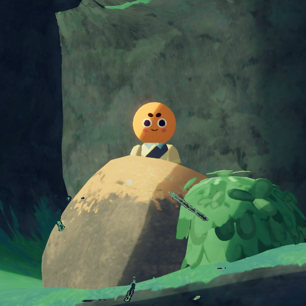

# Looker

Looker

General
Type
[NPC](https://peak.wiki.gg/wiki/NPC)
Biome- [Shore](Shore.md)
- [Tropics](Tropics.md)
- [Roots](Roots.md)
- [Alpine](Alpine.md)
- [Mesa](Mesa.md)

The **Looker** is an [NPC](https://peak.wiki.gg/wiki/NPC) who has a chance of spawning during a game session. They will appear to pop up from behind a smooth round rock, staring at the player for a moment before quickly hiding behind the rock again if a player looks at them. If a player has looked at them for too long (roughly **3 seconds**) or approaches the rock, they will vanish and cannot reappear for the remainder of the run.

It can be disabled in the game's accessibility options.

## Notes

- The Looker cannot spawn in the [Caldera](Caldera.md), [Gloom](Gloom.md), [The Kiln](The%20Kiln.md), [The Citadel](The%20Citadel.md), or the [PEAK](Peak%20%28biome%29.md).
- The chance of the Looker spawning is 5%, at one of 20 random locations on the map.
- The scout and the rock are linked via code, therefore the rock will not appear in sessions where the scout did not spawn.
- It is possible for multiple rocks to spawn nearby, allowing multiple Lookers to be visible at the same time.
- When approached before it can hide, it turns around and even tilt into the rock to ensure always appearing behind it for each player's viewpoint.

## Patch history

 **[1.20.a](1.20.a.md) (2025-08-11):** Introduced.
 **[1.25.a](1.25.a.md) (2025-08-21):**

- There is now a setting to disable "The Looker."
- Fixed an issue where "The Looker" would not work properly sometimes, and made it a much more rare occurrence.

 **[2.2.a](2.2.a.md) (2026-08-18):** Looker rocks should once again match the biome they're in
