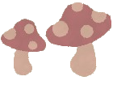
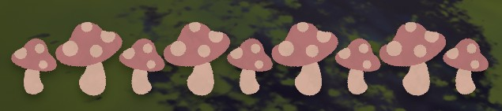
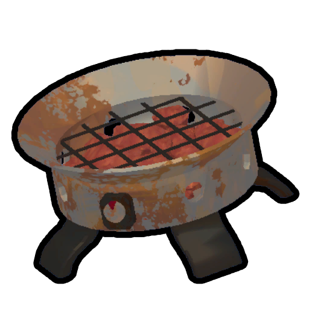

# Mandrake

Mandrake

[Item type](Items.md)- [Food](Food.md)
- [Natural food](https://peak.wiki.gg/wiki/Natural_food)
Biome- [Roots](Roots.md)
Weight
 **2.5**
Base Status Effects
Hunger
-10
Numb
60 seconds
Cooked Bonuses
Hunger
-20 (-20 total)
Bonus Stamina
10 (10 total)

The **Mandrake** is a natural [food](Food.md) item in *[PEAK](Peak%20%28game%29.md)*. It has a 28.57% chance to spawn instead of a  [Medicinal Root](Medicinal%20Root.md) in [Roots](Roots.md). Until uprooted, it looks identical to a Medicinal Root.

Once uprooted and near a conscious player, the Mandrake will scream loudly for **3 seconds**, followed by a cooldown of **0.75-2 seconds**. While it is screaming, players within **16 meters** gain  **5** [Drowsy](Stamina%20bar.md#Drowsy) every quarter second. [Cooking](Cooking.md) the Mandrake will stop the screaming. The Mandrake cannot be stored in a player's inventory slots, but it can be stored in a backpack.

Eating (or being fed) a [cooked](https://peak.wiki.gg/wiki/Cooked) Mandrake grants the player the  [Cryptogastronomy Badge](https://peak.wiki.gg/wiki/Cryptogastronomy_Badge) and removes  **25** [Curse](Stamina%20bar.md#Curse). Cooking the Mandrake stops it from screaming.

Eating (or being fed) a raw Mandrake applies the [numb](https://peak.wiki.gg/wiki/Numb) effect to the player for **60 seconds**.

Stamina bar hidden by the [Numb](Stamina%20bar.md#Numb) effect.

## Tips

- If the  [Cryptogastronomy Badge](https://peak.wiki.gg/wiki/Cryptogastronomy_Badge) has been completed then players should quickly throw the Mandrake away, as the scream it produces builds up  [Drowsy](Stamina%20bar.md#Drowsy) quickly.- If the goal is to complete the  [Cryptogastronomy Badge](https://peak.wiki.gg/wiki/Cryptogastronomy_Badge), then having a  [Portable Stove](Portable%20Stove.md) is almost a necessity, as players cannot store the Mandrake outside of a [backpack](Backpack.md), and even then it continues to scream.
- After using  [The Book of Bones](The%20Book%20of%20Bones.md), you are immune to the  [Drowsy](Stamina%20bar.md#Drowsy) the Mandrake normally provides, allowing you to safely carry it. However, be careful around other players!

## Trivia

- If the player's sound effects volume is set to 0, they won't be affected by the Mandrake's scream drowsiness effect.

## Gallery

- 
  A screaming Mandrake held by a player.

## Patch history

 **[1.40.a](1.40.a.md) (2025-11-05):** Introduced.
 **[1.47.a](1.47.a.md) (2025-12-01):** Fixed an issue where unpocketable items (Mandrakes, [Scorpions](Scorpion.md), etc) could be pocketed while climbing under certain circumstances.

[Food](Food.md)
Natural food
Berries
Berrynanas-  [Yellow Berrynana](Yellow%20Berrynana.md)
-  [Pink Berrynana](Pink%20Berrynana.md)
-  [Blue Berrynana](Blue%20Berrynana.md)
-  [Brown Berrynana](Brown%20Berrynana.md)
Clusterberries-  [Red Clusterberry](Red%20Clusterberry.md)
-  [Yellow Clusterberry](Yellow%20Clusterberry.md)
-  [Black Clusterberry](Black%20Clusterberry.md)
Crispberries-  [Green Crispberry](Green%20Crispberry.md)
-  [Yellow Crispberry](Yellow%20Crispberry.md)
-  [Red Crispberry](Red%20Crispberry.md)
Kingberries-  [Green Kingberry](Green%20Kingberry.md)
-  [Yellow Kingberry](Yellow%20Kingberry.md)
-  [Purple Kingberry](Purple%20Kingberry.md)
Prickleberries-  [Red Prickleberry](Red%20Prickleberry.md)
-  [Gold Prickleberry](Gold%20Prickleberry.md)
Shroomberries-  [Red Shroomberry](Red%20Shroomberry.md)
-  [Yellow Shroomberry](Yellow%20Shroomberry.md)
-  [Green Shroomberry](Green%20Shroomberry.md)
-  [Blue Shroomberry](Blue%20Shroomberry.md)
-  [Purple Shroomberry](Purple%20Shroomberry.md)
Winterberries-  [Orange Winterberry](Orange%20Winterberry.md)
-  [Yellow Winterberry](Yellow%20Winterberry.md)
Other-  [Napberry](Napberry.md)
-  [Scorchberry](Scorchberry.md)
Campfire food-  [Marshmallow](Marshmallow.md)
-  [Hot Dog](Hot%20Dog.md)
Mushrooms-  [Bugle Shroom](Bugle%20Shroom.md)
-  [Button Shroom](Button%20Shroom.md)
-  [Chubby Shroom](Chubby%20Shroom.md)
-  [Cluster Shroom](Cluster%20Shroom.md)
Mystical food-  [Cure-All](Cure-All.md)
-  [Pandora's Lunchbox](Pandora%27s%20Lunchbox.md)
Other-  [Cooked Bird](Cooked%20Bird.md)
-  [Egg](Egg.md)
-  [Frog Legs](Frog%20Legs.md)
-  [Honeycomb](Honeycomb.md)
-  [Half-Coconut](Half-Coconut.md)
-  [Medicinal Root](Medicinal%20Root.md)
-  Mandrake
-  [Scorpion](Scorpion.md)
-  [Tick](Tick.md)
-  [The Early Worm](The%20Early%20Worm.md)
Packaged food
All packaged foods-  [Airline Food](Airline%20Food.md)
-  [Big Lollipop](Big%20Lollipop.md)
-  [Energy Drink](Energy%20Drink.md)
-  [Fortified Milk](Fortified%20Milk.md)
-  [Granola Bar](Granola%20Bar.md)
-  [Scout Cookies](Scout%20Cookies.md)
-  [Sports Drink](Sports%20Drink.md)
-  [Trail Mix](Trail%20Mix.md)
