# Marshmallow

Marshmallow
[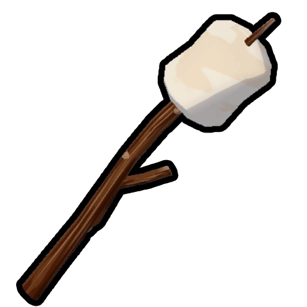](https://peak.wiki.gg/wiki/File%3AMarshmallow.png)
[Item type](Items.md)- [Food](Food.md)
- [Natural food](https://peak.wiki.gg/wiki/Natural_food)
Rarity
[Uncommon](https://peak.wiki.gg/wiki/Uncommon)
Source- [Campfires](https://peak.wiki.gg/wiki/Campfires)
Weight
 **2.5**
Base Status Effects
Hunger
-15
Cooked Bonuses
Hunger
-15 (-30 total)
Bonus Stamina
10 (10 total)

The **Marshmallow** is a natural [food](Food.md) in *[PEAK](Peak%20%28game%29.md)* found near the [campfires](Campfire.md).

At each campfire, either a Marshmallow (62.5% chance) or a  [Hot Dog](Hot%20Dog.md) (37.5% chance) spawns for each player in the expedition.

## Trivia

- As part of a collaboration with *[Fortnite](https://en.wikipedia.org/wiki/Fortnite)*, the Marshmallow is used as a Pickaxe cosmetic called "Scout's Marshmallow" with an item description of "Time to cook!". The pickaxe is available for purchased on its own for 800 V-Bucks or with the PEAK Bundle for 2,500 V-Bucks.

## Patch history

 **[1.0](1.0.md) (2025-06-16):** Introduced.
 **[1.40.a](1.40.a.md) (2025-11-05):** Now reduces  [Hunger](Stamina%20bar.md#Hunger) by 15 (previously 20).

[Food](Food.md)
Natural food
Berries
Berrynanas- [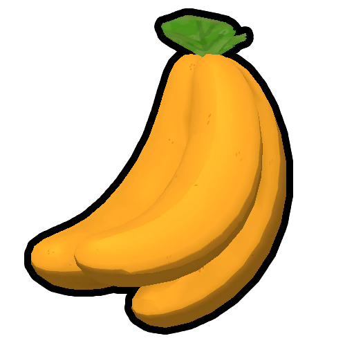](Yellow%20Berrynana.md) [Yellow Berrynana](Yellow%20Berrynana.md)
- [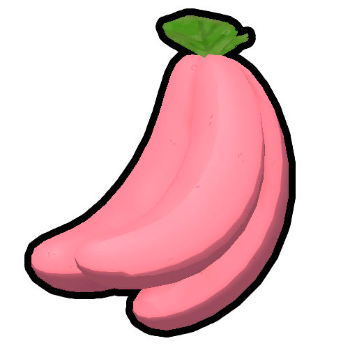](Pink%20Berrynana.md) [Pink Berrynana](Pink%20Berrynana.md)
- [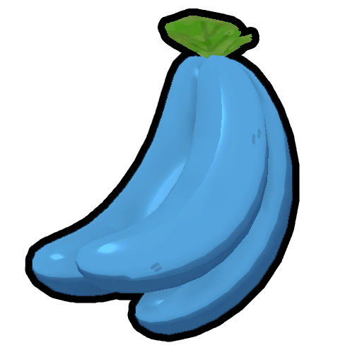](Blue%20Berrynana.md) [Blue Berrynana](Blue%20Berrynana.md)
- [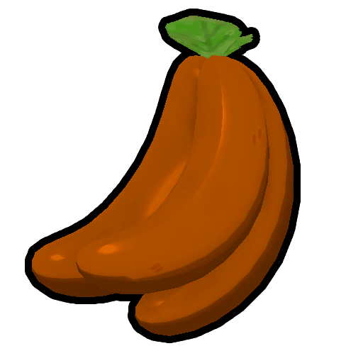](Brown%20Berrynana.md) [Brown Berrynana](Brown%20Berrynana.md)
Clusterberries- [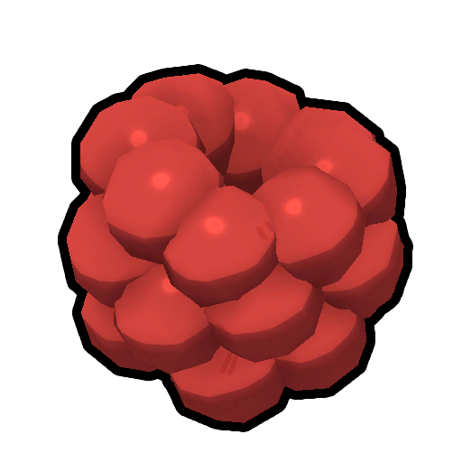](Red%20Clusterberry.md) [Red Clusterberry](Red%20Clusterberry.md)
- [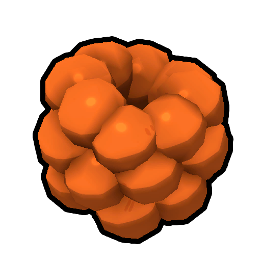](Yellow%20Clusterberry.md) [Yellow Clusterberry](Yellow%20Clusterberry.md)
- [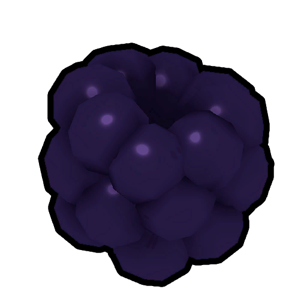](Black%20Clusterberry.md) [Black Clusterberry](Black%20Clusterberry.md)
Crispberries- [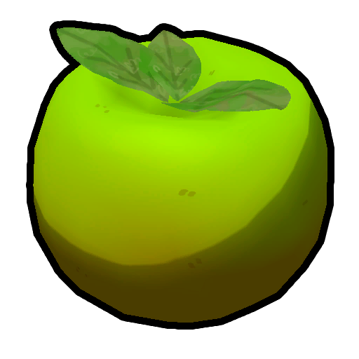](Green%20Crispberry.md) [Green Crispberry](Green%20Crispberry.md)
- [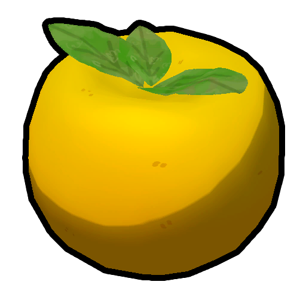](Yellow%20Crispberry.md) [Yellow Crispberry](Yellow%20Crispberry.md)
- [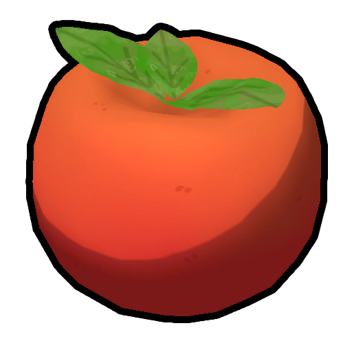](Red%20Crispberry.md) [Red Crispberry](Red%20Crispberry.md)
Kingberries- [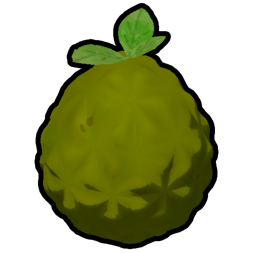](Green%20Kingberry.md) [Green Kingberry](Green%20Kingberry.md)
- [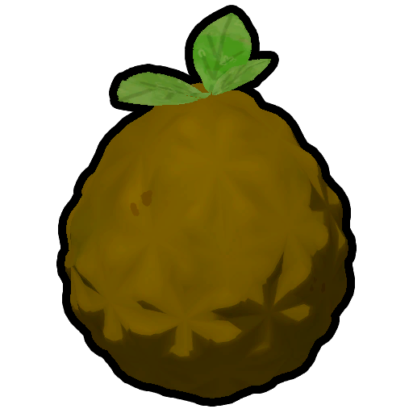](Yellow%20Kingberry.md) [Yellow Kingberry](Yellow%20Kingberry.md)
- [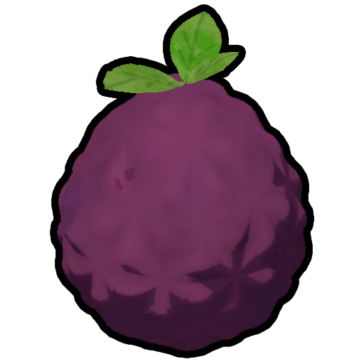](Purple%20Kingberry.md) [Purple Kingberry](Purple%20Kingberry.md)
Prickleberries- [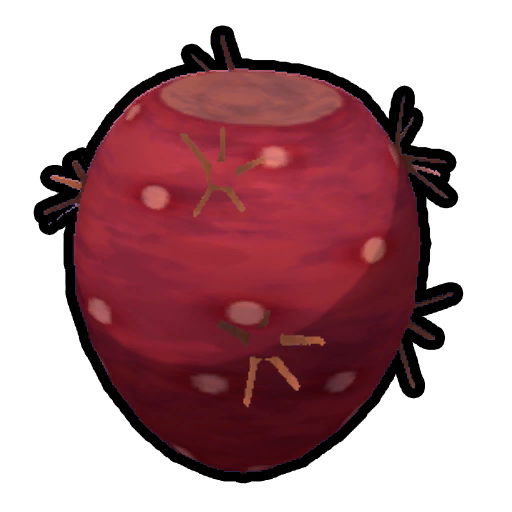](Red%20Prickleberry.md) [Red Prickleberry](Red%20Prickleberry.md)
- [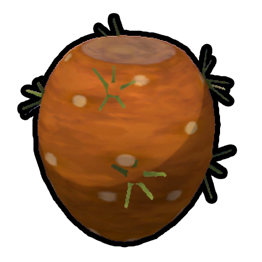](Gold%20Prickleberry.md) [Gold Prickleberry](Gold%20Prickleberry.md)
Shroomberries- [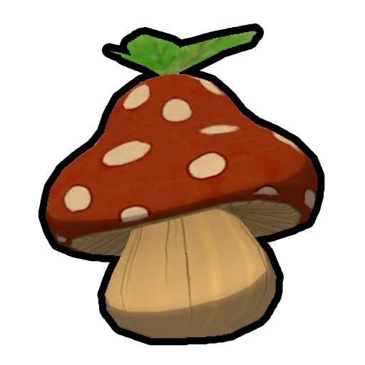](Red%20Shroomberry.md) [Red Shroomberry](Red%20Shroomberry.md)
- [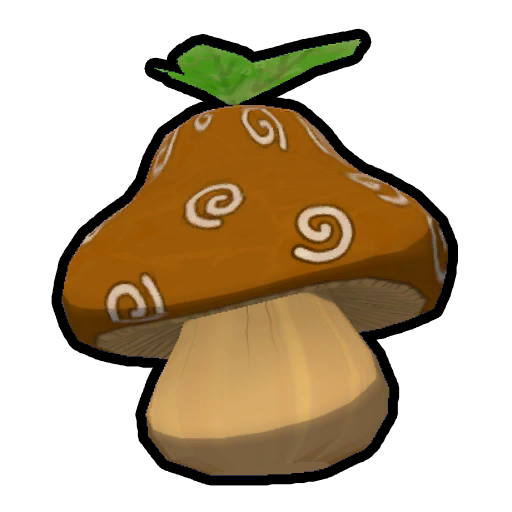](Yellow%20Shroomberry.md) [Yellow Shroomberry](Yellow%20Shroomberry.md)
- [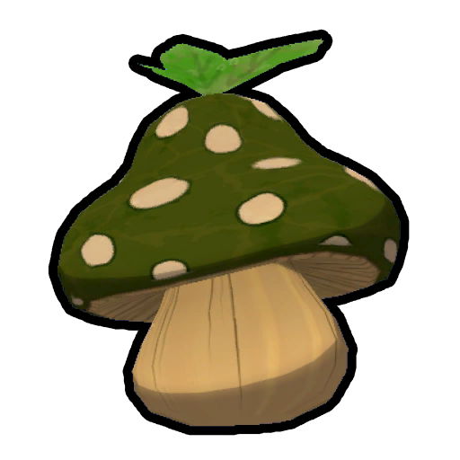](Green%20Shroomberry.md) [Green Shroomberry](Green%20Shroomberry.md)
- [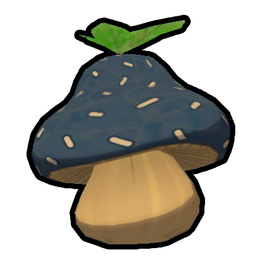](Blue%20Shroomberry.md) [Blue Shroomberry](Blue%20Shroomberry.md)
- [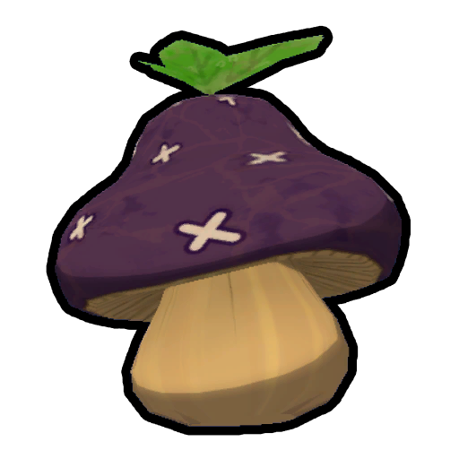](Purple%20Shroomberry.md) [Purple Shroomberry](Purple%20Shroomberry.md)
Winterberries- [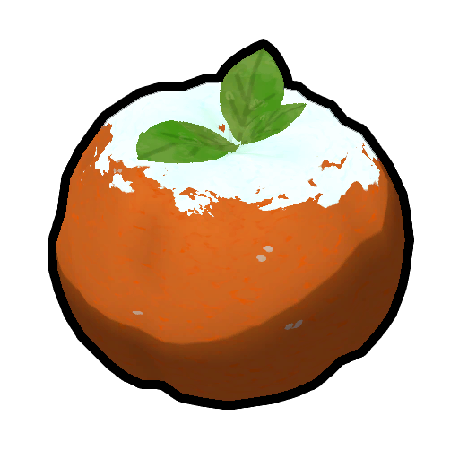](Orange%20Winterberry.md) [Orange Winterberry](Orange%20Winterberry.md)
- [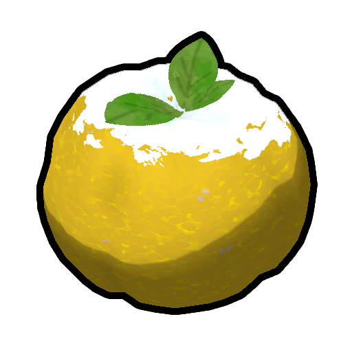](Yellow%20Winterberry.md) [Yellow Winterberry](Yellow%20Winterberry.md)
Other- [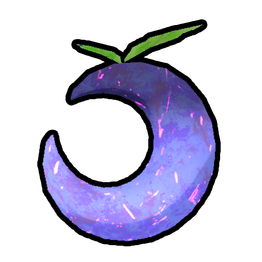](Napberry.md) [Napberry](Napberry.md)
- [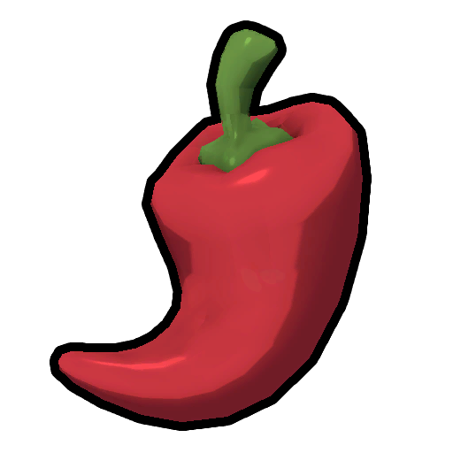](Scorchberry.md) [Scorchberry](Scorchberry.md)
Campfire food-  Marshmallow
-  [Hot Dog](Hot%20Dog.md)
Mushrooms- [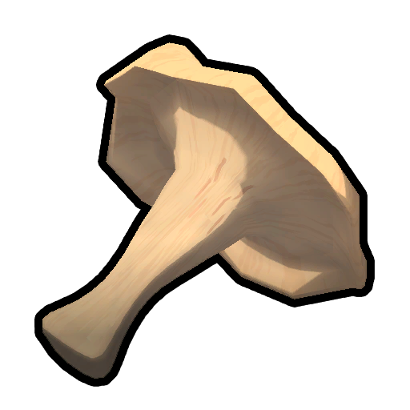](Bugle%20Shroom.md) [Bugle Shroom](Bugle%20Shroom.md)
- [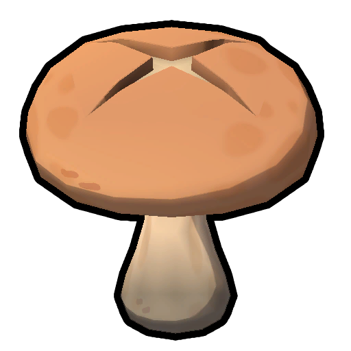](Button%20Shroom.md) [Button Shroom](Button%20Shroom.md)
- [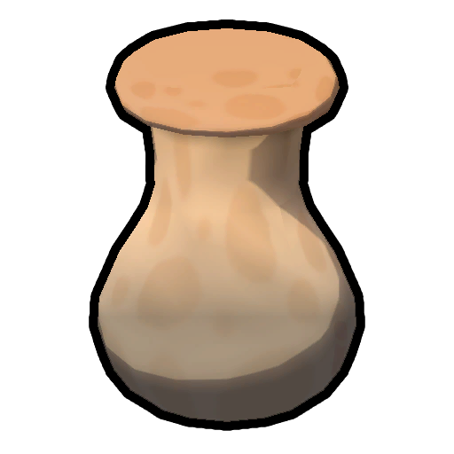](Chubby%20Shroom.md) [Chubby Shroom](Chubby%20Shroom.md)
- [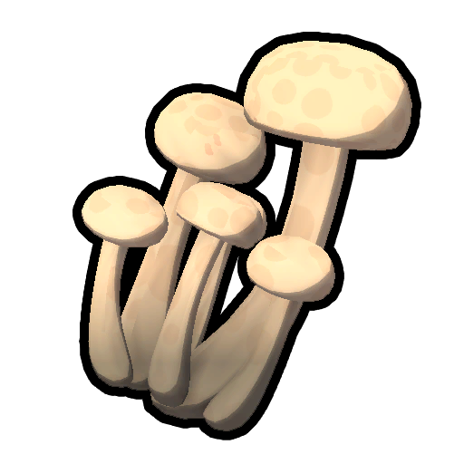](Cluster%20Shroom.md) [Cluster Shroom](Cluster%20Shroom.md)
Mystical food- [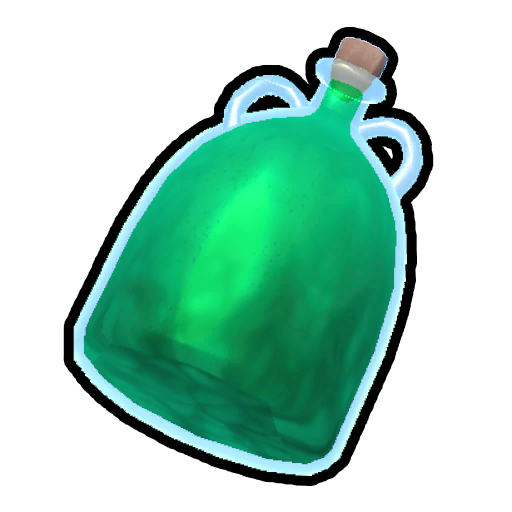](Cure-All.md) [Cure-All](Cure-All.md)
-  [Pandora's Lunchbox](Pandora%27s%20Lunchbox.md)
Other- [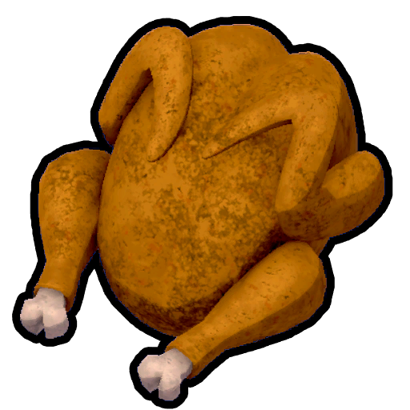](Cooked%20Bird.md) [Cooked Bird](Cooked%20Bird.md)
- [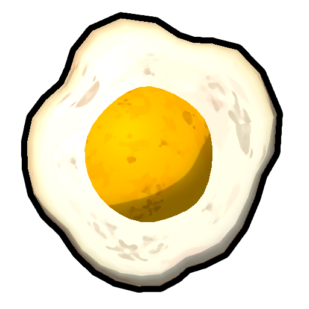](Egg.md) [Egg](Egg.md)
- [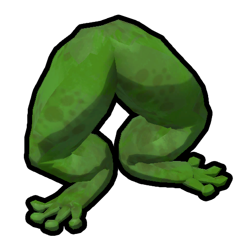](Frog%20Legs.md) [Frog Legs](Frog%20Legs.md)
- [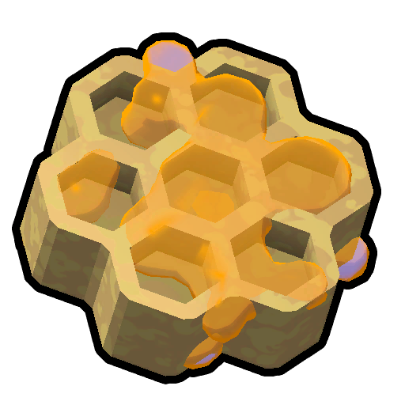](Honeycomb.md) [Honeycomb](Honeycomb.md)
- [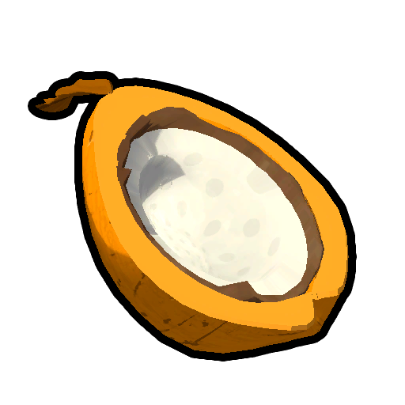](Half-Coconut.md) [Half-Coconut](Half-Coconut.md)
- [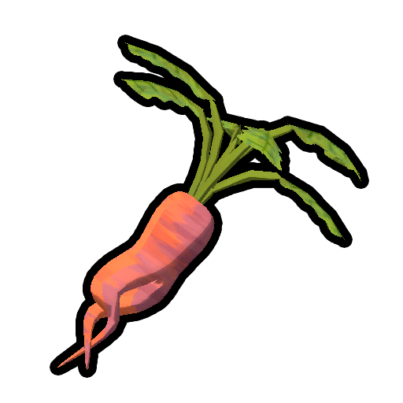](Medicinal%20Root.md) [Medicinal Root](Medicinal%20Root.md)
-  [Mandrake](Mandrake.md)
- [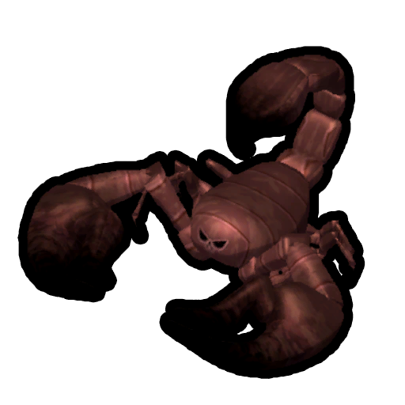](Scorpion.md) [Scorpion](Scorpion.md)
- [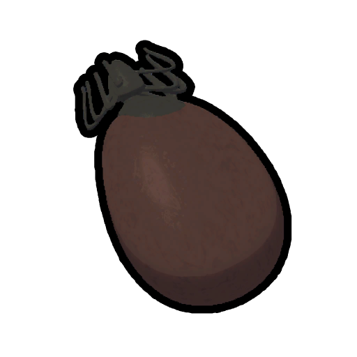](Tick.md) [Tick](Tick.md)
-  [The Early Worm](The%20Early%20Worm.md)
Packaged food
All packaged foods- [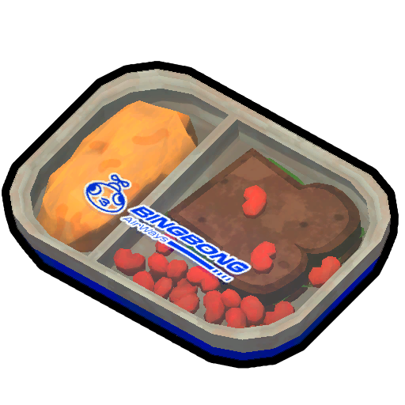](Airline%20Food.md) [Airline Food](Airline%20Food.md)
-  [Big Lollipop](Big%20Lollipop.md)
- [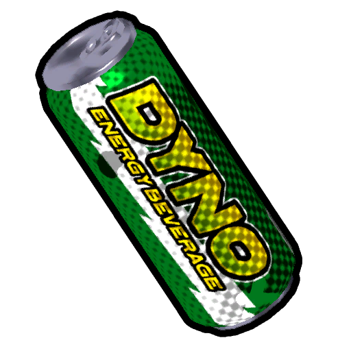](Energy%20Drink.md) [Energy Drink](Energy%20Drink.md)
-  [Fortified Milk](Fortified%20Milk.md)
- [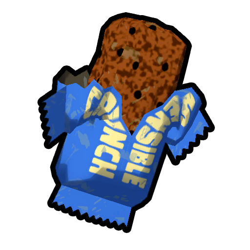](Granola%20Bar.md) [Granola Bar](Granola%20Bar.md)
- [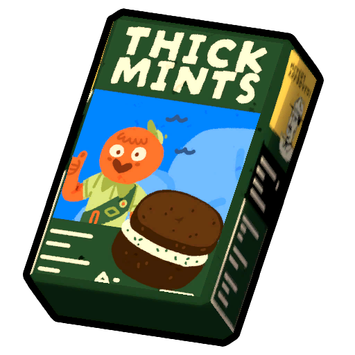](Scout%20Cookies.md) [Scout Cookies](Scout%20Cookies.md)
- [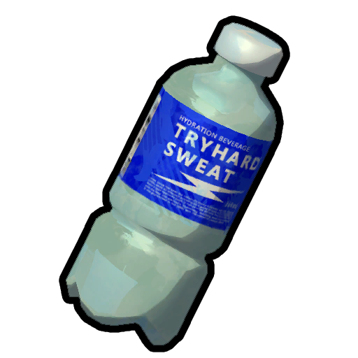](Sports%20Drink.md) [Sports Drink](Sports%20Drink.md)
- [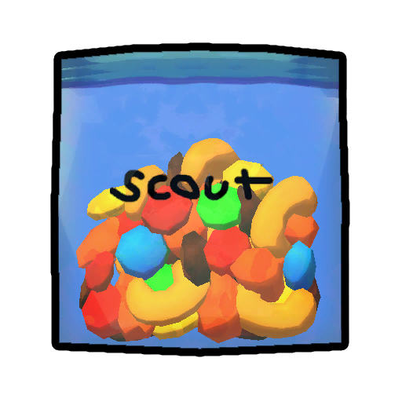](Trail%20Mix.md) [Trail Mix](Trail%20Mix.md)
