# Nadir

Spoilers ahead!

This page contains **spoilers** for *[PEAK](Peak%20%28game%29.md)*. View at your own discretion.

Nadir
[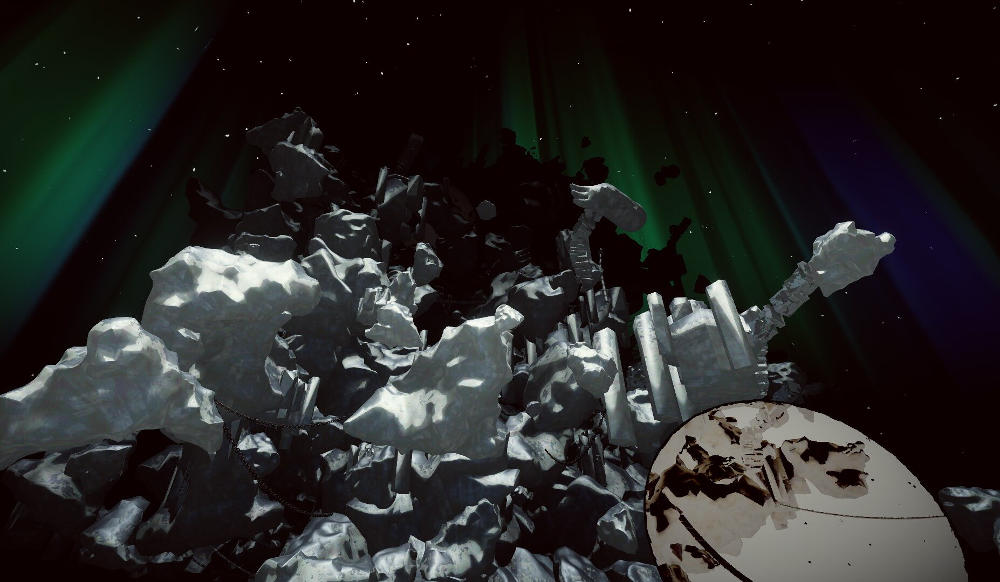](https://peak.wiki.gg/wiki/File%3ANadir.jpg)
Details
Type
[Secret Location](https://peak.wiki.gg/wiki/Secret_Location)
Region
**7**/6

**Nadir** is a secret [biome](https://peak.wiki.gg/wiki/Biome) in *[PEAK](Peak%20%28game%29.md)*, serving as the optional seventh and final biome for the game, following the [Peak](Peak%20%28biome%29.md). It is a monochrome island surrounded by an endless black void, and seemingly serves as some form of afterlife or underworld.

The only way to access the biome is to activate the  [Scout's Honor](Scout%27s%20Honor.md) after having bestowed the four [Amulets](https://peak.wiki.gg/wiki/Amulet) upon the [Stone Scout](https://peak.wiki.gg/wiki/Stone_Scout) behind the Peak. When entering Nadir, all  [Hunger](Stamina%20bar.md#Hunger) and  **20** [Petrify](Stamina%20bar.md#Petrify) is removed from every Scout, and any dead [Scouts](https://peak.wiki.gg/wiki/Scouts) are revived.

Similar to the [Peak](Peak%20%28biome%29.md), Nadir does not have a [campfire](Campfire.md) nor an [Ancient Statue](Ancient%20Statue.md).

Escaping Nadir grants all Scouts the  [Rule Zero Badge](https://peak.wiki.gg/wiki/Rule_Zero_Badge), regardless of if they survived or not, and plays the secret ending. On [Ascent 8](https://peak.wiki.gg/wiki/Ascent_8), it is required to enter and escape Nadir to win the run.

## Areas & Features

### False Shore

---

Upon loading in, the Scouts spawn on a shore, with a crashed sailboat beached on some rocks. Three [Explorer's Luggages](https://peak.wiki.gg/wiki/Explorer%27s_Luggage) can be found in front of the Scouts' spawning location, with some stairs leading to a stone platform further ahead of them.

#### Scoutmaster's Soul

[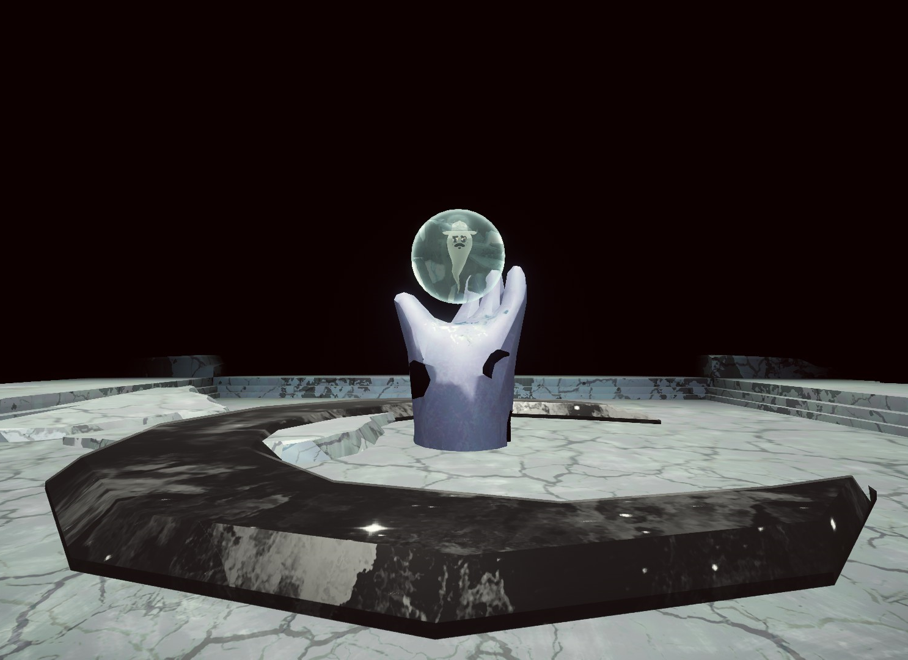](https://peak.wiki.gg/wiki/File%3ANadir_Scoutmaster_Soul.png)

Ascending the steps reveals [Scoutmaster Myres](Scoutmaster%20Myres.md)' soul trapped within a green bubble, which any Scout can commune with. Once communed, the bubble shatters and Myres' soul ascends freely into the dark. Moments later, Myres' soul will begin to follow and circle around the Scout who communed with him and the False Climb will be unveiled.

### False Climb

---

The **False Climb** is revealed after communing with Myres' spirit, appearing to be a shattered and distorted version of the [Shore](Shore.md)'s cliffside, with elements from multiple other biomes included as well. The Lost Souls begin rising as soon as the climb is revealed.

It lacks any natural item spawns with the exception of a solitary  [Bing Bong](Bing%20Bong.md) tucked away inside a crashed plane.

#### The Lost Souls

[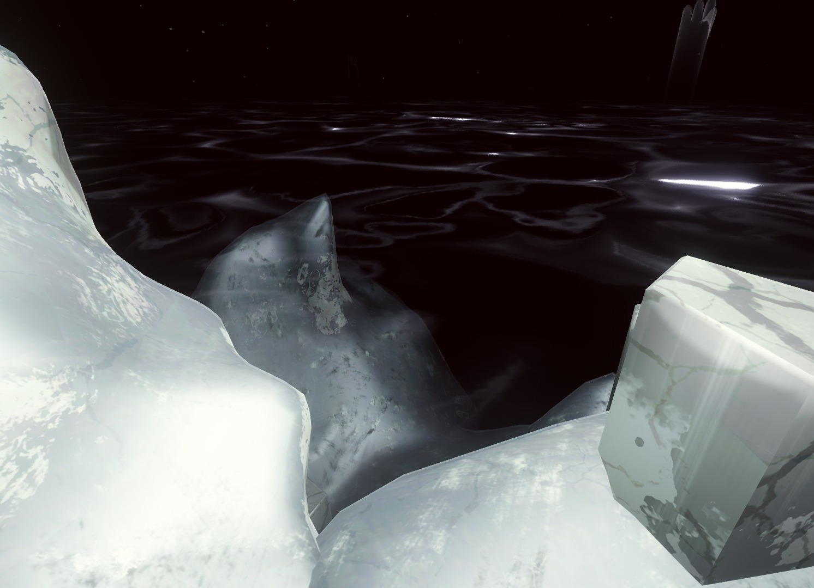](https://peak.wiki.gg/wiki/File%3ANadir_Lost_Souls.png)

The **Lost Souls** are an environmental hazard and time limit similar to the [Fog](Fog.md), the rising lava of [The Kiln](The%20Kiln.md) or the rising Gloom of [The Citadel](The%20Citadel.md). The Lost Souls appear as a inky black liquid with Scout ghosts that occasionally fly up from the liquid. It slowly ascends from the False Shore up the climb, moving faster than the other time limit hazards. Scouts submerged in the Lost Souls are gradually inflicted with  [Petrify](Stamina%20bar.md#Petrify), and if they are submerged too deep, they take a large amount of  [Injury](Stamina%20bar.md#Injury) at once and are instantly killed.

Unlike other time limit hazards, "The lost souls are rising" notification is not disabled on [Tenderfoot](https://peak.wiki.gg/wiki/Tenderfoot). However, the actual effect is disabled and the lost souls will never actually inflict  [Petrify](Stamina%20bar.md#Petrify) or  [Injury](Stamina%20bar.md#Injury).

#### Anti-Spheres

[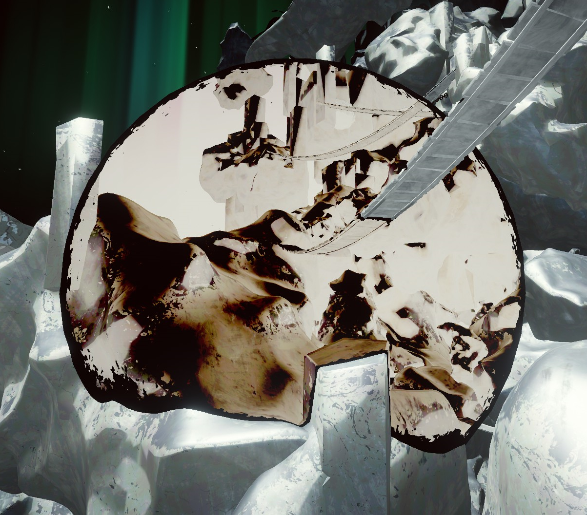](https://peak.wiki.gg/wiki/File%3ANadir_Anti-Sphere.png)

**Anti-Spheres** identical to the ones produced by the  [Anti-Zooka](Anti-Zooka.md) can appear in the False Climb. They invert the gravity of any Scouts or items inside, allowing for easy ascension.

#### Monochrome Bridges

[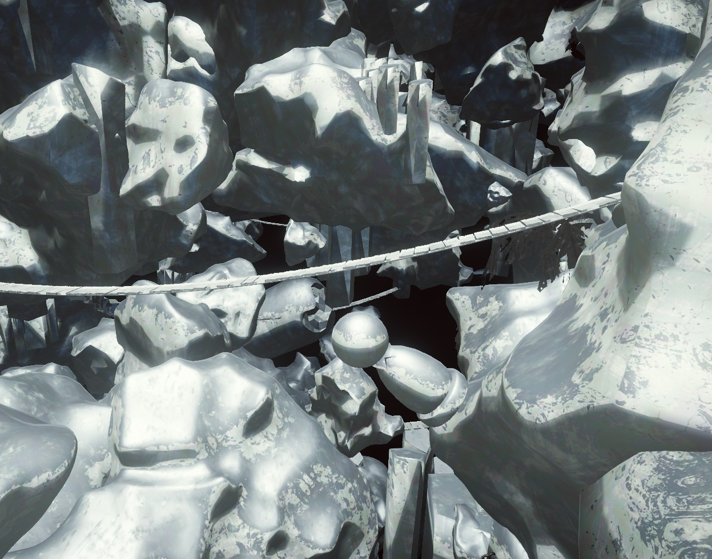](https://peak.wiki.gg/wiki/File%3ANadir_Bridge.png)

**Monochrome Bridges** can appear in the False Climb, acting similar to their counterparts in the [Shore](Shore.md). Unlike the Shore's bridges, the bridges in Nadir cannot collapse, making them perfectly safe to use.

#### Monochrome Chains

[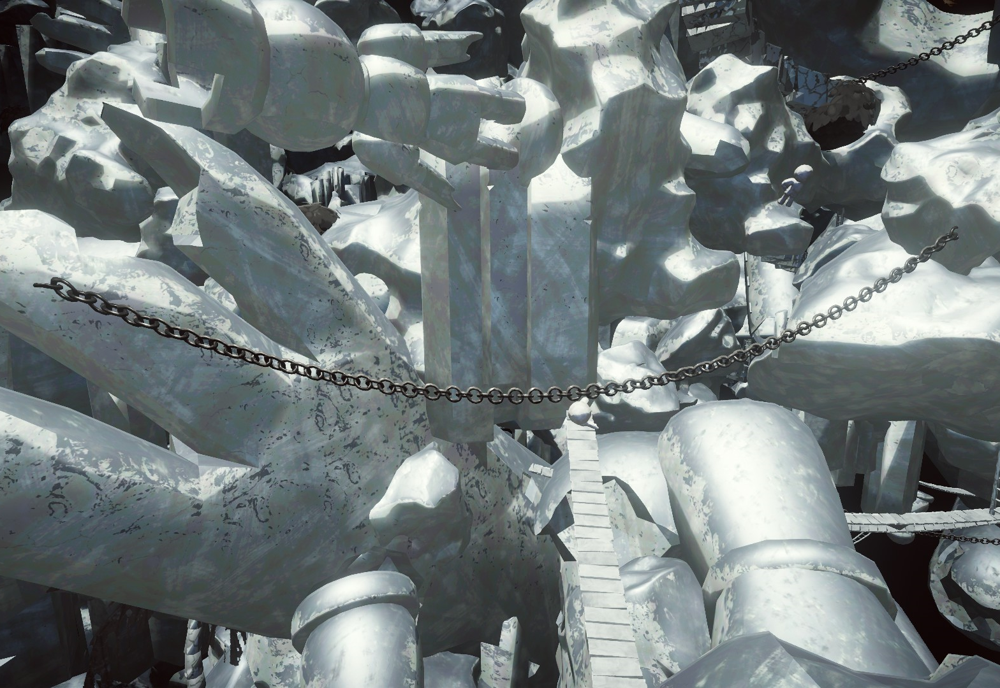](https://peak.wiki.gg/wiki/File%3ANadir_Chain.png)

**Monochrome Chains** can appear in the False Climb, acting similar to their counterparts in the [Caldera](Caldera.md). They can be grabbed onto to cross spaces, providing reduced stamina cost when traveling on them.

#### Twisted Ladders

[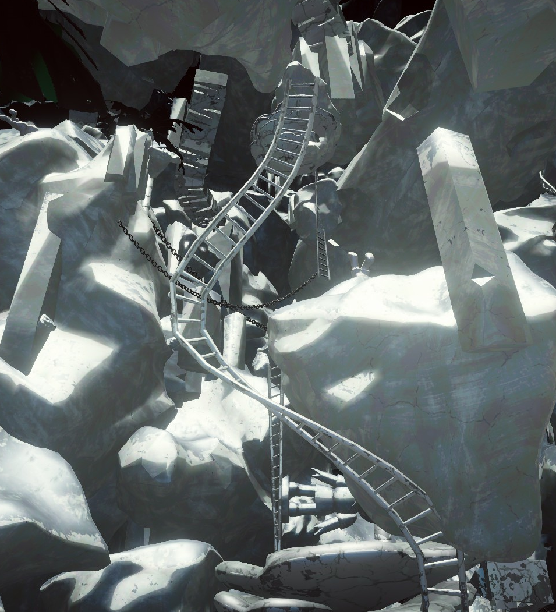](https://peak.wiki.gg/wiki/File%3ANadir_Ladder.png)

**Twisted Ladders** can appear in the False Climb, acting similar to their counterparts in [The Citadel](The%20Citadel.md). They provide reduced stamina cost when climbing them.

### The Gate

---

[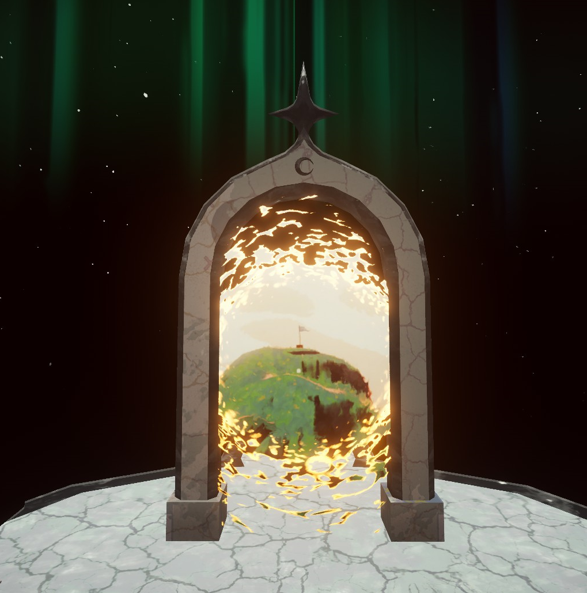](https://peak.wiki.gg/wiki/File%3ANadir_Gate.png)

Atop the False Climb is a platform supporting **The Gate**, a portal leading back to the [PEAK](Peak%20%28biome%29.md). Beside the Gate is a single  [Flare](Flare.md). Once a Scout interacts with the Gate, the ending cutscene begins.

## Ending cutscene

The surviving Scouts are shown falling onto the Peak from above and look up through the night toward the flag. One Scout ambles forward, taking a flare from the crate and peering up at the flag, when a skeletal green hand reaches over the crest of the Peak, heaving up the mottled form of the Scoutmaster. The Scouts retreat in terror and surprise, but the loose rocks beneath the Scoutmaster crumble and he begins to plummet downward.

The host Scout suddenly reaches out their hand and clutches the Scoutmaster's, with any other living Scouts clinging onto each other as an anchor. The Scouts manage to successfully hoist the Scoutmaster over the crest of the Peak and fall to the ground, winded.

The two parties gape at each other in disbelief for a brief moment before something behind the Scouts catches the eye of the Scoutmaster. Both groups turn to look at the soul of the Scoutmaster. The soul hovers in the air before rushing into the body of the Scoutmaster, who recoils, his eyes flashing brightly before revealing humanlike irises. The Scoutmaster peers down at his hands and looks back and forth, surprised.

The Scouts stare in disbelief. One of them, shocked and in a stupor, drops the flare, which promptly lights itself after rolling. Both parties turn toward the smoke billowing from the flare. The rescue helicopter appears after a few moments and positions itself above the Peak. After staring up at the helicopter for a few seconds, the Scoutmaster salutes the Scouts, clearly proud of their accomplishments. The Scouts salute back.

After the Scouts climb aboard, the Scoutmaster then tumbles inside as well. From his position on the floor of the helicopter, he turns ominously toward the camera. The [Scouting Report](Scouting%20Report.md) is then shown, however on the report, when the scouts are in Nadir, they are shown 1920 meters below ground, cutting into the [badge](https://peak.wiki.gg/wiki/Badge) section before the helicopter flies off and the credits roll.

## Tips & Tricks

- Anti-Spheres can be used to reach platforms higher up.
- If you are lucky enough to find one prior to entering Nadir, the  [Scoutmaster's Bugle](Scoutmaster%27s%20Bugle.md) can be used after the False Climb is revealed to gain  [Bonus stamina](Stamina%20bar.md#Bonus_stamina) with a significantly lesser risk, as the Scoutmaster has a very high chance to spawn under the map and be unable to reach you.
- Successfully finishing Nadir's ascent allows the player to complete [Ascent 4](https://peak.wiki.gg/wiki/Ascent_4) and higher without a  [Flare](Flare.md). Despite there being one provided at Nadir's exit gate, the player can safely leave without grabbing it as the cinematic will play regardless.

## Gallery

- [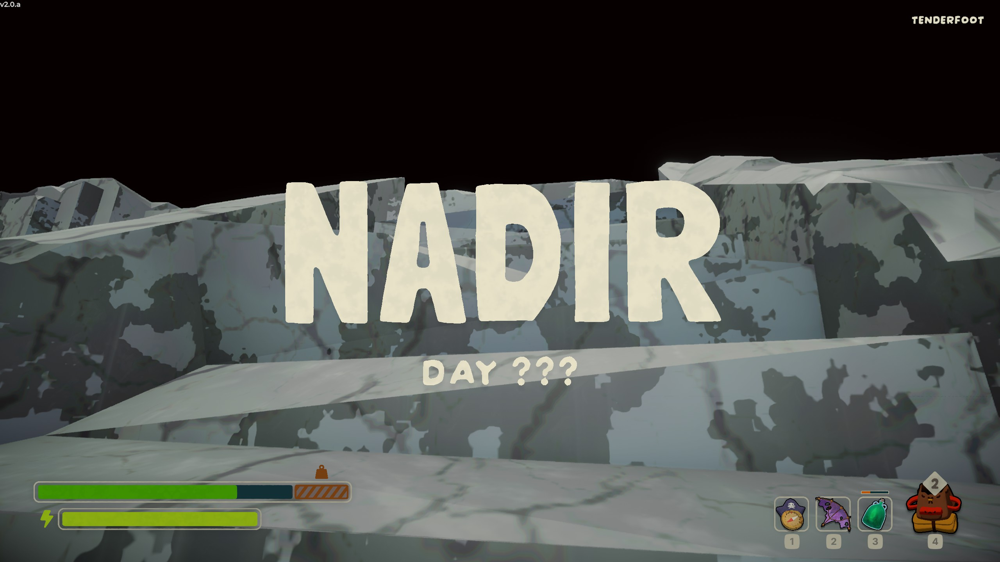](https://peak.wiki.gg/wiki/File%3ANadir_Title_Card.jpg)
  The Title Card for Nadir.
- [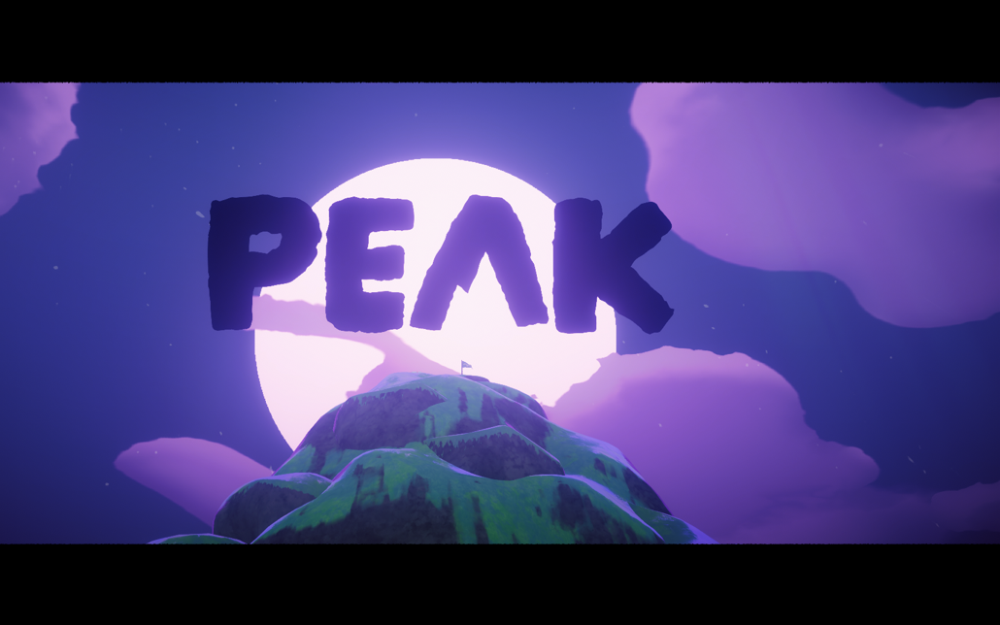](https://peak.wiki.gg/wiki/File%3ANighttime.png)
  The ending after completing Nadir.
- 
  The scouts helping the scoutmaster up.
- [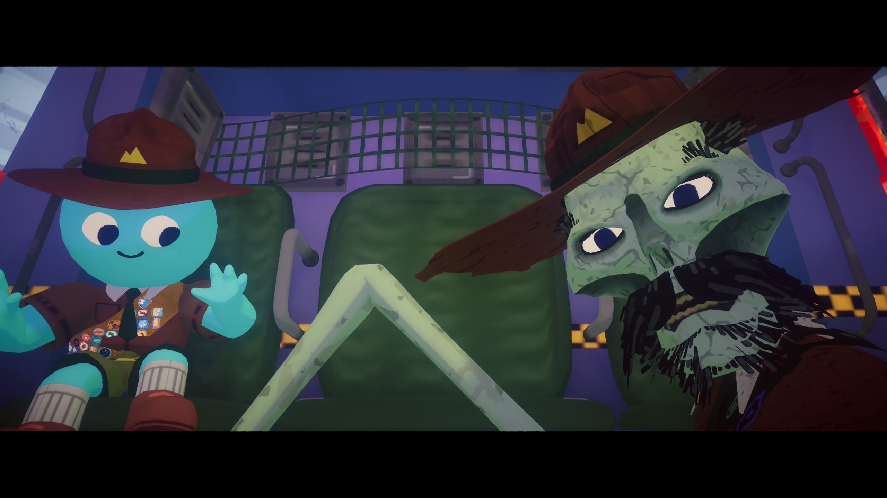](https://peak.wiki.gg/wiki/File%3AHelicopter_secret.jpg)
  The Scoutmaster in the helicopter during the secret ending cutscene.
- [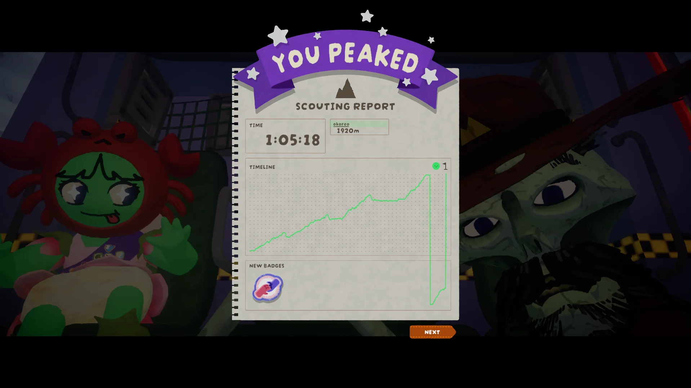](https://peak.wiki.gg/wiki/File%3AScouting_Report_Stars.webp)
  The Scouting Report after the ending cutscene.

## Trivia

- "Nadir" is an astronomical term used to denote the point on the celestial sphere directly below an observer.- "Nadir" can also mean a "low point," typically within one's spirit.
- When entering Nadir, the day will not be shown, instead displaying "Day ???" below the biome reveal.
- The scouting report shows Nadir to be below 0 meters, with the altitude graph dipping down over the section for acquired badges. Dying in the Nadir will display a final altitude of at least -900 meters and potentially more than -1200 meters.
- The Lost Souls appear regardless of ascent level, but will not rise above the initial height on [Tenderfoot](https://peak.wiki.gg/wiki/Tenderfoot), contrary to the message that displays.
- The Bing Bong found in Nadir is the same asset used in the airport. It is outwards facing and cannot be stored by normal means by the player.
- Despite the Gate depicting the Peak at day, the ending cutscene always takes place at night.
- The moon is full in the ending cutscene, whereas at all other times it appears as a crescent moon at night.
- During the ending cutscene, the dropped flare always emits red smoke.
- In [Ascent 4](Ascents.md) and higher, the crate of flares will be absent from the ending cutscene as well and it will cut directly from the Scouts shuffling toward the flag to a Scout pulling out a flare at the summit.

## Patch history

 **[2.0.a](2.0.a.md) (2026-08-11):** Added Nadir. **(Undocumented)**
 **[2.01.a](https://peak.wiki.gg/wiki/2.01.a) :**

- Fixed an issue with the collision of the backpack-shaped rock in [REDACTED].
- Fixed an issue where the level generation in [REDACTED] could soft-lock a run by placing a rock in the wrong place.
