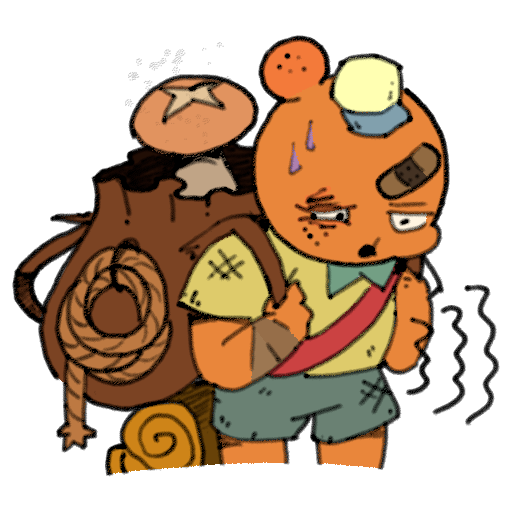
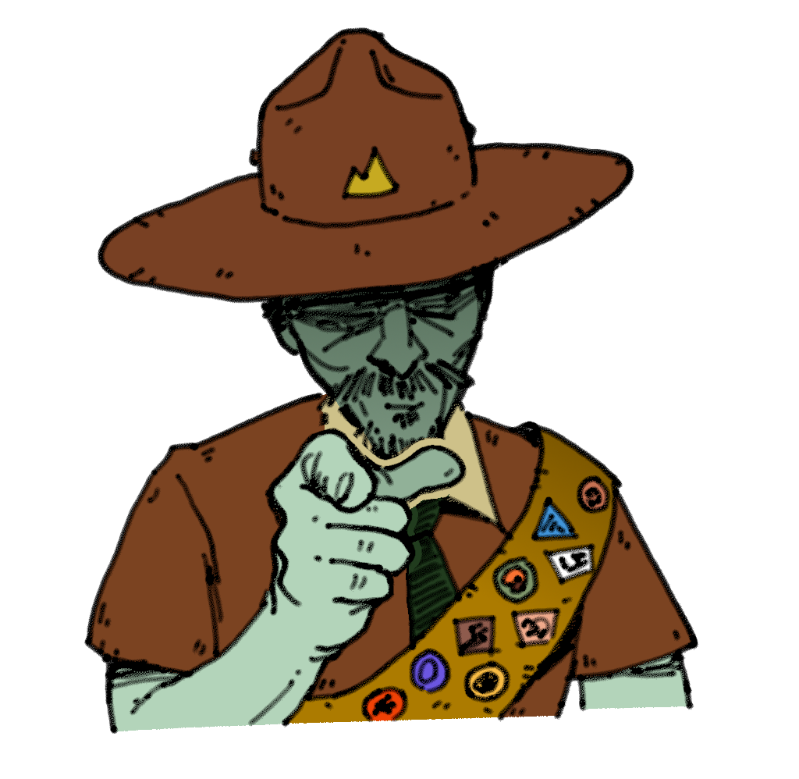
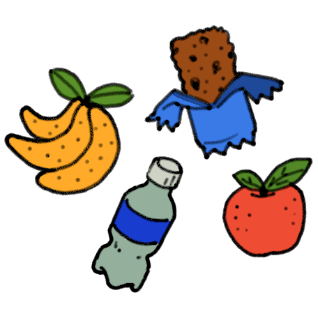
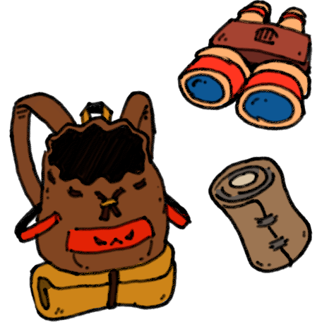

# PEAK Wiki/ko

## PEAK Wiki에 온 걸 환영합니다!

현재 [문서 357개](https://peak.wiki.gg/wiki/Special%3AAllPages)가 유지보수되고 있습니다. 문서 작성을 주저하지 말고, 위키에 기여해 보세요!

## 최신 업데이트

**패치 2.6.a** (2026년 10월 2일)

## PEAK란?

*[PEAK](Peak%20%28game%29.md)*는 작은 실수 하나가 치명적인 결과를 초래할 수 있는 협동 등반 게임입니다. 혼자서든, 길 잃은 자연 스카우트와 함께든, 신비한 섬에서 구조될 유일한 희망은 중앙에 우뚝 솟은 산을 오르는 것뿐입니다. 당신은 과연 정상에 오를 수 있을까요?

더 알아보기...

## 다음 섬 재설정:

불러오는 중...

---

오늘의 바이옴:

## 유용한 위키 문서

- 플레이하는 법
- 치장품
- 배지
- 음식
- 장비
- 장소

## 위키에 기여하기

PEAK Wiki는 모두에게 열려있고, 모두가 기여할 수 있는 리소스입니다. 대부분의 페이지 편집에는 [회원가입](https://peak.wiki.gg/wiki/Special%3AUserLogin/signup)이 필요하지 않으며, 여러분의 기여는 위키가 성장하고 다른 플레이어를 도울 수 있을 것입니다.

참고
:   - 페이지를 작성하거나 무엇을 해야할지 모르겠다면, 같은 주제의 여러 문서를 보며 익숙함을 키워보세요. 여러분은 언제나 위키의 원본 코드를 보고 다른 사람의 발자취를 보며 배워갈 수 있습니다.
    - 편집은 꼭 장대할 필요가 없습니다. 문서를 만들고 싶은게 아니더라도, 오타나 잘못된 정보를 수정하는 것만으로도 기여할 명분은 충분합니다.
    - [회원가입](https://peak.wiki.gg/wiki/Special%3AUserLogin/signup)하면 본인의 편집과 기여를 더 잘 알아볼 수 있습니다.

## 외부 링크

- [공식 PEAK 웹사이트](https://peakpeakpeak.com/)
- [공식 PEAK Discord](https://discord.gg/peakgame)
- [Steam 내 PEAK](https://s.team/a/3527290)
- [X에서의 Aggro Crab](https://x.com/AggroCrabGames)
- [X에서의 Landfall](https://x.com/LandfallGames)
