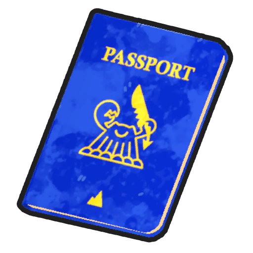
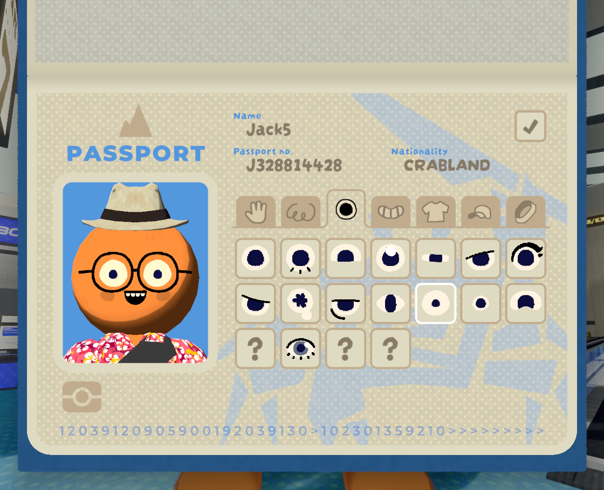

# Passport

This article is about the item. For the list of cosmetics, see [Cosmetics](Cosmetics.md).
Passport

[Item type](Items.md)- [Misc](Misc.md)
Biome- [Airport](Airport.md)
Weight
 **−2.5**

The **Passport** is a [lobby](Airport.md) exclusive [item](https://peak.wiki.gg/wiki/Item) in *[PEAK](Peak%20%28game%29.md)* which allows players to [customize](Cosmetics.md) the appearance of their [Scout](Scout.md). Available customization options include skin color, hair, eyes, mouth, fit (clothing/costumes), hats, and sashes.

The Passport is only accessible in the [Airport](Airport.md) and cannot be dropped.

## Trivia

- The Passport states your nationality as "Crabland", which is a reference to the [developers](https://peak.wiki.gg/wiki/Developers) of the game;*Landcrab* (*AggroCrab* & *Landfall*).
- The Passport had a different logo prior to version 1.60.c[[confirmation needed](https://peak.wiki.gg/wiki/Category%3APages_needing_confirmation)]. When it was changed to match *Landcrab'*s new logo.[[1]](#cite_note-1)

## Gallery

- 
  The customization menu that appears when using the Passport.

## References

- [↑](#cite_ref-1) [Landfall Day Stream where they showed their new logo](https://www.youtube.com/watch?v=6qlBqUpostE)

## Patch history

 **[1.0](1.0.md) (2025-06-16):** Introduced.
 **[1.6.a](1.6.a.md) (2025-07-04):** Fixed an issue where the Passport wouldn't properly update your cosmetics when returning to the airport after a win.
 **[1.27.a](1.27.a.md) (2025-08-27):** You can now change your [sash](https://peak.wiki.gg/wiki/Sash) in the Passport to any you've unlocked via [ascents](Ascents.md)!
 **[1.60.c](1.60.c.md) (2026-04-01):** Changed Passport item icon.[[confirmation needed](https://peak.wiki.gg/wiki/Category%3APages_needing_confirmation)] (**Undocumented Change**)
