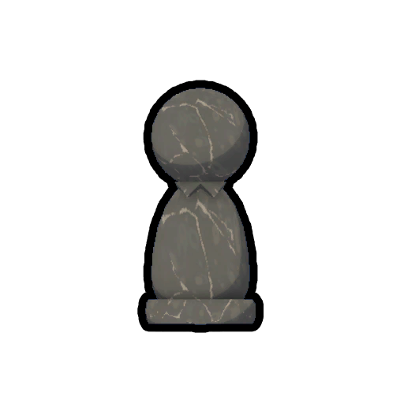
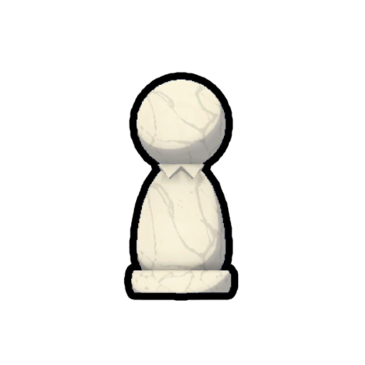

# Pawn

Pawn
Black
White

[Item type](Items.md)- [Misc](Misc.md)
Biome- [Airport](Airport.md)
Weight
 **2.5**

The **Pawn** is an [item](https://peak.wiki.gg/wiki/Item) in *[PEAK](Peak%20%28game%29.md)* that can be found in the [Airport](Airport.md). When dropped, chess pieces will automatically lock into place on the floor to avoid being accidentally displaced.

There are 16 pawns in total to be found in the Airport, with eight of each color set up on the the chess board.

## Patch history

 **[1.30.a](1.30.a.md) (2025-09-23):** Introduced.
