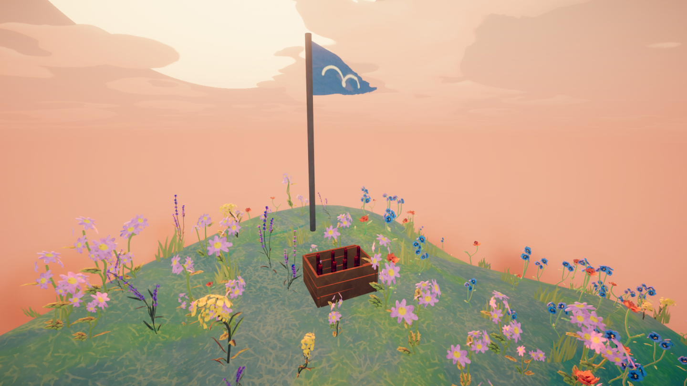
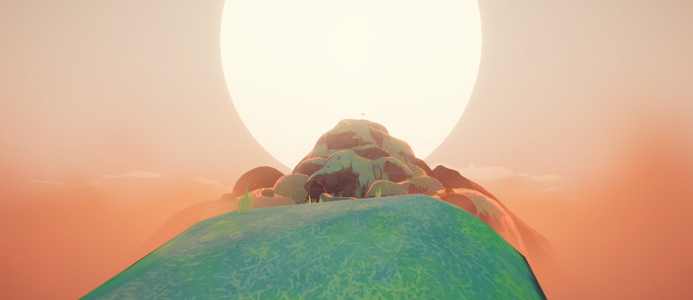
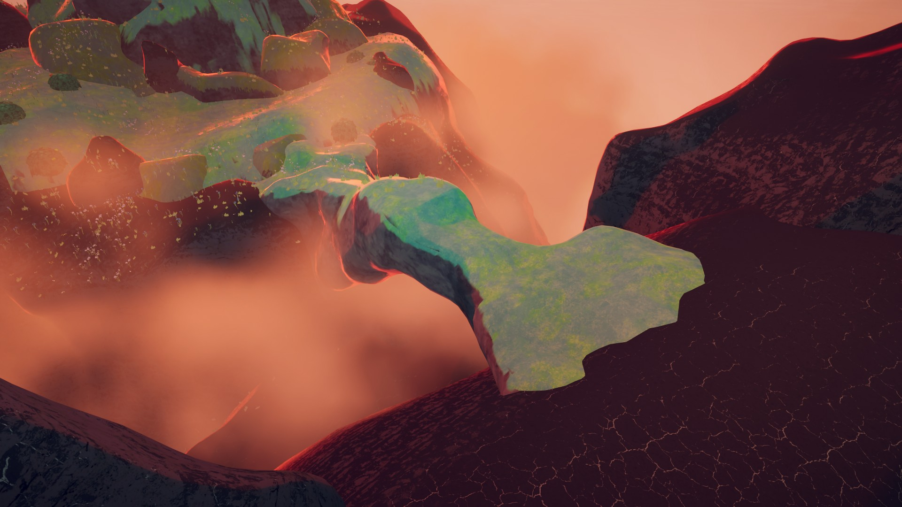
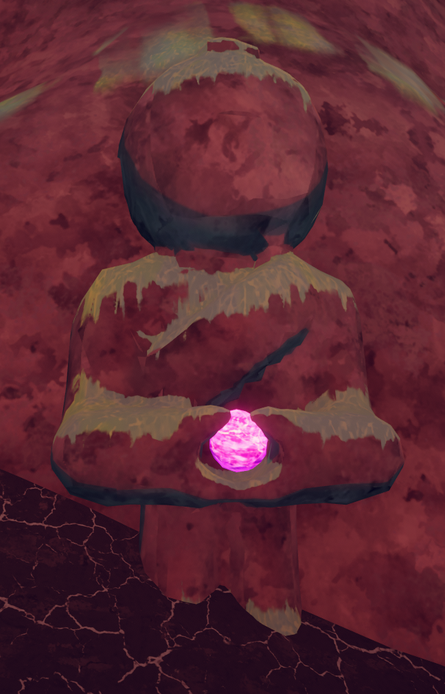
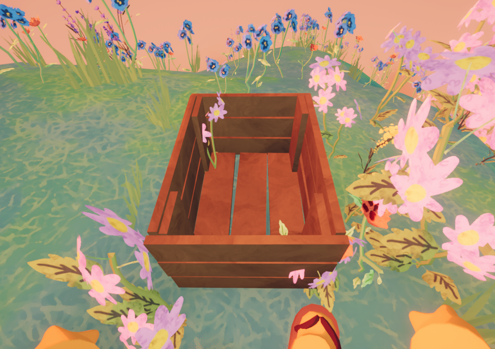
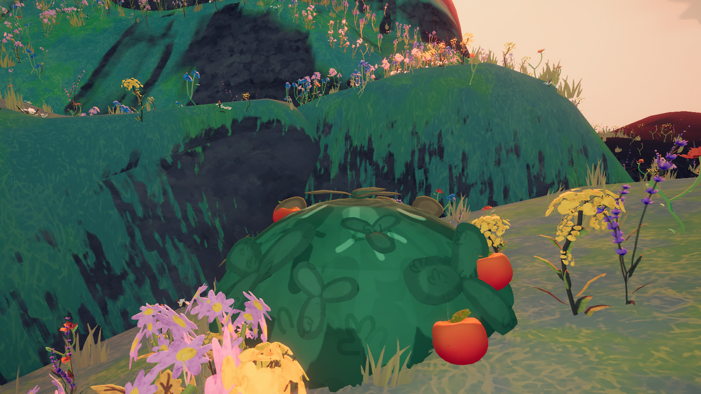
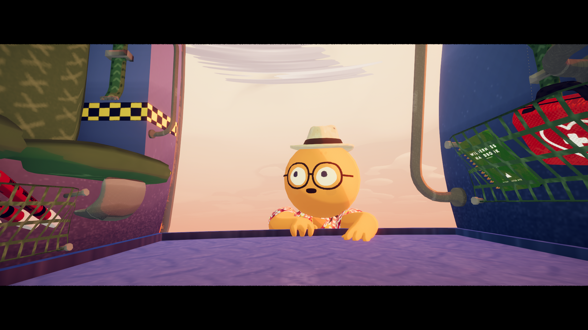
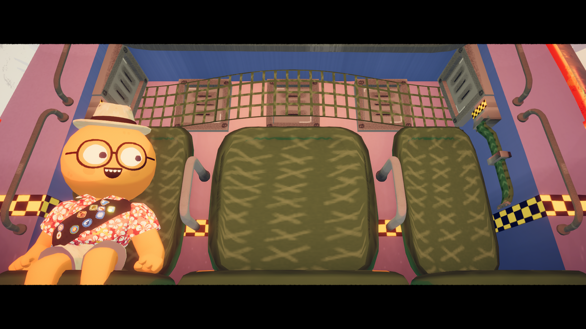
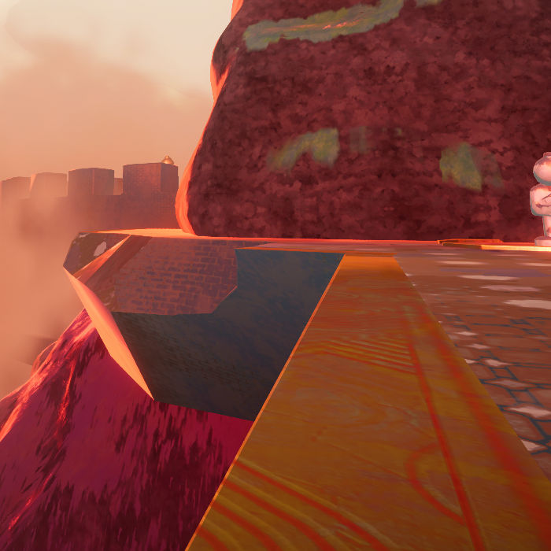

# Peak (biome)

For the article about the game, see [Peak (game)](Peak%20%28game%29.md).
Peak (biome)

Details
Type
[Biome](https://peak.wiki.gg/wiki/Biome)
Region
**6**/6

The **Peak** is the sixth and final [biome](https://peak.wiki.gg/wiki/Biome) in *[PEAK](Peak%20%28game%29.md)*, following [The Kiln](The%20Kiln.md) or [The Citadel](The%20Citadel.md). It is a grassy mountain peak covered in various wild flowers. The Peak is connected to the top of The Kiln by a bridge-like rock formation and to the top of The Citadel by being right beside the tower.

It does not have a [campfire](Campfire.md) or a usable [Ancient Statue](Ancient%20Statue.md), and is the only biome without any hazards.

## The Flag

At the very top of the Peak is a blue scout flag with a white icon of a seagull[[1]](#cite_note-1). A crate of  [Flares](Flare.md) is placed near the flag. The flares are absent from this crate on [Ascent 4](https://peak.wiki.gg/wiki/Ascent_4) or higher.

## End game countdown

Once a  [Flare](Flare.md) is lit anywhere on the Peak (not necessarily the very top), an orange rescue helicopter will be called and arrive soon after at the Peak. The helicopter will throw down a rope, after which a **10 second** countdown (30 seconds if not all players are present at the Peak) will begin. After the countdown ends, a small cinematic cutscene will play, showing all the living [Scouts](Scout.md) getting on board. The players *do not* need to hold the rope to be rescued; the only requirement is to be present at the Peak (indicated by the word "PEAK" appearing on the screen).

When the cutscene ends, the [Scouting Report](Scouting%20Report.md) will be shown, after which the helicopter will fly off into the sunset as the game's credits roll, ending the expedition. After the credits end or are skipped, all players are brought back to the [Airport](Airport.md).

## Stone Scout

 **Spoilers!** - The following section contains spoilers for *[PEAK](Peak%20%28game%29.md)*.

Going behind the Peak reveals a white stone statue of a Scout, holding the  [Strange Gem](Strange%20Gem.md) in its hands. Besides the gem the Stone Scout features a sash with four empty sockets. Finding and inserting four specific items in the sockets - the four [Amulets](Amulets.md), transforms the gem into  [Scout's Honor](Scout%27s%20Honor.md). Which, upon activation, transports all Scouts to [Nadir](Nadir.md).

## Tips & Tricks

- Always remember to bring a  [Flare](Flare.md) with you when playing on [Ascent 4](https://peak.wiki.gg/wiki/Ascent_4) or higher, as these difficulties lack the flares usually found in a crate near the flag. The [Crash Site](https://peak.wiki.gg/wiki/Crash_Site) always has one Flare.- If you are planning to enter [Nadir](Nadir.md), a Flare is not required, as the ending cutscene for escaping through Nadir's gate triggers regardless.

## Trivia

- When ascending from the [Citadel](https://peak.wiki.gg/wiki/Citadel), the grass on the back of the Peak is the same texture as that of the [Tropics](Tropics.md). This is noticeable when the Tropics generates with the Ivy variant, as the grass everywhere but the summit will also turn purple. The version connected to the [Kiln](https://peak.wiki.gg/wiki/Kiln) is covered in volcanic rock and lava instead.
- Aesthetically, the time of the day is eternally sunset at the Peak, as the sun is completely stationary. If you venture off the Peak and go out of bounds, the stationary sunset will switch back to the sky that changes based on the time of the day in-game.
- When you are in this biome, your Steam Now Playing will say "At the PEAK".

## Gallery

- 
  A far-away view of the Peak. Note that this biome is stuck in eternal sunset
- 
  The bridge between [The Kiln](The%20Kiln.md) and the Peak.
- 
  The [Stone Scout](https://peak.wiki.gg/wiki/Stone_Scout) holding the  [Strange Gem](Strange%20Gem.md) pre-[2.0.a](2.0.a.md).
- 
  The crate atop the Peak without any  [Flares](Flare.md), as seen in [Ascent 4](https://peak.wiki.gg/wiki/Ascent_4) and higher.
- 
  The foot of the Peak, with [Red Crispberries](Red%20Crispberry.md) growing on a bush.
- 
  The beginning of the ending cutscene: The first [Scout](Scout.md) to be rescued climbs into the helicopter.
- 
  The majority of the ending cutscene: All alive Scouts sit inside the helicopter. Single-player example.
- 
  The grass on the back of the Peak when both the Citadel and the Ivy variant of the Tropics are present.

## Notes

- [↑](#cite_ref-1) Confirmed by the texture name.
