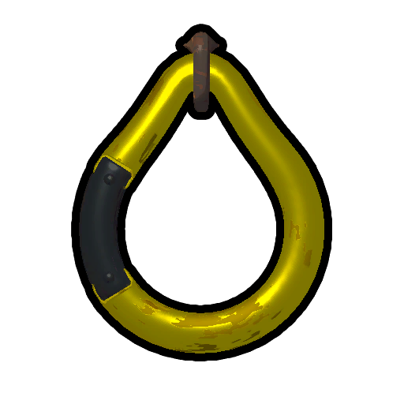

# Peak (game)

For the biome, see [Peak (biome)](Peak%20%28biome%29.md).
PEAK

Details
Developers
[Team PEAK](https://peak.wiki.gg/wiki/Team_PEAK)
Publishers
[Aggro Crab](https://en.wikipedia.org/wiki/Aggro_Crab), [Landfall Games](https://en.wikipedia.org/wiki/Landfall_Games)
Composers
Erik Skog[[1]](#cite_note-1)
Engine
[Unity](https://en.wikipedia.org/wiki/Unity_(game_engine))
Platforms
Windows (Steam),
Genre
Co-op survival climbing
Modes
[Single-player](https://en.wikipedia.org/wiki/Single-player_video_game), [Multiplayer](https://en.wikipedia.org/wiki/Multiplayer_video_game)
Release dates
 Steam
June 16, 2025

**Peak** (stylized as **PEAK**) is a co-operative climbing game developed and published by [Aggro Crab](https://en.wikipedia.org/wiki/Aggro_Crab) and [Landfall](https://en.wikipedia.org/wiki/Landfall_Games), released on June 16, 2025 on [Steam](https://store.steampowered.com/app/3527290/PEAK/) for Windows, and is verified Steam Deck compatible.

## Overview

PEAK's gameplay revolves around lone [Scouts](https://peak.wiki.gg/wiki/Scouts), or Scout troops of up to 4 members, waking up after a plane belonging to [BingBong Airlines](https://peak.wiki.gg/wiki/BingBong_Airlines) [crashes](https://peak.wiki.gg/wiki/Crash_Site) on the [Shore](Shore.md) of the [Island](Island.md). Their goal is to make it to the [Peak](Peak%20%28biome%29.md), the highest point on the Island, where a rescue [helicopter](https://peak.wiki.gg/wiki/Helicopter) can be summoned using a  [Flare](Flare.md). The game has a number of difficulty levels called *[Ascents](Ascents.md)* which progressively add stacking downsides and make the climb harder for everyone.

The terrain, [biomes](https://peak.wiki.gg/wiki/Biomes) (separated by [campfires](https://peak.wiki.gg/wiki/Campfires)) and land-based hazards of the Island are [randomized](Island.md) each day at [17:00 UTC](https://dateful.com/convert/utc?t=17), while naturally spawning [food](Food.md) and the contents of scattered [luggage](Luggage.md) are [randomized](Rarity.md) each expedition. There are also environmental hazards that can be found in every biome, such as [Shore](Shore.md)'s [giant urchins](https://peak.wiki.gg/wiki/Giant_urchin), [Tropics](Tropics.md)' [rain](Tropics.md#Rain), [Roots](Roots.md)' [wind](Roots.md), [Alpine](Alpine.md)'s [blizzards](https://peak.wiki.gg/wiki/Blizzards), [Mesa](Mesa.md)'s hot [sun](https://peak.wiki.gg/wiki/Sun), and [Caldera](Caldera.md)'s [lava](Caldera.md#Lava). If playing on the [Peak](Ascents.md#Peak) [Ascent](https://peak.wiki.gg/wiki/Ascent) or higher, the [Fog](Fog.md) is also present and will slowly encroach on the Scout troop if they take too long to ascend.

Playing PEAK is very much a trial-and-error affair, with the game itself leaving a lot for players to discover on their own. Some of the most important things learnt by the players include what [foods](https://peak.wiki.gg/wiki/Foods) are poisonous, when to take and how to use the various pieces of [equipment](Equipment.md) found in [luggage](Luggage.md), and how to most effectively manage their [stamina](https://peak.wiki.gg/wiki/Stamina).

PEAK's seemingly simple but deeply complex gameplay and aesthetics have allowed it to achieve a rating of *Overwhelmingly Positive* on [Steam](https://en.wikipedia.org/wiki/Steam_(service)) and have spawned an underground meme culture that has gone on to be recognized by the game's developers, culminating in a reference to *[Jonathan Frisbee](https://www.youtube.com/watch?v=ZvkYRdqlY3s)* being added to the [texture](https://peak.wiki.gg/wiki/File%3AFrisbee_texture.png) of the  [Flying Disc](Flying%20Disc.md).

## Steam Description

*(Revision as of 2025-08-21)*

PEAK is a co-op climbing game where the slightest mistake can spell your doom. Either solo or as a group of lost nature scouts, your only hope of rescue from a mysterious island is to scale the mountain at its center. Do you have what it takes to reach the [PEAK](Peak%20%28biome%29.md)?

**WORK TOGETHER**

Need a Hand? You’ll need to rely on your friends to have any hope of scaling the mountain, which [changes](Island.md) every single day. Help each other up ledges, or place  [ropes](Rope%20Spool.md) and  [climbing spikes](Piton.md)[[2]](#cite_note-2) to make the way easier for those who come after.

**CLIMB**

The Mountain Takes no Prisoners! Climb through 4 [biomes](https://peak.wiki.gg/wiki/Biomes) on your way to the [PEAK](Peak%20%28biome%29.md), each with their own life-threatening obstacles. You’ll need to scavenge for questionable [food](Food.md) to survive, and manage your  [injuries](Stamina%20bar.md#Injury) carefully - every setback limits your [stamina](https://peak.wiki.gg/wiki/Stamina), making it harder to climb.

**SURVIVE**

Prepare For the Worst: Discover a variety of helpful survival [items](Items.md), from  [Energy drinks](Energy%20Drink.md) to  [climbing spikes](Piton.md) to the mysterious  [Anti-Rope](Anti-Rope.md). You’ve got no hope of making it to the [PEAK](Peak%20%28biome%29.md) unless you press every advantage given to you.

**A NEW ISLAND EACH DAY**

The game's [map](Island.md) rotates out every 24 hours! Try out the new layout each day, or give the same island multiple attempts in a day until you conquer it.

**EARN BADGES**

A Well-Seasoned Scout: Show off your survival prowess with dozens of [badges](Badges.md) to earn and [cosmetics](Cosmetics.md) to unlock.

**CLIMBING IS BETTER WITH FRIENDS**

Multiplayer in PEAK is friends-only - invite up to three other scouts through Steam to climb together, or face the mountain alone if you're *really* brave!

**FEATURES**

- Climb with a total of 4 friends
- Communicate through proximity chat
- 4 different [biomes](https://peak.wiki.gg/wiki/Biomes) to ascend through[[3]](#cite_note-3)
- A bunch of questionable [foods](Food.md)
- Lots of different climbing [items](Items.md)
- [Campfires](https://peak.wiki.gg/wiki/Campfires) and  [marshmallows](Marshmallow.md)
- Character [customization](https://peak.wiki.gg/wiki/Customization)
- Online co-op and offline single player
- [Ghosts](https://peak.wiki.gg/wiki/Ghost)

## Trivia

- The font primarily used in Peak and its menus is called [Darumadrop One](https://fonts.google.com/specimen/Darumadrop+One). This includes the game's logo itself (excluding the capital A used in the logo, which seems to be custom). This font is also used on the packaging of the  [Scout Cookies](Scout%20Cookies.md), as well as the key prompts.

## See also

- [Credits](Credits.md)
- [Soundtrack](Soundtrack.md)
- [Steam Community Items](Steam%20Community%20Items.md)

## External links

- [PEAK on Steam](https://store.steampowered.com/app/3527290/PEAK/)

## Notes

- [↑](#cite_ref-1) [Landfall Games on Bluesky](https://bsky.app/profile/landfall.se/post/3lwhb7rkfz222) ([screenshot](https://peak.wiki.gg/wiki/File%3ALandfall_BSky_Response.png))
- [↑](#cite_ref-2) The description refers to "climbing spikes", which is the old name for the  [Piton](Piton.md).
- [↑](#cite_ref-3) Outdated since [1.20.a](1.20.a.md) with the addition of the [Mesa](Mesa.md). As of [2.3.a](2.3.a.md), there are 9 different biomes.
