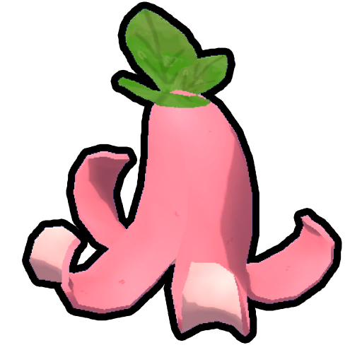
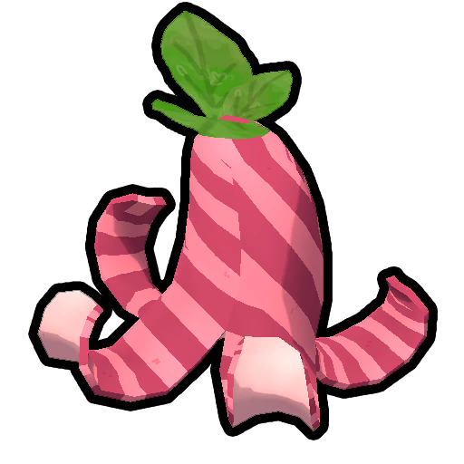

# Pink Berrynana Peel

Pink Berrynana Peel
Normal
Colorblind

[Item type](Items.md)- [Misc](Misc.md)
Biome- [Tropics](Tropics.md)
Source- [Pink Berrynana](Pink%20Berrynana.md)
Weight
 **2.5**

The **Pink Berrynana Peel** is an [item](https://peak.wiki.gg/wiki/Item) in *[PEAK](Peak%20%28game%29.md)* that is acquired after eating  [Pink Berrynanas](Pink%20Berrynana.md) from the [Tropics](Tropics.md). Players walking over a peel will [slip](https://peak.wiki.gg/wiki/Slippery_effect) and fall to the ground, losing control for a moment.

## Patch history

 **[1.0](1.0.md) (2025-06-16):** Introduced.
