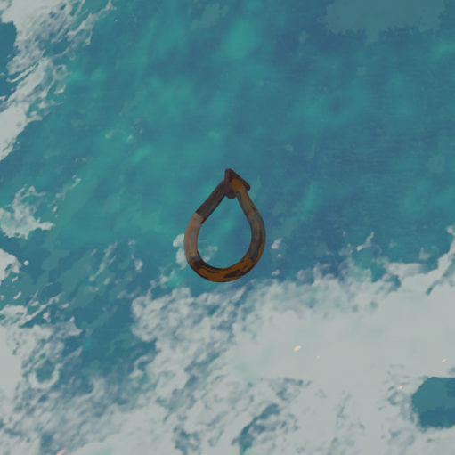
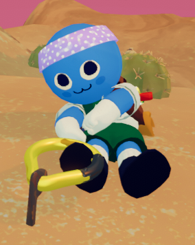

# Piton

Piton

[Item type](Items.md)- [Deployable](https://peak.wiki.gg/wiki/Deployable)
Rarity
[Epic](https://peak.wiki.gg/wiki/Epic)
Source- [Regular Luggage](https://peak.wiki.gg/wiki/Regular_Luggage)
- [Big Luggage](https://peak.wiki.gg/wiki/Big_Luggage)
- [Explorer's Luggage](https://peak.wiki.gg/wiki/Explorer%27s_Luggage)
Weight
 **2.5**

The **Piton** (pē- tän) is a [deployable](https://peak.wiki.gg/wiki/Deployable) item in *[PEAK](Peak%20%28game%29.md)*.

When present in the inventory, a [Scout](Scout.md) can place it on the cliff while climbing without letting go. Once placed, it becomes a permanent handhold, letting Scouts recover their [stamina](https://peak.wiki.gg/wiki/Stamina) while holding onto it. Only one [Scout](Scout.md) can hang on a piton at a time.

Grabbing a piton is accomplished by looking at it and pressing the interact button (). Players do not need to hold the climbing button to hang on the piton.

While inserting a piton into a cliff, a preview will be shown of the piton's position. Placing a piton is only possible when the preview is blue. During the insertion, the [Scout's](Scout.md) [stamina](https://peak.wiki.gg/wiki/Stamina) drains considerably slower, although any movement will reset the insertion progress.

## Rusty Pitons

### In the [Alpine](Alpine.md)

A rusty piton found in the [Alpine](Alpine.md).

In the [Alpine](Alpine.md), already placed Pitons can be found on the mountain. These pitons, having a rusted appearance, will break after **6 seconds** of being held on to.

### Pickaxes

A pickaxe stuck into a cliff in the [Mesa](Mesa.md).

**Pickaxes** are a naturally spawning feature exclusive to the [Mesa](Mesa.md). They are found stuck in rock walls, and act identically to Pitons in the [Alpine](Alpine.md), letting scouts rest for up to **6 seconds** before they break. They can not be obtained as an item, and will only ever appear already placed in the wall.

## Tips & Tricks

- Pitons are best placed near the very end of a climb, when [stamina](https://peak.wiki.gg/wiki/Stamina) is particularly low. However, always make sure you have enough [stamina](https://peak.wiki.gg/wiki/Stamina) to reach the piton again if you're placing it to cross a large horizontal distance.
- On the topic of reaching Pitons, they have a rather large interaction distance which is often quite handy.
- Instead of jumping off a piton, simply hold the climbing button () and start moving. Doing this will not consume any additional [stamina](https://peak.wiki.gg/wiki/Stamina) as you will not be grabbing a wall mid-air.
- If you cook a piton at a [Campfire](Campfire.md) or a [Portable Stove](Portable%20Stove.md), it will become incinerated and you won't be able to use it anymore.
- Pitons must be held in one of the hand slots, it cannot be used if it is in a  [Backpack](Backpack.md).
- Some items can be used while hanging onto a Piton, such as the  [Energy Drink](Energy%20Drink.md).

## Gallery

- 
  A [Scout](Scout.md) grabbing a piton affixed to the ground. Since Scouts are physically simulated, this Scout is stuck to the piton by its foot.

## Patch history

 **[1.0](1.0.md) (2025-06-16):** Introduced.
 **[1.7](1.7.md) (2025-07-10):** Players will now fall off pitons when passed out, fixing an issue where, on revival, they don’t experience teleporting back to the piton.
 **[1.8](1.8.md) (2025-07-21):** Fixed an issue where your weight on the [stamina bar](Stamina%20bar.md) didn't update after placing a piton while climbing.
 **[1.44.a](1.44.a.md) (2025-11-13):** Fixed players not being able to grab a piton while hanging from a [vine](https://peak.wiki.gg/wiki/Vine).
 **[2.0.a](2.0.a.md) (2026-08-11):** Fixed an issue where being prompted to grab pitons would sometimes not work, especially when directly on top of the piton.
