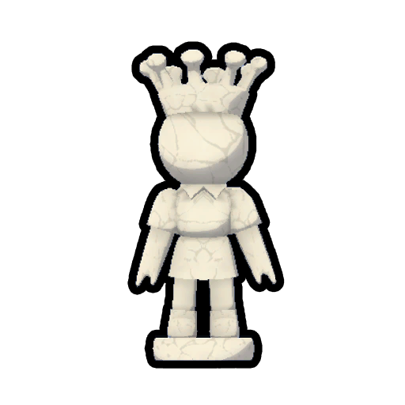

# Queen

Queen
Black
White

[Item type](Items.md)- [Misc](Misc.md)
Biome- [Airport](Airport.md)
Weight
 **2.5**

The **Queen** is an [item](https://peak.wiki.gg/wiki/Item) in *[PEAK](Peak%20%28game%29.md)* that can be found in the [Airport](Airport.md). When dropped, chess pieces will automatically lock into place on the floor to avoid being accidentally displaced.

There are four queen pieces in total to be found in the Airport: one of each color will spawn on the the chess board, and another queen piece of each color of will be off to the side.

## Patch history

 **[1.30.a](1.30.a.md) (2025-09-23):** Introduced.
