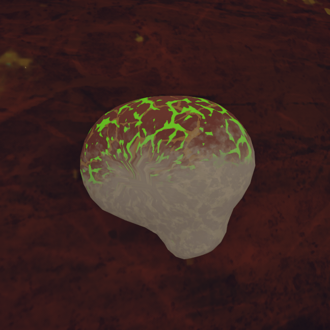

# Remedy Fungus

Remedy Fungus

[Item type](Items.md)- [Consumable](https://peak.wiki.gg/wiki/Consumable)
Weight
 **2.5**
Base Status Effects
Poison
-35
Injury
-52.5
Spores
-35

The **Remedy Fungus** is a [consumable](https://peak.wiki.gg/wiki/Consumable) item in *[PEAK](Peak%20%28game%29.md)*. When dropped or thrown, it releases an explosion that immediately heals players within **8 meters** for  **17.5** [Injury](Stamina%20bar.md#Injury) with an additional  **35** [Injury](Stamina%20bar.md#Injury),  [Poison](Stamina%20bar.md#Poison), and  [Spores](Stamina%20bar.md#Spores) removed over the course of **14 seconds** if they remain in the area of effect.

## Tips

- The Remedy Fungus can be used to negate [fall damage](https://peak.wiki.gg/wiki/Fall_damage). The healing cloud will remove a certain amount of  [Injury](Stamina%20bar.md#Injury) when the item is dropped, either manually by the player before landing, or automatically upon [losing consciousness](https://peak.wiki.gg/wiki/Death) (provided the Remedy Fungus was in one of the inventory slots).

## Gallery

- 
  A Remedy Fungus close up.

## Patch history

 **[1.2.a](1.2.a.md) (2025-06-18):** Introduced.
 **[1.10.a](1.10.a.md) (2025-07-30):** Remedy Fungus now also cures poison in addition to injury, because it seems like it would.
