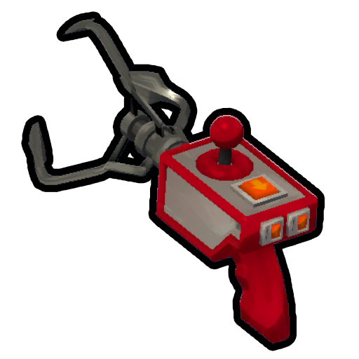
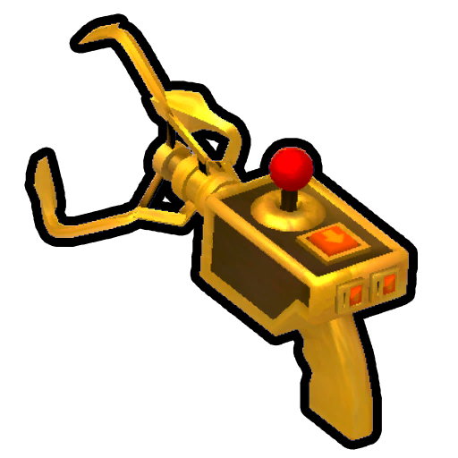

# Rescue Claw

Rescue Claw

[Item type](Items.md)- [Consumable](https://peak.wiki.gg/wiki/Consumable)
- [Equipment](Equipment.md)
Rarity
[Legendary](https://peak.wiki.gg/wiki/Legendary)
Source- [Regular Luggage](https://peak.wiki.gg/wiki/Regular_Luggage)
- [Big Luggage](https://peak.wiki.gg/wiki/Big_Luggage)
- [Explorer's Luggage](https://peak.wiki.gg/wiki/Explorer%27s_Luggage)
Uses
3
Weight
 **2.5**

The **Rescue Claw** is a [consumable](https://peak.wiki.gg/wiki/Consumable) item in *[PEAK](Peak%20%28game%29.md)* found in regular and large [luggage](Luggage.md) throughout the [island](Island.md). It can be used to pull the wielding player towards terrain, or to pull other scouts towards them. When aiming at all upwards, the claw has a range of **48 meters**. When aiming downwards, the claw has a range of **64 meters**.

Using a Rescue Claw to pull an [unconscious](Scout.md#Unconsciousness_&_Death) scout player **30 meters** will grant you the  [Disaster Response Badge](https://peak.wiki.gg/wiki/Disaster_Response_Badge).

[Cooking](Cooking.md) a Rescue Claw immediately incinerates it, making it unusable.

## Tips

- Using a Rescue Claw to climb up or across surfaces may cause the player to be thrown if used on an odd angle/surface. Movement inertia is not accounted for if the player fails to hold onto a surface they hooked on, making them plummet.
- Players are advised to **carefully** select safe surfaces to grapple onto. You must unequip the rescue claw and hold onto surfaces as soon as the claw retraction ends to avoid being thrown.
- You should be very cautious when rescuing scouts with the Rescue Claw. It can be easy for them to not be able to grab onto a ledge in time, or have the opportunity to, and plummet.
- The Rescue Claw is a high risk, high reward item. It can help you get through tough spots in places like [Alpine](Alpine.md) and [The Kiln](The%20Kiln.md), but a mistimed grapple or the game physics betraying you can send you falling to your death. It is recommended to use the item as your last resort if a successful grapple would be very risky, more necessary if the [Fog](Fog.md) is catching up to you.
- You should never use a Rescue Claw on a [Zombie](Zombie.md), as the claw will pull it towards you and have an opportunity to lunge at you.

## Infinite Variant

Infinite Rescue Claw

Selecting "Grapple mode" in [Custom Runs](https://peak.wiki.gg/wiki/Custom_Runs) gives each Scout a gold Rescue Claw with no usage limit. The gold Claw cannot be dropped.

## Patch history

 **[1.40.a](1.40.a.md) (2025-11-05):** Introduced.
 **[1.60.a](1.60.a.md) (2026-03-30):** Rescue Hook now doesn't put you in a [ragdolled state](Scout.md#Ragdoll_State) for as long, making it easier to use.
 **[2.4.a](2.4.a.md) (2026-09-02):** Using the Rescue Claw on a friend will [ragdoll](Scout.md#Ragdoll_State) them for less time, making it easier for them to grab onto something once the claw completes.
