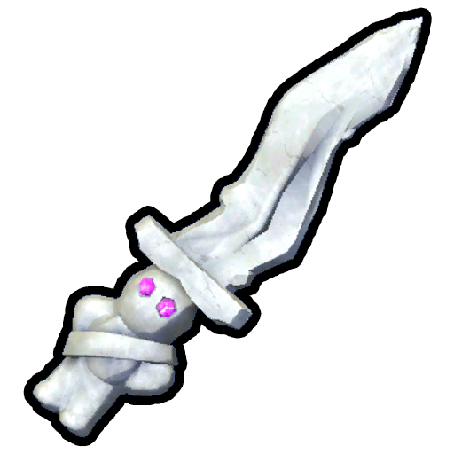

# Ritual Dagger

Ritual Dagger

[Item type](Items.md)- [Mystical item](https://peak.wiki.gg/wiki/Mystical_item)
Source- [Ancient Luggage](https://peak.wiki.gg/wiki/Ancient_Luggage)
- [Ancient Statue](Ancient%20Statue.md)
Weight
 **2.5**
Base Status Effects
Hunger
-100
Bonus Stamina
100
Heat
-100
Cold
-100
Poison
-100
Drowsy
-100
Injury
-100
Spores
-100

The **Ritual Dagger** is a [consumable](https://peak.wiki.gg/wiki/Consumable) [Mystical](https://peak.wiki.gg/wiki/Mystical) item in *[PEAK](Peak%20%28game%29.md)*. It can be obtained from [Ancient Luggages](https://peak.wiki.gg/wiki/Ancient_Luggage) or an [Ancient Statues](Ancient%20Statue.md) when playing co-op. The dagger can be used by "sacrificing" another Scout from behind, killing that Scout and healing the user (in a small AOE) of most negative status effects.

The Ritual Dagger can be [cooked](Cooking.md) but its functionality or effects don't change.

Removing more than 75% negative status effects in one use grants the user the  [Last Resort Badge](https://peak.wiki.gg/wiki/Last_Resort_Badge).

## Usage Mechanics

To use the dagger, the following conditions must be met:

- The victim must face away from the user.
- The victim must appear as a Scout and not as a [cooked chicken](Cannibalism.md).

Once used, the following happens:

- The victim's [Bonus Stamina](Stamina%20bar.md#Bonus_Stamina) bar gets completely filled with  [Petrify](Stamina%20bar.md#Petrify), killing them immediately.
- The user of the dagger is cured of most negative status effects.- This does not include  [Weight](Stamina%20bar.md#Weight),  [Thorns](Stamina%20bar.md#Thorns),  [Arrow](Stamina%20bar.md#Arrow)[[confirmation needed](https://peak.wiki.gg/wiki/Category%3APages_needing_confirmation)],  [Curse](Stamina%20bar.md#Curse), or  [Petrify](Stamina%20bar.md#Petrify).
  - The user also gains  **100** [Bonus stamina](Stamina%20bar.md#Bonus_stamina).

## Notes

- Despite appearing and behaving similarly to Scouts, [Zombies](Zombie.md) cannot be sacrificed.

## Patch history

 **[2.0.a](2.0.a.md) (2026-08-11):** Introduced.
 **[2.01.a](https://peak.wiki.gg/wiki/2.01.a) :**

- Fixed an issue where the Ritual Dagger could be used indefinitely.
- Fixed an issue where killing a player who had placed a [Checkpoint Flag](Checkpoint%20Flag.md) with the Ritual Dagger could break their voice chat and mess up their character animations.
