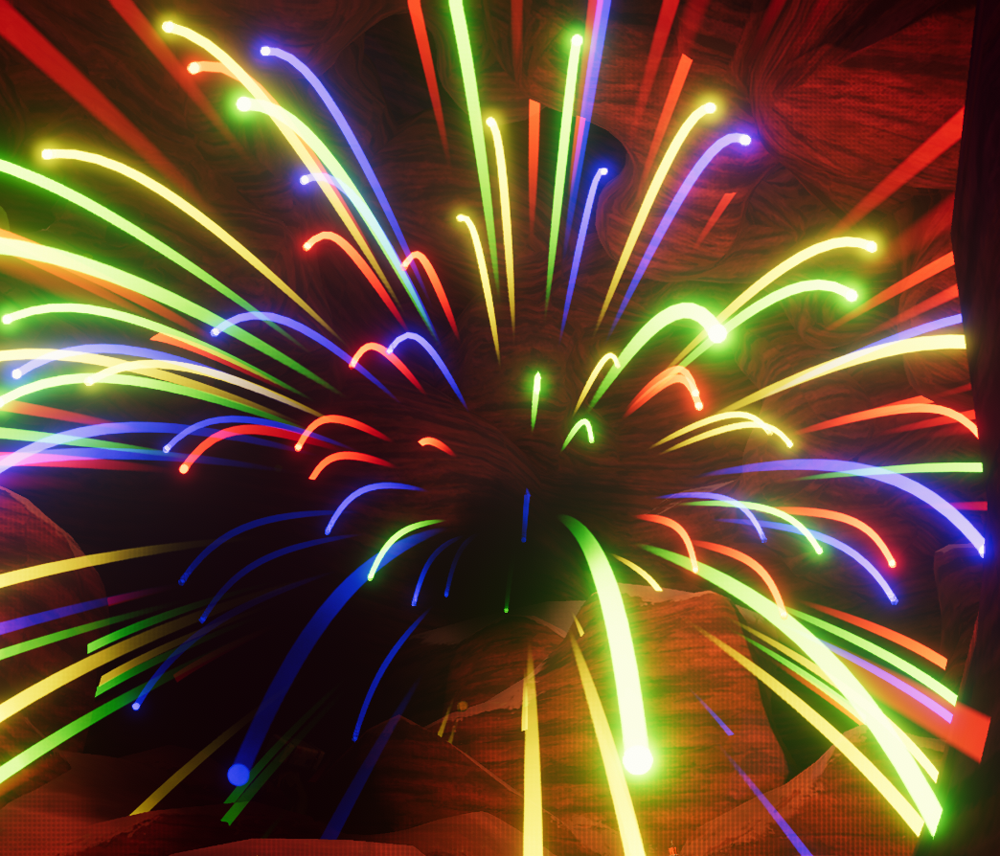

# Rocketpack

Rocketpack

[Item type](Items.md)- [Equipment](Equipment.md)
Rarity
[Mythic](https://peak.wiki.gg/wiki/Mythic)
Source- [Regular Luggage](https://peak.wiki.gg/wiki/Regular_Luggage)
- [Big Luggage](https://peak.wiki.gg/wiki/Big_Luggage)
- [Clown Luggage](https://peak.wiki.gg/wiki/Clown_Luggage)
Weight
 **2.5**

The **Rocketpack** is a wearable [Equipment](Equipment.md) [item](https://peak.wiki.gg/wiki/Item) in *[PEAK](Peak%20%28game%29.md)*. It takes the fourth equipment slot similar to the  [Backpack](Backpack.md), and you cannot wear both at the same time.

While equipped, another [Scout](Scout.md) or the wearer (with the right angle) can light the fuse to the Rocketpack. After **3 seconds**, the rocket ignites for **3 seconds** and causes the wearer to fly. While flying, you can use your movement keys to slightly steer the flying direction, but control over movement is very negligible.

After the flying time is up, the rocket explodes into fireworks, dealing up to  **20** [Injury](Stamina%20bar.md#Injury) to nearby Scouts.

## Gallery

- 
  A Rocketpack exploding into fireworks.

## Patch history

 **[2.0.a](2.0.a.md) (2026-08-11):** Introduced.
