# Roots

Roots
[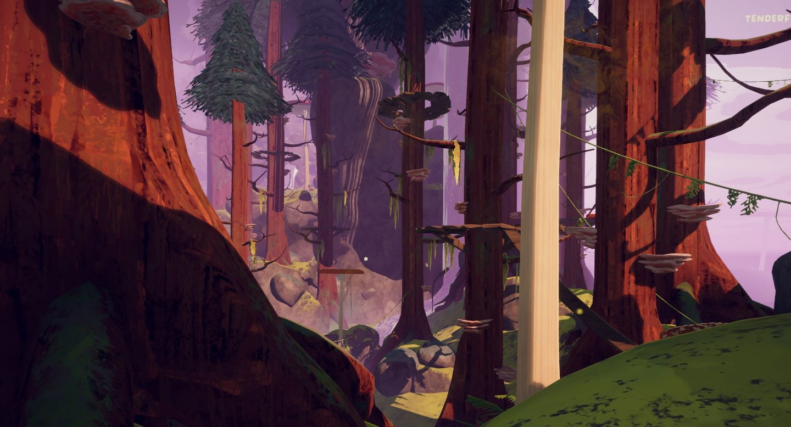](https://peak.wiki.gg/wiki/File%3ARoots_Location.jpg)
Details
Type
[Biome](https://peak.wiki.gg/wiki/Biome)
Region
**2**/6

The **Roots** is one of the two possible second [biomes](https://peak.wiki.gg/wiki/Biome) in *[PEAK](Peak%20%28game%29.md)* (the other being the [Tropics](Tropics.md)). It follows the [Shore](Shore.md) and precedes either the [Alpine](Alpine.md) or the [Mesa](Mesa.md), depending on the map [seed](https://peak.wiki.gg/wiki/Seed). It is comprised of a redwood forest infested with mushrooms.

Reaching the top and lighting the [campfire](Campfire.md) dispels the fog wall blocking access to the next biome and grants all living [Scouts](https://peak.wiki.gg/wiki/Scouts) the  [Forestry Badge](https://peak.wiki.gg/wiki/Forestry_Badge) if they haven't already obtained it.

When playing on the [Peak Ascent](Ascents.md) or higher, the [Fog](Fog.md) will eventually start rising in this biome.

## Features

### Redwood Trees

---

[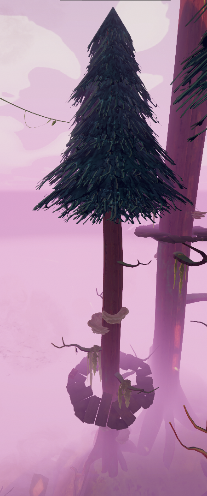](https://peak.wiki.gg/wiki/File%3ARoots_redwood_tree.png)

**Redwood Trees** with thick trunks and conical crowns appear in the Roots. Small natural shelf fungi can be found scattered upon their trunks. They often feature wooden platforms you can stand on, and can have  [Bounce Fungi](Bounce%20Fungus.md)  [Cloud Fungi](Cloud%20Fungus.md), and  [Shelf Fungi](Shelf%20Fungus.md) to pick up. The trees' canopies are standable locations, which can be useful for traversal.

### Redwood Stumps

---

- [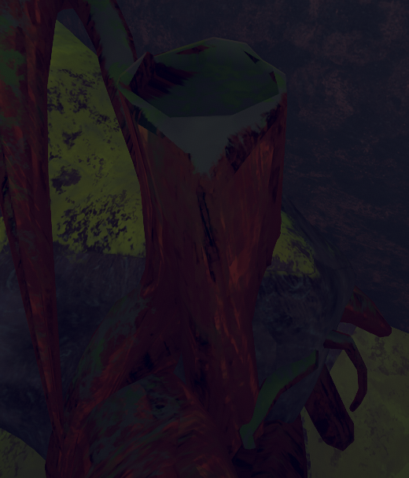](https://peak.wiki.gg/wiki/File%3ARoots_stump.png)
- [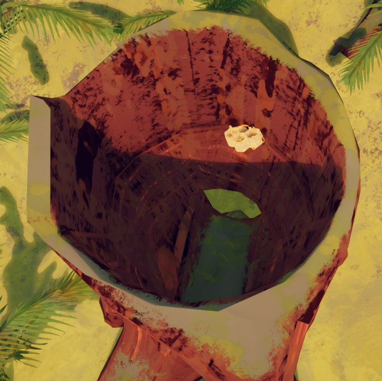](https://peak.wiki.gg/wiki/File%3AHollow_trunk_honeycomb.jpg)

**Redwood Stumps** appear all around the Roots. Some of these stumps are hollow, with an entrance at the bottom and top. These hollow stumps may contain a  [Honeycomb](Honeycomb.md).

### Vines

---

[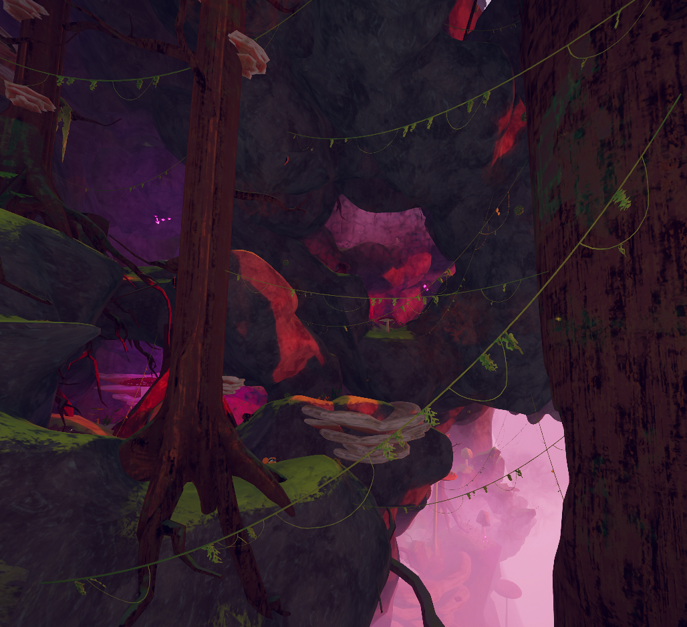](https://peak.wiki.gg/wiki/File%3ARoots_vines.png)

**Vines** can be found throughout the Roots that connect various points on the mountain. They can be grappled onto similar to [rope](Rope.md), taking very little [stamina](https://peak.wiki.gg/wiki/Stamina) while doing so. Moving along the vines takes some stamina, but much less than climbing. Hanging on a vine without moving drains stamina at a very slow rate.

[Shroomberries](https://peak.wiki.gg/wiki/Shroomberries) can sometimes be found growing on vines.

### Giant Shelf Fungi

---

[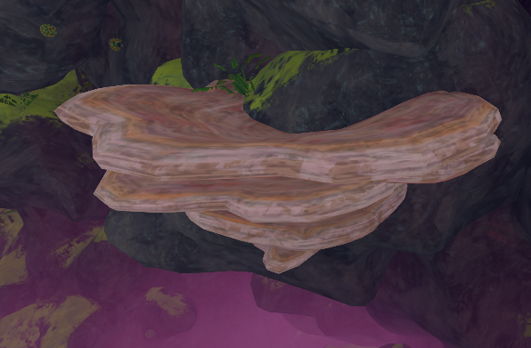](https://peak.wiki.gg/wiki/File%3ARoots_shelf_fungus.png)

**Giant Shelf Fungi** can be found growing on the trees and on the climb in the Roots. They act as platforms to help scouts maneuver the biome.

### Bouncy Mushrooms

---

[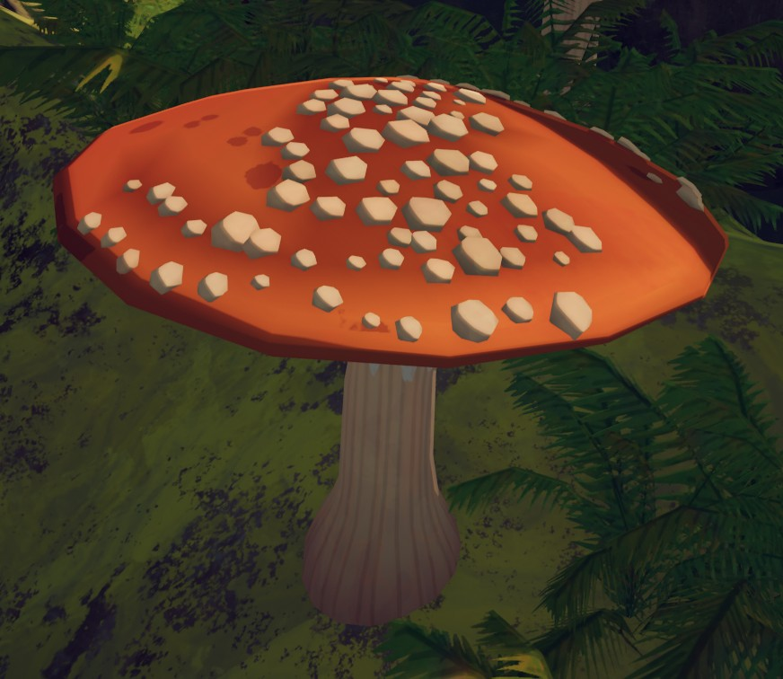](https://peak.wiki.gg/wiki/File%3ARoots_red_shroom.jpg)

**Bouncy Mushrooms** can be found all throughout the Roots. Landing on the top of one will bounce a scout and restore a small amount of stamina, identical to a  [Bounce Fungus](Bounce%20Fungus.md).

### Water

---

[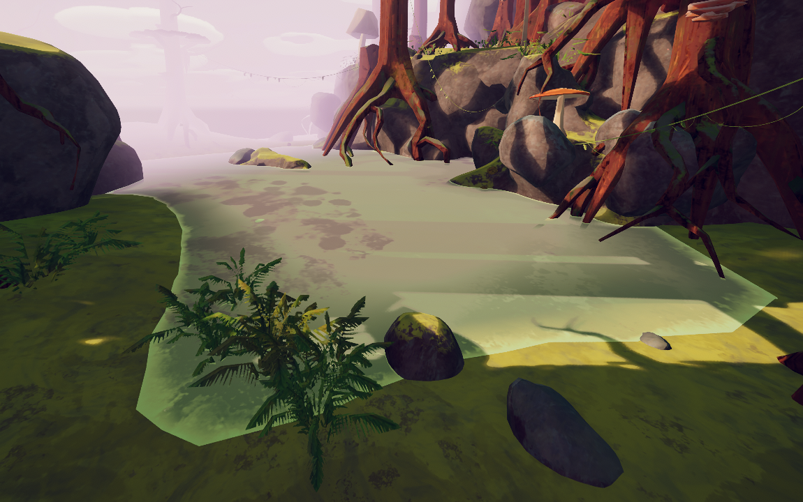](https://peak.wiki.gg/wiki/File%3ARoots_water.png)

**Water** can be found covering the lowest parts of the Roots. Scouts' movement speed is reduced while wading through the water.

### Waterfalls

---

[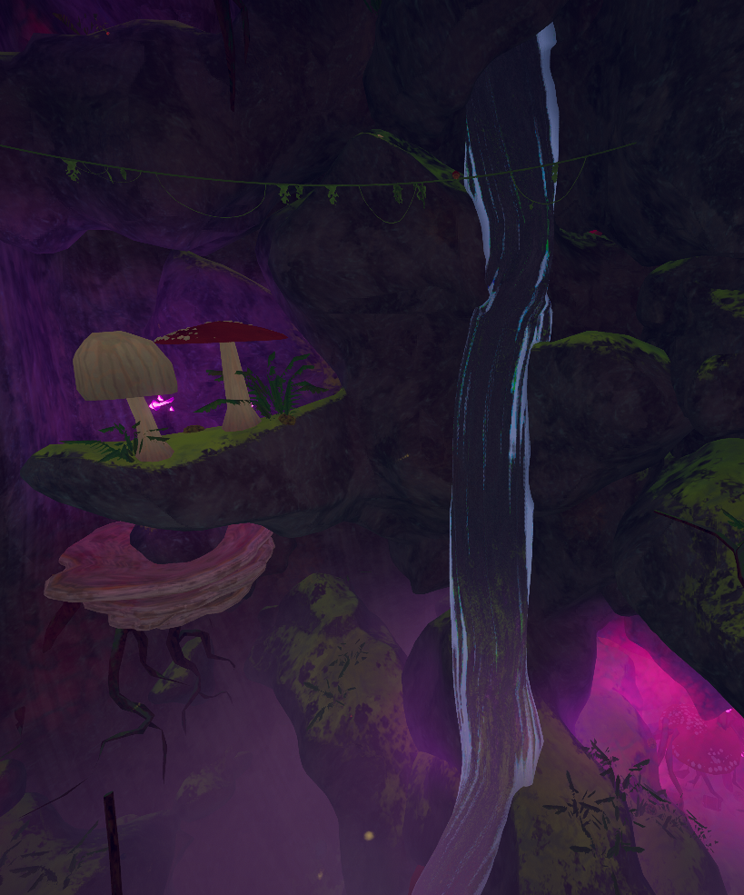](https://peak.wiki.gg/wiki/File%3ARoots_waterfall.png)

**Waterfalls** can also spawn in the Roots, similar to those seen in the [Tropics](Tropics.md). The water may make it harder to see the terrain behind it, but otherwise waterfalls are completely benign. Touching the water will knock a [Scout](Scout.md) over for a couple of seconds without doing any damage.

## Hazards

| Hazard | Image | Description |
| --- | --- | --- |
| **Wind** | [Roots wind.jpg](https://peak.wiki.gg/wiki/File%3ARoots_wind.jpg) | **Wind** is the main environmental hazard in the Roots, unique to the biome, and the counterpart of the Rain in the [Tropics](Tropics.md). Periodically, it will begin to gust, pushing all physics objects to either the left or right side of the biome, somewhat similar to how [Tornadoes](Tornado.md) work in the [Mesa](Mesa.md). Additionally, while a player is affected by wind, their stamina consumption when gripping onto a wall without moving becomes similar to regular climbing. Stamina consumption while climbing is also increased. Increased stamina consumption applied only for the usual climbing and not for using vines, ropes or chains [[confirmation needed](https://peak.wiki.gg/wiki/Category%3APages_needing_confirmation)] |
| **[Bridges](Bridge.md)** | [Roots Bridge.png](https://peak.wiki.gg/wiki/File%3ARoots_Bridge.png) | **Bridges** connect some tree platforms together. Each bridge has a weight limit from 1-5. If a number of [Scouts](Scout.md) equal to or greater than the weight limit stand on a bridge, it will break after a few seconds. |
| **Mushroom Spore Clouds** | [Roots spores outside.jpg](https://peak.wiki.gg/wiki/File%3ARoots_spores_outside.jpg)[Roots spore emitter.jpg](https://peak.wiki.gg/wiki/File%3ARoots_spore_emitter.jpg) | **Mushroom Spore Clouds** are areas of glowing pink fog that inflict [Spores](Stamina%20bar.md#Spores) [Spores](Stamina%20bar.md#Spores) as players remain within them. When the wind is blowing, the clouds will temporarily dissipate. Found within these areas are glowing pink mushrooms. However, these mushrooms are non-interactive, and deal no additional [Spores](Stamina%20bar.md#Spores) [Spores](Stamina%20bar.md#Spores) damage to the players. The cloud is produced by a **Spore Emitter**, which can be found at its center. |
| **Evil Bouncy Mushrooms** | [Evil Bounce Fungus.png](https://peak.wiki.gg/wiki/File%3AEvil_Bounce_Fungus.png) | **Evil Bouncy Mushrooms** are similar to **Bouncy Mushrooms**, with a more purple, cracked appearance. Landing on one will bounce you as usual, and will additionally apply [Spores](Stamina%20bar.md#Spores) **5** [Spores](Stamina%20bar.md#Spores) each bounce. They only generate in the Clearcut variant. |
| **Spore Bombs** | [Roots bombshroom.jpg](https://peak.wiki.gg/wiki/File%3ARoots_bombshroom.jpg) | **Spore Bombs** can usually be found on the ground, especially near the edges. They explode upon contact, releasing a purple gas cloud that inflicts [Spores](Stamina%20bar.md#Spores) [Spores](Stamina%20bar.md#Spores) on any [Scouts](Scout.md) caught in it. The cloud dissipates after a certain amount of time or when the wind blows. |
| **Explosive Spore Bombs** | [Spore Bomb - explosive - closeup.png](https://peak.wiki.gg/wiki/File%3ASpore_Bomb_-_explosive_-_closeup.png) | **Explosive Spore Bombs** can be found on the ground or on the cliffs. They explode upon contact, sending [Scouts](Scout.md) flying in the direction they came in. They are primarily yellow with splotches of green all over them. They can also be found in the [Tropics](Tropics.md). |
| **[Beetles](Beetle.md)** | [Beetle.jpg](https://peak.wiki.gg/wiki/File%3ABeetle.jpg) | **Beetles** are a creature players can encounter in the climb of the Roots. They chase [Scouts](Scout.md) and attempt to throw them, but do not deal damage themselves. |
| **[Spiders](Spider.md)** | [Spider closeup.jpg](https://peak.wiki.gg/wiki/File%3ASpider_closeup.jpg) | **Spiders** are an enemy found hanging from the trees and cliffs of the Roots. They grab careless [Scouts](Scout.md), dealing [Web](Stamina%20bar.md#Web) **25** [Web](Stamina%20bar.md#Web) and a significant amount of [Poison](Stamina%20bar.md#Poison) [Poison](Stamina%20bar.md#Poison). Throwing objects at spiders, on hit, will stun them for a period of time, allowing Scouts to pass by beneath completely unharmed. |
| **[Zombies](Zombie.md)** | [Zombie run.jpg](https://peak.wiki.gg/wiki/File%3AZombie_run.jpg) | **Zombies** are enemies found throughout the Roots on [Peak ascent](Ascents.md#Peak) or higher. They chase and climb after [Scouts](Scout.md), biting them and inflicting [Spores](Stamina%20bar.md#Spores) [Spores](Stamina%20bar.md#Spores) and [Injury](Stamina%20bar.md#Injury) [Injury](Stamina%20bar.md#Injury) until they die. Much like the [Scoutmaster](https://peak.wiki.gg/wiki/Scoutmaster), activating the [Campfire](Campfire.md) will cause them to die. |

## Food

The following natural [foods](Food.md) can be found in the Roots:

-  [Red Shroomberry](Red%20Shroomberry.md)
-  [Yellow Shroomberry](Yellow%20Shroomberry.md)
-  [Green Shroomberry](Green%20Shroomberry.md)
-  [Blue Shroomberry](Blue%20Shroomberry.md)
-  [Purple Shroomberry](Purple%20Shroomberry.md)
-  [Medicinal Root](Medicinal%20Root.md)
-  [Mandrake](Mandrake.md)
-  [Button Shroom](Button%20Shroom.md)
-  [Button Shroom (Poisonous)](https://peak.wiki.gg/wiki/Button_Shroom_%28Poisonous%29)
-  [Bugle Shroom](Bugle%20Shroom.md)
-  [Bugle Shroom (Poisonous)](https://peak.wiki.gg/wiki/Bugle_Shroom_%28Poisonous%29)
-  [Cluster Shroom](Cluster%20Shroom.md)
-  [Cluster Shroom (Poisonous)](https://peak.wiki.gg/wiki/Cluster_Shroom_%28Poisonous%29)
-  [Chubby Shroom](Chubby%20Shroom.md)
-  [Honeycomb](Honeycomb.md)

## Natural Items

The following natural items can spawn in the Roots.

-  [Bounce Fungus](Bounce%20Fungus.md)
-  [Cloud Fungus](Cloud%20Fungus.md)
-  [Shelf Fungus](Shelf%20Fungus.md)
-  [Remedy Fungus](Remedy%20Fungus.md)
-  [Warp Fungus](Warp%20Fungus.md)
-  [Magic Bean](Magic%20Bean.md)

## Variants

Roots Variants

| Variant | Weight | Image | Description |
| --- | --- | --- | --- |
| **Default** | 100 | [Roots Default.JPG](https://peak.wiki.gg/wiki/File%3ARoots_Default.JPG) | The default generation of Roots |
| **Cave Mania** | 10 | [Roots Cave Mania.jpg](https://peak.wiki.gg/wiki/File%3ARoots_Cave_Mania.jpg) | Rock formations generate in the center of the biome. Generation generally creates more caves. |
| **Clearcut** | 25 | [Roots Clearcut.jpg](https://peak.wiki.gg/wiki/File%3ARoots_Clearcut.jpg) | No redwood trees generate on the approach, being replaced by a significant amount of **Bouncy Mushrooms**. **Evil Bouncy Mushrooms** also generate. |
| **Deep Water** | 25 | [Roots Deep Water.jpg](https://peak.wiki.gg/wiki/File%3ARoots_Deep_Water.jpg) | The water at the bottom of the biome is deeper and has a red hue. Less trees generate in the center of the biome. More **Waterfalls** generate. The water will constantly inflict [Spores](Stamina%20bar.md#Spores) [Spores](Stamina%20bar.md#Spores) to any [Scouts](https://peak.wiki.gg/wiki/Scouts) in contact with it. |
| **Deep Woods** | 25 | [Roots Deep Woods.jpg](https://peak.wiki.gg/wiki/File%3ARoots_Deep_Woods.jpg) | Significantly more trees generate, creating a very dense forest. |

Removed Roots Variants

| Variant | Weight | Image | Description |
| --- | --- | --- | --- |
| **Bomb Beetle** | 25 | [Roots Bomb Beetle.jpg](https://peak.wiki.gg/wiki/File%3ARoots_Bomb_Beetle.jpg) | Significantly more **Beetles** and **Explosive Bombshrooms** generate. Removed in [1.64.a](1.64.a.md). |

## Tips & tricks

- The trees are often not connected well, so traversing along the floor is advised.
- [Zombies](Zombie.md) only activate while you are in their line of sight. If you see one, run away before it sees you.
- Climbing giant redwoods near the cliff face can get you very high before getting onto the face.
- Similar to [Blizzards](Blizzard.md) in the [Alpine](Alpine.md), wind is less dangerous when rock formations or trees are used as cover. Running against the wind or grabbing onto nearby surfaces can help prevent your [Scout](Scout.md) from getting blown off from a high place or into a hazard.
- It is wise to wait until wind has just passed before attempting lengthy or risky maneuvers (i.e. crossing bridges between redwood tree platforms).
- Due to the high number of entity hazards in the biome, maintaining awareness is important. Audio cues can alert players to the presence of nearby [Spiders](Spider.md) or [Beetles](Beetle.md), as well as signalling when a player is being targeted by an active [zombie](Zombie.md).
- It is often impossible to find a route completely unobstructed by spore clouds. As a result,  [Spores](Stamina%20bar.md#Spores) can accumulate quickly and in large amounts while in the Roots, and the [status effect](Stamina%20bar.md) is among the slowest-decaying in the game.  [Fortified Milk](Fortified%20Milk.md) is helpful to mitigate the accumulation of  [Spores](Stamina%20bar.md#Spores) when moving through particularly difficult areas. Most healing items also remove  [Spores](Stamina%20bar.md#Spores), with the exception of  [Bandages](Bandages.md).

## Trivia

- When you are in this biome, your Steam Now Playing will say "Traversing the Roots".

## Gallery

- [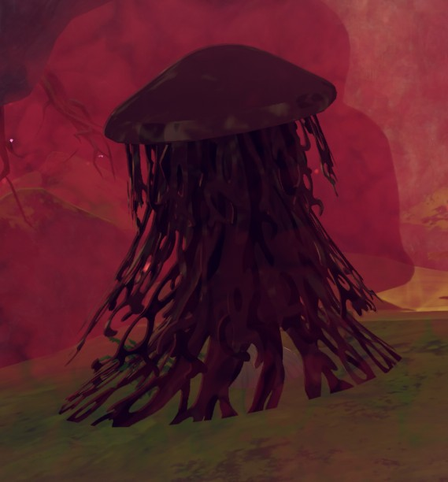](https://peak.wiki.gg/wiki/File%3ARoots_spore_emitter.jpg)
  A [spore emitter](Spore%20emitter.md) found inside a spore cloud.
- [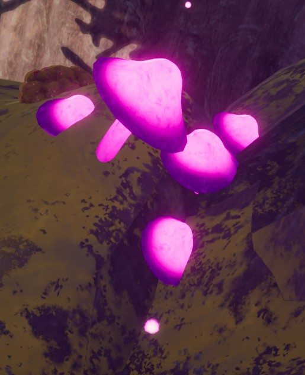](https://peak.wiki.gg/wiki/File%3ARoots_glowing_shrooms.jpg)
  Glowing pink mushrooms can be seen growing throughout the biome.
- [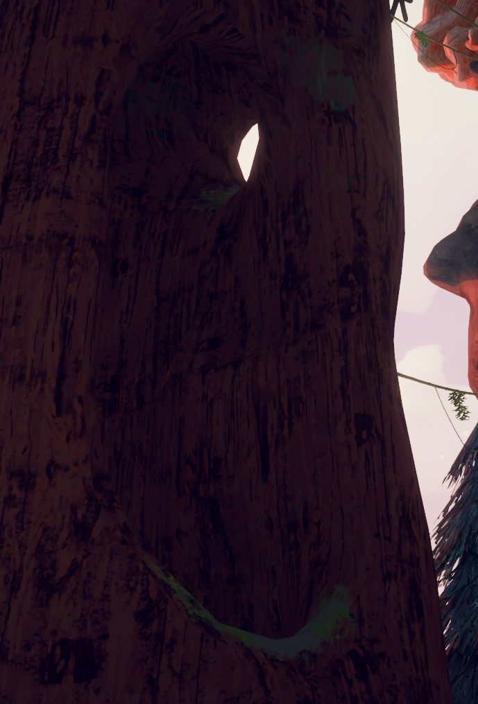](https://peak.wiki.gg/wiki/File%3ARoots_tree_cavity.jpg)
  A cavity in a **redwood** tree.
- [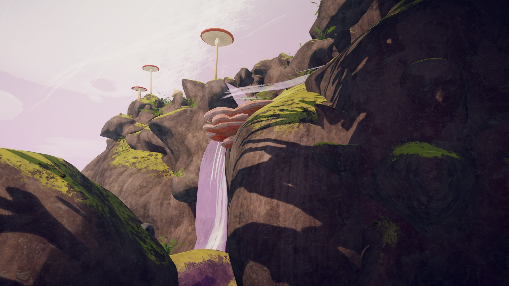](https://peak.wiki.gg/wiki/File%3ARoots_top.jpg)
  The top of the Roots.
- 
  The [Campfire](Campfire.md) at the very top of the biome, surrounded by large mushrooms.
- [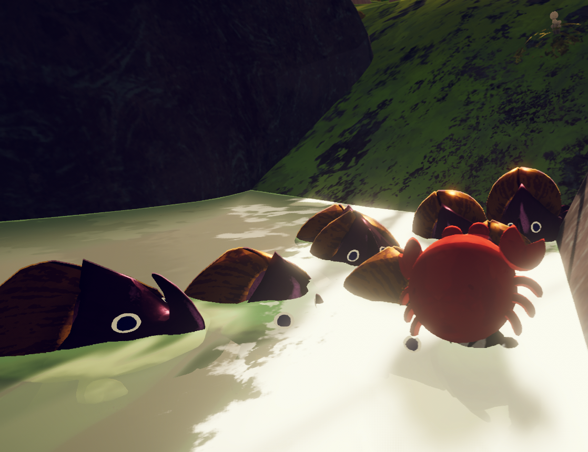](https://peak.wiki.gg/wiki/File%3ATooManyBeetles.png)
  A large group of [Beetles](Beetle.md) pushing around the same scout in the Bomb Beetle variant.

## Patch history

 **[1.40.a](1.40.a.md) (2025-11-05):** Introduced.
 **[1.44.a](1.44.a.md) (2025-11-13):**

- Fixed an issue where [scouts](https://peak.wiki.gg/wiki/Scouts) in a [ragdoll](https://peak.wiki.gg/wiki/Ragdoll) state would bounce off [mushrooms](#Bouncy_Mushrooms) way too high.
- Fixed an issue where a spawn point could spawn a [Zombie](Zombie.md) more than once if an old one died, resulting in some comedic infinite spawns if the spawned [Zombie](Zombie.md) [ragdolled](Scout.md#Ragdoll_State) off a cliff.

 **[1.45.a](1.45.a.md) (2025-11-17):**

- The Roots now has [biome variants](#Variants). You know how sometimes the [Tropics](Tropics.md) is freaky and full of more [bombs](Tropics.md#Hazards) than usual? We did a pass like that to the Roots.
- Thickened [giant mushroom](#Bouncy_Mushrooms) colliders to make it less likely to get stuck in them when falling from a great height.

 **[1.64.a](1.64.a.md) (2026-06-24):** Removed BombBeetles and TornadoHell from the list of potential variants for Roots and [Mesa](Mesa.md).
