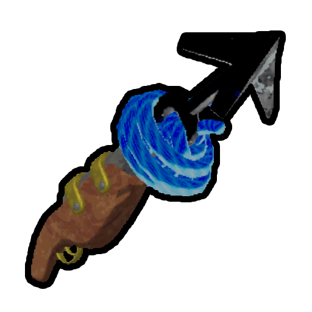
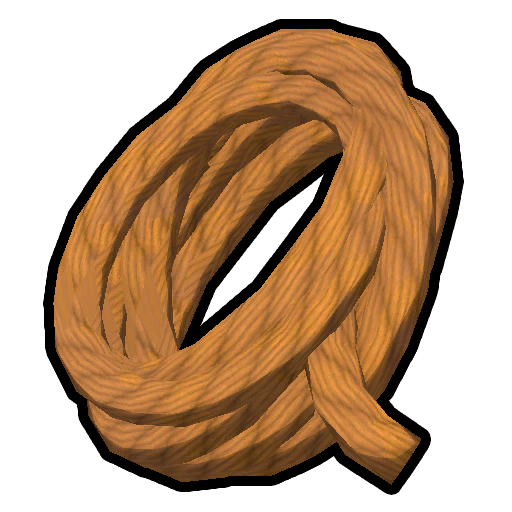

# Rope Cannon

Rope Cannon

[Item type](Items.md)- [Deployable](https://peak.wiki.gg/wiki/Deployable)
Rarity
[Legendary](https://peak.wiki.gg/wiki/Legendary)
Source- [Regular Luggage](https://peak.wiki.gg/wiki/Regular_Luggage)
- [Big Luggage](https://peak.wiki.gg/wiki/Big_Luggage)
- [Explorer's Luggage](https://peak.wiki.gg/wiki/Explorer%27s_Luggage)
Weight
 **2.5**

The **Rope Cannon** is a [deployable](https://peak.wiki.gg/wiki/Deployable) item in *[PEAK](Peak%20%28game%29.md)*. Using a rope cannon allows the player to attach a **7.5 meter** rope to a surface up to **48 meters** away, embedding one end of it into the surface via a hook. It is the normal version of the  [Anti-Rope Cannon](Anti-Rope%20Cannon.md).

[Cooking](Cooking.md) a Rope Cannon immediately incinerates it, making it unusable.

## Physics

The physics of the ropes deployed by the Rope Cannon are mostly identical to the  [Rope Spool](Rope%20Spool.md), with the following caveats:

When a rope is deployed, it gradually extends from the exposed end of its associated hook. However, the initial direction the rope begins extending is indeterminate. Depending on the initial placement of the hook, this can cause the rope to unspool itself in an inconvenient place that renders it useless.

To avoid bad unspools, it is recommended to shoot hooks at vertically-oriented surfaces, slightly down from the top of the surface and away from any flatter surrounding surfaces. Also avoid situations where there are sloped surfaces of any kind beneath the rope, as it is unlikely to unspool down the full distance of these slopes.

## See also

-  [Anti-Rope Cannon](Anti-Rope%20Cannon.md)

## Patch history

 **[1.0](1.0.md) (2025-06-16):** Introduced.
 **[1.1.a](1.1.a.md) (2025-06-17):** Prevented the Rope Shooter from firing and being wasted on a target that's out of range, like the [Chain Shooter](Chain%20Launcher.md) does
 **[1.7](1.7.md) (2025-07-10):** Rope Shooters and [Anti-Rope Shooters](Anti-Rope%20Cannon.md) shoot 50% more rope!
 **[1.60.a](1.60.a.md) (2026-03-30):** Fixed a long-standing issue where interacting with a rope shooter's rope immediately after it was fired could cause a division by zero, causing chaotic behaviour, including locking the player's controls or sending them to the void.
