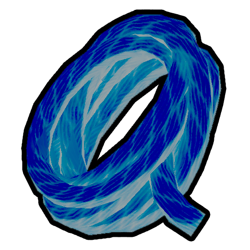

# Rope Spool

Rope Spool

[Item type](Items.md)- [Deployable](https://peak.wiki.gg/wiki/Deployable)
Rarity
[Rare](https://peak.wiki.gg/wiki/Rare)
Source- [Regular Luggage](https://peak.wiki.gg/wiki/Regular_Luggage)
- [Big Luggage](https://peak.wiki.gg/wiki/Big_Luggage)
- [Explorer's Luggage](https://peak.wiki.gg/wiki/Explorer%27s_Luggage)
Weight
 **2.5**

The **Rope Spool** is an [deployable](https://peak.wiki.gg/wiki/Deployable) item in *[PEAK](Peak%20%28game%29.md)*. It provides a total of **12.5 meters** of climbable rope, placeable in lengths from **0.75m** to **10m** long. The rope will then allow [Scouts](https://peak.wiki.gg/wiki/Scouts) to climb it while using less [stamina](https://peak.wiki.gg/wiki/Stamina) than normal. The  [Anti-Rope Spool](Anti-Rope%20Spool.md) is a gravity-defying variant of the Rope Spool.

[Cooking](Cooking.md) a Rope Spool immediately incinerates it, making it unusable.

## Usage

When placing rope, first have the spool in hand and use the scroll wheel to unravel the rope to the desired length. To secure the rope, hold  for 2 seconds while aiming at the surface where the knot should be tied. A preview of the rope's anchor will shown in blue when the surface is valid, or red when the attempting to tie to an invalid surface.

Rope can be grabbed by using the interact key () on it, and climbing is done using forward and backward movement. To let go of the rope, simply jump ().

## Physics

Ropes are physically simulated in *[PEAK](Peak%20%28game%29.md)* with regards to the environment only. They are not affected by the weight or momentum of any Scouts climbing them.

For more information on rope physics, refer to how they behave when deployed by the  [Rope Cannon](Rope%20Cannon.md).

## See also

-  [Anti-Rope Spool](Anti-Rope%20Spool.md)

## Patch history

 **[1.0](1.0.md) (2025-06-16):** Introduced.
 **[1.6.a](1.6.a.md) (2025-07-04):** Fixed an issue where the rope anchor preview would spawn on walls at weird angles
 **[1.7](1.7.md) (2025-07-10):** Rope Spool now has a weight of 1 instead of 0. Anti-Rope Spool and Anti-Rope Shooter now have a weight of -1
 **[1.8](1.8.md) (2025-07-21):** Fixed an issue where your controls could get soft-locked if a held Rope Spool was incinerated by lava while you tried to tie it off.
