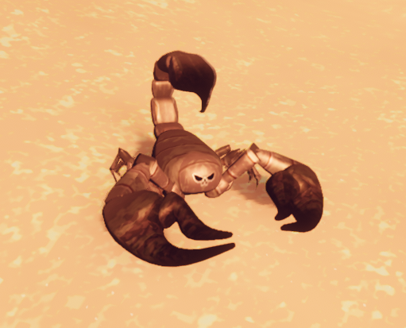
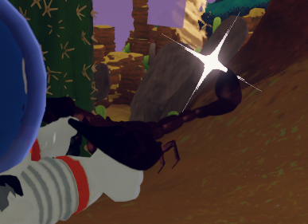

# Scorpion

Scorpion
Normal
Bug Phobia Mode

[Item type](Items.md)- [Enemy](https://peak.wiki.gg/wiki/Enemy)
- [Food](Food.md)
Biome- [Mesa](Mesa.md)
Weight
 **2.5**
Cooked Bonuses
Hunger
-20 (-20 total)
Bonus Stamina
10 (10 total)

The **Scorpion** is a creature found in the [Mesa](Mesa.md), specifically in the canyons and the cliffs of the biome. It wanders around aimlessly until it spots a [Scout](Scout.md), at which point it will attempt to sting them.

## Mechanics

When picked up or approached, it will ready its stinger, stabbing the [Scout](Scout.md) if in range. The Scorpion's sting will immediately deal  **2.5** [Poison](Stamina%20bar.md#Poison), and will apply  **50 to 100** [Poison](Stamina%20bar.md#Poison) over the next **15 seconds**. The sting also applies a small amount of knockback to the player in the direction the Scorpion is looking.

The poison over time is equal to the amount of available stamina the player has when stung, with a minimum value of **50**. As a result, a player will always end with **at least 102.5** total affliction after the poison finishes (assuming nothing else changed the player's affliction).

A scout can pick up a Scorpion, but cannot put it into an inventory slot or backpack. If the scout is quick, they may can throw it, cook it, or use it as fuel for a [Jetpack](Jetpack.md) before being stung.

After being [cooked](Cooking.md), a Scorpion can be eaten. It can no longer move or attack, but it still cannot be stored in the inventory or a backpack.

## Gallery

- 
  Close-up view of a Scorpion.
- 
  A Scorpion about to attack a Scout.
- 
  A Scorpion with [Bug Phobia Mode](Bug%20Phobia%20Mode.md) enabled.

## Patch history

 **[1.20.a](1.20.a.md) (2025-08-11):** Added.
 **[1.23.a](1.23.a.md) (2025-08-13):** Rebalanced the scorpion.
 **[1.50.a](1.50.a.md) (2025-12-16):** Beetles and scorpions will no longer attempt to DDoS non-host players by sending 1 million data over the network.
 **[1.51.a](1.51.a.md) (2025-12-19):** Scorpions immediately try to sting the player when picked up. (bug mentioned in [1.52.a](1.52.a.md))
 **[1.53.a](1.53.a.md) (2026-01-27):** Scorpions will stop stinging you immediately when picked up. You once again have enough time to throw them before they sting

[Food](Food.md)
Natural food
Berries
Berrynanas-  [Yellow Berrynana](Yellow%20Berrynana.md)
-  [Pink Berrynana](Pink%20Berrynana.md)
-  [Blue Berrynana](Blue%20Berrynana.md)
-  [Brown Berrynana](Brown%20Berrynana.md)
Clusterberries-  [Red Clusterberry](Red%20Clusterberry.md)
-  [Yellow Clusterberry](Yellow%20Clusterberry.md)
-  [Black Clusterberry](Black%20Clusterberry.md)
Crispberries-  [Green Crispberry](Green%20Crispberry.md)
-  [Yellow Crispberry](Yellow%20Crispberry.md)
-  [Red Crispberry](Red%20Crispberry.md)
Kingberries-  [Green Kingberry](Green%20Kingberry.md)
-  [Yellow Kingberry](Yellow%20Kingberry.md)
-  [Purple Kingberry](Purple%20Kingberry.md)
Prickleberries-  [Red Prickleberry](Red%20Prickleberry.md)
-  [Gold Prickleberry](Gold%20Prickleberry.md)
Shroomberries-  [Red Shroomberry](Red%20Shroomberry.md)
-  [Yellow Shroomberry](Yellow%20Shroomberry.md)
-  [Green Shroomberry](Green%20Shroomberry.md)
-  [Blue Shroomberry](Blue%20Shroomberry.md)
-  [Purple Shroomberry](Purple%20Shroomberry.md)
Winterberries-  [Orange Winterberry](Orange%20Winterberry.md)
-  [Yellow Winterberry](Yellow%20Winterberry.md)
Other-  [Napberry](Napberry.md)
-  [Scorchberry](Scorchberry.md)
Campfire food-  [Marshmallow](Marshmallow.md)
-  [Hot Dog](Hot%20Dog.md)
Mushrooms-  [Bugle Shroom](Bugle%20Shroom.md)
-  [Button Shroom](Button%20Shroom.md)
-  [Chubby Shroom](Chubby%20Shroom.md)
-  [Cluster Shroom](Cluster%20Shroom.md)
Mystical food-  [Cure-All](Cure-All.md)
-  [Pandora's Lunchbox](Pandora%27s%20Lunchbox.md)
Other-  [Cooked Bird](Cooked%20Bird.md)
-  [Egg](Egg.md)
-  [Frog Legs](Frog%20Legs.md)
-  [Honeycomb](Honeycomb.md)
-  [Half-Coconut](Half-Coconut.md)
-  [Medicinal Root](Medicinal%20Root.md)
-  [Mandrake](Mandrake.md)
-  Scorpion
-  [Tick](Tick.md)
-  [The Early Worm](The%20Early%20Worm.md)
Packaged food
All packaged foods-  [Airline Food](Airline%20Food.md)
-  [Big Lollipop](Big%20Lollipop.md)
-  [Energy Drink](Energy%20Drink.md)
-  [Fortified Milk](Fortified%20Milk.md)
-  [Granola Bar](Granola%20Bar.md)
-  [Scout Cookies](Scout%20Cookies.md)
-  [Sports Drink](Sports%20Drink.md)
-  [Trail Mix](Trail%20Mix.md)
