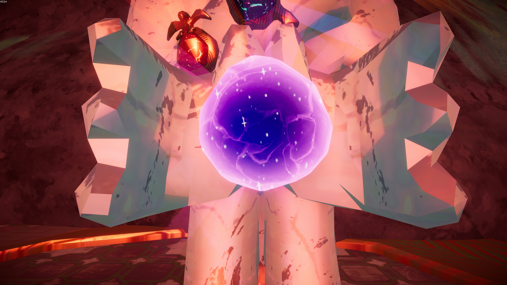

# Scout's Honor

Spoilers ahead!

This page contains **spoilers** for *[PEAK](Peak%20%28game%29.md)*. View at your own discretion.

Scout's Honor

[Item type](Items.md)- [Mystical item](https://peak.wiki.gg/wiki/Mystical_item)
Biome- [Peak](Peak%20%28biome%29.md)
Location- [Stone Scout](Peak%20%28biome%29.md#Stone_Scout)
Weight
 **2.5**

The **Scout's Honor** is an [mystical item](Equipment.md#Mystical_Items) in *[PEAK](Peak%20%28game%29.md)* that is obtained by transforming the  [Strange Gem](Strange%20Gem.md) after bestowing the four [amulets](Amulets.md) upon the [Stone Scout](https://peak.wiki.gg/wiki/Stone_Scout) found at the [Peak](Peak%20%28biome%29.md). Scouts can hold  **Left Mouse** to commune with it, distorting the screen heavily before transporting all players to [Nadir](Nadir.md).

When [cooked](https://peak.wiki.gg/wiki/Cooked), the Scout's Honor explodes into a **40 meter** Anti-Sphere that launches all scouts within away from the center before quickly vanishing. Additionally, the [Scoutmaster](https://peak.wiki.gg/wiki/Scoutmaster) will be spawned targeting the player who cooked it, chasing them for up to **1 hour**.

- 
  Scout's Honor, held by the [Stone Scout](https://peak.wiki.gg/wiki/Stone_Scout)

## Patch history

 **[2.0.a](2.0.a.md) (2026-08-11):** Introduced. **(Undocumented)**
