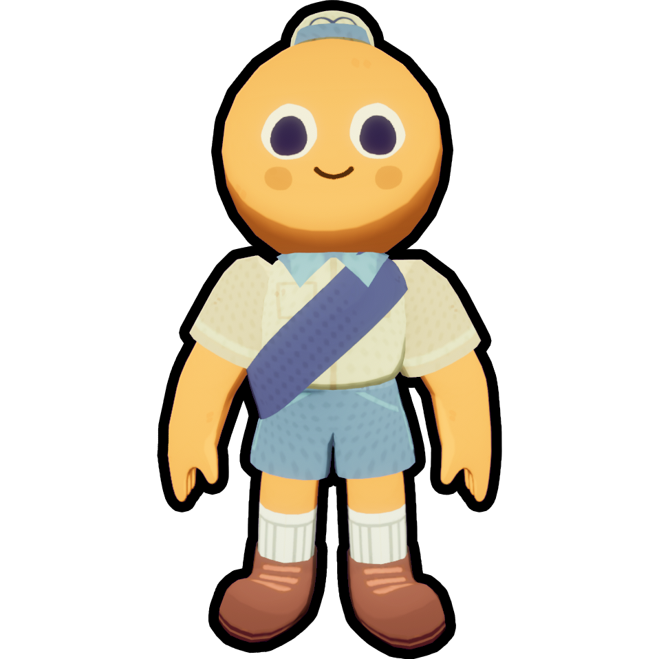
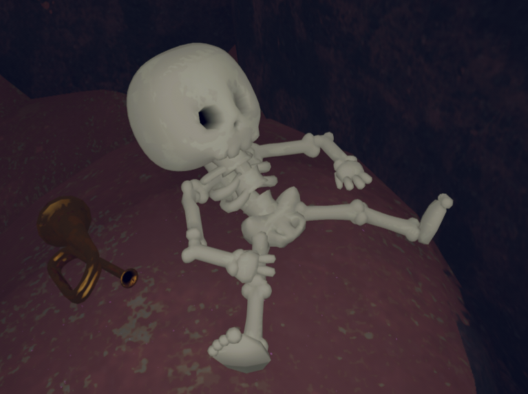
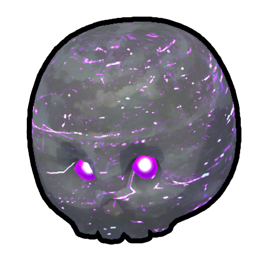
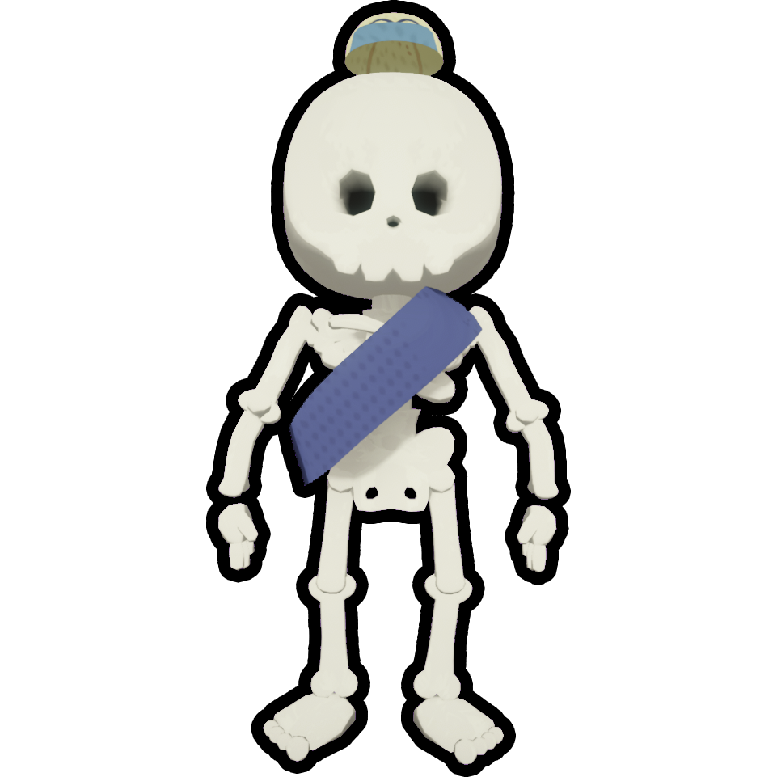
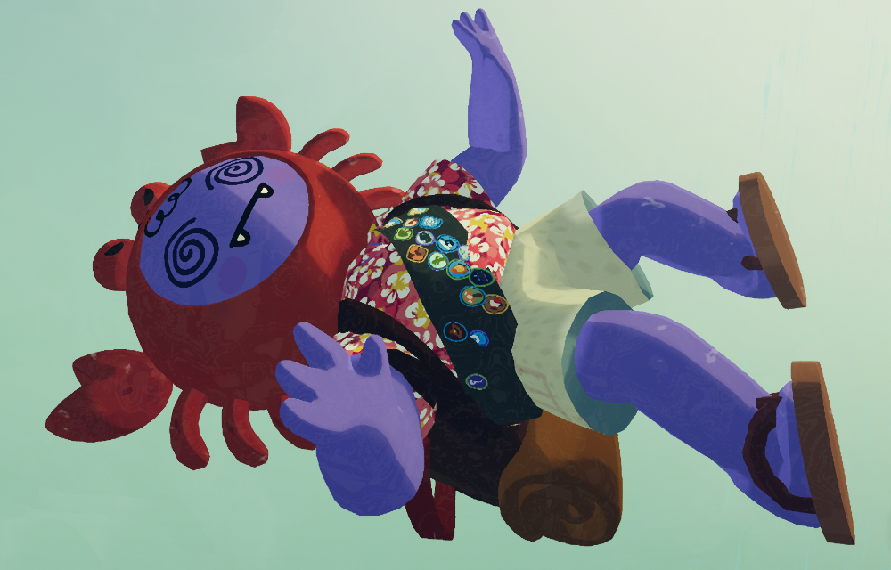
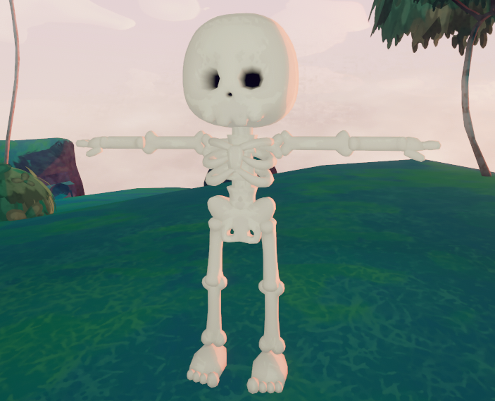
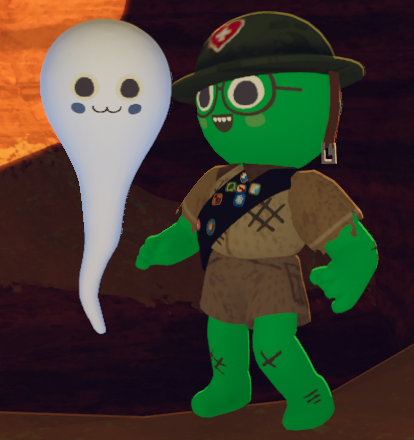
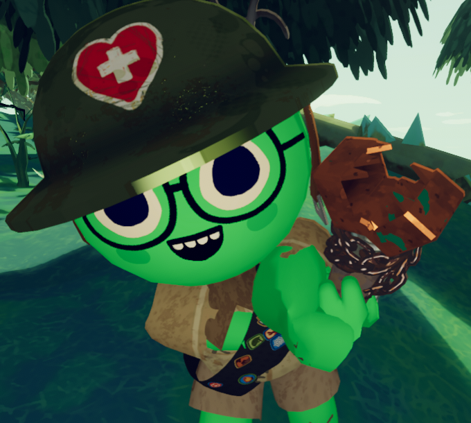

# Scout

Scout

**Scouts** are the player characters in *[PEAK](Peak%20%28game%29.md)*. They are colorful humanoids of ambiguous gender and age with big round heads.

In multiplayer, the player's username is shown above their Scout's head.

## Appearance

The **appearance** of a Scout can be [customized](Cosmetics.md) in the [Airport](Airport.md) by using the  [Passport](Passport.md), which allows the player to select their Scout's [skin color](Cosmetics.md#Colors), [head accessory](Cosmetics.md#Accessories), [eyes](Cosmetics.md#Eyes), [mouth](Cosmetics.md#Mouths), [headwear](Cosmetics.md#Hats), [outfit](Cosmetics.md#Clothing), and [sash](Cosmetics.md#Sashes).

**Various Scout Appearances**

|  |
| --- |
| - [Scout variant 1.png](https://peak.wiki.gg/wiki/File%3AScout_variant_1.png) - [Scout variant 2.png](https://peak.wiki.gg/wiki/File%3AScout_variant_2.png) - [Scout variant 3.png](https://peak.wiki.gg/wiki/File%3AScout_variant_3.png) - [Scout variant 4.png](https://peak.wiki.gg/wiki/File%3AScout_variant_4.png) |

## Ragdoll state

A Scout can be put into a **ragdoll** state where the player can't control their movement and the Scout's body will instead move by unpredictable [ragdoll physics](https://en.wikipedia.org/wiki/ragdoll_physics). The following are all the ways a scout can enter Ragdoll State:

- Performing the "Play dead" or the "Backflip" [emote](https://peak.wiki.gg/wiki/Emote) and failing it.
- Falling from a [great height](https://peak.wiki.gg/wiki/Fall_damage).
- Being hit by an [item](https://peak.wiki.gg/wiki/Item) in the [Ragdoll-inducing projectile](https://peak.wiki.gg/wiki/Category%3ARagdoll-Inducing_Projectile) category or by a [swinging mace](https://peak.wiki.gg/wiki/Swinging_mace).
- Being close to an explosion.
- Stepping on a [jellyfish](https://peak.wiki.gg/wiki/Jellyfish) or a [Berrynana](Berrynana%20%28disambiguation%29.md) Peel.
- Being dragged by the current of a [waterfall](https://peak.wiki.gg/wiki/Waterfall) or by a  [Rescue Claw](Rescue%20Claw.md).
- Suffering a bad effect from a [Shroomberry](Shroomberry.md).
- Being attacked by a [Beetle](Beetle.md), [Zombie](Zombie.md), [Antlion](Antlion.md), [Frog](Frog.md), [Big Ghost](Big%20Ghost.md), or the [Scoutmaster](https://peak.wiki.gg/wiki/Scoutmaster).
- Being launched by a [Geyser](Geyser.md) or a  [Scout Cannon](Scout%20Cannon.md).

Jumping repeatedly while in this state will prolong the ragdoll state's duration.

## Unconscious state & Death

**Unconscious Eyes**

A Scout will become **unconscious** when the [Stamina Bar](https://peak.wiki.gg/wiki/Stamina_Bar) has been filled with [Status Effects](https://peak.wiki.gg/wiki/Status_Effects); they will slowly lose control over their body and start falling into a ragdoll state and players won't be able to use [items](Items.md) or talk (although they can still [emote](https://peak.wiki.gg/wiki/Emote) to a degree). An unconscious Scout will also drop all items from their inventory and hands, though a  [Backpack](Backpack.md) will remain equipped with all their items inside if the player wasn't holding it in their hands.

### Death timer

---

Once a scout has become unconscious, a **death timer** begins. This timer will slowly tick down, but can be stopped if the Scout is carried in the **Backpack Slot** () (unless they are inflicted with  **50** [Spores](Stamina%20bar.md#Spores) or more), which unequips the carrier's  [Backpack](Backpack.md) if they were wearing one. The timer will speed up if the player is unlikely to recover from their  [Injury](Stamina%20bar.md#Injury), is in the [fog](Fog.md), or is **giving up** ().

An unconscious Scout (and their troop) must use the duration of the death timer to try to recover. The majority of [Status Effects](https://peak.wiki.gg/wiki/Status_Effects) decay over time, so there's no reason to give up. If the accumulated [Status Effects](https://peak.wiki.gg/wiki/Status_Effects) don't decay over time, the other Scouts need to help them recover with healing [items](Items.md), such as  [Bandages](Bandages.md),  [First Aid Kit](First%20Aid%20Kit.md) or  [Cure-All](Cure-All.md).

- 
  A player reviving another player with a  [First Aid Kit](First%20Aid%20Kit.md)
- 
  A skeleton of a dead Scout. A dropped  [Bugle](Bugle.md) can be seen nearby.

If the death timer expires and the [Stamina Bar](https://peak.wiki.gg/wiki/Stamina_Bar) is still full of [Status Effects](https://peak.wiki.gg/wiki/Status_Effects), the Scout dies and becomes a [Ghost](#Ghost), leaving a skeleton behind.

If the death timer expires and the Scout was afflicted with  **50** [Spores](Stamina%20bar.md#Spores) or more, the Scout dies and becomes a [Ghost](#Ghost), but their corpse will become a [Zombie](Zombie.md).

If the death timer expires but the Scout has an active  [Checkpoint Flag](Checkpoint%20Flag.md), they won't die and will instead respawn at the Checkpoint Flag's location.

See [Checkpoint Flag Mechanics](Checkpoint%20Flag.md#Mechanics) for details.

Communing with a  [Cursed Skull](Cursed%20Skull.md) immediately kills the user, causing them to become a [Ghost](#Ghost) and leave a skeleton behind.

### Resurrection

---

Dead Scouts can be resurrected by living Scouts using an [Ancient Statue](Ancient%20Statue.md) or a  [Scout Effigy](Scout%20Effigy.md).

 [The Book of Bones](The%20Book%20of%20Bones.md) can be used on a dead Scout's skeleton to resurrect them as a [Living Skeleton](#Living_Skeleton).

Any dead Scouts are instantly revived upon entering [Nadir](Nadir.md).

## Ghost

Ghost

Not to be confused with [Big Ghost](Big%20Ghost.md).

When a Scout [dies](#Unconscious_State_&_Death), they become a **Ghost**. Ghosts can spectate living Scouts and communicate with them using the in-game voice chat. They can rotate around the Scout they are watching by **Moving the Mouse** (). They can also move in and out by **Scrolling** () or by **Scrolling Forward** () and **Scrolling Backward** (). The Scout being watched can be changed pressing **Item Slot 1** () to go to the previous one and **Item Slot 2** () to go to the next one.

Living Scouts are able to see and hear all Ghosts. Ghosts switch between players visually, making it possible to discern the location of other living Scouts based on their movement. There is also a pronounced [Doppler effect](https://en.wikipedia.org/wiki/Doppler_effect) if they are talking while switching players.

## Living Skeleton

Living Skeleton

**Living Skeletons** are immune to  [Hunger](Stamina%20bar.md#Hunger),  [Poison](Stamina%20bar.md#Poison),  [Spores](Stamina%20bar.md#Spores),  [Cold](Stamina%20bar.md#Cold),  [Heat](Stamina%20bar.md#Heat),  [Drowsy](Stamina%20bar.md#Drowsy), and  [Thorns](Stamina%20bar.md#Thorns), but are very fragile and receive  **8x** [Injury](Stamina%20bar.md#Injury) from most sources, except in the following cases:

- Opening an [Ancient Luggage](https://peak.wiki.gg/wiki/Ancient_Luggage) still inflicts  **20** [Injury](Stamina%20bar.md#Injury).
- Being bitten by a [Zombie](Zombie.md) inflicts  **20** [Injury](Stamina%20bar.md#Injury).

Because of this, some [hazards](Hazards.md) are especially dangerous for Living Skeletons:

- [Lava](Lava.md) instantly kills Living Skeletons.
- Removing an  [Arrow](Stamina%20bar.md#Arrow) instantly kills Living Skeletons.
- Explosions instantly kill Living Skeletons in most cases.
- [Fall damage](https://peak.wiki.gg/wiki/Fall_damage) is more dangerous, as the Injury multiplier means that the minimum amount they can receive this way is  **40** [Injury](Stamina%20bar.md#Injury).- The fall damage multiplier from *[Ascent 1](https://peak.wiki.gg/wiki/Ascent_1)* and higher stacks with the Living Skeleton's one, for an effective **16x** fall damage multiplier. This means that the minimum amount they can receive is  **80** [Injury](Stamina%20bar.md#Injury).

The [fog](Fog.md) will deal  [Injury](Stamina%20bar.md#Injury) to Living Skeletons instead of  [Cold](Stamina%20bar.md#Cold), but it's not affected by the Injury multiplier.

However, not everything's bad, as Living Skeletons cannot stick to [cacti](Cactus%20%28disambiguation%29.md) and the  [Fortified Milk](Fortified%20Milk.md) heals  **100** [Injury](Stamina%20bar.md#Injury) to them alongside applying  [Invincibility](Stamina%20bar.md#Invincibility). This makes it the best healing [item](https://peak.wiki.gg/wiki/Item) for a Living Skeleton, letting living Scouts take items such as a  [First Aid Kit](First%20Aid%20Kit.md).

A Living Skeleton cannot enter [Unconscious State](#Unconscious_State_&_Death) and will instead die immediately when their [Stamina Bar](https://peak.wiki.gg/wiki/Stamina_Bar) is filled with [Status Effects](https://peak.wiki.gg/wiki/Status_Effects), scattering their bones as if by an explosion. If the Living Skeleton had an active  [Checkpoint Flag](Checkpoint%20Flag.md), they won't die and instead will respawn at the Checkpoint Flag's location.

## Trivia

- The body of a Scout is physically simulated in *[PEAK](Peak%20%28game%29.md)*. This makes the act of climbing, moving through thin or tight passages, and holding or stepping on [items](Items.md) more realistic.- On occasion, the arms and/or legs of a Scout can become locked in positions they shouldn't be, yet mechanically behaving normally for the player controlling the Scout.
- The Scouts have appeared in other game media, either as a reference to or as an official collaboration with *[PEAK](Peak%20%28game%29.md)*.- [*Fortnite*](https://en.wikipedia.org/wiki/Fortnite) includes the Scout as a purchasable skin, along with a small number of other *PEAK*-themed cosmetics. A Scout NPC was added to the Battle Royale island during the duration of the *Override* season which ran from August 2026 to November 2026, with a story quest involving him.
  - [*Crashout Crew*](https://store.steampowered.com/app/3583210/Crashout_Crew/%7C), another game by AggroCrab, has the Scout appear in the TipTap app.
  - [*Gunny Ascend*](https://store.steampowered.com/app/2886300/Gunny_Ascend/%7C) includes a Scout as a playable character.
- The face of a [Ghost](#Ghosts) will always stare directly at whoever is watching it, regardless of the direction the Ghost is facing.

## Gallery

- 
  An [unconscious](#Unconscious_State_&_Death) Scout with a  [Backpack](Backpack.md) on, falling through the [fog](Fog.md).
- 
  A T-posed skeleton, spawned when a disconnected player rejoins after a [campfire](Campfire.md) is lit.
- 
  A close-up [Ghost](#Ghost) and a Scout side-by-side.
- 
  A Scout with bugged arms holding a  [Chain Launcher](Chain%20Launcher.md).

## Patch history

 **[1.0](1.0.md) (2025-06-16):** Introduced.
 **[1.40.a](1.40.a.md) (2025-11-05):** Added [Living Skeletons](#Living_Skeleton). **(Undocumented)**
 **[1.50.a](1.50.a.md) (2025-12-16):** The [Ancient Luggage](https://peak.wiki.gg/wiki/Ancient_Luggage) no longer one-shots you if you're a [skeleton](#Living_Skeleton) from  [the Book of Bones](The%20Book%20of%20Bones.md).
 **[1.60.a](1.60.a.md) (2026-03-30):** Scouts that were [skeletons](#Living_Skeleton) when they disconnected will still be skeletons when they reconnect.
 **[2.0.a](2.0.a.md) (2026-08-11):** Heavily reduced the frequency that arms would twist unnaturally when holding an item in your hands.
 **[2.1.a](2.1.a.md) (2026-08-13):** [Skeleton Scouts](#Living_Skeleton) are now affected by [spiders](Spider.md), [flytraps](Flytrap.md), and [arrow traps](The%20Citadel.md#Arrow_Traps). (Be especially careful around the arrow traps…)
