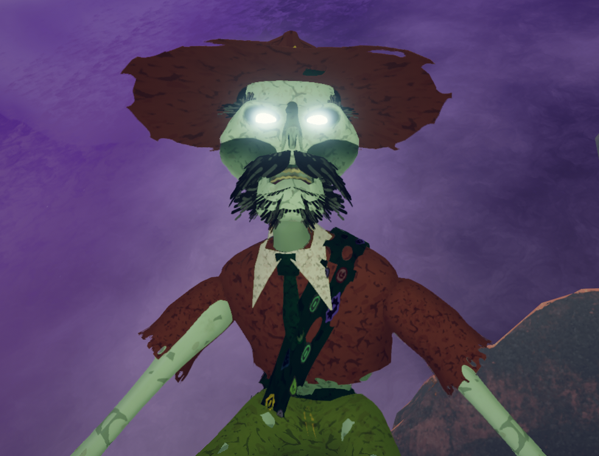
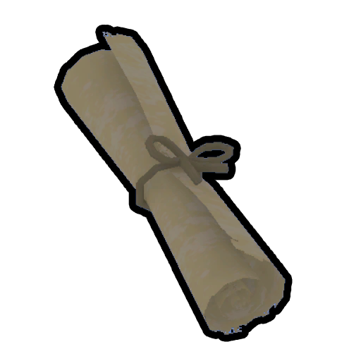
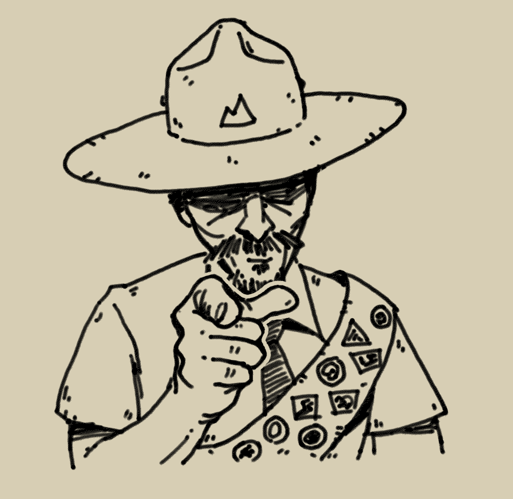
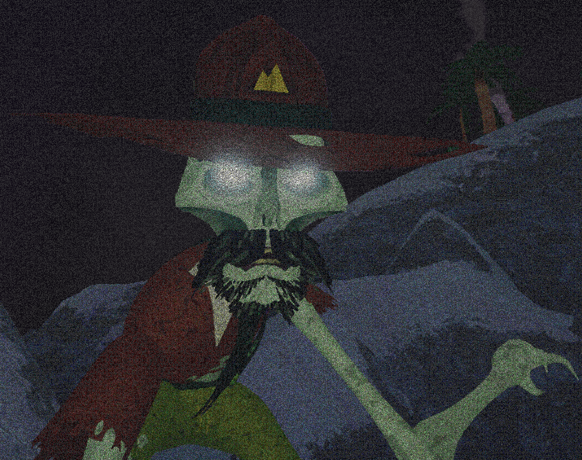
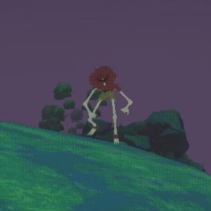
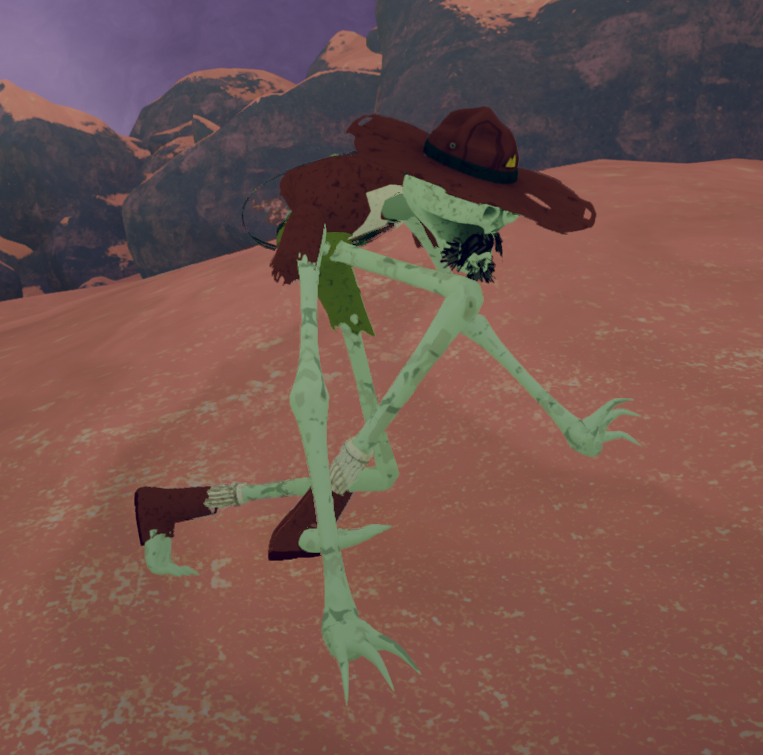
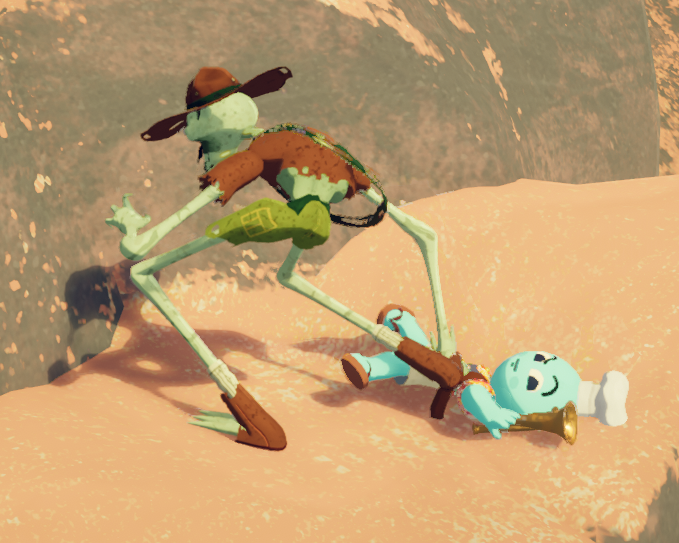
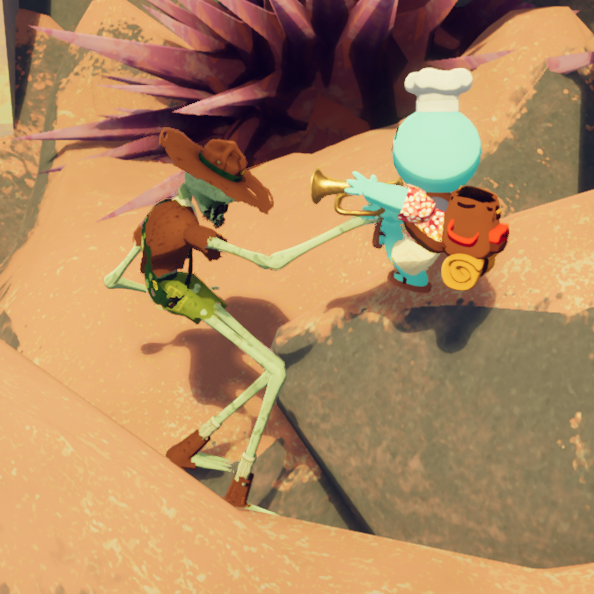
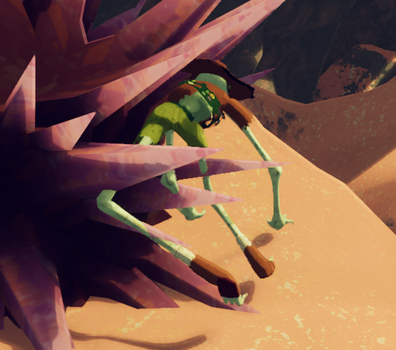

# Scoutmaster Myres

Spoilers ahead!

This page contains **spoilers** for *[PEAK](Peak%20%28game%29.md)*. View at your own discretion.

This page does not meet **PEAK Wiki**'s page quality standards. You can edit it to help fix grammar, formatting, or code issues.

Scoutmaster Myres

General
Type
[Enemy](https://peak.wiki.gg/wiki/Enemy)
Hey, [Scouts](https://peak.wiki.gg/wiki/Scouts)! This is Scoutmaster Myres of troop number 437. This will be my... final journal entry. When we crashed in [this place](Island.md), I thought it a freak accident. Now, I am beginning to believe... it was providence. This island has been drawing me here since the moment I was born, and it intends to keep me forever. Please... someone, anyone... come back for me.[[1]](#cite_note-1)

**Scoutmaster Myres**, also known simply as **The Scoutmaster**, is a hostile [NPC](https://peak.wiki.gg/wiki/NPC) in *[PEAK](Peak%20%28game%29.md)*. He can be encountered in any [biome](https://peak.wiki.gg/wiki/Biome) under the right conditions, with the exception of the [PEAK](Peak%20%28biome%29.md) and [Nadir](Nadir.md), although he can still spawn in either biome if The Scoutmaster's Bugle is used.

## Lore

Scoutmaster Myres was the leader of his own troop of [Scouts](https://peak.wiki.gg/wiki/Scouts), troop 437, having spent over 40 years as a Scoutmaster. He wrote the  [Guidebook](Guidebook.md) found at the [crash site](Shore.md#Crash_Site) on the [Shore](Shore.md), and his diary also makes up the  [scrolls](Scroll.md) found at the [campfires](Campfire.md).

Scoutmaster Myres as depicted in his [Guidebook](Guidebook.md).

According to his diary, he and his [scouts](https://peak.wiki.gg/wiki/Scouts) were stranded on the [island](Island.md) after their ship had crashed. They worked together to climb and reach the [Peak](Peak%20%28biome%29.md). The Scoutmaster was documenting their journey in his diary, while also writing additional pages for his famous guidebook.

While climbing the [Alpine](Alpine.md), Myres came across a  [Napberry](Napberry.md) and ended up falling asleep. While he was unconscious, his scouts left him behind to continue their climb. After waking up, Scoutmaster Myres lost his mind over the scouts leaving him for dead. At some point, it is assumed that he died and became the vengeful, skeletal undead monster that he appears as in the game.

In reality, the Scoutmaster's soul was trapped in [Nadir](Nadir.md) after his death while his corpse transformed into the monster it is now. After being freed from Nadir by the Scouts, Myres' soul reunites with his body at the top of the Peak, restoring his humanity and sanity. He boards the rescue helicopter with the Scouts and flies off with them, finally freed from the island.

## Gameplay

The Scoutmaster primarily serves a threat to Scouts who leave their fellow scouts behind while climbing up the mountain.

Every **30 seconds**, the game checks the conditions required to spawn the Scoutmaster[[2]](#cite_note-2). For the Scoutmaster to spawn, there must be at least two active (i.e. not dead or unconscious) players. The current highest player must also be below **1320 meters** and above the second highest player by at least **160 meters**. If these conditions are met, the Scoutmaster will spawn and begin chasing the current highest player.

If the distance from the Scoutmaster to his current target player is more than 128 meters, he will try to teleport within **80** to **112** meters of them, although this teleportation can only happen once every five seconds. Once the Scoutmaster is sufficiently close, he will chase his target, climbing the mountain if necessary. After reaching the target player, the Scoutmaster will grab them, dealing  **25** [Injury](Stamina%20bar.md#Injury), and throw them in the direction that will potentially result in the longest fall down. He will then wait for two seconds before attempting to throw his target again.

The Scoutmaster will stop chasing his current target when any of the following criteria are met:

- The target player passes out or dies.
- The target player gets above **1320 meters**.
- The target player stops being the highest.
- The target player gets within **128 meters** (vertically) of the second highest player.
- There is another player within **24 meters** of the target player.

When the Scoutmaster has no current target, he will try to flee from the first player who sees him and will despawn once **0.5 seconds** pass since he has been seen by anybody. Before he despawns, he will continue to check for a new target every **30 seconds**.

The Scoutmaster can also be summoned on demand by playing the  [Scoutmaster's Bugle](Scoutmaster%27s%20Bugle.md), which is the only way he can appear in solo play. Playing this bugle will force him to chase its user for **2 minutes**. During this time, the Scoutmaster cannot target other players even if they meet the targeting criteria or play the bugle again.

The Scoutmaster can also be summoned by cooking the  [Scout's Honor](Scout%27s%20Honor.md), which will cause him to chase whichever Scout cooked it for **1 hour**.

When a player is targeted by the Scoutmaster, their screen will become desaturated and covered in static. The intensity of these effects depends on the distance to the Scoutmaster, reaching its maximum at **8 meters** and fading out completely at **80 meters**.

Getting within **40 meters** of the Scoutmaster unlocks the  [Mentorship Badge](https://peak.wiki.gg/wiki/Mentorship_Badge) for the target player.

In [Nadir](Nadir.md), the Scoutmaster's spirit can be communed with in order to bring him with you back to the [PEAK](Peak%20%28biome%29.md), looking similar in appearance to the spectator Ghosts of dead players. Once communed, he will follow the Scout who communed with him.

## Trivia

- The Scoutmaster is the only humanoid character in the game that does not share a model with the Scouts, [Scout Zombies](Zombie.md), and the [Looker](Looker.md).
- The Scoutmaster's model can be found inside the [airport](Airport.md) in a small room out of bounds. The model's inclusion here may possibly serve to preload his assets.
- A useful strategy to avoiding the Scoutmaster's attack effortlessly is to place a  [Piton](Piton.md) high up onto a wall and stay on it. The Scoutmaster will climb close to the player and attempt to grab them, failing almost every time. In some cases, this breaks his pathfinding after a few tries.
- In the teaser trailer for the Final Ascent update, Scoutmaster Myres is voiced by [Xalavier Nelson Jr.](https://en.wikipedia.org/wiki/Xalavier_Nelson_Jr.), founder of the indie game studio Strange Scaffold, which developed the 2023 award winning game *[El Paso, Elsewhere](https://en.wikipedia.org/wiki/El_Paso,_Elsewhere)*.
- The Scoutmaster's troop number is censored with audio glitching in the Final Ascent teaser trailer, with the subtitle also glitching visibly. However, going frame by frame reveals the number to be *437*.

## Gallery

- 
  A close-up of the Scoutmaster's face with the static effect.
- 
  The Scoutmaster chasing the camera, moving slowly from far away. Note the dithering effect.
- 
  Scoutmaster Myres chasing his target.
- 
  The Scoutmaster having grabbed a [Scout](Scout.md).
- 
  The Scoutmaster about to throw a grabbed Scout. Tooting the  [Bugle](Bugle.md) has no effect on Mr. Myres.
- 
  The Scoutmaster running away.
- 
  An A-posing model of Scoutmaster Myres found in an out of bounds room in the [Airport](Airport.md).

## Patch history

 **[1.0](1.0.md) (2025-06-16):** Introduced.

- [↑](#cite_ref-1) [PEAK: Final Ascent Teaser Trailer](https://www.youtube.com/watch?v=FN82qEvzhkY)
- [↑](#cite_ref-2) This check is set to only succeed **10%** of the time it is performed in addition to the timer.
