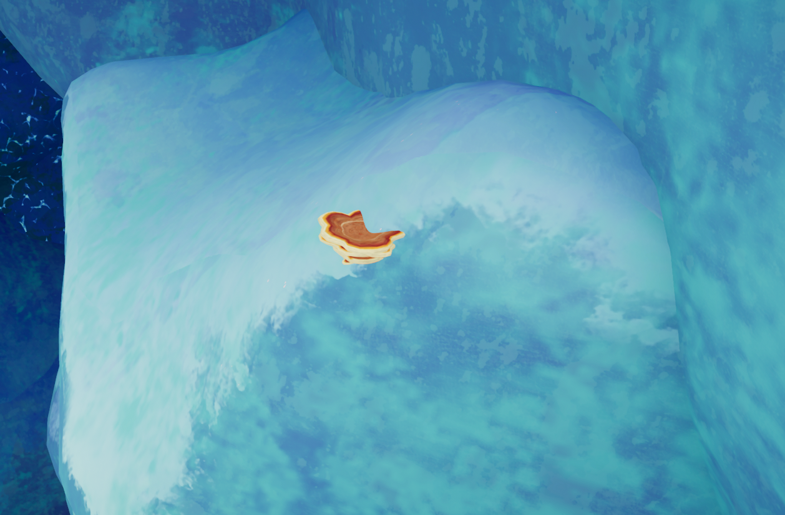
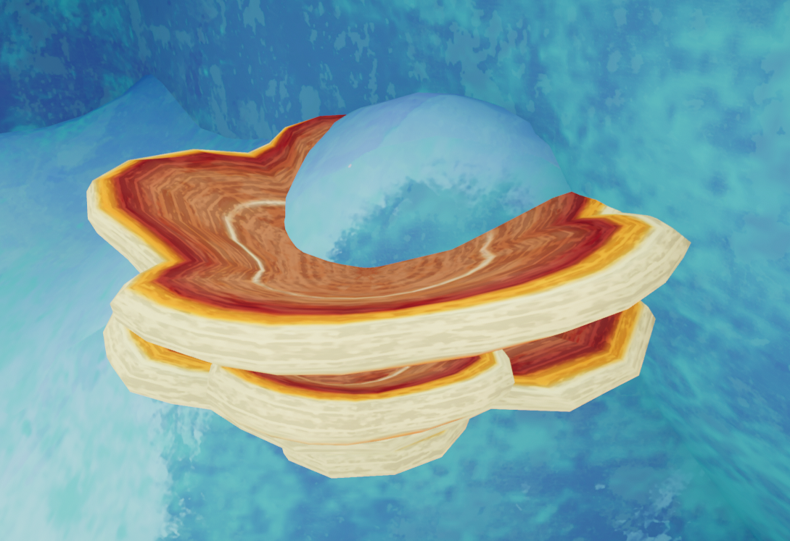
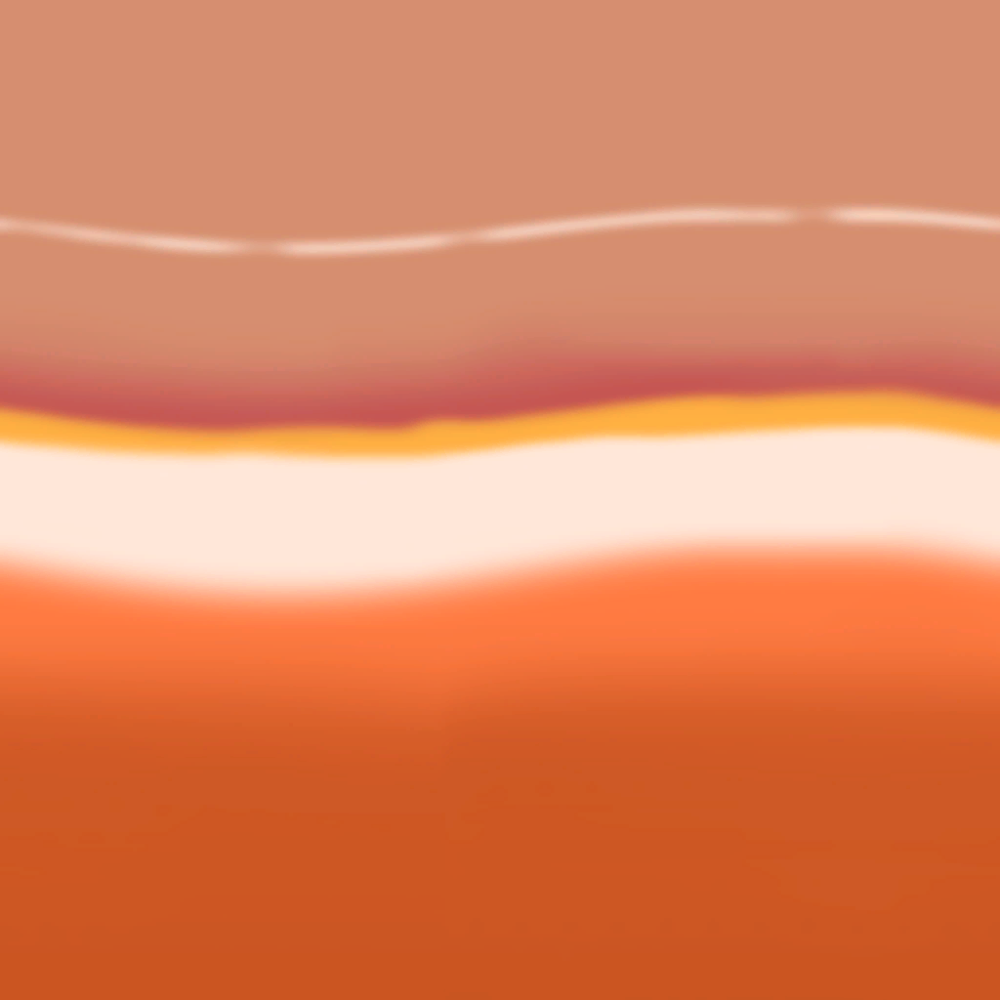

# Shelf Fungus

Shelf Fungus

[Item type](Items.md)- [Deployable](https://peak.wiki.gg/wiki/Deployable)
Weight
 **2.5**

The **Shelf Fungus** is an [deployable](https://peak.wiki.gg/wiki/Deployable) item in *[PEAK](Peak%20%28game%29.md)* found on steep surfaces in most [Biomes](https://peak.wiki.gg/wiki/Biome). It can be thrown or dropped to create a platform at the point of impact with terrain, an item, player, or other object with valid collision.

Thrown items and falling players can also trigger a shelf fungus to become a platform.

## Trivia

- The Shelf Fungus resembles the real-life *Laetiporus*  genus of fungi, also known as [chicken of the woods](https://en.wikipedia.org/wiki/Laetiporus).

## Gallery

- 
  A Shelf Fungus spawned on a cliff in [Alpine](Alpine.md).
- 
  A Shelf Fungus platform after throwing it into a cliff.
- 
  Shelf Fungus texture

## Patch history

 **[1.2.a](1.2.a.md) (2025-06-18):** Introduced.
