# Shore

Shore

Details
Type
[Biome](https://peak.wiki.gg/wiki/Biome)
Region
**1**/6

The **Shore** is the first [biome](https://peak.wiki.gg/wiki/Biome) in *[PEAK](Peak%20%28game%29.md)*. It precedes either the [Tropics](Tropics.md) or the [Roots](Roots.md) and is comprised of a long, sandy beach on the outskirts on the [island](Island.md) with a large mountain cliff ahead of it. Multiple  [Conches](Conch.md) are scattered across the beach.

Reaching the top of the Shore and lighting the [campfire](Campfire.md) opens the mist to the [Tropics](Tropics.md) or [Roots](Roots.md), as well as granting all living Scouts the  [Beachcomber Badge](https://peak.wiki.gg/wiki/Beachcomber_Badge) if they haven't already obtained it.

When playing on the "Peak" [difficulty](Ascents.md) or higher, the [Fog](Fog.md) will gradually rise up in this biome, forcing the players to get up fast.

## Features

### Crash Site

The fire from the plane crash can be used to [cook](Cooking.md) [food](Food.md)

Various equipment can be found at the crash site

The **Crash Site** is the starting area of the Shore where all Scouts wake up at the beginning of a run. It is the wreckage of the airplane that took off from the [Airport](Airport.md).

A [Regular Luggage](Luggage.md#Regular_Luggage) and [Big Luggage](Luggage.md#Big_Luggage) always spawn near the plane along with a number of guaranteed item spawns, some of which are unique to the site itself:

- 1x  [Backpack](Backpack.md)
- 1x  [Lantern](Lantern.md)
- 1x  [Flare](Flare.md)
- 1x  [Bugle](Bugle.md)
- 1x  [Compass](Compass.md) *(unique)*
- 1x  [Guidebook](Guidebook.md) *(unique)*
- 1x  [Binoculars](Binoculars.md) *(unique)*
- 1x  [Flying Disc](Flying%20Disc.md) *(unique)*
- 1x  [Bing Bong](Bing%20Bong.md) plush *(unique)*

A small fire can also be found at the crash site, allowing players to cook any items they may have, similar to a [campfire](Campfire.md).

### Backshore

[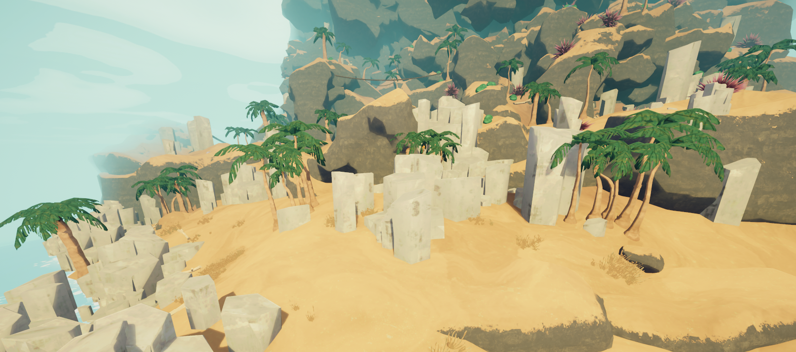](https://peak.wiki.gg/wiki/File%3AShore_backshore.png)

The **Backshore** of the biome is a relatively flat plain containing large groups of vertical, polygonal rock formations and palm trees, as well as sizeable but easily scalable terrain. [Jellyfish](#Jellyfish) are the only hazard to be found in this portion of the biome. It is an ideal starting location for *[PEAK](Peak%20%28game%29.md)*, as it teaches players simple climbing and maneuvering while they still have a lot of [stamina](https://peak.wiki.gg/wiki/Stamina), and has long sightlines allowing for them to monitor and call out to straggling players.

### Cliff

- [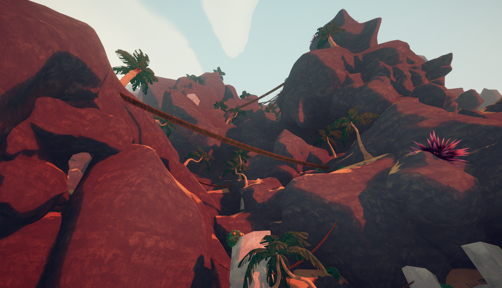](https://peak.wiki.gg/wiki/File%3AShore_cliffs.png)
  The Cliff
- [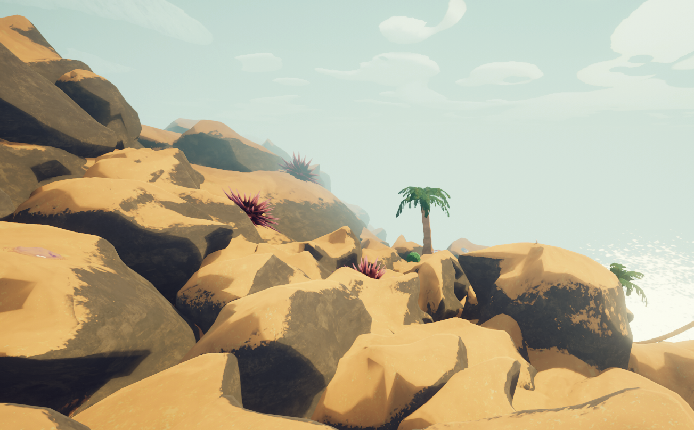](https://peak.wiki.gg/wiki/File%3AShore_clifftop.png)
  Smoother terrain near the top of the cliff.

The **Cliff** comprises the rest of the biome, stretching vertically but to a lesser extent than vertical terrain found in other [biomes](https://peak.wiki.gg/wiki/Biomes). It is at the cliff where the other hazards of Shore become apparent.

## Hazards

| Hazard | Image | Description |
| --- | --- | --- |
| **Jellyfish** | [Jellyfish.png](https://peak.wiki.gg/wiki/File%3AJellyfish.png) | **Jellyfish** are scattered across the entire biome. If a [Scout](Scout.md) makes contact with a Jellyfish, they receive [Poison](Stamina%20bar.md#Poison) **5** [Poison](Stamina%20bar.md#Poison) and slip, entering a [ragdoll](https://peak.wiki.gg/wiki/Ragdoll) state for **2 seconds**. |
| **Giant Urchins** | [Urchin.png](https://peak.wiki.gg/wiki/File%3AUrchin.png) | **Giant Urchins** inflict [Poison](Stamina%20bar.md#Poison) **10** [Poison](Stamina%20bar.md#Poison) once every second while a [Scout](Scout.md) is in contact with them. |
| **[Bridges](Bridge.md)** | [Bridge.png](https://peak.wiki.gg/wiki/File%3ABridge.png) | **[Bridges](Bridge.md)** connect parts of the mountain together. Each bridge has a weight limit from 1-5. If a number of Scouts equal to or greater than the weight limit stand on a bridge, it will break after a few seconds. |

## Variants

The Shore is generated as one of the following below. Red, blue and black sand/beaches are rarer to find.

- [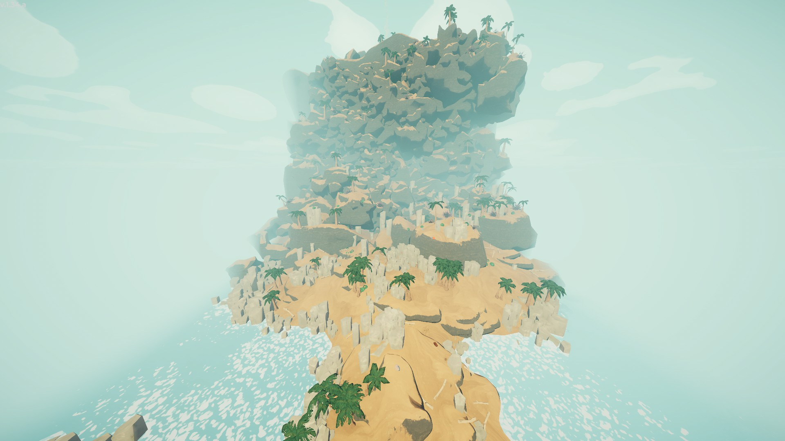](https://peak.wiki.gg/wiki/File%3AShore_Default.jpg)
  Default variant.
- [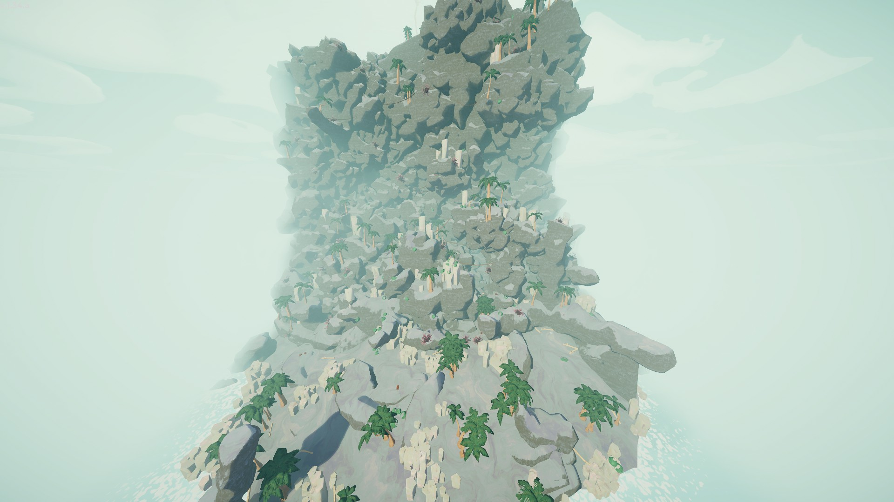](https://peak.wiki.gg/wiki/File%3AShore_Blue_Beach.jpg)
  **"Blue Beach":**
  Sand is bluish-gray.
- [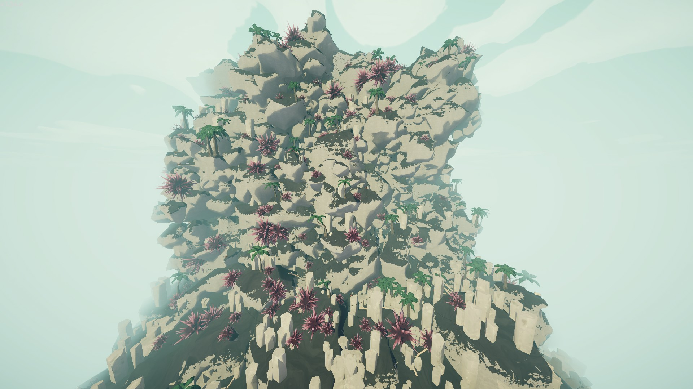](https://peak.wiki.gg/wiki/File%3AShore_Black_Sand.jpg)
  **"Black Sand":**
  Sand is black. Giant Urchins spawn much more frequently, and bridges are replaced by [Chains](Chain.md).
- [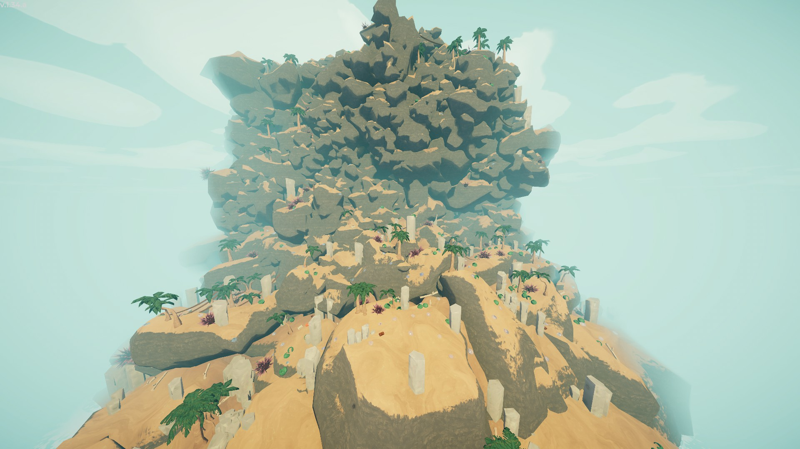](https://peak.wiki.gg/wiki/File%3AShore_Jelly_Hell.jpg)
  **"Jelly Hell":**
  Increased spawn rates for Jellyfish.
- [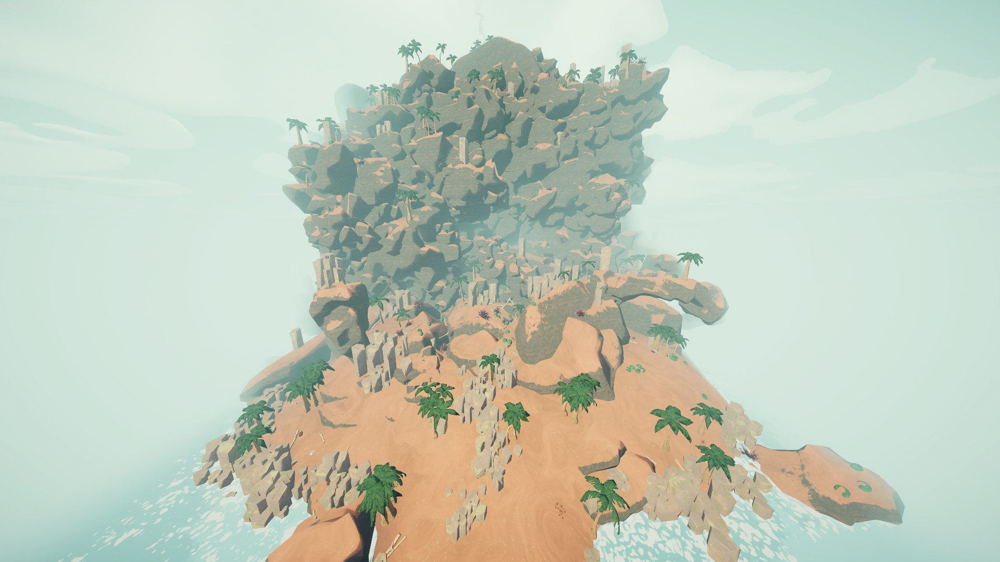](https://peak.wiki.gg/wiki/File%3AShore_Red_Beach.jpg)
  **"Red Beach":**
  Sand is more red than normal.
- [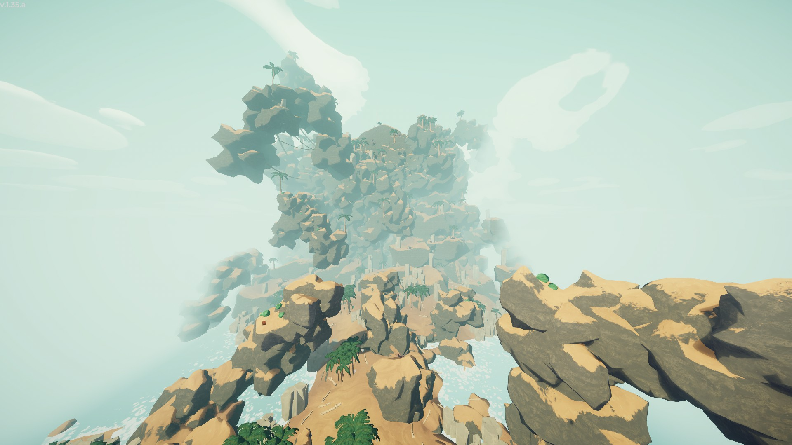](https://peak.wiki.gg/wiki/File%3AShore_Snake_Beach.jpg)
  **"Snake Beach":**
  Large snake-like rock formations generate around the biome.

## Food

The following food items can be found in the Shore, excluding packaged food found in luggage boxes.

-  [Coconut](Coconut.md) (removes  [Heat](Stamina%20bar.md#Heat))
-  [Red Crispberry](Red%20Crispberry.md)
-  [Yellow Crispberry](Yellow%20Crispberry.md) ( [Bonus stamina](Stamina%20bar.md#Bonus_stamina))
-  [Green Crispberry](Green%20Crispberry.md) ( [Poison](Stamina%20bar.md#Poison))
-  [Medicinal Root](Medicinal%20Root.md) (heals  [Injury](Stamina%20bar.md#Injury))
-  [Button Shroom](Button%20Shroom.md)
-  [Button Shroom (Poisonous)](https://peak.wiki.gg/wiki/Button_Shroom_%28Poisonous%29)
-  [Bugle Shroom](Bugle%20Shroom.md)
-  [Bugle Shroom (Poisonous)](https://peak.wiki.gg/wiki/Bugle_Shroom_%28Poisonous%29)
-  [Cluster Shroom](Cluster%20Shroom.md)
-  [Cluster Shroom (Poisonous)](https://peak.wiki.gg/wiki/Cluster_Shroom_%28Poisonous%29)
-  [Chubby Shroom](Chubby%20Shroom.md)

## Natural Items

The following natural items can spawn in the Shore.

-  [Shelf Fungus](Shelf%20Fungus.md)
-  [Remedy Fungus](Remedy%20Fungus.md)
-  [Warp Fungus](Warp%20Fungus.md)
-  [Magic Bean](Magic%20Bean.md)

## Tips & Tricks

- Being the first and easiest biome, the Shore is perfect for learning how to plan your path if you're a new player, as having less hazards and events to worry about means more time to focus on getting the hang of pathfinding and [stamina](https://peak.wiki.gg/wiki/Stamina) management.
- Be wary of the [jellyfish](#Jellyfish) when climbing up, especially if you can't see the ground right away. While the poison is a meager amount and manageable, the [ragdolling](Scout.md#Ragdoll_State) can really screw you over. One wrong step and you might find yourself sliding all the way back down.
- [Bridges](Bridge.md) have a hidden weight limit. Too many [Scouts](https://peak.wiki.gg/wiki/Scouts) can cause a collapse, so it’s safest to cross one at a time.
- Starting with [Ascent 4](Ascents.md), grabbing the  [Flare](Flare.md) from the crash site is advantageous as it is the only guaranteed spawn. If you are planning to visit [Nadir](Nadir.md), this flare will not be necessary.
- Starting with [Ascent 5](Ascents.md), grabbing the  [Lantern](Lantern.md) from the crash site is near essential to fight the cold off during the night, so make sure to grab it right away.

## Gallery

- 
  A  [Bing Bong](Bing%20Bong.md) plushie found at the crash site.
- [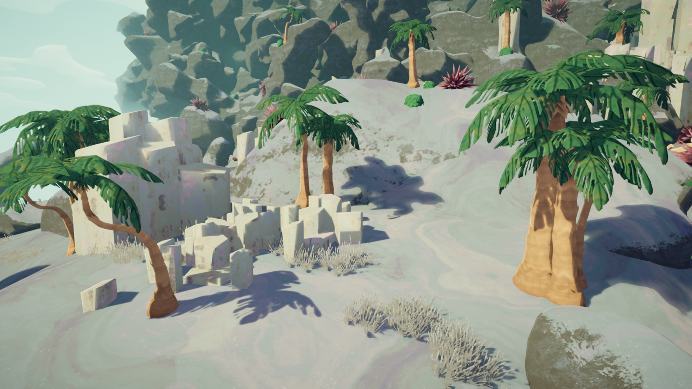](https://peak.wiki.gg/wiki/File%3AShore_2.png)
  The Blue Beach variant of Shore up-close.
- [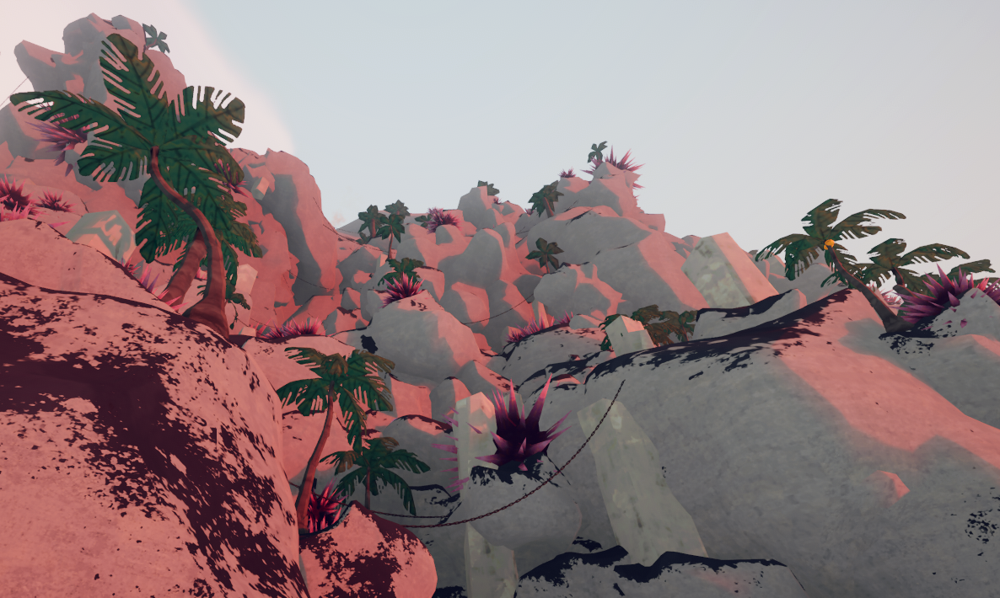](https://peak.wiki.gg/wiki/File%3AShore_variant_Black_Sand.png)
  The Black Sand variant of Shore up-close. Note the large concentration of Giant Urchins and chains.

## Trivia

- The presence of [basalt](https://en.wikipedia.org/wiki/Basalt) — a type of volcanic rock — in the Shore foreshadows the appearance of a [volcano](The%20Kiln.md) after the [Caldera](Caldera.md).
- The Shore is one of two biomes that do not rotate out with an alternative one, along with [the Peak](Peak%20%28biome%29.md).
- When you are in this biome, your Steam Now Playing will say "At the Shore".

## Patch history

 **[1.0](1.0.md) (2025-06-16):** Introduced.
 **[1.1.a](1.1.a.md) (2025-06-17):** Made jellyfish even harder to see.
 **[1.8](1.8.md) (2025-07-21):**

- New biome-specific sunset/sunrise music!
- Added two new items to the crash site: the "Flying Disc" and Binoculars.
