# Shore/es-419

Costa
[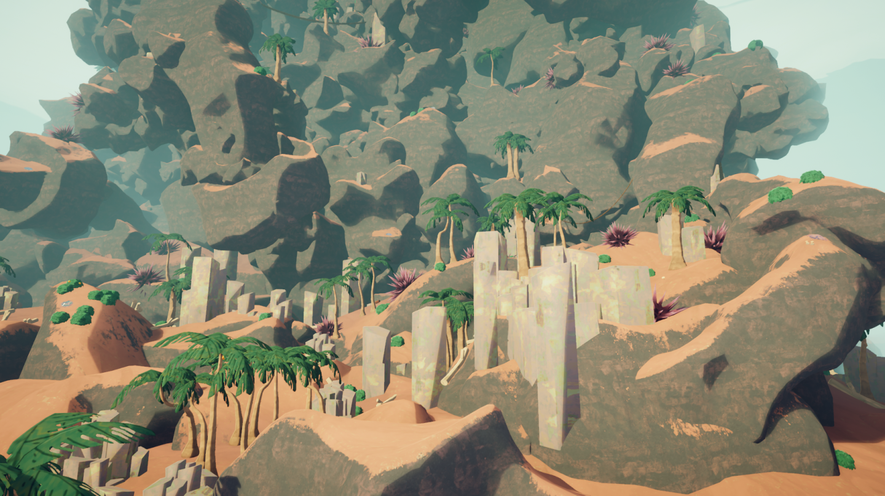](https://peak.wiki.gg/wiki/File%3AShore_Location.png)
Detalles
Tipo
[Bioma](Locations_es-419.md#Biomas)
Sección
**1**/6

La **Costa** es el primer [bioma](Locations_es-419.md#Biomas) en *[PEAK](Peak%20%28game%29_es-419.md)*, ubicado antes de la [Zona Tropical](Tropics.md) o de las [Raíces](Roots.md). Está compuesta por una gran playa con [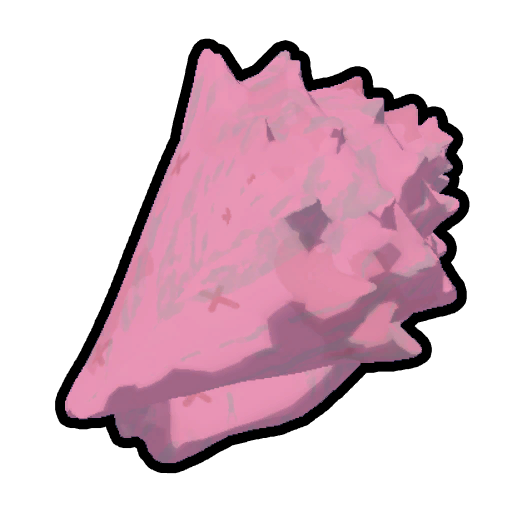](Conch.md) [Caracolas](Conch.md) y palmeras junto al océano, mientras que al otro lado se alza un gran acantilado con más peligros que la playa.

En una expedición en cualquier [Ascenso](Ascents_es-419.md) exceptuando *[Pies Blandos](Ascents_es-419.md#Pies_Blandos)*, la [niebla](Fog.md) irá subiendo gradualmente, evitando que los [Exploradores](Scout_es-419.md) puedan permanecer en la Costa por mucho tiempo.

Encender la [fogata](Campfire.md) en la cima de la Costa desvanecerá la neblina y revelará el siguiente bioma, otorgando a todos los Exploradores vivos la [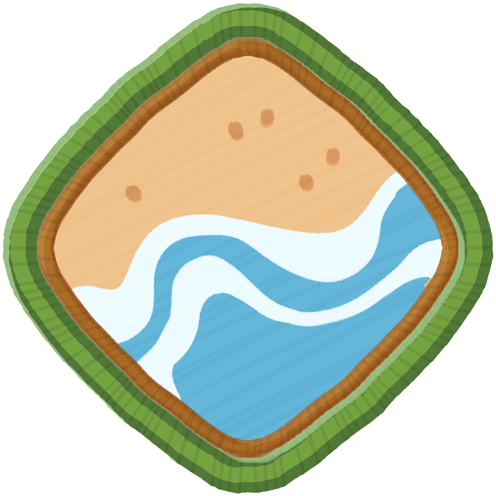](https://peak.wiki.gg/wiki/Beachcomber_Badge) [Beachcomber Badge](https://peak.wiki.gg/wiki/Beachcomber_Badge) si no la tenían.

## Características

### Lugar del accidente

El **lugar del accidente** es la zona inicial de la Costa, donde todos los [Exploradores](Scout_es-419.md) se despiertan y comienzan su expedición. El avión que despegó del [Aeropuerto](Airport_es-419.md) se encuentra estrellado aquí y está separado en tres partes. La cabina contiene una  [Linterna](Lantern.md), una [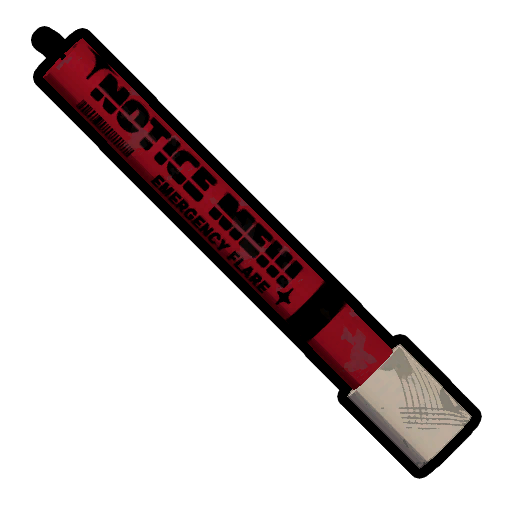](Flare.md) [Bengala](Flare.md), un [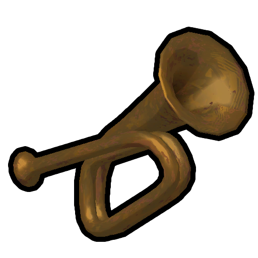](Bugle.md) [Clarín](Bugle.md), una  [Brújula](Compass.md), unos [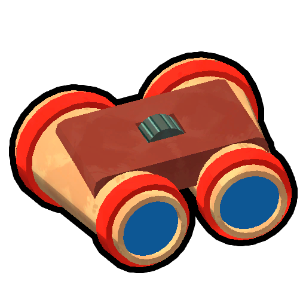](Binoculars.md) [Binoculares](Binoculars.md) y un [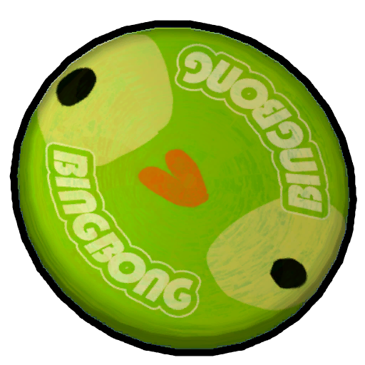](Flying%20Disc.md) [Disco Volador](Flying%20Disc.md). La sección de pasajeros contiene a  [Bing Bong](Bing%20Bong.md) y tiene el ala rota. El ala está en llamas, y puede usarse como una [fogata](Campfire.md) para cocinar [objetos](Items_es-419.md).

Cerca del avión también se pueden encontrar una [Maleta Normal](https://peak.wiki.gg/wiki/Regular_Luggage), una [Maleta Grande](https://peak.wiki.gg/wiki/Big_Luggage), una  [Mochila](Backpack.md) y una [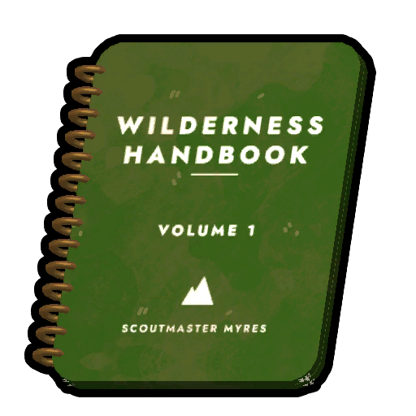](Guidebook.md) [Guía](Guidebook.md).

- [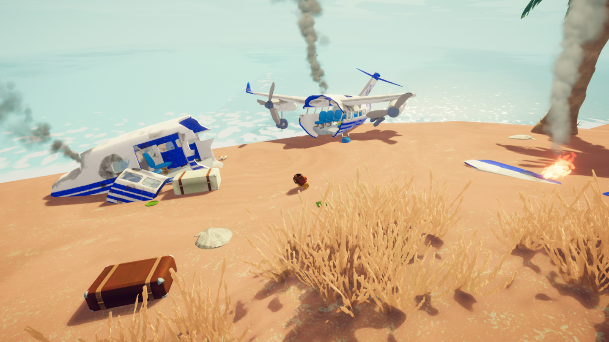](https://peak.wiki.gg/wiki/File%3ACrashSite.png)
  Lugar del accidente
- [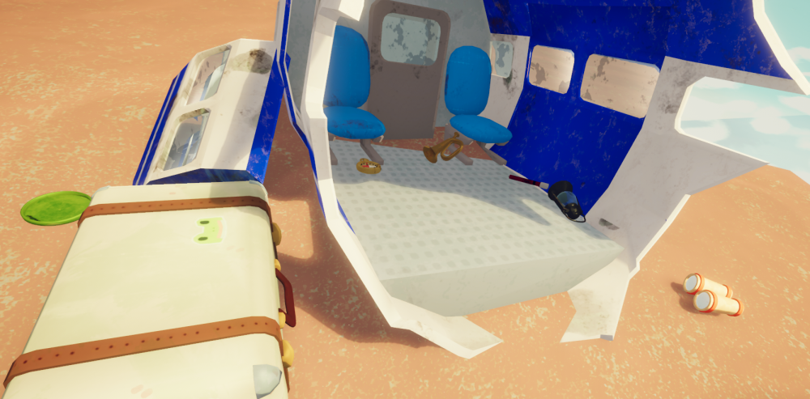](https://peak.wiki.gg/wiki/File%3ACrashsite_equipment.png)
  Parte de la cabina
- 
  Parte de los pasajeros
- [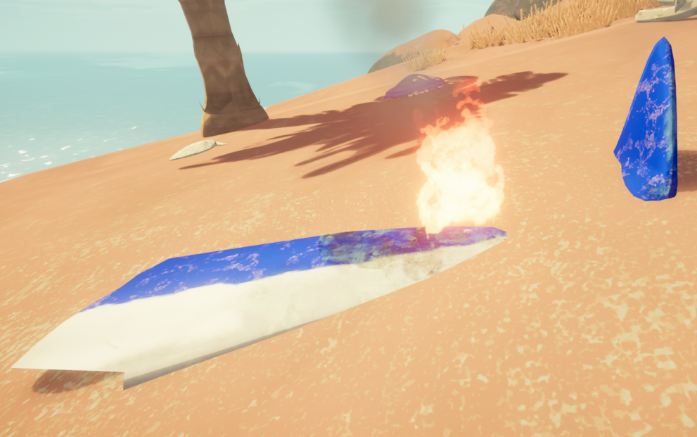](https://peak.wiki.gg/wiki/File%3ACrashsite_fire.png)
  El fuego del ala rota puede usarse para [cocinar](Cooking.md).

## Peligros

| Peligro | Imagen | Descripción |
| --- | --- | --- |
| **Medusa** | [Jellyfish.png](https://peak.wiki.gg/wiki/File%3AJellyfish.png) | Las **medusas** se encuentran a lo largo de toda la Costa. Si un [Explorador](Scout_es-419.md) toca una medusa, recibirá [Poison](Stamina%20bar.md#Poison) **5** [Veneno](Stamina%20bar.md#Poison) y se resbalará, entrando en [Estado Ragdoll](Scout_es-419.md#Estado_Ragdoll) por **2 segundos**. |
| **Erizo de mar gigante** | [Urchin.png](https://peak.wiki.gg/wiki/File%3AUrchin.png) | Los **erizos de mar gigantes** se encuentran en el acantilado de la Costa, e infligen [Poison](Stamina%20bar.md#Poison) **10** [Veneno](Stamina%20bar.md#Poison) por **cada segundo** que un [Explorador](Scout_es-419.md) esté en contacto con él. |
| **[Puente](Bridge.md)** | [Bridge.png](https://peak.wiki.gg/wiki/File%3ABridge.png) | Los **[puentes](Bridge.md)** se encuentran en el acantilado de la Costa. Estos conectan partes del acantilado entre sí, pero algunos no son muy resistentes, y se destruirán si muchos [Exploradores](Scout_es-419.md) caminan sobre ellos a la vez. |

## Comidas naturales

- [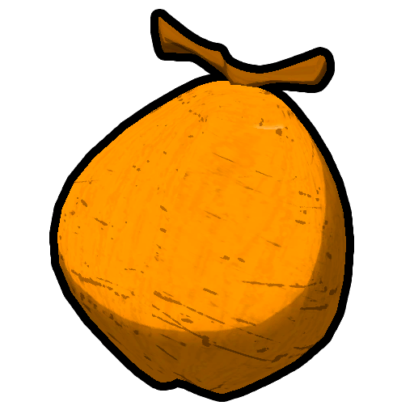](Coconut.md) [Coco](Coconut.md)
-  [Crujibaya Roja](Red%20Crispberry.md)
-  [Crujibaya Verde](Green%20Crispberry.md)
-  [Crujibaya Amarilla](Yellow%20Crispberry.md)
-  [Hongo Rechoncho](Chubby%20Shroom.md)
- | [Hongo Botón](Button%20Shroom.md)
- | [Hongo Clarín](Bugle%20Shroom.md)
- | [Hongo en Racimo](Cluster%20Shroom.md)
-  [Raíz Medicinal](Medicinal%20Root.md)

## Objetos naturales

- [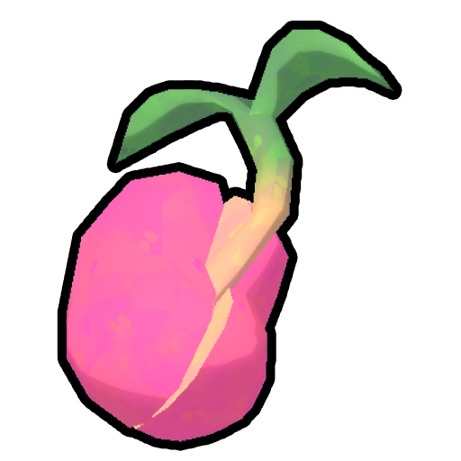](Magic%20Bean.md) [Frijol Mágico](Magic%20Bean.md)
- [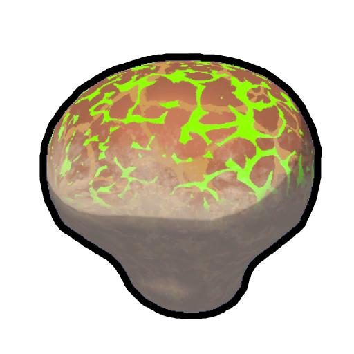](Remedy%20Fungus.md) [Hongo Curativo](Remedy%20Fungus.md)
- [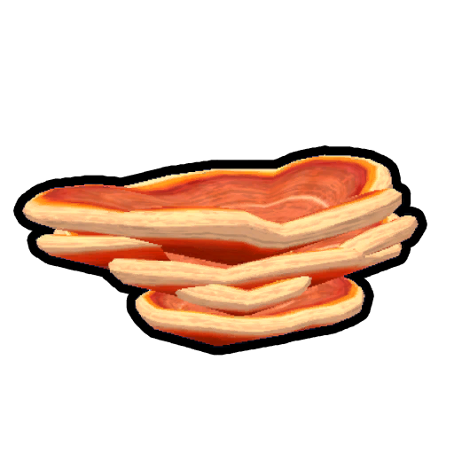](Shelf%20Fungus.md) [Hongo de Repisa](Shelf%20Fungus.md)
- [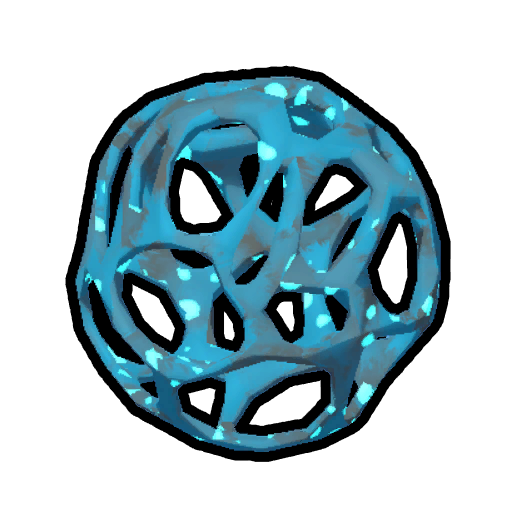](Warp%20Fungus.md) [Hongo de Teletransportación](Warp%20Fungus.md)

## Variantes

| Variante | Rareza | Imagen | Descripción |
| --- | --- | --- | --- |
| **Predeterminado** | 100 | [Shore Default.jpg](https://peak.wiki.gg/wiki/File%3AShore_Default.jpg) | La variante predeterminada de la Costa. |
| **Playa roja** | 40 | [Shore Red Beach.jpg](https://peak.wiki.gg/wiki/File%3AShore_Red_Beach.jpg) | La arena es de color rojizo. |
| **Playa azul** | 20 | [Shore Blue Beach.jpg](https://peak.wiki.gg/wiki/File%3AShore_Blue_Beach.jpg) | La arena es de color gris azulado. |
| **Playa serpenteada** | 20 | [Shore Snake Beach.jpg](https://peak.wiki.gg/wiki/File%3AShore_Snake_Beach.jpg) | Contiene formaciones rocosas con forma de serpiente. |
| **Playa negra** | 10 | [Shore Black Sand.jpg](https://peak.wiki.gg/wiki/File%3AShore_Black_Sand.jpg) | La arena es negra, contiene más [erizos de mar gigantes](#Erizo_de_Mar_Gigante) y los [puentes](Bridge.md) se reemplazan con [cadenas](Chain.md). |
| **Infierno de medusas** | 10 | [Shore Jelly Hell.jpg](https://peak.wiki.gg/wiki/File%3AShore_Jelly_Hell.jpg) | Contiene más [medusas](#Medusa). |

## Trucos y consejos

- Al ser el primer bioma y el más fácil, la Costa es perfecta para aprender a planificar tus caminos si eres un [Explorador](Scout_es-419.md) novato, ya que no pierdes tiempo con peligros difíciles de evadir y puedes mejorar tus habilidades para encontrar caminos óptimos y gestionar tu [Resistencia](https://peak.wiki.gg/wiki/Stamina).
- Ten cuidado con las [medusas](#Medusa) mientras escalas el acantilado, sobre todo si no llegas a ver dónde vas a pararte. El [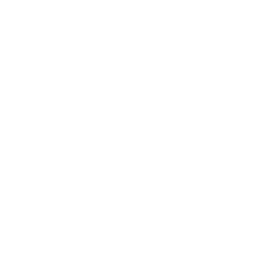](Stamina%20bar.md#Poison) [Veneno](Stamina%20bar.md#Poison) que infligen no suele ser un gran problema, pero entrar en [Estado Ragdoll](Scout_es-419.md#Estado_Ragdoll) puede hacer que pierdas todo el progreso que habías conseguido, o peor aún, llevarte a la muerte.
- La resistencia de cada [puente](Bridge.md) es aleatoria en cada expedición, así que siempre es más seguro cruzarlos de a uno.
- En una expedición en [Ascenso 4](Ascents_es-419.md#Ascenso_4) o superior, recoger la  [Bengala](Flare.md) del [lugar del accidente](#Lugar_del_accidente) es muy recomendable, ya que nada garantiza que puedas conseguir otra en una [maleta](Luggage.md). Si estás planeando liberar el alma del [Jefe de Tropa](https://peak.wiki.gg/wiki/Scoutmaster), no necesitarás una Bengala.
- En una expedición en [Ascenso 5](Ascents_es-419.md#Ascenso_5) o superior, recoger la  [Linterna](Lantern.md) del [lugar del accidente](#Lugar_del_accidente) es esencial para sobrevivir las noches frías, así que recógela rápidamente y aprovecha el día para escalar todo lo que puedas.

## Curiosidades

- La presencia de [basalto](https://es.wikipedia.org/wiki/Basalto), un tipo de roca volcánica, en la Costa presagia la aparición de un [volcán](The%20Kiln.md).
- La Costa es uno de los dos biomas que no tienen un bioma alternativo; el otro es la [Cima](Peak%20%28biome%29.md).

## Historial de versiones

 **[1.0](1.0.md) (2025-06-16):** Se introdujo la Costa.

 **[1.1.a](1.1.a.md) (2025-06-17):** Se hizo más difícil ver a las [medusas](#Medusa).

 **[1.8](1.8.md) (2025-07-21):**

- ¡Nueva música de amanecer/atardecer específica de cada bioma!
- Se añadieron dos [objetos](Items_es-419.md) nuevos al [lugar del accidente](#Lugar_del_accidente): el “ [Disco Volador](Flying%20Disc.md)” y los  [Binoculares](Binoculars.md).
