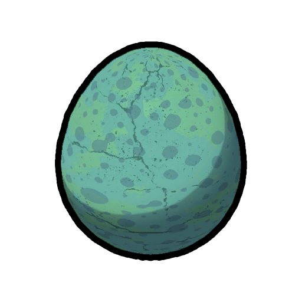

# Small Egg

This page is a [stub](https://support.wiki.gg/wiki/Stub). You can help **PEAK Wiki** by expanding it.

Small Egg

[Item type](Items.md)- [Misc](Misc.md)
Biome- [Gloom](Gloom.md)
Weight
 **2.5**

The **Small Egg** is an [item](https://peak.wiki.gg/wiki/Item) in *[PEAK](Peak%20%28game%29.md)* found in the [Gloom](Gloom.md) inside Raven nests.
A Small Egg can be cracked open to receive an  [Egg](Egg.md) similar to the  [Big Egg](Big%20Egg.md). Has a 99% chance to spawn [Egg](Egg.md) when cracked and 1% chance to spawn a  [Cooked Bird](Cooked%20Bird.md).
Cooking an  [Egg](Egg.md) is required for the  [Gourmand Badge](https://peak.wiki.gg/wiki/Gourmand_Badge), as the  [Cooked Bird](Cooked%20Bird.md) will not count..

## Trivia

- Cooking the Egg causes the resulting [Egg](Egg.md) to also be cooked when cracked open.

## Patch history

 **[2.0.a](2.0.a.md) (2026-08-11):** Introduced. **(Undocumented)**
