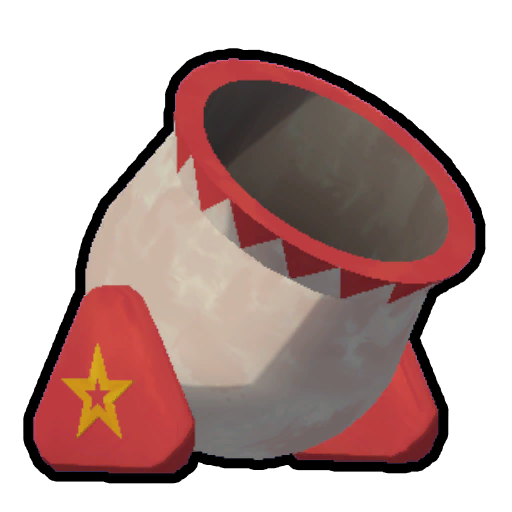
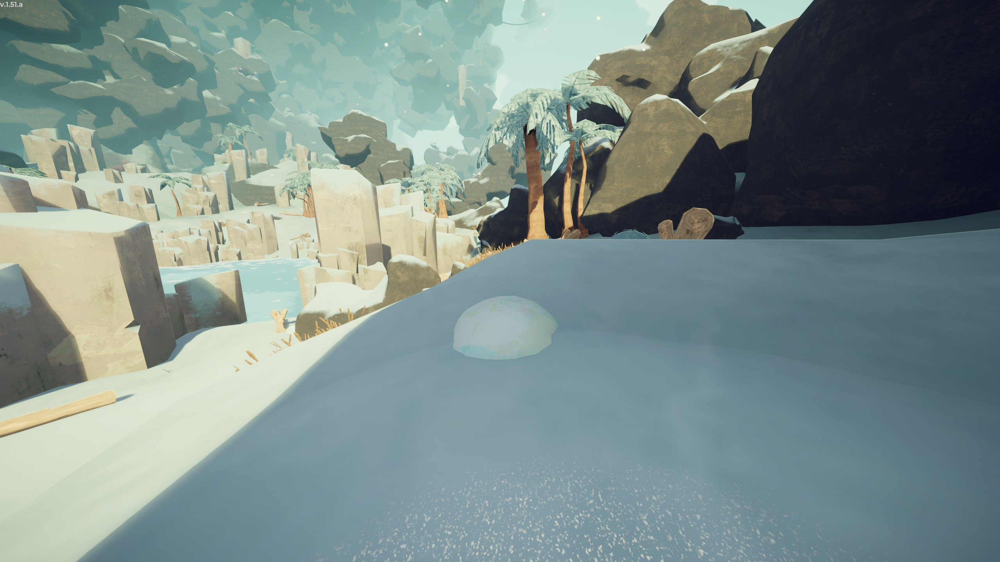
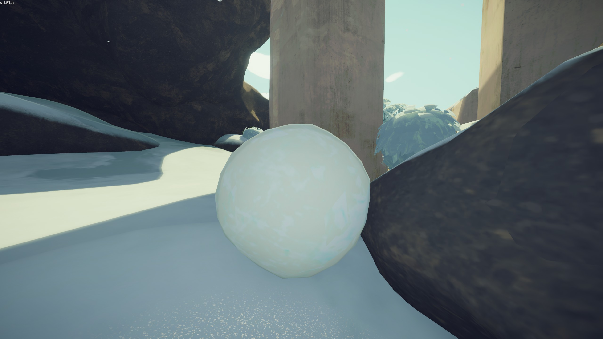

# Snowball

Snowball

[Item type](Items.md)- [Misc](Misc.md)
Biome- [Alpine](Alpine.md)
Weight
 **2.5**

The **Snowball** is an [item](https://peak.wiki.gg/wiki/Item) in *[PEAK](Peak%20%28game%29.md)* that can gained by picking up Snow Piles on the ground. Snowballs can be thrown and will be destroyed if they impact a player or the environment at a fast enough velocity. Throwing a Snowball at a player will cause the player to gain  **5 to 10** [Cold](Stamina%20bar.md#Cold) and will cause the player to enter a [ragdoll](https://peak.wiki.gg/wiki/Ragdoll) state. Cooking a Snowball will inflict  [Cold](Stamina%20bar.md#Cold) to the player but will not knock them down.

Rolling a Snowball on snowy ground causes it to get larger but has no effect on its  [Weight](Stamina%20bar.md#Weight). Larger snowballs apply more knockback when thrown at a player. Once a Snowball is sufficiently large, it can no longer be picked up.

## Interactions

- Thrown Snowballs can be used to knock down [Zombies](Zombie.md).
- Thrown Snowballs can be used to knock down various fruits and  [Beehives](Beehive.md).
- Thrown Snowballs will not trigger Explosive Bombshrooms or Poison Bombshrooms but Snowballs that are rolled into or dropped onto either kind of Bombshroom will trigger them.
- A  [Scout Cannon](Scout%20Cannon.md) can launch a Snowball provided that it can fit in the barrel of the cannon.

## Gallery

- 
  A Snow Pile on Shore
- 
  A large Snowball that can no longer be picked up

## Patch History

 **[1.50.a](1.50.a.md) (2025-12-16):** You should also be able to find snow mounds throughout the level, interact with them to form....a snowball. The ultimate weapon for enraging your friends.
 **[1.51.a](1.51.a.md) (2025-12-19):** Snowballs should be slightly less glitchy
 **[1.52.a](1.52.a.md) (2026-01-06):** Removed the holiday event changes (except snow piles which can still be found in Alpine)
 **[1.53.a](1.53.a.md) (2026-01-27):** Scouts can once again roll snowballs to make them bigger in Alpine
