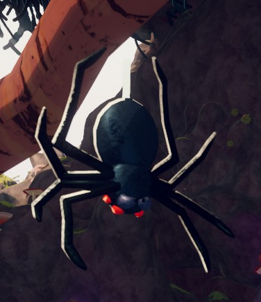
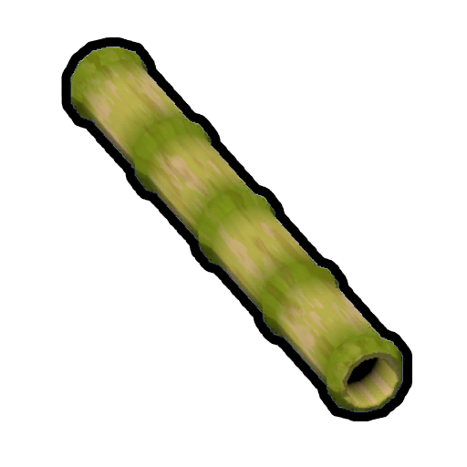
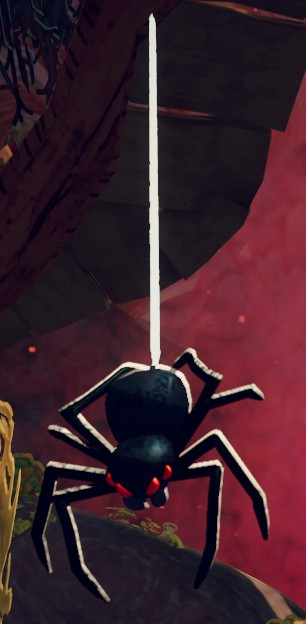
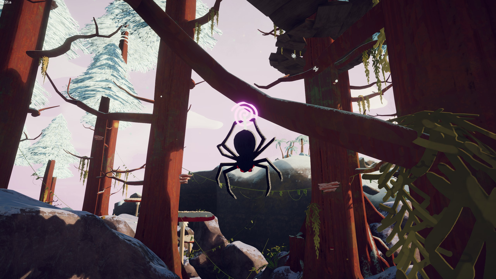
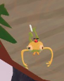

# Spider

Spider

General
Type
[Enemy](https://peak.wiki.gg/wiki/Enemy)
Biome- [Roots](Roots.md)

**Spiders** are hostile [NPCs](https://peak.wiki.gg/wiki/NPC) found in the [Roots](Roots.md). They can catch unaware [Scouts](Scout.md) in a web, inflicting  [Poison](Stamina%20bar.md#Poison) until the Scout escapes.

## Mechanics

When a [Scout](Scout.md) walks below a Spider, it will descend straight down and grab any Scout it touches. The grabbed Scout is immediately inflicted with  **25** [Web](Stamina%20bar.md#Web) and slowly pulled up to the Spider's original location. The grabbed Scout can struggle out of the web by pressing jump (), removing  **5** [Web](Stamina%20bar.md#Web) per press of the key. Note that struggling requires [stamina](https://peak.wiki.gg/wiki/Stamina) and stamina is still regained while grabbed. A grabbed Scout cannot use any items or access their [backpack](Backpack.md).

Once the Spider has fully raised its victim, it will begin dealing  **5** [Poison](Stamina%20bar.md#Poison) to them every **0.8 seconds**.
After escaping, [Scouts](Scout.md) will likely fall a large distance due to the fact that Spiders spawn in high places.

Throwing an [item](https://peak.wiki.gg/wiki/Item) at a Spider will briefly stun it, preventing it from grabbing any [Scouts](Scout.md) and causing it to drop any webbed Scout it may have grabbed.

Other [Scouts](Scout.md) can also free a webbed Scout by grabbing them with **Helping Hand**.

Escaping a Spider's web unlocks the  [Web Security Badge](https://peak.wiki.gg/wiki/Web_Security_Badge).

## Interactions

- A player with [invincibility](Stamina%20bar.md#Invincibility) will be immediately dropped after being grabbed by a Spider. This will still briefly knock the player down.
- A player that is grabbed can be freed from afar by shooting them with a  [Blowgun](Blowgun.md).
- A player can also be freed by being fed a  [Napberry](Napberry.md). If the grabbed player is close enough to be fed, it is probably best to instead use **Helping Hand**.

## Gallery

- 
  A spider hanging on its web.
- 
  A spider that been stunned after being hit with an item.
- 
  A spider with [Bug Phobia Mode](Bug%20Phobia%20Mode.md) on

## Patch History

 **[1.40.a](1.40.a.md) (2025-11-05):** Introduced.

 **[2.1.a](2.1.a.md) (2026-08-13):** Made so scouts that are a living skeleton are affected.
