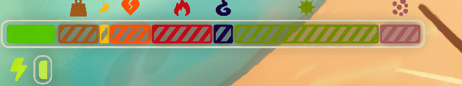
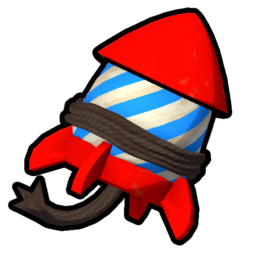
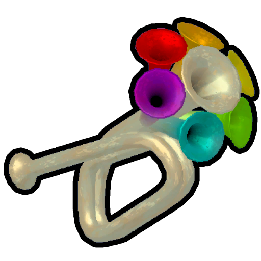

# Stamina bar

Stamina bar

General
Type
[Mechanic](https://peak.wiki.gg/wiki/Mechanic)

The **stamina bar** is one of the core game mechanics in *[PEAK](Peak%20%28game%29.md)*. It displays the amount of **stamina** available to the player, as well as any **status effects** they currently have. Managing the stamina bar presents one of the major challenges of the game.

Stamina and all status effects are measured in points or their effective percentage of the full bar, which constitutes a total of **100**. Status effects may add up to more than 100%, and extend beyond the bounds of the stamina bar, and marked with a dashed outline. The sum of all status effects is capped at 200%.

With the exception of stamina,  [Bonus stamina](#Bonus_stamina), and  [Petrify](#Petrify), all status effect amounts are divisible by **2.5**, which constitutes a so-called "tick".

## Stamina

Maintaining a high level of available stamina is a top priority of a [Scout](Scout.md)

**Stamina** is the most important quantity displayed on the stamina bar. It dictates the player's ability to climb or sprint.

Climbing, sprinting, or jumping consumes the player's stamina, which is immediately displayed on the stamina bar. When the stamina reaches 0, the player can no longer climb or sprint until it regenerates back.

Regeneration of stamina can happen under any of the following conditions:

- The player is hanging on a  [Piton](Piton.md) or a [Pickaxe](https://peak.wiki.gg/wiki/Pickaxe).
- The player is currently stuck (e.g. on a [cactus](Mesa.md#Cacti)).
- The player has been grounded for at least **0.2 seconds** *AND* either:- At least **1 second** has passed since the player stopped using stamina while still having a non-zero amount of it. For example, climbing a wall with full stamina for 1 second and then letting go.
  - At least **2 seconds** have passed since the player has run out of stamina completely (including  [Bonus stamina](#Bonus_stamina)).

When the conditions allow, stamina regenerates at a rate of **20 per second**.

All stamina (including  [Bonus stamina](#Bonus_stamina)) is consumed 40% faster when playing on [Ascent 6](https://peak.wiki.gg/wiki/Ascent_6) or higher.

Stamina Usage

| Action | Usage |
| --- | --- |
| Sprinting | **5** per second |
| Jumping | **5** |
| Jumping while sprinting | **15** |

### Status Bonus stamina.png Bonus stamina

---

**Bonus stamina** is a secondary source of stamina which serves as a reserve. It is displayed as a separate bar below the main stamina bar.

Bonus stamina is only consumed when the player is out of primary stamina, although it cannot be used for sprinting. Jumping without sprinting will not consume bonus stamina.

Bonus stamina does not regenerate and can only be gained by consuming certain [food](Food.md) or using the  [Pandora's Lunchbox](Pandora%27s%20Lunchbox.md). [Cooking](Cooking.md) food can increase the amount of Bonus stamina it provides.

Actions that consume more primary stamina than the player has do not consume Bonus stamina (e.g. consuming 5 stamina when the player has 2 regular stamina and 10 Bonus stamina will leave them with 0 regular stamina and 10 Bonus stamina still).

 [Petrify](#Petrify) is the only status effect that impacts the Bonus stamina bar.

## Status effects

Having too many status effects drastically reduces the available stamina

**Status effects** decrease the maximum amount of stamina available to the player. If the status effects leave no available room for stamina to regenerate, the player will [pass out](https://peak.wiki.gg/wiki/Passing_out).

### Status Weight.png Weight

---

**Weight** is gained from carrying [items](Items.md) in the hands, inventory, and the equipped  [Backpack](Backpack.md). Certain items like  [Anti-Rope Spool](Anti-Rope%20Spool.md) and  [Balloons](Balloon.md) reduce weight instead when carried. Dropping or consuming an item immediately removes the corresponding amount of weight.

Weight does not affect movement speed, fall damage, or the collapsing behavior of [Bridges](Bridge.md).

When playing on [Ascent 3](https://peak.wiki.gg/wiki/Ascent_3) or higher, all items (except the  [Backpack](Backpack.md)) have a flat increase in weight of **2.5** (e.g. a  [Cure-All](Cure-All.md) will weigh 7.5 instead of 5). This also applies to items with negative weight, though does not prevent them from flying away as physical mass and carry weight are two different unrelated values from the game's perspective.

### Status Hunger.png Hunger

---

Making the right food choices helps keep Hunger low and prevents gaining [Poison](#Poison)

**Hunger** is gained naturally over time at a rate of **0.05 per second**, or equivalently, **2.5 per 50 seconds**. Amounts below 2.5 are not visible and do not affect the stamina bar. Hunger can be reduced by eating [food](Food.md) or using certain [mystical items](https://peak.wiki.gg/wiki/Mystical_item) like the  [Cure-All](Cure-All.md) or  [Pandora's Lunchbox](Pandora%27s%20Lunchbox.md).

Hunger grows 30% slower (2.5 every ~71.43 seconds) when playing on [Tenderfoot](https://peak.wiki.gg/wiki/Tenderfoot) and 60% faster (2.5 every 31.25 seconds) when playing on [Ascent 2](https://peak.wiki.gg/wiki/Ascent_2) or higher.

Consuming food does not reset the Hunger timer, which may result in the player getting 2.5 Hunger right after eating. However, having the [Invincibility status](#Invincibility) does stop the Hunger timer.

### Status Injury.png Injury

---

**Injury** is primarily gained by falling from great heights. Other sources of Injury include:

- Touching a [Lava Tube](https://peak.wiki.gg/wiki/Lava_Tube), the lava pool in [The Citadel](The%20Citadel.md), or the lava in the [Caldera](Caldera.md) or [Kiln](The%20Kiln.md)
-  [Dynamite](Dynamite.md) explosions
- [Antlion](Antlion.md) attacks
- Opening [Ancient Luggage](https://peak.wiki.gg/wiki/Ancient_Luggage)
- Cooking a  [Flare](Flare.md),  [Lantern](Lantern.md),  [Scout Cannon](Scout%20Cannon.md) or other flammable item
- Crashing while using a  [Rocketpack](Rocketpack.md)
- Getting bit by a [Zombie](Zombie.md)
- Removing an [Arrow](The%20Citadel.md#Arrow_Trap).
- Getting grabbed by [The Scoutmaster](https://peak.wiki.gg/wiki/The_Scoutmaster)
- Standing on top of a Wrought-Iron Fence in the [Gloom](Gloom.md)
- Being in the [Fog](Fog.md) as a [skeleton](The%20Book%20of%20Bones.md)
- Falling into [The Lost Souls](https://peak.wiki.gg/wiki/The_Lost_Souls) in [Nadir](Nadir.md)

Injury does not go away on its own and has to be healed manually. Sources of healing include:

- Lighting a [Campfire](Campfire.md)
-  [Bandages](Bandages.md) and  [First Aid Kits](First%20Aid%20Kit.md)
- Healing [food](Food.md):  [Medicinal Root](Medicinal%20Root.md),  [Yellow Winterberry](Yellow%20Winterberry.md),  [Gold Prickleberry](Gold%20Prickleberry.md),  [Red Clusterberry](Red%20Clusterberry.md).
-  [Remedy Fungus](Remedy%20Fungus.md)'s spore cloud
-  [Cure-All](Cure-All.md)
-  [Faerie Lantern](Faerie%20Lantern.md)
-  [Pandora's Lunchbox](Pandora%27s%20Lunchbox.md) (by randomizing status effects)
-  [Scout's Tenacity](Scout%27s%20Tenacity.md).

#### Fall damage

**Fall damage** calculations are based on the total fall duration (impact velocity is largely irrelevant).

Only falls lasting **1.5 seconds** or longer cause damage. The minimum amount of Injury inflicted upon landing is **5**, while the maximum is calculated based on the player's vertical velocity (see the [calculations](#Fall_damage_calculations) section). At 1.5 seconds, fall damage is minimal (5 Injury), while at **3 seconds** or more, fall damage is at its highest (up to **100** Injury). Jumping before the fall subtracts **0.5 seconds** from its total duration (e.g. a 3-second fall is treated as a 2.5-second one).

All fall damage is multiplied by **2** when playing on [Ascent 1](https://peak.wiki.gg/wiki/Ascent_1) or higher.

Taking any fall damage prevents the player from obtaining the  [Balloon Badge](https://peak.wiki.gg/wiki/Balloon_Badge) in the same run (note that this only applies to fall damage, not Injury in general).

Fall damage calculations

*This section was last updated for Patch [1.27.a](1.27.a.md).*

Values

| Name | Value |
| --- | --- |
| Min Time | **1.5** |
| Max Time | **3.0** |
| Fall Damage Multiplier | - **1.0** on Tenderfoot and Peak [Ascents](https://peak.wiki.gg/wiki/Ascent) - **2.0** on [Ascent 1](https://peak.wiki.gg/wiki/Ascent_1) and higher |

- Total *Fall Time* is checked. Fall time is defined as the minimum between "time since last jump" and "time since has last been on ground". Jumping 0.05 seconds (50 ms) or less before the fall begins (e.g. jumping down from a height, not simply walking off the ledge) subtracts 0.5 seconds (500 ms) from the total fall time.- If the calculated total fall time is not greater than 1.5 seconds, the calculations stop and no damage is dealt.
- The *Fall Factor* is calculated using the following formula: Fall Factor=clamp(Fall Time−Min TimeMax Time−Min Time)1.5, where clamp constrains the argument to be between 0 and 1 (inclusive).
- The *Max Velocity Damage* is calculated: M.V.D.=clamp(|V|−10.020.0−10.0)1.5, where V is defined as V=min⁡(Player Velocity Y,0).
- *Damage* is set to equal min⁡(max⁡(Fall Factor,0.05),M.V.D.), which effectively sets a minimum of 5 Injury and a maximum of *Max Velocity Damage*.
- If the previously calculated *Damage* is at least 0.025 (2.5 Injury), then it is multiplied by the *Fall Damage Multiplier* and inflicted on the player.- Additionally, if the *Damage* is greater than 0.3 (30 Injury), the player will fall for 5⋅Damage seconds (i.e. at least 1.5 seconds).

### Status Poison.png Poison

---

**Poison** can be gained in multiple ways:

- Consuming poisonous or [incinerated](Cooking.md#Incinerated) [food](Food.md)
- Touching a [Giant Urchin](https://peak.wiki.gg/wiki/Giant_Urchin) in the [Shore](Shore.md)
- Slipping on a [Jellyfish](https://peak.wiki.gg/wiki/Jellyfish) in the [Shore](Shore.md)
- Staying in a [Spider](Spider.md) web in the [Roots](Roots.md)
- Being captured by a [Flytrap](Flytrap.md) in the [Gloom](Gloom.md)
- Touching [Giant Roots](Tropics.md#Giant_Roots) or [Poison Ivy](Tropics.md#Poison_Ivy) in the [Tropics](Tropics.md)
- Standing inside a poison cloud created by a [Poison Bombshroom](Tropics.md#Poison_Bombshroom) in the [Tropics](Tropics.md)
- Getting stung by a  [Scorpion](Scorpion.md) in the [Mesa](Mesa.md) or by [bees](Beehive.md) in the [Tropics](Tropics.md)
- Having a  [Tick](Tick.md) attached

Poison goes away on its own after **30 seconds** of not taking any Poison damage at a rate of **0.4 per second** (2.5 per 6.25 seconds). Additional ways to reduce Poison include:

- Eating a  [Medicinal Root](Medicinal%20Root.md)
- Using a  [First Aid Kit](First%20Aid%20Kit.md)
- Drinking  [Antidote](Antidote.md)
- Standing in a  [Remedy Fungus](Remedy%20Fungus.md)'s spore cloud
- Using [mystical items](https://peak.wiki.gg/wiki/Mystical_item), such as the  [Cure-All](Cure-All.md),  [Faerie Lantern](Faerie%20Lantern.md),  [Pandora's Lunchbox](Pandora%27s%20Lunchbox.md), and  [Scout's Tenacity](Scout%27s%20Tenacity.md).

### Status Spores.png Spores

---

**Spores** are gained in the following ways:

- Eating [Shroomberries](https://peak.wiki.gg/wiki/Shroomberries) (random, see page for details).
- Being inside a [Spore Cloud](Roots.md#Mushroom_Spore_Clouds) in the [Roots](Roots.md).
- Being infected by a [Zombie](Zombie.md) bite.
- Being in the water in the Deep Water variant of the Roots.
- Bouncing on [Evil Bounce Fungi](Roots.md#Evil_Bounce_Fungi) in the Clearcut variant of the Roots.

Spores decay at a rate of **0.5 per second** after 45 seconds of not receiving any more Spores, provided the player is not [infected](Zombie.md#Zombie_infection).

Other ways to remove Spores include:

-  [Medicinal Root](Medicinal%20Root.md)
-  [Antidote](Antidote.md)
-  [First Aid Kit](First%20Aid%20Kit.md)
-  [Faerie Lantern](Faerie%20Lantern.md)
-  [Cure-All](Cure-All.md)
-  [Pandora's Lunchbox](Pandora%27s%20Lunchbox.md)
- Standing in a  [Remedy Fungus](Remedy%20Fungus.md)'s spore cloud
- [Shroomberries](https://peak.wiki.gg/wiki/Shroomberries) (occasionally, see page for details)

[Cooking](Cooking.md) [Shroomberries](https://peak.wiki.gg/wiki/Shroomberries) removes the **5** guaranteed Spores gained from them.

### Status Cold.png Cold

---

Huddling helps mitigate Cold

**Cold** can be gained from the following sources:

- [Blizzards](Blizzard.md) and [Ice rocks](Ice%20Rocks.md) in the [Alpine](Alpine.md)
- [Fog](Fog.md)
- Cold nights on [Ascent 5](https://peak.wiki.gg/wiki/Ascent_5) and higher
- Being caught in the [Ghost](https://peak.wiki.gg/wiki/Ghost_%28npc%29)'s explosion

Cold goes away over time, so long as the player is not still exposed to any Cold. This property of the Cold status effect is the greatest threat during Ascent 5 and higher's cold nights, since nowhere is safe from the slow infliction of **100** total Cold.

Other ways to mitigate Cold include:

- Huddling with other players
- Using a  [Lantern](Lantern.md) or  [Faerie Lantern](Faerie%20Lantern.md)
- Using a  [Heat Pack](Heat%20Pack.md)
- Drinking the  [Cure-All](Cure-All.md)
- Using the  [Scout's Tenacity](Scout%27s%20Tenacity.md).
- Staying in the [Hot Spring](Alpine.md#Hot_Spring) on [Alpine](Alpine.md)
- Staying near a [Geyser](Geyser.md) in the Alpine
- Staying near a lit [Campfire](Campfire.md), the fire at the [Crash site](https://peak.wiki.gg/wiki/Crash_site) or a [Portable Stove](Portable%20Stove.md)

Cold cannot stack with  [Heat](#Heat). Any attempt to inflict Cold while Heat is present will instead remove the corresponding amount of Heat.

#### Huddling

All [Scouts](Scout.md) within **3.2 meters** of another Scout will have **1.5 units** of Cold removed from them **every second** (2.5 every ~1.67 seconds), provided they didn't take Cold damage in the previous **3 seconds**. Scouts also heat up from themselves using this exact mechanic.

#### Cold Nights

The [nights](https://peak.wiki.gg/wiki/Night) are cold on [Ascent 5](https://peak.wiki.gg/wiki/Ascent_5) and higher. In total, **~100 (97.5)** Cold will be inflicted during the night. This effect ends from the [Caldera](Caldera.md) and [Gloom](Gloom.md) onwards.

### Status Heat.png Heat

---

**Heat** is gained in the following ways:

- Eating a  [Scorchberry](Scorchberry.md) found in the [Tropics](Tropics.md)
- Getting hit by a [cooked](Cooking.md)  [Blowgun](Blowgun.md)
- Being exposed to the [Mesa](Mesa.md)'s scorching [sun](Mesa.md#Sun)
- Touching hot rocks in the [Caldera](Caldera.md#Flare-Ups) or [The Kiln](The%20Kiln.md#Hot_Rocks)
- Touching any kind of [Lava](Lava.md)
- Touching any kind of fire (including the fire from [Campfires](Campfire.md))

Heat begins to decay at a rate of **1.3 per second** (2.5 every ~2 seconds) after **8 seconds** of not receiving Heat damage. Other ways to reduce Heat include:

- Drinking the  [Sports Drink](Sports%20Drink.md),  [Energy Drink](Energy%20Drink.md),  [Fortified Milk](Fortified%20Milk.md), or  [Antidote](Antidote.md)
- Using the  [Faerie Lantern](Faerie%20Lantern.md) or the  [Cure-All](Cure-All.md)
- Eating any kind of [Winterberry](https://peak.wiki.gg/wiki/Winterberry) or [Prickleberry](Prickleberry.md)
- Eating a  [Half-Coconut](Half-Coconut.md)
- Using the  [Aloe Vera](Aloe%20Vera.md)
- Using the  [Pandora's Lunchbox](Pandora%27s%20Lunchbox.md) (randomizes status effects)
- Using the  [Scout's Tenacity](Scout%27s%20Tenacity.md).
- Staying in the [pool](Mesa.md#Oasis) in [Mesa](Mesa.md) or [Hot Spring](Alpine.md#Hot_Spring) on [Alpine](Alpine.md)

Heat cannot stack with  [Cold](#Cold) and behaves in a similar way.

### Status Drowsy.png Drowsy

---

**Drowsy** can be gained in the following ways:

- Getting hit by the dart from an uncooked  [Blowgun](Blowgun.md)
- Drinking uncooked  [Energy Drink](Energy%20Drink.md) (inflicts Drowsy when the effect wears off)
- Eating uncooked  [Big Lollipop](Big%20Lollipop.md) (inflicts Drowsy when the effect wears off)
- Being near an unpicked  [Napberry](Napberry.md) Plant
- Eating the  [Napberry](Napberry.md) (replaces all status effects except Curse with Drowsy)
- Being near a screaming  [Mandrake](Mandrake.md)
- Walking in the fog of the [Gloom](Gloom.md)

Drowsy begins to decay at a rate of **1.5 per second** (2.5 every ~1.67 seconds) after **10 seconds** of not taking any Drowsy damage. Other ways to reduce Drowsy include:

- Using the  [Cure-All](Cure-All.md),  [Faerie Lantern](Faerie%20Lantern.md) or  [Pandora's Lunchbox](Pandora%27s%20Lunchbox.md)
- Drinking the  [Energy Drink](Energy%20Drink.md) (removes **all** Drowsy and adds its own 25 Drowsy when the effect runs out if not cooked)
- Consuming the  [The Early Worm](The%20Early%20Worm.md)
- Using the  [Scout's Tenacity](Scout%27s%20Tenacity.md)

Using a  [Candlestick](Candlestick.md) or being near a belltower in the [Gloom](Gloom.md) makes Drowsy begin decaying instantly at twice the speed.

### Status Thorns.png Thorns

---

**Thorns** are gained by getting prickled by thorns from various sources:

- Big [Cacti](https://peak.wiki.gg/wiki/Cacti) in the [Mesa](Mesa.md)
- Small  [Cactus](Cactus.md) balls
- Eating [Prickleberries](Prickleberry.md)
- Getting hit by a [Tumbleweed](Tumbleweed.md)

Thorns have a physical appearance on the player's [Scout](Scout.md) and can be removed similarly to a  [Tick](Tick.md). Up to 36 physical thorns may be attached to a [Scout](Scout.md) at the same time. Every attached thorn inflicts  **5** [Thorns](#Thorns). Physical thorns disappear on their own after **30** seconds in solo or **120** seconds in multiplayer.

Thorns gained from holding a  [Cactus](Cactus.md) are removed instantly upon letting go.

### Status Arrow.png Arrow

---

**Arrow** is an effect obtained by getting shot by an Arrow Trap in [The Citadel](The%20Citadel.md). A single arrow will inflict  **7.5** [Arrow](#Arrow). Similarly to  [Thorns](#Thorns), they can be pulled out but upon doing so inflicts  **12.5** [Injury](#Injury) to the Scout. If the arrow hits a skeleton, it will die if pulled out.

### Status Web.png Web

---

Main article: [Spider](Spider.md)

**Web** is a status effect unique to encounters with [Spiders](Spider.md). It is gained when a Spider wraps the player in a web and is removed manually by repeatedly pressing  **Space** (by default).

### Status Flytrap.png Flytrap

---

Main article: [Flytrap](Flytrap.md)

**Flytrap** is an effect similar to  [Web](#Web), unique to the [Flytrap](Flytrap.md), a hazard present in the [Gloom](Gloom.md). Upon coming into contact with the Flytrap, the [Scout](Scout.md) will be captured,  **30** [Flytrap](#Flytrap) will be inflicted immediately, and then  **5** [Poison](#Poison) will be dealt additionally every second. Pressing the jump button ( **Space** by default) will remove  **2.5** [Flytrap](#Flytrap) per press. Reducing it to zero this way makes the Flytrap release the Scout.

### Status Curse.png Curse

---

**Curse** is gained in the following ways:

- Being revived by an [Ancient Statue](Ancient%20Statue.md).
- Engaging in [Cannibalism](Cannibalism.md).
- Using  [The Book of Bones](The%20Book%20of%20Bones.md).
- Automatically applied at the start of a run on [Ascent 7](https://peak.wiki.gg/wiki/Ascent_7) and [Ascent 8](https://peak.wiki.gg/wiki/Ascent_8).

Curse is not removed naturally. It can be removed with the following items:

-  [Cure-All](Cure-All.md)
-  [Pandora's Lunchbox](Pandora%27s%20Lunchbox.md)
-  [Mandrake](Mandrake.md) (cooked)

### Status Petrify.png Petrify

---

**Petrify** can be gained in the following ways:

- Using the [Amulets](Amulets.md)
- Walking on [Petrifying Stones](https://peak.wiki.gg/wiki/Petrifying_Stones)
- Being sacrificed with the  [Ritual Dagger](Ritual%20Dagger.md)
- Falling into [The Lost Souls](https://peak.wiki.gg/wiki/The_Lost_Souls) in [Nadir](Nadir.md)

Unlike other status effects, Petrify limits the maximum *bonus stamina* bar instead of the main stamina bar, and is applied in **1%** increments. If the entire bonus stamina bar is filled with Petrify, the [Scout](Scout.md) will die after a short delay, crystallizing and turning into a statue.

Petrify is not affected by [Invincibility](https://peak.wiki.gg/wiki/Invincibility) and continues to accumulate if a source is present.

Petrify does not decay naturally, although  **20** [Petrify](#Petrify) will be removed upon lighting a [Campfire](Campfire.md) or entering [Nadir](Nadir.md).

## Special Effects

Special effects (also called "afflictions" in the game's code) are temporary effects that alter the behavior or appearance of the stamina bar.

### Status Infinite Stamina.png Infinite Stamina

---

**Infinite Stamina** is an effect that makes the player not consume any stamina for the duration of the effect, and if applied for long enough, regenerate any lost stamina at the same delay as being grounded. Having infinite stamina gives a rainbow effect to the stamina bar.

Infinite Stamina can be obtained in the following ways:

- Eating the  [Big Lollipop](Big%20Lollipop.md).
- Using the  [Bugle of Friendship](Bugle%20of%20Friendship.md).
- Eating a [Shroomberry](Shroomberry.md) (occasionally; see page for details).
- Using the  [Scout's Ambition](Scout%27s%20Ambition.md).

### Status Numb.png Numb

---

Stamina bar hidden by the **Numb** effect.

**Numb** is an effect that completely hides the player's Stamina bar for the duration of the effect. It does not prevent gaining new status effects or the usage of stamina.

Numb is gained in the following ways:

- Eating a [Shroomberry](Shroomberry.md) (occasionally; see page for details).
- Eating a raw  [Mandrake](Mandrake.md).

### Status Invincibility.png Invincibility

---

**Invincibility**, indicated by a shield effect around the stamina bar and a golden glow on the [Scout](Scout.md)'s skin. While active, statuses that would be applied to the stamina bar, other than  [Weight](#Weight) and  [Curse](#Curse), are ignored (it however stops the [Hunger timer](#Hunger) while active). Invincibility does not protect from other afflictions, such as Zombie Bite or Blindness.

Invincibility does not affect stamina drain. Knockback from sources such as  [Dynamite](Dynamite.md) explosions can still affect someone with Invincibility.

**Invincibility** can be obtained in the following ways:

- Holding the  [Ancient Idol](Ancient%20Idol.md).
- Drinking the  [Fortified Milk](Fortified%20Milk.md).
- Eating a [Shroomberry](Shroomberry.md) (occasionally; see page for details).
- Using the  [Scout's Tenacity](Scout%27s%20Tenacity.md).

Invincibility does not stop  [Petrify](#Petrify) from accumulating.

## Notes

- Sprinting while airborne does not consume stamina.

## Patch history

 **[1.0](1.0.md) (2025-06-16):** Introduced.
 **[1.20.a](1.20.a.md) (2025-08-11):**

- The Heat status will now decay faster, but it will take a bit longer to start decaying, and the hot rocks in the [Caldera](Caldera.md) will inflict more Heat on you.
- Adds status effect "Thorns"

 **[1.30.a](1.30.a.md) (2025-09-23):** It now takes less stamina to let go and regrab the wall at the same or lower position.
 **[1.40.a](1.40.a.md) (2025-11-05):**

- Adds status effects "Spores" and "Web"
- Fixed an issue where status over time (hunger, poison, etc) could result in the stamina bar being visually full of status, but the player would not pass out.
- Extra stamina will now reset to 0 when a scout is killed.
