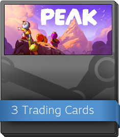

# Steam Community Items

**Steam community items** for *[PEAK](Peak%20%28game%29.md)* were added to Steam on August 28, 2025. They feature artwork by [Gina](https://x.com/SaiyaGina). They include [Steam Trading Cards](https://steamcommunity.com/tradingcards), booster packs, badges, emoticons, and profile backgrounds. Only emoticons and profile backgrounds are available for purchase from the [Steam Points Shop](https://store.steampowered.com/points/shop/app/3527290) while emoticons, backgrounds, and trading cards and booster packs can be purchased from the [Steam Community Market](https://steamcommunity.com/market/search?appid=753&category_753_Game%5B%5D=tag_app_3527290). Badges can only be obtained through crafting.

## Trading Cards

There are a total of 15 Steam Trading Cards for *[PEAK](Peak%20%28game%29.md)*. [Steam Trading Cards](https://steamcommunity.com/tradingcards) are Steam Marketplace commodities. This means that each item is not unique, and can be bought and/or sold in bulk. Each is available in basic and foil rarity. Trading cards are used to craft [Steam Badges](https://steamcommunity.com/tradingcards/faq). Trading cards can also be acquired through booster packs.

Trading Cards are automatically awarded to players while playing the game on Steam. Players can receive up to eight cards while playing for the first four hours.

While prices fluctuate with availability and demand, the basic trading cards cost around $0.05 USD, with foil cards costing between $0.19 USD and $0.40 USD (as of November 2025).

| Basic | Foil | Wallpaper | Number | Name |
| --- | --- | --- | --- | --- |
| [Steam Trading Card 01 - At The Gate.png](https://peak.wiki.gg/wiki/File%3ASteam_Trading_Card_01_-_At_The_Gate.png) | [Steam Trading Card 01 - At The Gate (Foil).png](https://peak.wiki.gg/wiki/File%3ASteam_Trading_Card_01_-_At_The_Gate_%28Foil%29.png) | [Steam Wallpaper 01 - At The Gate.jpg](https://peak.wiki.gg/wiki/File%3ASteam_Wallpaper_01_-_At_The_Gate.jpg) | 1 | At The Gate |
| [Steam Trading Card 02 - A Quick Dip.png](https://peak.wiki.gg/wiki/File%3ASteam_Trading_Card_02_-_A_Quick_Dip.png) | [Steam Trading Card 02 - A Quick Dip (Foil).png](https://peak.wiki.gg/wiki/File%3ASteam_Trading_Card_02_-_A_Quick_Dip_%28Foil%29.png) | [Steam Wallpaper 02 - A Quick Dip.jpg](https://peak.wiki.gg/wiki/File%3ASteam_Wallpaper_02_-_A_Quick_Dip.jpg) | 2 | A Quick Dip |
| [Steam Trading Card 03 - Scoutmaster Myres.png](https://peak.wiki.gg/wiki/File%3ASteam_Trading_Card_03_-_Scoutmaster_Myres.png) | [Steam Trading Card 03 - Scoutmaster Myres (Foil).png](https://peak.wiki.gg/wiki/File%3ASteam_Trading_Card_03_-_Scoutmaster_Myres_%28Foil%29.png) | [Steam Wallpaper 03 - Scoutmaster Myres.jpg](https://peak.wiki.gg/wiki/File%3ASteam_Wallpaper_03_-_Scoutmaster_Myres.jpg) | 3 | Scoutmaster Myres |
| [Steam Trading Card 04 - Zip Line.png](https://peak.wiki.gg/wiki/File%3ASteam_Trading_Card_04_-_Zip_Line.png) | [Steam Trading Card 04 - Zip Line (Foil).png](https://peak.wiki.gg/wiki/File%3ASteam_Trading_Card_04_-_Zip_Line_%28Foil%29.png) | [Steam Wallpaper 04 - Zip Line.jpg](https://peak.wiki.gg/wiki/File%3ASteam_Wallpaper_04_-_Zip_Line.jpg) | 4 | Zip Line |
| [Steam Trading Card 05 - The Ultimate Carry.png](https://peak.wiki.gg/wiki/File%3ASteam_Trading_Card_05_-_The_Ultimate_Carry.png) | [Steam Trading Card 05 - The Ultimate Carry (Foil).png](https://peak.wiki.gg/wiki/File%3ASteam_Trading_Card_05_-_The_Ultimate_Carry_%28Foil%29.png) | [Steam Wallpaper 05 - The Ultimate Carry.jpg](https://peak.wiki.gg/wiki/File%3ASteam_Wallpaper_05_-_The_Ultimate_Carry.jpg) | 5 | The Ultimate Carry |
| [Steam Trading Card 06 - Campfire.png](https://peak.wiki.gg/wiki/File%3ASteam_Trading_Card_06_-_Campfire.png) | [Steam Trading Card 06 - Campfire (Foil).png](https://peak.wiki.gg/wiki/File%3ASteam_Trading_Card_06_-_Campfire_%28Foil%29.png) | [Steam Wallpaper 06 - Campfire.jpg](https://peak.wiki.gg/wiki/File%3ASteam_Wallpaper_06_-_Campfire.jpg) | 6 | Campfire |
| [Steam Trading Card 07 - You Fell Off.png](https://peak.wiki.gg/wiki/File%3ASteam_Trading_Card_07_-_You_Fell_Off.png) | [Steam Trading Card 07 - You Fell Off (Foil).png](https://peak.wiki.gg/wiki/File%3ASteam_Trading_Card_07_-_You_Fell_Off_%28Foil%29.png) | [Steam Wallpaper 07 - You Fell Off.jpg](https://peak.wiki.gg/wiki/File%3ASteam_Wallpaper_07_-_You_Fell_Off.jpg) | 7 | You Fell Off |
| [Steam Trading Card 08 - PEAK!.png](https://peak.wiki.gg/wiki/File%3ASteam_Trading_Card_08_-_PEAK%21.png) | [Steam Trading Card 08 - PEAK! (Foil).png](https://peak.wiki.gg/wiki/File%3ASteam_Trading_Card_08_-_PEAK%21_%28Foil%29.png) | [Steam Wallpaper 08 - PEAK!.jpg](https://peak.wiki.gg/wiki/File%3ASteam_Wallpaper_08_-_PEAK%21.jpg) | 8 | PEAK! |
| [Steam Trading Card 09 - Bing Bong.png](https://peak.wiki.gg/wiki/File%3ASteam_Trading_Card_09_-_Bing_Bong.png) | [Steam Trading Card 09 - Bing Bong (Foil).png](https://peak.wiki.gg/wiki/File%3ASteam_Trading_Card_09_-_Bing_Bong_%28Foil%29.png) | [Steam Wallpaper 09 - Bing Bong.jpg](https://peak.wiki.gg/wiki/File%3ASteam_Wallpaper_09_-_Bing_Bong.jpg) | 9 | Bing Bong |
| [Steam Trading Card 10 - Don't Eat That!.png](https://peak.wiki.gg/wiki/File%3ASteam_Trading_Card_10_-_Don%27t_Eat_That%21.png) | [Steam Trading Card 10 - Don't Eat That! (Foil).png](https://peak.wiki.gg/wiki/File%3ASteam_Trading_Card_10_-_Don%27t_Eat_That%21_%28Foil%29.png) | [Steam Wallpaper 10 - Don't Eat That!.jpg](https://peak.wiki.gg/wiki/File%3ASteam_Wallpaper_10_-_Don%27t_Eat_That%21.jpg) | 10 | Don't Eat That! |
| [Steam Trading Card 11 - Taking Inventory.png](https://peak.wiki.gg/wiki/File%3ASteam_Trading_Card_11_-_Taking_Inventory.png) | [Steam Trading Card 11 - Taking Inventory (Foil).png](https://peak.wiki.gg/wiki/File%3ASteam_Trading_Card_11_-_Taking_Inventory_%28Foil%29.png) | [Steam Wallpaper 11 - Taking Inventory.jpg](https://peak.wiki.gg/wiki/File%3ASteam_Wallpaper_11_-_Taking_Inventory.jpg) | 11 | Taking Inventory |
| [Steam Trading Card 12 - Slip Up.png](https://peak.wiki.gg/wiki/File%3ASteam_Trading_Card_12_-_Slip_Up.png) | [Steam Trading Card 12 - Slip Up (Foil).png](https://peak.wiki.gg/wiki/File%3ASteam_Trading_Card_12_-_Slip_Up_%28Foil%29.png) | [Steam Wallpaper 12 - Slip Up.jpg](https://peak.wiki.gg/wiki/File%3ASteam_Wallpaper_12_-_Slip_Up.jpg) | 12 | Slip Up |
| [Steam Trading Card 13 - Stick Together.png](https://peak.wiki.gg/wiki/File%3ASteam_Trading_Card_13_-_Stick_Together.png) | [Steam Trading Card 13 - Stick Together (Foil).png](https://peak.wiki.gg/wiki/File%3ASteam_Trading_Card_13_-_Stick_Together_%28Foil%29.png) | [Steam Wallpaper 13 - Stick Together.jpg](https://peak.wiki.gg/wiki/File%3ASteam_Wallpaper_13_-_Stick_Together.jpg) | 13 | Stick Together |
| [Steam Trading Card 14 - Ka-boom.png](https://peak.wiki.gg/wiki/File%3ASteam_Trading_Card_14_-_Ka-boom.png) | [Steam Trading Card 14 - Ka-boom (Foil).png](https://peak.wiki.gg/wiki/File%3ASteam_Trading_Card_14_-_Ka-boom_%28Foil%29.png) | [Steam Wallpaper 14 - Ka-boom.jpg](https://peak.wiki.gg/wiki/File%3ASteam_Wallpaper_14_-_Ka-boom.jpg) | 14 | Ka-boom |
| [Steam Trading Card 15 - Sugar Rush.png](https://peak.wiki.gg/wiki/File%3ASteam_Trading_Card_15_-_Sugar_Rush.png) | [Steam Trading Card 15 - Sugar Rush (Foil).png](https://peak.wiki.gg/wiki/File%3ASteam_Trading_Card_15_-_Sugar_Rush_%28Foil%29.png) | [Steam Wallpaper 15 - Sugar Rush.jpg](https://peak.wiki.gg/wiki/File%3ASteam_Wallpaper_15_-_Sugar_Rush.jpg) | 15 | Sugar Rush |

## Booster Packs

Booster Packs can be opened for three random trading cards. Each booster pack has a 1-in-100 chance of containing a foil trading card.

A Steam account is eligible to receive a random booster pack drop once the player has collected all eight initial card drops. Random drops occur every time another Steam user crafts a Steam badge for the same game. Booster packs can also be purchased from the [Steam Community Market](https://steamcommunity.com/market/listings/753/3527290-PEAK%20Booster%20Pack), or crafted on the [booster crafting page](https://steamcommunity.com/tradingcards/boostercreator) using gems.

## Badges

Steam Badges should not be confused with *[PEAK](Peak%20%28game%29.md)'*s own in-game [Badges](Badges.md).

[Steam Badges](https://steamcommunity.com/tradingcards/faq) can be crafted by collecting a full set of trading cards. As Steam Badges are crafted, the affiliated Steam account is awarded with Steam level XP, as well Background and Emoticon. The basic badge can be crafted and upgraded up to five badge levels while the foil badge can only be crafted once. The highest level of basic badge and/or the foil badge can be displayed on the player's Steam Profile badge showcase or as their Featured Badge. Lower levels of the basic badge can not be displayed once a higher level has been crafted.

### Badges

| Image | Level | Name | Steam XP |
| --- | --- | --- | --- |
| [Steam Badge Level 1 - Happy Camper Badge.png](https://peak.wiki.gg/wiki/File%3ASteam_Badge_Level_1_-_Happy_Camper_Badge.png) | 1 | Happy Camper Badge | 100 |
| [Steam Badge Level 2 - Beachcomber Badge.png](https://peak.wiki.gg/wiki/File%3ASteam_Badge_Level_2_-_Beachcomber_Badge.png) | 2 | Beachcomber Badge | 200 |
| [Steam Badge Level 3 - Trailblazer Badge.png](https://peak.wiki.gg/wiki/File%3ASteam_Badge_Level_3_-_Trailblazer_Badge.png) | 3 | Trailblazer Badge | 300 |
| [Steam Badge Level 4 - Alpinist Badge.png](https://peak.wiki.gg/wiki/File%3ASteam_Badge_Level_4_-_Alpinist_Badge.png) | 4 | Alpinist Badge | 400 |
| [Steam Badge Level 5 - Volcanology Badge.png](https://peak.wiki.gg/wiki/File%3ASteam_Badge_Level_5_-_Volcanology_Badge.png) | 5 | Volcanology Badge | 500 |

### Foil Badges

| Image | Level | Name | Steam XP |
| --- | --- | --- | --- |
| [Steam Foil Badge - PEAK Badge.png](https://peak.wiki.gg/wiki/File%3ASteam_Foil_Badge_-_PEAK_Badge.png) | 1 | PEAK Badge | 100 |

## Emoticons

There are 10 Steam Emoticons for *[PEAK](Peak%20%28game%29.md)*. They can be acquired from crafting Steam Badges, or purchase on the [Steam Points Shop](https://store.steampowered.com/points/shop/app/3527290) for 100 points each. Emoticons can be used in Steam Chat or any text field on Steam such as comments and reviews. Emoticons can also be converted into gems unless purchased from the Points Shop.

| Image | Name | Rarity | Steam Points |
| --- | --- | --- | --- |
| [Steam Emoticon - PEAKactually.png](https://peak.wiki.gg/wiki/File%3ASteam_Emoticon_-_PEAKactually.png) | :PEAKactually: | Common | Steam Points 100 |
| [Steam Emoticon - PEAKbingbong.png](https://peak.wiki.gg/wiki/File%3ASteam_Emoticon_-_PEAKbingbong.png) | :PEAKbingbong: | Rare | Steam Points 100 |
| [Steam Emoticon - PEAKblush.png](https://peak.wiki.gg/wiki/File%3ASteam_Emoticon_-_PEAKblush.png) | :PEAKblush: | Common | Steam Points 100 |
| [Steam Emoticon - PEAKcapy.png](https://peak.wiki.gg/wiki/File%3ASteam_Emoticon_-_PEAKcapy.png) | :PEAKcapy: | Rare | Steam Points 100 |
| [Steam Emoticon - PEAKghost.png](https://peak.wiki.gg/wiki/File%3ASteam_Emoticon_-_PEAKghost.png) | :PEAKghost: | Uncommon | Steam Points 100 |
| [Steam Emoticon - PEAKpoint.png](https://peak.wiki.gg/wiki/File%3ASteam_Emoticon_-_PEAKpoint.png) | :PEAKpoint: | Common | Steam Points 100 |
| [Steam Emoticon - PEAKsalute.png](https://peak.wiki.gg/wiki/File%3ASteam_Emoticon_-_PEAKsalute.png) | :PEAKsalute: | Common | Steam Points 100 |
| [Steam Emoticon - PEAKslip.png](https://peak.wiki.gg/wiki/File%3ASteam_Emoticon_-_PEAKslip.png) | :PEAKslip: | Uncommon | Steam Points 100 |
| [Steam Emoticon - PEAKsob.png](https://peak.wiki.gg/wiki/File%3ASteam_Emoticon_-_PEAKsob.png) | :PEAKsob: | Common | Steam Points 100 |
| [Steam Emoticon - PEAKthink.png](https://peak.wiki.gg/wiki/File%3ASteam_Emoticon_-_PEAKthink.png) | :PEAKthink: | Common | Steam Points 100 |

## Profile Backgrounds

There are eight Steam Profile Backgrounds and one Mini-Profile Background for *[PEAK](Peak%20%28game%29.md)*. Seven of which can be acquired by crafting Steam Badges, or purchased on the [Steam Points Shop](https://store.steampowered.com/points/shop/app/3527290) for  500 Steam Points each, while the Animated Background and Mini-Profile Background are exclusively available through the Points Shop for  2,000 each. Profile backgrounds can be equipped to the player's Steam Profile. Profile backgrounds can be converted into gems unless purchased from the Points Shop.

### Profile Backgrounds

| Image | Name | Rarity | Steam Points |
| --- | --- | --- | --- |
| [Steam Background - Alpine.jpg](https://peak.wiki.gg/wiki/File%3ASteam_Background_-_Alpine.jpg) | Alpine | Common | Steam Points 500 |
| [Steam Background - Caldera.jpg](https://peak.wiki.gg/wiki/File%3ASteam_Background_-_Caldera.jpg) | Caldera | Common | Steam Points 500 |
| [Steam Background - Mesa.jpg](https://peak.wiki.gg/wiki/File%3ASteam_Background_-_Mesa.jpg) | Mesa | Uncommon | Steam Points 500 |
| [Steam Background - PEAK.jpg](https://peak.wiki.gg/wiki/File%3ASteam_Background_-_PEAK.jpg) | PEAK | Rare | Steam Points 500 |
| [Steam Background - Shore.jpg](https://peak.wiki.gg/wiki/File%3ASteam_Background_-_Shore.jpg) | Shore | Common | Steam Points 500 |
| [Steam Background - The Kiln.jpg](https://peak.wiki.gg/wiki/File%3ASteam_Background_-_The_Kiln.jpg) | The Kiln | Uncommon | Steam Points 500 |
| [Steam Background - Tropics.jpg](https://peak.wiki.gg/wiki/File%3ASteam_Background_-_Tropics.jpg) | Tropics | Common | Steam Points 500 |
|  | Capybaras in the Alpines (Animated Background) | n/a | Steam Points 2,000 |

### Mini-Profile Backgrounds

There is one Mini-Profile Background for *[PEAK](Peak%20%28game%29.md)* available from the Steam Points Shop.

| Image | Name | Rarity | Steam Points |
| --- | --- | --- | --- |
|  | Capybaras in the Alpines | Common | Steam Points 2,000 |

## Animated Stickers

There are four Animated Stickers for *[PEAK](Peak%20%28game%29.md)* available from the Steam Points Shop.

| Image | Name | Steam Points |
| --- | --- | --- |
| [Steam Animated Sticker - Climbing Scout.webp](https://peak.wiki.gg/wiki/File%3ASteam_Animated_Sticker_-_Climbing_Scout.webp) | Climbing Scout | Steam Points 1,000 |
| [Steam Animated Sticker - Falling Scout.webp](https://peak.wiki.gg/wiki/File%3ASteam_Animated_Sticker_-_Falling_Scout.webp) | Falling Scout | Steam Points 1,000 |
| [Steam Animated Sticker - Keeping It Together.webp](https://peak.wiki.gg/wiki/File%3ASteam_Animated_Sticker_-_Keeping_It_Together.webp) | Keeping It Together | Steam Points 1,000 |
| [Steam Animated Sticker - Smug Scout.webp](https://peak.wiki.gg/wiki/File%3ASteam_Animated_Sticker_-_Smug_Scout.webp) | Smug Scout | Steam Points 1,000 |

## Avatar Frames

There are two Avatar Frames for *[PEAK](Peak%20%28game%29.md)* available from the Steam Points Shop.

| Image | Name | Steam Points |
| --- | --- | --- |
| [Steam Avatar Frame - Banana!.webp](https://peak.wiki.gg/wiki/File%3ASteam_Avatar_Frame_-_Banana%21.webp) | Banana! | Steam Points 2,000 |
| [Steam Avatar Frame - Bing Bong on the Beach.webp](https://peak.wiki.gg/wiki/File%3ASteam_Avatar_Frame_-_Bing_Bong_on_the_Beach.webp) | Bing Bong on the Beach | Steam Points 2,000 |

## Animated Avatars

There are four Animated Avatars for *[PEAK](Peak%20%28game%29.md)* available from the Steam Points Shop.

| Image | Name | Steam Points |
| --- | --- | --- |
| [Steam Animated Avatar - Bing Bong.gif](https://peak.wiki.gg/wiki/File%3ASteam_Animated_Avatar_-_Bing_Bong.gif) | Bing Bong | Steam Points 3,000 |
| [Steam Animated Avatar - Campfire.gif](https://peak.wiki.gg/wiki/File%3ASteam_Animated_Avatar_-_Campfire.gif) | Campfire | Steam Points 3,000 |
| [Steam Animated Avatar - Dancing Scout.gif](https://peak.wiki.gg/wiki/File%3ASteam_Animated_Avatar_-_Dancing_Scout.gif) | Dancing Scout | Steam Points 3,000 |
| [Steam Animated Avatar - PEAK Scout.gif](https://peak.wiki.gg/wiki/File%3ASteam_Animated_Avatar_-_PEAK_Scout.gif) | PEAK Scout | Steam Points 3,000 |

## Startup Movie

There is one Startup Movie for *[PEAK](Peak%20%28game%29.md)* available from the Steam Points Shop.

| Image | Name | Steam Points |
| --- | --- | --- |
|  | LOADING | Steam Points 3,000 |
