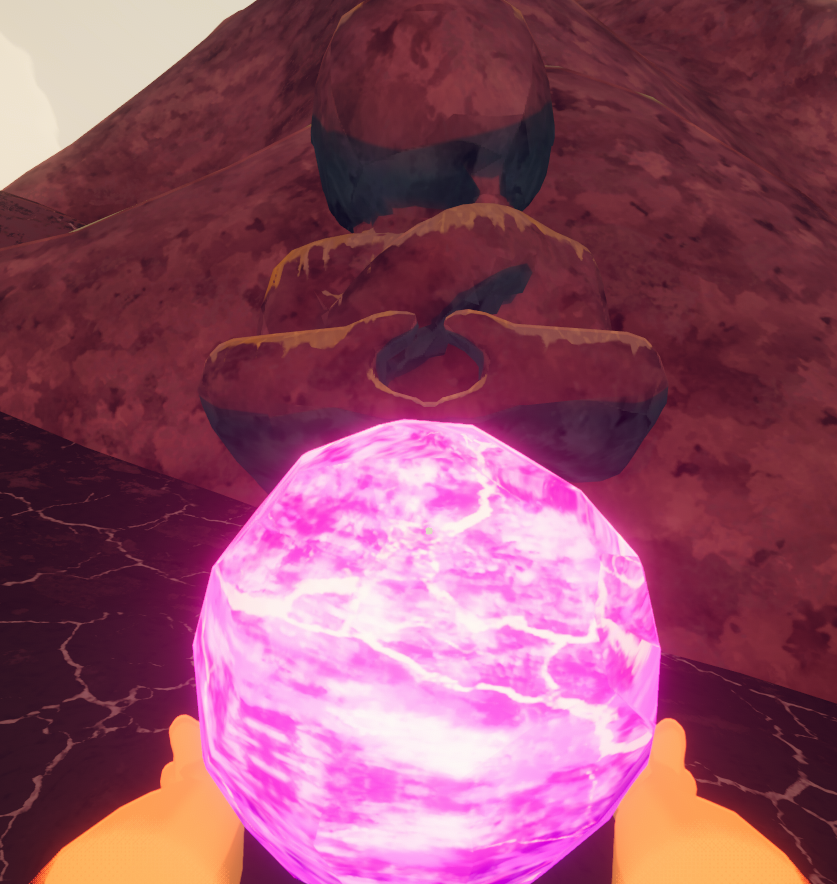

# Strange Gem

Strange Gem

[Item type](Items.md)- [Amulet](https://peak.wiki.gg/wiki/Amulet)
- [Mystical item](https://peak.wiki.gg/wiki/Mystical_item)
Biome- [Peak](Peak%20%28biome%29.md)
Source- [Stone Scout](https://peak.wiki.gg/wiki/Stone_Scout)
Weight
 **2.5**

The **Strange Gem** is an [mystical item](https://peak.wiki.gg/wiki/Mystical_item) in *[PEAK](Peak%20%28game%29.md)* found in the hands of the Stone Scout behind the mountain top of the [PEAK](Peak%20%28biome%29.md). Picking up the gem and pressing  **Left Click** displays a message reading "Gem Activated" in the top left corner of the screen, doing it again displays another message reading "Gem Deactivated".

[Cooking](Cooking.md) the strange gem will cause it to apply  **10** [Bonus stamina](Stamina%20bar.md#Bonus_stamina) when bestowed. Burning it will apply  [Poison](Stamina%20bar.md#Poison) under the same circumstances.

## Purpose

 **Spoilers!** - The following section contains spoilers for *[PEAK](Peak%20%28game%29.md)*.

Prior to the [Final Ascent](2.0.a.md) update the Strange Gem had no use other than displaying the text messages. After the update the [Stone Scout](https://peak.wiki.gg/wiki/Stone_Scout) statue holding it was changed, now featuring four [Amulet](https://peak.wiki.gg/wiki/Amulet) slots in its sash. If all four Scout's Amulets are bestowed onto the statue's sash, they will transform the Strange Gem into  [Scout's Honor](Scout%27s%20Honor.md).

## Trivia

- The Strange Gem is likely a reference to the "Chat Gem" from the role-playing video game [Diablo II](https://en.wikipedia.org/wiki/Diablo_II). Diablo II's Chat Gem appeared at the bottom of games's chat window and clicking on it would switch its color between blue and magenta and display the message "Gem Activated" or "Gem Deactivated". Apart from displaying the text messages it served no gameplay purpose.

## Gallery

- 
  The strange gem in-game prior to [2.0.a](2.0.a.md).

## Patch history

 **[1.20.a](1.20.a.md) (2025-08-11):** Introduced.
 **[1.40.a](1.40.a.md) (2025-11-05):** Can now be "activated."
 **[2.0.a](2.0.a.md) (2026-08-11):**

- Updated the Gem's model. **(Undocumented)**
- Added the ability to transform into [Scout's Honor](Scout%27s%20Honor.md) after all four [Amulets](Amulets.md) are placed on the scout statue. **(Undocumented)**

## Notes
