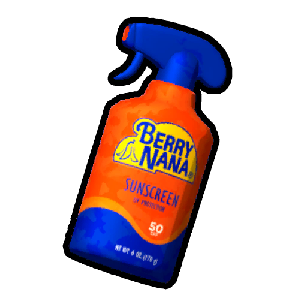
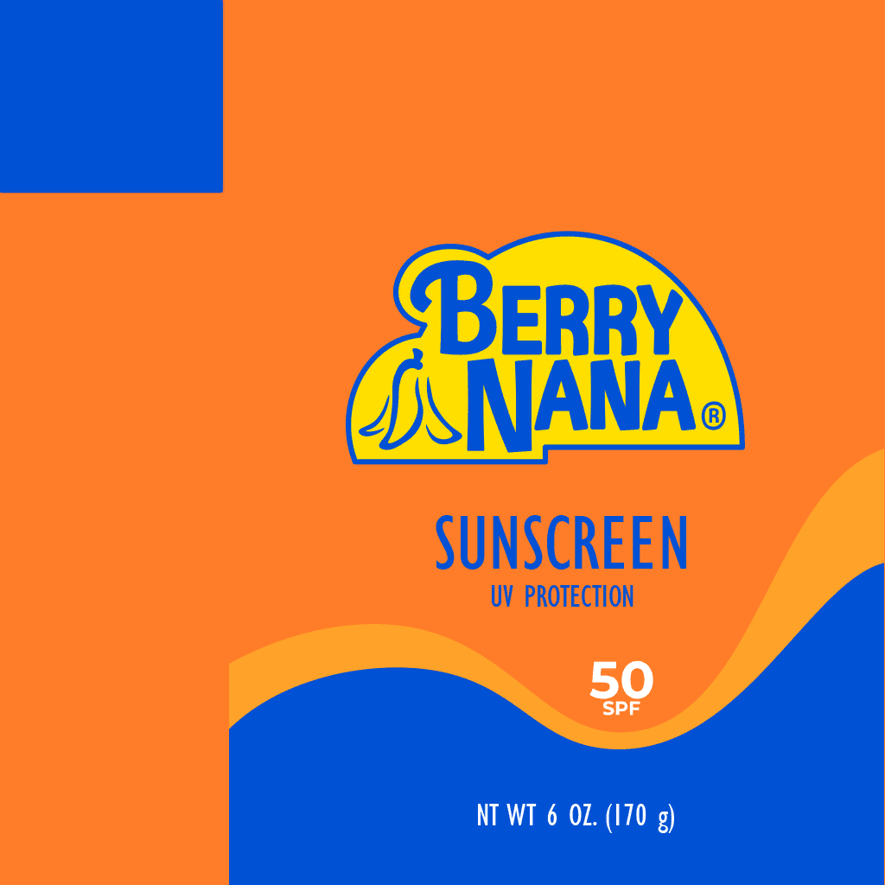

# Sunscreen

Sunscreen

[Item type](Items.md)- [Consumable](https://peak.wiki.gg/wiki/Consumable)
Rarity
[Epic](https://peak.wiki.gg/wiki/Epic)
Biome- [Mesa](Mesa.md)
Source- [Regular Luggage](https://peak.wiki.gg/wiki/Regular_Luggage)
- [Big Luggage](https://peak.wiki.gg/wiki/Big_Luggage)
Uses
3
Weight
 **2.5**

The **Sunscreen** is a [consumable](https://peak.wiki.gg/wiki/Consumable) item in *[PEAK](Peak%20%28game%29.md)* found in [luggage](Luggage.md) in the [Mesa](Mesa.md). It can be used to create a small cloud spanning **4.8 meters** that will apply a sunscreen effect to any players passing through it, offering **90 seconds** of protection from the sun's  [Heat](Stamina%20bar.md#Heat) damage in the [Mesa](Mesa.md). Sunscreen will appear as a white sheen on the [Scout](Scout.md)'s skin and a white cloudy texture around the edges of the screen. The sunscreen cloud will dissipate after **4 seconds**.

[Cooking](Cooking.md) a Sunscreen causes it to explode, creating a cloud **9.6 meters** across that gives any scouts within the sunscreen effect for the normal **90 seconds**. This cloud also dissipates after **4 seconds**.

## Gallery

- 
  Sunscreen texture

## Patch history

 **[1.20.a](1.20.a.md) (2025-08-11):** Introduced.
 **[1.40.a](1.40.a.md) (2025-11-05):** Cooking sunscreen now causes it to explode.
