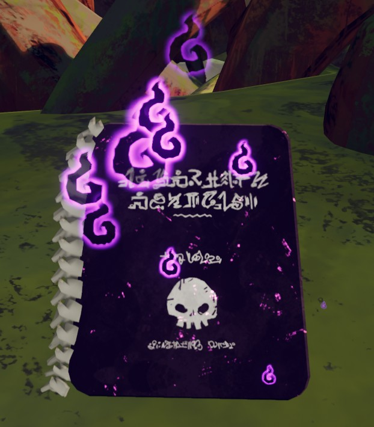
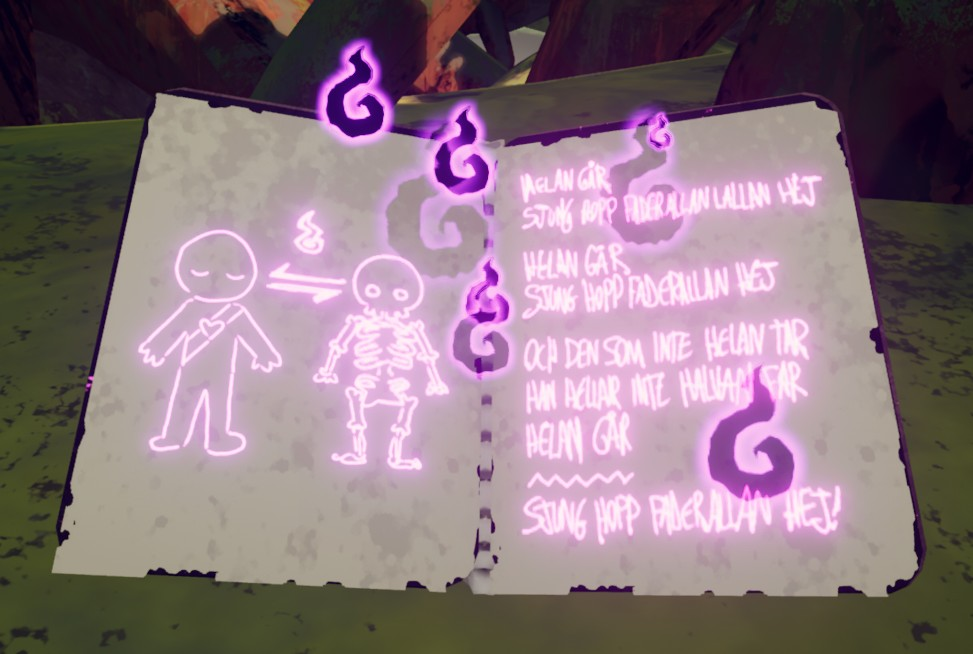
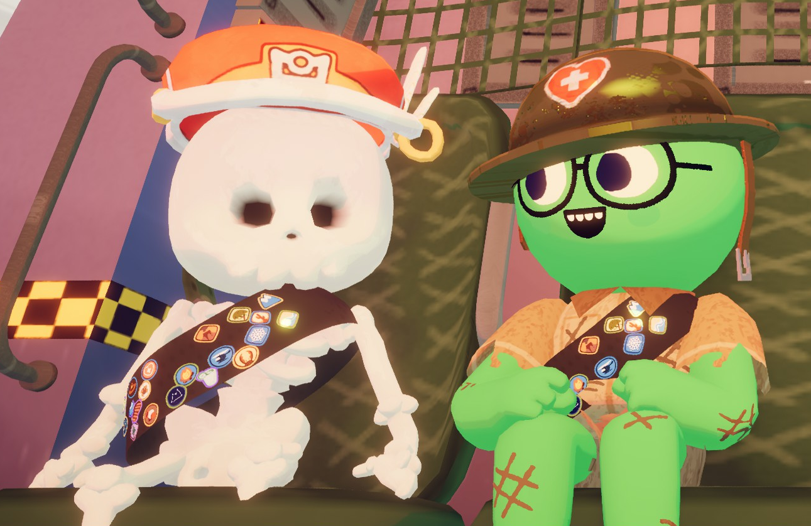
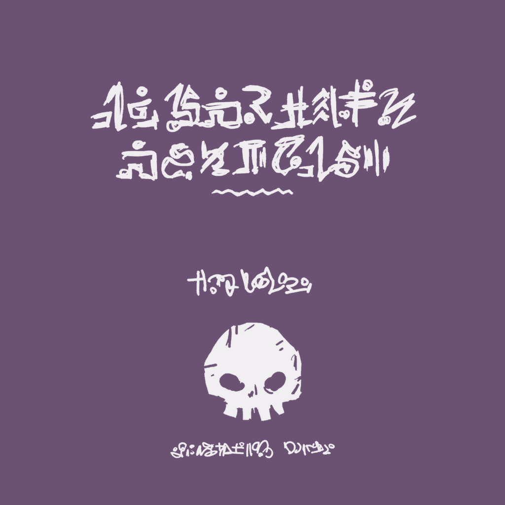
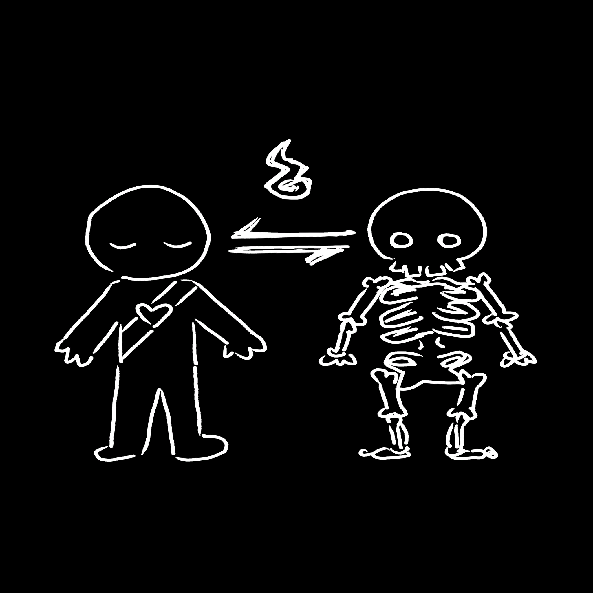
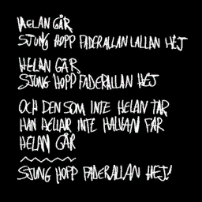

# The Book of Bones

 This page is about **the item that turns scouts into a [Living Skeleton](https://peak.wiki.gg/wiki/Skeleton_Scouts)**. For other uses, see [Skeleton](Skeleton.md).
The Book of Bones

[Item type](Items.md)- [Consumable](https://peak.wiki.gg/wiki/Consumable)
- [Mystical item](https://peak.wiki.gg/wiki/Mystical_item)
Source- [Ancient Luggage](https://peak.wiki.gg/wiki/Ancient_Luggage)
- [Ancient Statues](https://peak.wiki.gg/wiki/Ancient_Statues)
Weight
 **2.5**
Base Status Effects
Curse
25
Removes all status effects except  [Curse](Stamina%20bar.md#Curse) and  [Petrify](Stamina%20bar.md#Petrify).

**The Book of Bones** is a [consumable](https://peak.wiki.gg/wiki/Consumable) [mystical item](https://peak.wiki.gg/wiki/Mystical_item) in *[PEAK](Peak%20%28game%29.md)*. It can be used to turn dead [Scouts](https://peak.wiki.gg/wiki/Scouts) (and alive ones) into [Living Skeletons](https://peak.wiki.gg/wiki/Skeleton_Scouts). The Book of Bones can only be acquired from [Ancient Statues](Ancient%20Statue.md) and [Ancient Luggage](https://peak.wiki.gg/wiki/Ancient_Luggage).

[Cooking](Cooking.md) The Book of Bones has no effect, even when incinerated.

Using The Book of Bones on another dead player grants the  [Applied Esoterica Badge](https://peak.wiki.gg/wiki/Applied_Esoterica_Badge).

## Usage mechanics

The Book of Bones can be used once either on the player wielding the book, or on another player's dead skeleton. It does not work on the skeletons of [Zombies](Zombie.md), even those of dead players.

The following effects are applied to the target:

- All status effects except  [Curse](Stamina%20bar.md#Curse) and  [Petrify](Stamina%20bar.md#Petrify) are cleared.
- If the target is a normal Scout or dead skeleton, they will become a [Living Skeleton](https://peak.wiki.gg/wiki/Skeleton_Scouts). If they were already a Living Skeleton, the target becomes a normal Scout.- A dead skeleton can be targeted even if its associated player is currently alive. The target player will be revived as a [Living Skeleton](https://peak.wiki.gg/wiki/Skeleton_Scouts) where the dead skeleton was. All of the target player's dead skeletons will be removed.
- The target will either gain or lose  [Curse](Stamina%20bar.md#Curse) depending on several factors.- If the target is now a normal Scout, they will lose  **25** [Curse](Stamina%20bar.md#Curse).
  - If the target was a dead skeleton that has been revived, they will gain  **5** [Curse](Stamina%20bar.md#Curse).
  - If the target was the player holding the book and they became a [Living Skeleton](https://peak.wiki.gg/wiki/Skeleton_Scouts), they will gain  **25** [Curse](Stamina%20bar.md#Curse), even if currently  [Invincible](Stamina%20bar.md#Invincibility).

Petrified scouts lack skeletons, and therefore cannot be revived as [Living Skeletons](https://peak.wiki.gg/wiki/Skeleton_Scouts) (unless one of their skeletons was already present).

## Trivia

- The text on the right page is quoting [Helan Går](https://en.wikipedia.org/wiki/Helan_G%C3%A5r), a popular Swedish drinking song.
- It is possible to reach the [Peak](Peak%20%28biome%29.md) and be part of the ending cutscene as a [Living Skeleton](https://peak.wiki.gg/wiki/Skeleton_Scouts) using this item.

## Gallery

- 
  The Book of Bones when held.
- 
  The Book of Bones being used.
- 
  The ending cutscene with one player as a [Living Skeleton](https://peak.wiki.gg/wiki/Skeleton_Scouts), accomplished with The Book of Bones.
- 
  Cover texture.
- 
  Left page texture.
- 
  Right page texture.

## Patch history

 **[1.40.a](1.40.a.md) (2025-11-05):** Introduced.
 **[1.43.a](1.43.a.md) (2025-11-07):** The [Cursed Skull](Cursed%20Skull.md) and Book of Bones ambient sfx are now muted when in the [backpack](Backpack.md).
 **[1.44.a](1.44.a.md) (2025-11-13):** Fixed visual issues relating to using the Book of Bones with the [Third Eye](https://peak.wiki.gg/wiki/Third_Eye) accessory equipped.
 **[2.02.a](https://peak.wiki.gg/wiki/2.02.a) :** Cooking the Book of Bones will no longer provide any benefit.
