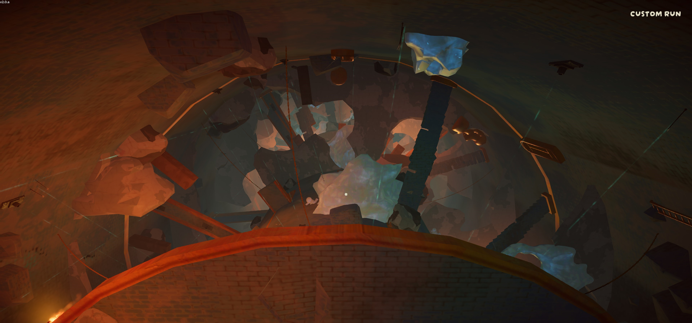
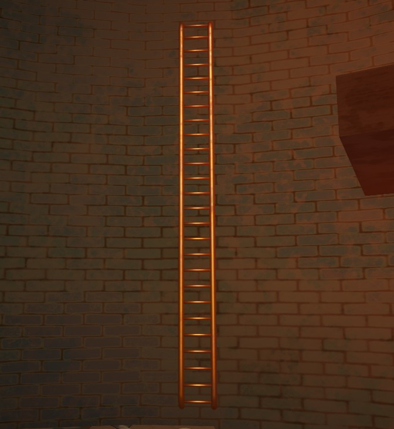
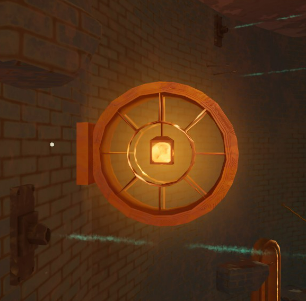
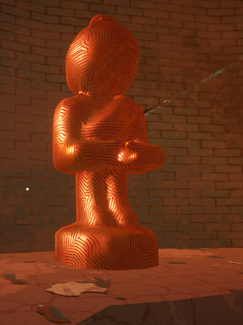
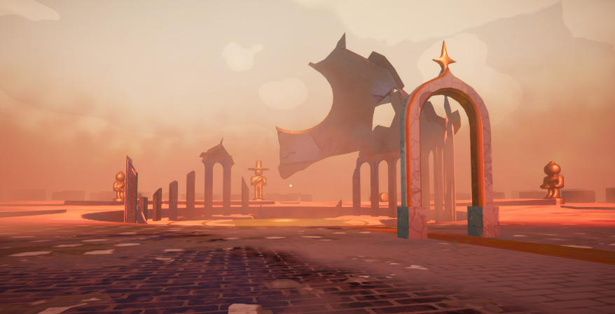

# The Citadel

This page is a [stub](https://support.wiki.gg/wiki/Stub). You can help **PEAK Wiki** by expanding it.

The Citadel

Details
Type
[Biome](https://peak.wiki.gg/wiki/Biome)
Region
**5**/6

**The Citadel** is one of two possible fifth and penultimate [biomes](https://peak.wiki.gg/wiki/Biomes) (the other being [The Kiln](The%20Kiln.md)) in *[PEAK](Peak%20%28game%29.md)*, following the [Gloom](Gloom.md) and preceding the [Peak](Peak%20%28biome%29.md) of the [mountain](Island.md). It is the inside of a tall tower, filled to the brim with traps and ruined structures.

On the ["Peak" ascent](Ascents.md#Peak) or higher, the Sleepy Gloom will eventually begin to rise from the bottom, gradually making its way to the top similarly to the [fog](Fog.md) or [The Kiln](The%20Kiln.md)'s rising lava.

The Citadel can only appear if its preceding biome is the Gloom. If the preceding biome is the [Caldera](Caldera.md), [The Kiln](The%20Kiln.md) will always appear as the fifth biome of the run.

Climbing past the citadel without getting hit by any traps grants the  [Medieval History Badge](https://peak.wiki.gg/wiki/Medieval_History_Badge).

## Areas

The Citadel is comprised of two cylinders, a larger "outside" and a smaller "center." The terrain generation depends on the given area. Hazard and prop generation is done seperately.

### Citadel Center

---

The center of the Citadel is comprised of a hollow pillar, which can be traversed through cracks and golden doorways on the floors. The smaller radius makes for easier climbing, but each floor has more traps. The majority of [luggages](Luggage.md) are also here.

7 floors are selected from the following options without repeats:

- **Roller:** 2 horizontal spike rollers rotate around a possible luggage spot. The platform above has a hole in the middle.
- **Roller 2:** Like Roller, but with 4 spike rollers and a lot more traps in general.
- **Stairs:** The inside is sparse, but walkable. A spiral staircase surrounds the outside of the central wall.
- **Stairs Broken:** Like Stairs, but the outer staircase has 2 gaps. These gaps contain buzzsaws.
- **Spike Balls:** Swinging Maces adorn several straight platforms leading to the Citadel's outside.
- **Spike Ball Stairs:** Like Spike Balls, but with a spiral staircase on the outside.
- **Rings:** Several layers of spike traps.
- **Rings Evil:** Same as Rings, but with a vertical spike roller in the middle.

### Citadel Outside

---

The outside edges of the Citadel are away from the large pillar in the center. Chunks of the floor still stand, allowing for some traversal by foot. There are fewer climbing opportunities here, but it is almost trap-free.

The following options are shuffled and placed in that order until 14 total floors have been placed:

- **Empty:** The majority of the floor is missing, leaving a crescent shape on the outer edge.
- **Edges:** About 40% of the floor's circumference is missing. Shattered platforms dot the other edge.
- **Stairs:** The only walking space is a long staircase that (sometimes) connects the floors above and below.
- **Bridge:** It is possible to walk the entire circumference. The missing chunks of floor create a bridged design.
- **Partial Bridge:** Similar to Bridge, but the floor's inner circle is mostly gone.
- **Statues:** Similar to Bridge, but one side contains three golden statues. The middle statue is tipped over.

### Bottom of the Tower

---

The bottom 2 floors are unique:

- The first floor has several kneeling statues holding up the Citadel's center. Inside, A stone staircase wraps around a golden sun on the floor. This sun often has [luggage](Luggage.md) on top of it.
- The second floor contains a crucible of lava. Surrounding the crucible are four golden statues, including one of [The Scoutmaster](https://peak.wiki.gg/wiki/The_Scoutmaster).

### Top of the Tower

---

The top 2 floors are unique as well:

- The second-to-last floor of the Citadel is marked by a golden platform. Numerous weathered murals line the spaces between the windows. A stone staircase leads to the top floor.
- The very top of The Citadel bears a large weathered platform. Surrounding the platform are numerous golden Scout statues, including one of [The Scoutmaster](https://peak.wiki.gg/wiki/The_Scoutmaster). The Peak's entrance is marked by an archway with a star on top.

## Features

### Golden Chains

---

**Golden Chains** can be found scattered across the Citadel, functioning similarly to the ones found in the [caldera](Caldera.md).

### Ladders

---

Golden **Ladders** can be found scattered across the Citadel. They provide a reduced stamina rate and increased speed while climbing, as indicated by the player's crosshair changing to a white ladder.

### Lamps

---

**Lamps** can be found scattered across the Citadel. They provide a small amount of light, which is contained in a golden hoop that sticks out from the wall. They can be climbed on.

### Scout Statues

---

Golden **Scout Statues** can be found across the center and outside of the Citadel, bearing a resemblance to the [Ancient Statues](Ancient%20Statue.md). Multiple will be found on the floor they generated on, equally spaced from the ones around it. Some of them have fallen over. They can be climbed on.

### Staircases

---

**Staircases** can be found across the Citadel in various states of disrepair. The ones on the very top and bottom of the tower are the least broken.

They can be both walked and climbed on for easy traversal.

### Windows

---

Windows can be found across the Citadel. They cannot be walked through, but stick out far enough to be stood upon if climbed. They typically have light pouring through them.

## Hazards

| Hazard | Image | Description |
| --- | --- | --- |
| **Arrow Traps** | [Arrow Trap.png](https://peak.wiki.gg/wiki/File%3AArrow_Trap.png) | **Arrow Traps** are scattered across the walls and ceilings of The Citadel. If a [Scout](Scout.md) or item makes contact with the thin blue line, an arrow will shoot out. If the arrow hits the Scout, they are afflicted with [Arrow](Stamina%20bar.md#Arrow) **7.5** [Arrow](Stamina%20bar.md#Arrow). Similar to [Thorns](Stamina%20bar.md#Thorns) [Thorns](Stamina%20bar.md#Thorns), the arrows can be removed, but doing so will inflict [Injury](Stamina%20bar.md#Injury) **12.5** [Injury](Stamina%20bar.md#Injury). An arrow trap deactivates after firing 3 arrows, at which point its blue line will disappear. |
| **Spike Traps** | [SpikeTrap.png](https://peak.wiki.gg/wiki/File%3ASpikeTrap.png) | **Spike Traps** are pressure plates that can be found on the ground. When a Scout stands on a pressure plate, the spikes will arm themselves for **0.8 seconds** before shooting up, then receding back into the plate after a second. If a Scout is hit by the spikes, they take [Injury](Stamina%20bar.md#Injury) **15** [Injury](Stamina%20bar.md#Injury). Spike Traps can sometimes hit through floors when a platform generates close enough. |
| **Swinging Maces** | [SwingingMace.png](https://peak.wiki.gg/wiki/File%3ASwingingMace.png) | **Swinging Maces** are large, spiked balls hung from platforms inside The Citadel. They swing back and forth perpetually, granting small openings for Scouts to run through. Obstacles may sometimes impede the full swing of the mace, causing it to bounce off whatever it hit, shortening the swing. If a Swinging Mace hits a Scout, they take up to [Injury](Stamina%20bar.md#Injury) **25** [Injury](Stamina%20bar.md#Injury) and enter a [ragdoll](https://peak.wiki.gg/wiki/Ragdoll) state. |
| **Buzzsaws** | [Sawblade.png](https://peak.wiki.gg/wiki/File%3ASawblade.png) | **Buzzsaws** are large circular-bladed saws that move up and down in vertical tracks on the Citadel walls, sometimes intersecting floors, staircases, or windows. They inflict [Injury](Stamina%20bar.md#Injury) [Injury](Stamina%20bar.md#Injury) on contact. |
| **[Luggage Trap](Luggage.md#Luggage_Trap)** | [MimicLuggage.png](https://peak.wiki.gg/wiki/File%3AMimicLuggage.png) | **[Luggage Traps](Luggage.md#Luggage_Trap)** are traps made to look like [Regular Luggage](https://peak.wiki.gg/wiki/Regular_Luggage) but with the handle up and appearing slightly opened. When opened, a cloud of gas explodes out from the Luggage Trap, which inflicts [Drowsy](Stamina%20bar.md#Drowsy) [Drowsy](Stamina%20bar.md#Drowsy). |
| **Petrifying Stones** | [PetrifyingRocks.png](https://peak.wiki.gg/wiki/File%3APetrifyingRocks.png) | **Petrifying Stones** are rocks that form on the walls of The Citadel (and [The Kiln](The%20Kiln.md)), similar to the [Ice Rocks](Ice%20Rocks.md) of the [Alpine](Alpine.md). While any part of a Scout is touching a Petrifying Stone, they are inflicted with [Petrify](Stamina%20bar.md#Petrify) **2** [Petrify](Stamina%20bar.md#Petrify) every second. |
| **Vertical Spike Rollers** | [RotatingVerticalCrusher.png](https://peak.wiki.gg/wiki/File%3ARotatingVerticalCrusher.png) | **Vertical Spike Rollers** are large round metal beams dotted with spikes that appear in the center of The Citadel. They spin in place on the vertical axis, inflicting [Injury](Stamina%20bar.md#Injury) **5** [Injury](Stamina%20bar.md#Injury) every **0.25 seconds** while in contact. |
| **Horizontal Spike Rollers** | [RotatingHorizontalCrushers.png](https://peak.wiki.gg/wiki/File%3ARotatingHorizontalCrushers.png) | **Horizontal Spike Rollers** are round metal beams dotted with spikes that appear in the center of The Citadel. Two or four crushers spin clockwise in a circle around an elevated center, inflicting [Injury](Stamina%20bar.md#Injury) **5** [Injury](Stamina%20bar.md#Injury) every **0.25 seconds** while in contact. A luggage or a luggage trap can occasionally spawn on the center platform. |
| **Crucible of Lava** | [Crucible of lava.png](https://peak.wiki.gg/wiki/File%3ACrucible_of_lava.png) | The **Crucible of Lava** is a thin pool of lava inside a deep golden basin. Steam emits from the liquid inside. It always spawns in the center of the second floor, allowing scouts to easily walk around it. Making contact with the lava inflicts [Heat](Stamina%20bar.md#Heat) [Heat](Stamina%20bar.md#Heat). |

## Tips & Tricks

-  [Invincibility](Stamina%20bar.md#Invincibility) can allow a Scout to remove an arrow without taking subsequent  [Injury](Stamina%20bar.md#Injury), making items such as  [Fortified Milk](Fortified%20Milk.md) helpful in the event of triggering an arrow trap.
- The crucible of lava can be used as a substitute for the lava of [The Kiln](The%20Kiln.md) for the  [24 Karat Badge](https://peak.wiki.gg/wiki/24_Karat_Badge).
- The  [Medieval History Badge](https://peak.wiki.gg/wiki/Medieval_History_Badge) can be earned on the same run as the  [Archery Badge](https://peak.wiki.gg/wiki/Archery_Badge), as the first badge is automatically earned after reaching the Peak, allowing you to descend back down into The Citadel and trigger the arrow traps needed for the second.

## Gallery

- 
  The top floor of the Citadel.

## Trivia

- The Citadel, alongside the Gloom, were the final two biomes added to *Peak* post-launch.
- When The Citadel was first released alongside the Gloom, it was locked into rotation for three weeks, preventing them from cycling with the Caldera and The Kiln.
- Luggage Traps are possibly a reference to *Dungeons and Dragons'* [Mimic](https://en.wikipedia.org/wiki/Mimic_(Dungeons_%26_Dragons)).
- The Citadel, [The Kiln](The%20Kiln.md), and [Nadir](Nadir.md) are the only biomes that- do not have a [campfire](Campfire.md) or an [Ancient Statue](Ancient%20Statue.md) at the end, instead immediately opening up to the next biome.
  - do not have a statue wielding an amulet.
  - do not have any natural [food](Food.md) items, only packaged food inside [Luggage](Luggage.md).
- When you are in this biome, your Steam Now Playing will say "Ascending the Citadel".

## Patch history

 **[2.0.a](2.0.a.md) (2026-08-11):** Introduced.
