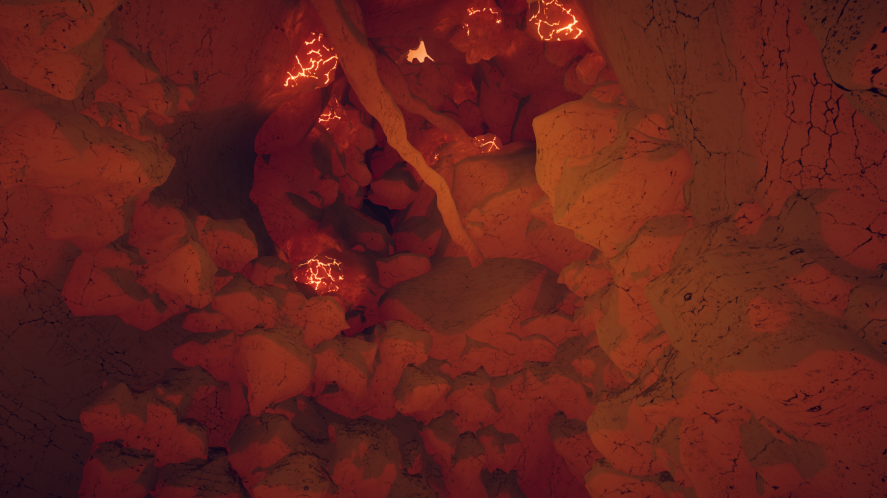
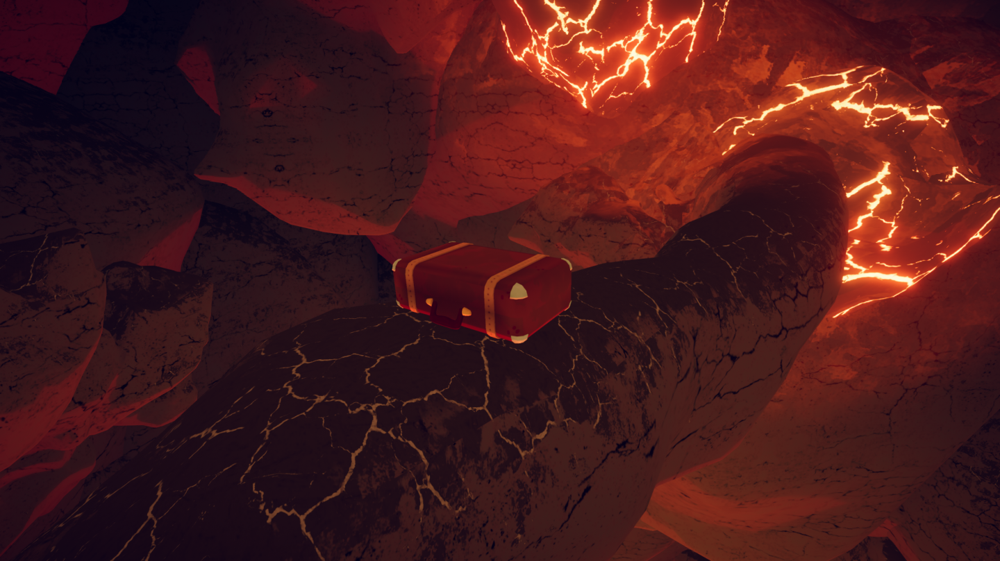
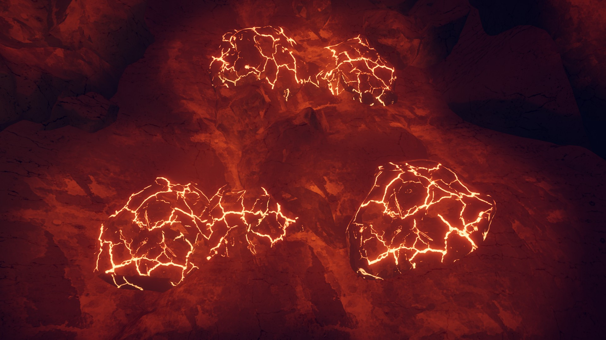
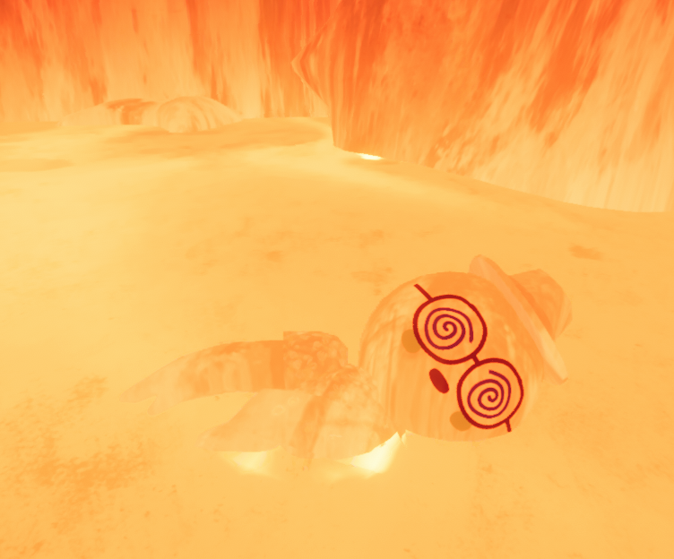
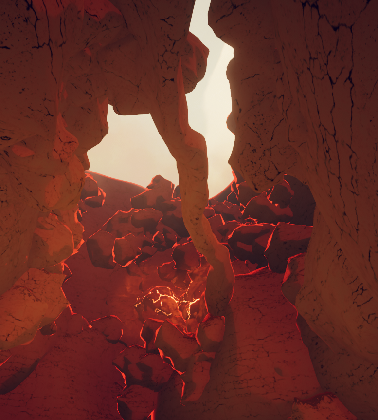
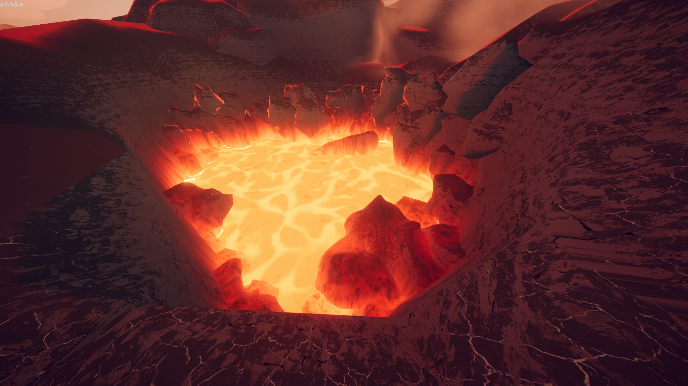

# The Kiln

The Kiln

Details
Type
[Biome](https://peak.wiki.gg/wiki/Biome)
Region
**5**/6

**The Kiln** is one of two possible fifth and penultimate [biomes](https://peak.wiki.gg/wiki/Biomes) (the other being [The Citadel](The%20Citadel.md)) in *[PEAK](Peak%20%28game%29.md)*, following the [Caldera](Caldera.md) and preceding the [Peak](Peak%20%28biome%29.md) of the [mountain](Island.md). It is the inside of a tall volcano with a pool of lava at the bottom.

When playing on the [Peak Ascent](Ascents.md) or higher, the lava at the bottom will eventually begin to rise. The lava in The Kiln is the equivalent of [Fog](Fog.md) in other biomes.

The Kiln can only appear if its preceding biome is the Caldera. If the preceding biome is the [Gloom](Gloom.md), The Citadel will always appear as the fifth biome of the run.

## Features

|  |  |
| --- | --- |
| [Kiln bottom 2.jpg](https://peak.wiki.gg/wiki/File%3AKiln_bottom_2.jpg) | At the bottom of The Kiln is a long platform that extends from the tunnel all the way to the center. Several smaller rocks also appear, surrounded by lava. Players will need to jump across the lava to reach the rocks in the walls and begin their climb. |
| [Kiln top view.png](https://peak.wiki.gg/wiki/File%3AKiln_top_view.png) | The bulk of The Kiln is comprised of many small rocks embedded in its otherwise smooth walls. Most of these rocks are climbable and can be stood on, but sections with few rocks and/or large overhanging structures may necessitate the use of [equipment](Equipment.md) to climb. |
| [Kiln bridge.jpg](https://peak.wiki.gg/wiki/File%3AKiln_bridge.jpg) | The middle of the volcano is mostly empty. Occasionally, bridge-like rock formations appear that extend from one side to the other. These rock bridges sometimes have gaps in them. |
| [Kiln luggage.jpg](https://peak.wiki.gg/wiki/File%3AKiln_luggage.jpg) | [Luggage](Luggage.md) in The Kiln is less common than in other biomes, but can still appear. It very frequently spawns on bridge-like rock formations. |
| [Kiln top 2.jpg](https://peak.wiki.gg/wiki/File%3AKiln_top_2.jpg) | Eventually, players reach the top of The Kiln, which has a bridge-like rock formation leading to the [Peak](Peak%20%28biome%29.md). |

## Hazards

| Hazard | Image | Description |
| --- | --- | --- |
| **Hot Rocks** | [Hot rock.png](https://peak.wiki.gg/wiki/File%3AHot_rock.png) | **Hot Rocks** can be found embedded in the walls throughout The Kiln, dealing [Heat](Stamina%20bar.md#Heat) [Heat](Stamina%20bar.md#Heat) damage on contact or when staying nearby. |
| **[Lava Rivers](https://peak.wiki.gg/wiki/Lava_River)** | [Lava tube kiln.jpg](https://peak.wiki.gg/wiki/File%3ALava_tube_kiln.jpg) | **Lava Rivers** can sometimes be found in The Kiln, dealing significant [Heat](Stamina%20bar.md#Heat) [Heat](Stamina%20bar.md#Heat) damage, as well as [Injury](Stamina%20bar.md#Injury) [Injury](Stamina%20bar.md#Injury), to players in direct contact with them. |
| **Hot Rock Bridges** | [Hot rock bridge.jpg](https://peak.wiki.gg/wiki/File%3AHot_rock_bridge.jpg) | **Hot Rock Bridges** can be found extending between the sides of The Kiln like the normal bridge-like rock formations, but touching them will deal [Heat](Stamina%20bar.md#Heat) [Heat](Stamina%20bar.md#Heat) damage. Unlike the Hot Rocks embedded in the walls, they do not produce [Heat](Stamina%20bar.md#Heat) [Heat](Stamina%20bar.md#Heat) around them. |
| **Petrifying Stones** | [Kiln Petrify Rock.png](https://peak.wiki.gg/wiki/File%3AKiln_Petrify_Rock.png) | **Petrifying Stones** are rocks that form on the walls of The Kiln (and [The Citadel](The%20Citadel.md)), similar to the [Ice Rocks](Ice%20Rocks.md) of the [Alpine](Alpine.md). While any part of a Scout is touching a Petrifying Stone, they are inflicted with  **2** [Petrify](Stamina%20bar.md#Petrify) [Petrify](Stamina%20bar.md#Petrify) every second. |

## Tips & Tricks

-  [Chain Launchers](Chain%20Launcher.md),  [Pitons](Piton.md),  [Anti-Rope Spools](Anti-Rope%20Spool.md) and  [Anti-Rope Cannons](Anti-Rope%20Cannon.md) are best used here above all previous biomes. If possible, preserve them when found before The Kiln unless absolutely necessary to progress.- Chain launchers allow significant portions of The Kiln to be circumvented given the Kiln's constricted and circular layout. They should be prioritized over other climbing items such as rope guns that may bunch up or are limited to vertical movement..
  - 3 to 4 chain launchers are usually enough to provide a high success rate for climbing the Kiln and are best used for middle sections with tricky layouts. The lowest and highest sections of The Kiln have plenty of climbable surfaces and easy paths that rarely require equipment use.
  - Rescue Claws may be used for a similar function to chain launchers albeit with a higher risk of being thrown if used on an odd wall or platform angle.- Aim for flat surfaces and be ready to climb surfaces near the end of the retraction to avoid falling while in the [ragdoll](https://peak.wiki.gg/wiki/Ragdoll) state.
- The lack of any [food](Food.md), aside from packaged meals inside [Luggage](Luggage.md), necessitates stocking up on food as well. Thankfully, the [Caldera](Caldera.md)'s [temple](Caldera.md#Temple) will usually yield some due to the sheer number of Luggage surrounding it.
- While **Hot Rocks** deal significant damage over time, do not be afraid to climb or rest on them if necessary, as it can often be safer than going out of your way to avoid them.
- Planning out routes in The Kiln is often more challenging than other biomes as it is more difficult to check for safe spots to stand on.- Use multiple angles to check routes. If necessary, climb up short paths that can be backtracked from midclimb especially if no apparent rest spot is viewable from below.

## Trivia

- The exterior of The Kiln is only visible from [Caldera](Caldera.md).
- Contrary to other biomes, a  [Backpack](Backpack.md) does not appear at the Kiln campfire.
- The Kiln, [The Citadel](The%20Citadel.md), and [Nadir](Nadir.md) the only biomes that- do not have a [campfire](Campfire.md) or an [Ancient Statue](Ancient%20Statue.md) at the end, instead immediately opening up to the next biome.
  - do not have a statue wielding an amulet.
  - do not have any natural [food](Food.md) items, only packaged food inside [Luggage](Luggage.md).
- When you are in this biome, your Steam Now Playing will say "Inside the Kiln".

## Gallery

- 
  [Regular Luggage](https://peak.wiki.gg/wiki/Regular_Luggage) on a rock bridge
- 
  Multiple Hot Rocks in the wall
- 
  A [Scout](Scout.md) unconscious in the rising lava
- 
  Near The Kiln's [crater](https://en.wikipedia.org/wiki/Volcanic_crater), a rock bridge is visible
- 
  The bridge to the [Peak](Peak%20%28biome%29.md)
- 
  Rising lava reaching its max height

## Patch history

 **[1.0](1.0.md) (2025-06-16):** Introduced.
 **[1.8](1.8.md) (2025-07-21):** We've improved performance in the [Caldera](Caldera.md) and Kiln. To folks noting the abnormally low framerate in these areas, please let us know if it's still happening. (We don't have access to a big variety of computer specs!)
 **[1.20.a](1.20.a.md) (2025-08-11):** There may be a surprise waiting for you in The Kiln… (Added lava rising in [Peak](Ascents.md#Peak) and later [difficulties](Ascents.md).)
 **[1.23.a](1.23.a.md) (2025-08-13):**

- The lava rising in THE KILN has an issue where it is desynced across players. We've disabled this feature until we find a solution!
- Fixed an issue where the fog walls in THE KILN were misaligned.

 **[1.25.a](1.25.a.md) (2025-08-21):** The hot rocks in THE KILN now properly deal more [damage](https://peak.wiki.gg/wiki/Heat) to you if you’re touching them directly.
 **[1.27.a](1.27.a.md) (2025-08-27):**

- The Lava Rises again in THE KILN. Admittedly, we didn't fix the issue with it--but since we weren't able to reproduce the issue on our end, we figured it would be helpful to put it back up and get more reports in. If the lava becomes desynced for you, please send us a video or logs!
- Wait time until the lava rises increased by 1 minute.
- The time for the lava to reach the top once it starts is increased by 3 minutes.

 **[1.29.a](1.29.a.md) (2025-09-16):** Re-disabled the lava rising. Thanks to your reports, we've probably got enough logs to fix the situation soon, so for now we're re-disabling it.
 **[1.31.a](1.31.a.md) (2025-09-25):** Re-enabled Lava rising in The Kiln. If it still doesn't work that's really embarrassing for us. But we put it on the beta branch and you guys didn't say it was broken so it'll be embarrassing for you too!!
 **[1.51.a](1.51.a.md) (2025-12-19):** Blocked scouts from being able to leave Kiln tunnel after the campfire is lit (and getting stuck on the wrong side of an invisible wall)
 **[2.4.a](2.4.a.md) (2026-09-02):**

- Petrifying rocks have been added to THE KILN
- Hot rock bridges have been added to THE KILN
- Added 2 more luggages in the spawner for THE KILN and removed 1 luggage from the statue area at the end of the CALDERA, but made it guaranteed to spawn better luggage.
