# Tomb

Spoilers ahead!

This page contains **spoilers** for *[PEAK](Peak%20%28game%29.md)*. View at your own discretion.

The **Tomb** is a secret location in the [Mesa](Mesa.md). It can occasionally be accessed by finding its entrance, provided it is open in the current [map generation](Island.md).

Refer to [this guide](https://steamcommunity.com/sharedfiles/filedetails/?id=3553972295) to see whether or not the Tomb is accessible today.

## Entrance

The entrance of the Tomb can be found in the first half of the [Mesa](Mesa.md), on the plateau prior to the [canyon](Mesa.md#Canyon). It's signaled by a large lump of ground with an opening in the middle. The opening has a **50%** chance of being blocked by terrain, so entering the Tomb is not guaranteed every time [Mesa](Mesa.md) appears on the map.

Climbing down into the opening reveals a large, downward pit that players must scale down to reach the Tomb's proper opening. Once inside, players find themselves in a large room with a ramp leading down into the maze. A [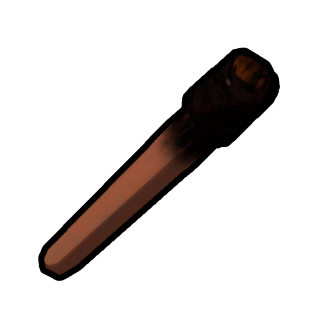](Torch.md) [Torch](Torch.md) is placed above the ramp. Two additional unlit [Torches](Torch.md) can be picked up and lit. Several unusable [Ancient Statues](https://peak.wiki.gg/wiki/Ancient_Statues) line the hall as well.

[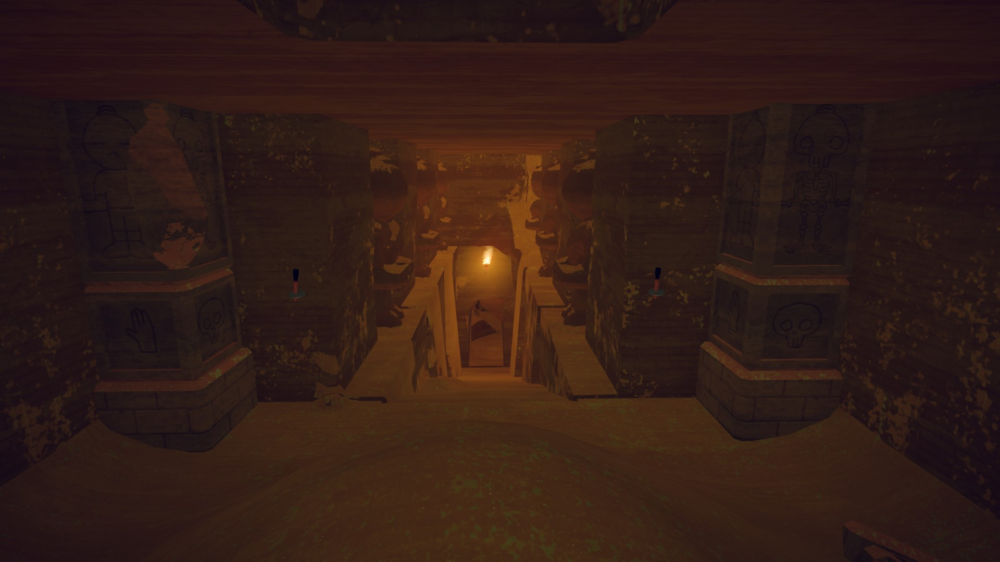](https://peak.wiki.gg/wiki/File%3ATomb_hallway.jpg)

## Maze

[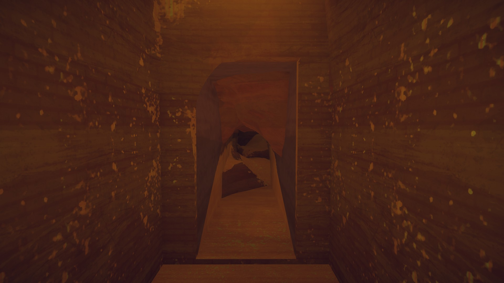](https://peak.wiki.gg/wiki/File%3ATomb_blocked_passageway.jpg)

The **Maze** is the first obstacle of the Tomb. It is a series of hallways that are mostly blocked by rock and terrain. [Scouts](https://peak.wiki.gg/wiki/Scouts) will need to try and squeeze past the rocks to find the correct path.

The correct path leads into a very narrow hallway with another [Torch](Torch.md), connected to the **Challenge Chamber**.

## Challenge Chamber

|  |  |  |
| --- | --- | --- |
| [Tomb challenge.jpg](https://peak.wiki.gg/wiki/File%3ATomb_challenge.jpg) | [Tomb challenge entrance.jpg](https://peak.wiki.gg/wiki/File%3ATomb_challenge_entrance.jpg) | [Tomb challenge exit.jpg](https://peak.wiki.gg/wiki/File%3ATomb_challenge_exit.jpg) |
| Overview | Entrance | Exit |

The **Challenge Chamber** is the main obstacle of the Tomb. It consists of a giant, dark pit where the only floor comes in form of protruding rocks from the walls of the chamber.

A large door similar to the one at the entrance is at the opposite side of the **Challenge Chamber**, which leads into a ramp descending into the **Idol Room**.

If you are unable to make it across, it is entirely possible to go back the way you came.

## Idol Room

[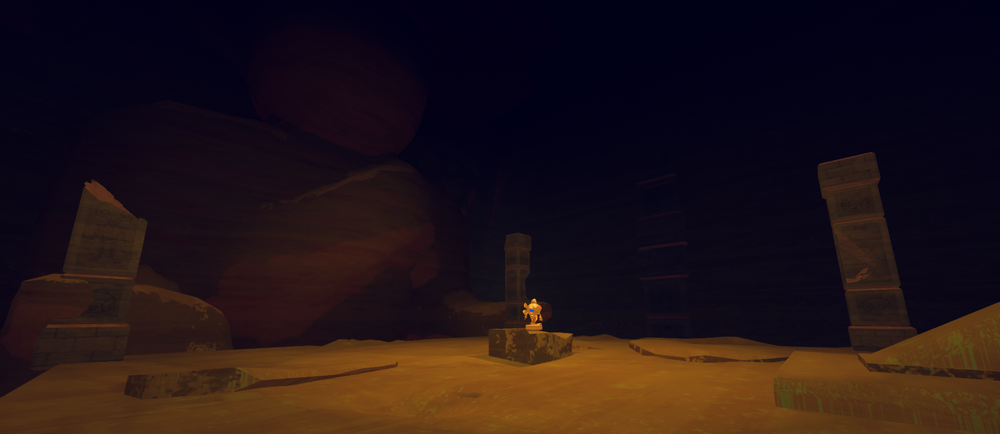](https://peak.wiki.gg/wiki/File%3APeakTombIdolRoom.png)

The **Idol Room** is a large room consisting of a suspended platform with a giant [Ancient Statue](Ancient%20Statue.md) towering over it with its hands splayed out. In the center of the platform lies the  [Ancient Idol](Ancient%20Idol.md) on a pedestal.

Beneath the ramp leading into the room is another that leads into the Tomb's **Exit**.

[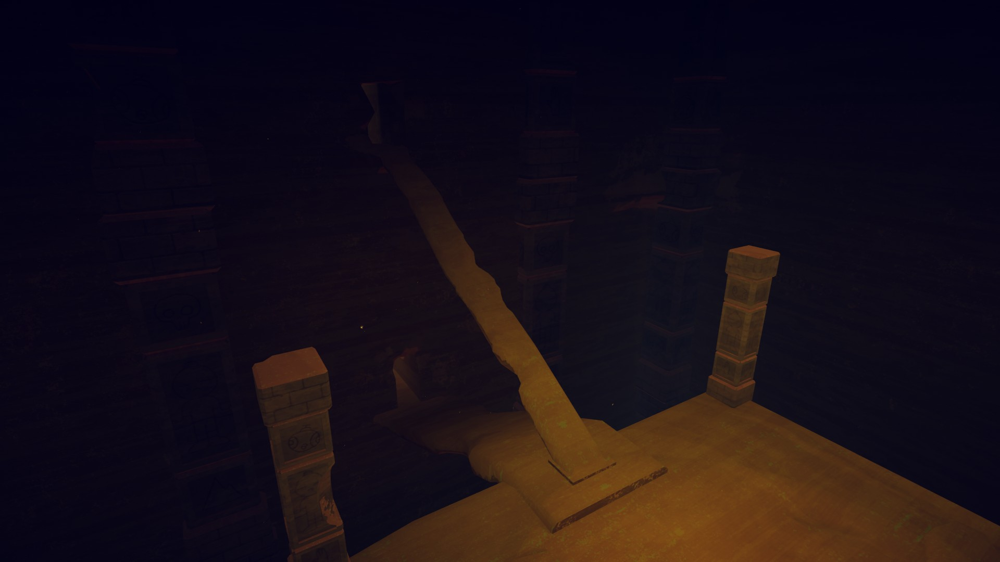](https://peak.wiki.gg/wiki/File%3ATomb_entrance.jpg)

## Exit

[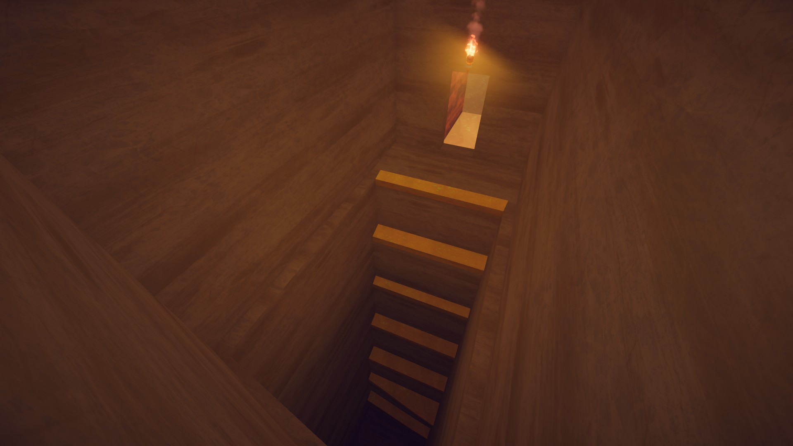](https://peak.wiki.gg/wiki/File%3ATomb_exit.jpg)

The **Exit** to the Tomb can be accessed by a ramp beneath the one leading from the Challenge Chamber. It is another narrow hallway with an upward walk, followed by a climb consisting of large steps, similar to the [Caldera](Caldera.md)'s [temple](Caldera.md#Temple).

Reaching the top of this path reveals a carved-out rectangular exit door in the side of the environment, leading back to the surface of [Mesa](Mesa.md).

[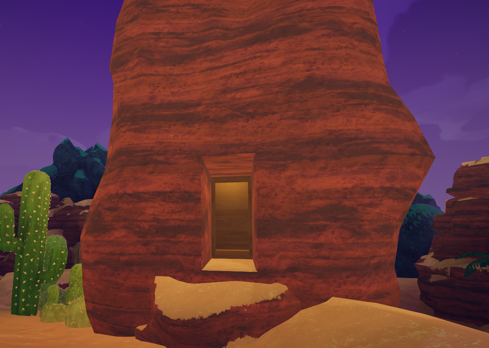](https://peak.wiki.gg/wiki/File%3ATombExitOutside.png)

## Tips & Tricks

-  [Chain Launchers](Chain%20Launcher.md) and  [Pitons](Piton.md) are useful for easily clearing the Challenge Room, especially if you're low on stamina or bonus stamina.
- If there's a hole in the maze that's too small to go through normally, you may be able you get through it by grabbing an item (especially a  [Backpack](Backpack.md)) while running towards it
- Be patient, as the [fog](Fog.md) does not rise in the Tomb.

## Trivia

- The Tomb is the only non-[biome](https://peak.wiki.gg/wiki/Biome) [location](Locations.md) in the game to have a title card when entering it.

## Gallery

- [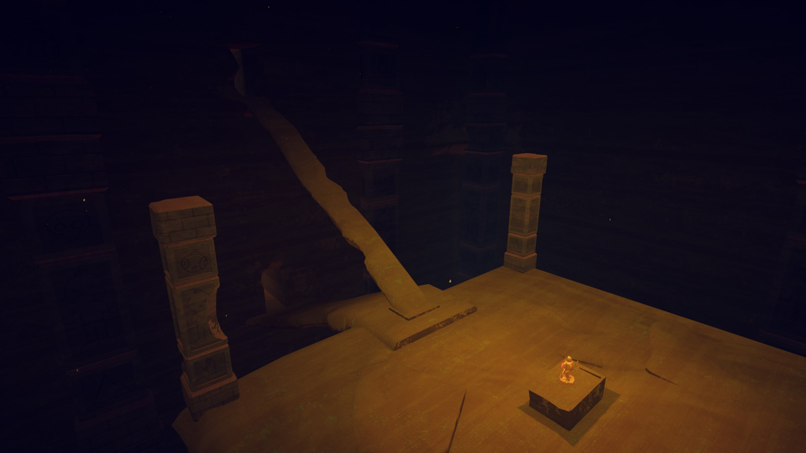](https://peak.wiki.gg/wiki/File%3ATomb_chamber.jpg)
  The Idol Room with its entrance and exit
- [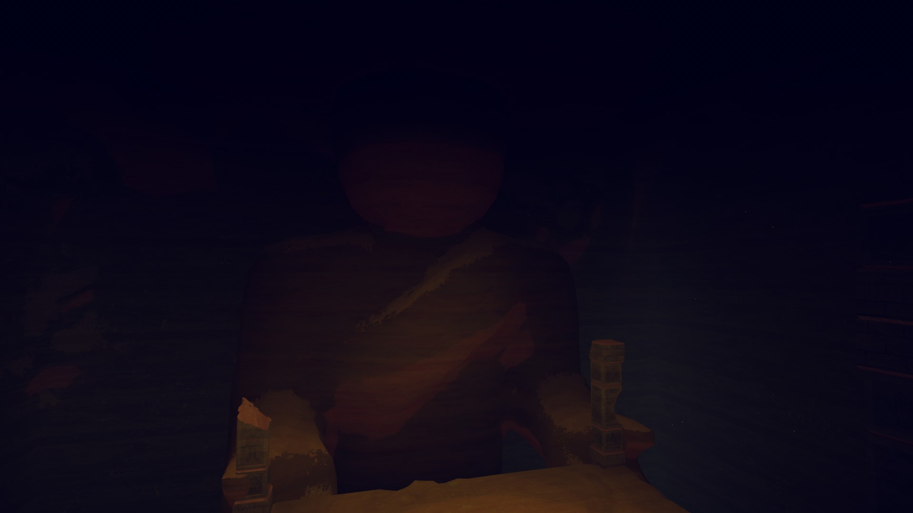](https://peak.wiki.gg/wiki/File%3ATomb_giant_statue.jpg)
  The giant [Ancient Statue](Ancient%20Statue.md) in the Idol Room
- [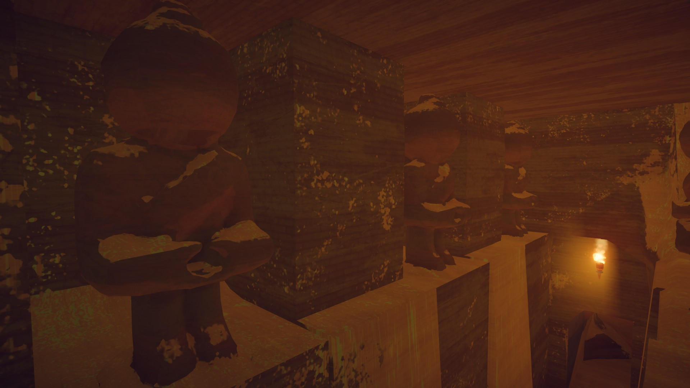](https://peak.wiki.gg/wiki/File%3ATomb_hallway_statues.jpg)
  [Ancient Statues](Ancient%20Statue.md) in the Entrance
- [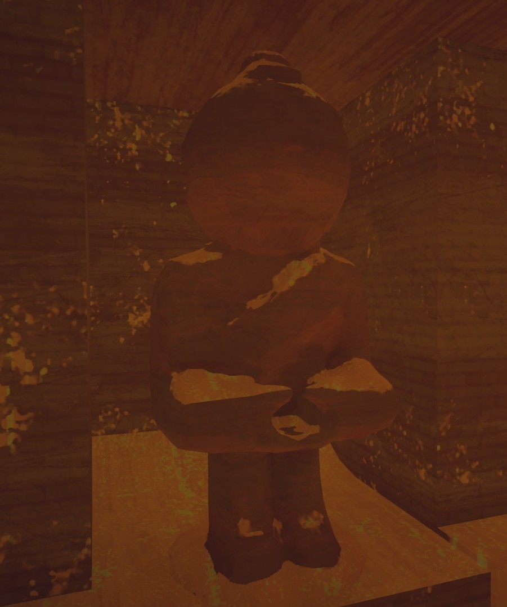](https://peak.wiki.gg/wiki/File%3ATomb_hallway_statue.jpg)
  Close-up of an [Ancient Statue](Ancient%20Statue.md)
- [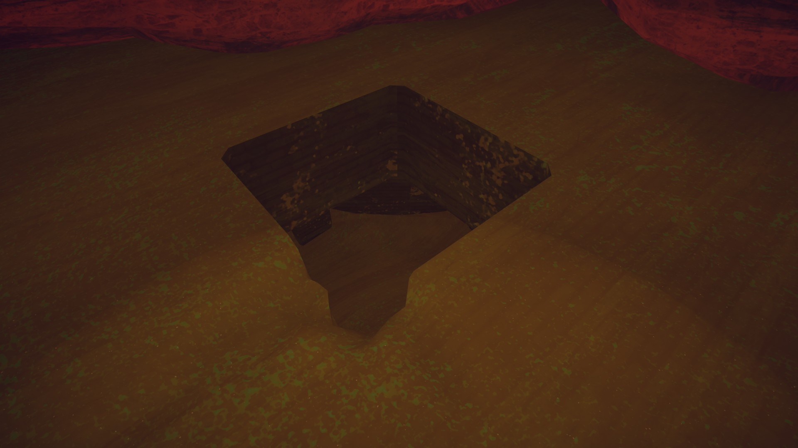](https://peak.wiki.gg/wiki/File%3ATomb_hole2.jpg)
  The hole at the bottom of the entrance pit
- [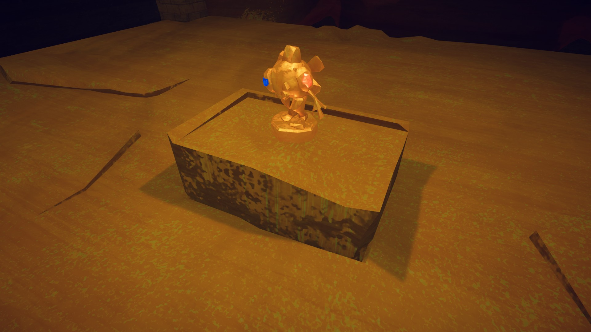](https://peak.wiki.gg/wiki/File%3ATomb_idol.jpg)
  The [Ancient Idol](Ancient%20Idol.md) on a pedestal in the Idol Room
- [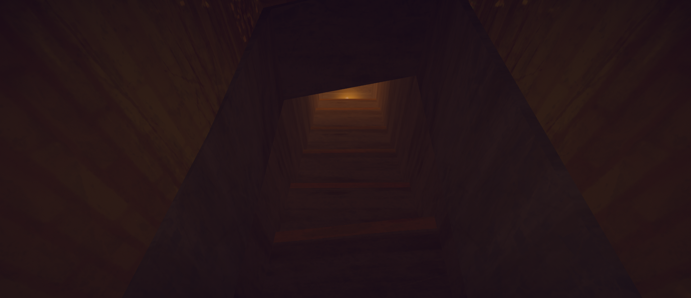](https://peak.wiki.gg/wiki/File%3APeakTombExitStairs.png)
  The exit stairs (view from the bottom)
- [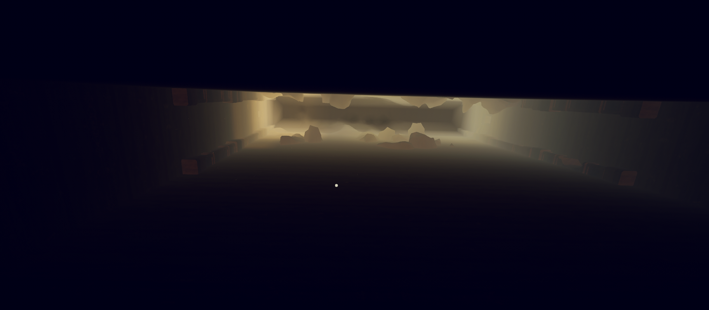](https://peak.wiki.gg/wiki/File%3ATombPit.png)
  The Challenge room, viewed from the bottom of the pit

## Patch history

 **[1.20.a](1.20.a.md) (2025-08-11):** Introduced.
 **[1.27.a](1.27.a.md) (2025-08-27):** A secret entrance in the MESA is now open 50% of the time instead of 25%. Feels fair considering the MESA itself is now open 50% of the time as well.
 **[1.28.a](1.28.a.md) (2025-09-08):** It is now wayyy less likely that the maze is blocked after entering the TOMB.
 **[1.30.a](1.30.a.md) (2025-09-23):** The Tomb maze is now less likely to be blocked off.
