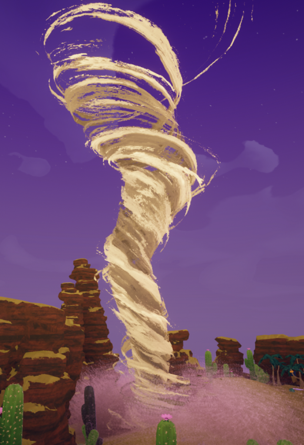
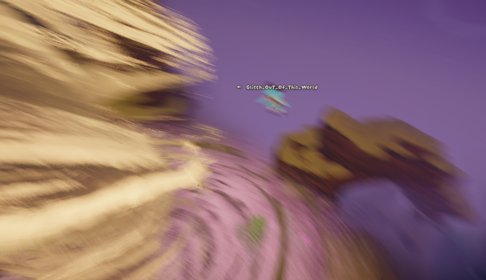

# Tornado

The current and a second player caught in the tornado.

**Tornadoes** appear in the [Mesa](Mesa.md)'s [plateau](Mesa.md#Plateau) moving around in an unpredictable manner. They pick up unaware players and send them flying in a random direction.

## Behavior

Tornadoes are created by an invisible tornado spawner object. The spawner will create its first tornado after **30-120 seconds**. After that, it creates a new tornado every **1-5 minutes**.

On the "[Tornado Hell](Mesa.md#Variants)" variant[*[currently disabled]*](1.64.a.md) of the [Mesa](Mesa.md), the spawner will always spawn its first tornado between **0-30 seconds**, and will spawn a new tornado every **30-120** seconds.

Once spawned, a tornado will itself remain active for **30-120** seconds. Tornadoes move towards invisible target points, periodically switching to a new random target point. They do not attempt to move towards players.

When a tornado gets close to a player, it exerts a pulling force that gets stronger the closer they are to the center of the tornado. This force is reduced by **75%** while the player is crouching. Once the pulling force on the player reaches a certain threshold, they will be picked up and spun around until they get stuck on the terrain or the tornado dissipates.

A player tossed by a tornado will often end up with  [Injury](Stamina%20bar.md#Injury) from falling and sometimes  [Thorns](Stamina%20bar.md#Thorns) from hitting a cactus.

## Patch History

 **[1.20.a](1.20.a.md) (2025-08-11):** Introduced.
 **[1.28.a](1.28.a.md) (2025-09-08):**

- Reduced the maximum time before the first tornado can spawn.
- Slightly increased the minimum time before a tornado can spawn again.
- Slightly reduced the commonness of the "Tornado Hell" biome variant,
- Fixed an issue where, rarely, getting caught in a tornado would cause the game to freeze on the loading screen upon failing a run.
