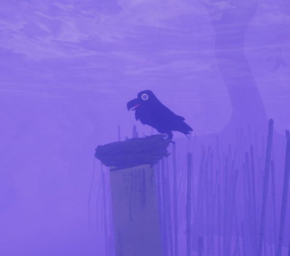

# Tricky Ravens

Tricky Ravens

General
Type
[Enemy](https://peak.wiki.gg/wiki/Enemy)
Biome- [Gloom](Gloom.md)

Tricky Ravens are creatures found within the [Gloom](Gloom.md) that make the biome more treacherous by stealing lost scout's voices.

## Mechanics

After a Scout has been within the fog of the [Gloom](Gloom.md) for 3 seconds, a Tricky Ravens will steal their voice if possible. A perch is chosen to spawn the Tricky Ravens. The perch is as close to **40 meters** away from all conscious Scouts besides the target, no more than an average of **168 meters** away from those Scouts, and cannot be visible to any of them. If, for some reason, no valid perch is found, the game will retry the search every frame until successful (or the target is no longer valid). Once the Tricky Ravens is spawned, the target's voice will be stolen, causing all voice chat to originate from the Tricky Ravens instead of the affected Scout from the perspective of any Scout that cannot see them. Any Scouts who can see the affected target (based on potential line of sight, not current camera orientation) hear their voice normally.

The effect lasts for **20-60 seconds**, until the affected Scout leaves the Gloom, or until the Tricky Ravens stealing their voice is scared off by any Scout approaching within **12.8 meters** of it, whichever comes first. After the effect ends, the target's voice cannot be stolen again for **5 seconds**.

No Scout's voice can be stolen if all Scouts (living or dead) are within **40 meters** of all other Scouts.
