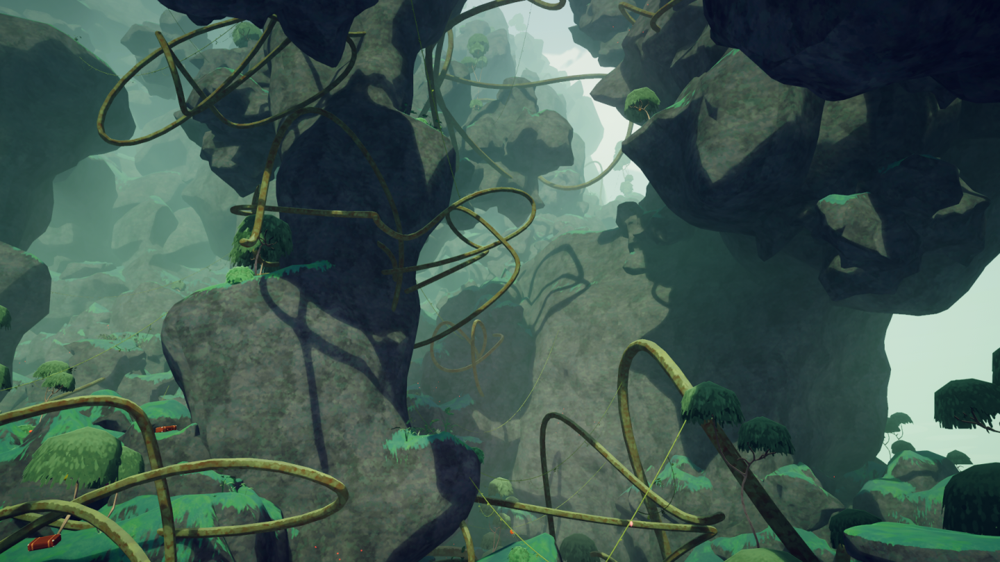

# Tropics/es-419

Zona Tropical

Detalles
Tipo
[Bioma](Locations_es-419.md#Biomas)
Sección
**2**/6

La **Zona Tropical** es uno de los dos posibles segundos [biomas](Locations_es-419.md#Biomas) en *[PEAK](Peak%20%28game%29_es-419.md)* (el otro es [Raíces](Roots.md)), ubicado luego de la [Costa](Shore_es-419.md) y antes de la [Zona Alpina](Alpine.md) o la [Mesa](Mesa.md). Está compuesta por una jungla con varios tipos de árboles, raíces de [hiedra gigante](#Hiedra_gigante) y [enredaderas](Vines.md) dispersas por todo el bioma.

En una expedición en cualquier [Ascenso](Ascents_es-419.md) exceptuando *[Pies Blandos](Ascents_es-419.md#Pies_Blandos)*, la [niebla](Fog.md) irá subiendo gradualmente, evitando que los [Exploradores](Scout_es-419.md) puedan permanecer en la Zona Tropical por mucho tiempo.

Encender la [fogata](Campfire.md) en la cima de la Zona Tropical desvanecerá la neblina y revelará el siguiente bioma, otorgando a todos los Exploradores vivos la  [Trailblazer Badge](https://peak.wiki.gg/wiki/Trailblazer_Badge) si no la tenían.

## Características

| Característica | Imagen | Descripción |
| --- | --- | --- |
| **Árbol grande** | [Tropics big tree.jpg](https://peak.wiki.gg/wiki/File%3ATropics_big_tree.jpg) | A lo largo de la Zona Tropical se pueden encontrar **árboles grandes**, con troncos y ramas gruesas. Sus frondas se pueden escalar y caminar sobre ellas. También pueden aparecer [maletas](Luggage.md) en sus copas. Alcanzar la cima de un árbol grande otorga la [Arborist Badge](https://peak.wiki.gg/wiki/Arborist_Badge) [Arborist Badge](https://peak.wiki.gg/wiki/Arborist_Badge). |
| **Sauce** | [Tropics trees.png](https://peak.wiki.gg/wiki/File%3ATropics_trees.png) | En la Zona Tropical encontrarás **sauces**[[1]](#cite_note-1). Sus troncos son muy finos como para escalarlos, lo que dificulta recoger las  [Bayarreyes](Green%20Kingberry.md) que crecen en ellos, pero pueden usarse para descender de manera segura y evitar [daño de caída](https://peak.wiki.gg/wiki/Fall_damage). |
| **[Enredadera](Vines.md)** | [Tropics vines.png](https://peak.wiki.gg/wiki/File%3ATropics_vines.png) | Las **[enredaderas](Vines.md)** conectan puntos de la Zona Tropical entre sí. Puedes sujetarte en ellas como si fuera una [cuerda](Rope%20Spool.md), consumiendo muy poca [Resistencia](https://peak.wiki.gg/wiki/Stamina). Moverte por ella consume Resistencia, pero mucho menos que escalar. En ellas pueden crecer  [Bayananas](Yellow%20Berrynana.md). |
| **Hiedra gigante** | [Tropics roots.png](https://peak.wiki.gg/wiki/File%3ATropics_roots.png) | Las **hiedras gigantes** son raíces que se abren paso entrando y saliendo de la [montaña](Island_es-419.md). Pueden servir para escalar y caminar sobre ellas, aunque es más común que aparezcan como un [peligro](Hazards.md), véase [hiedra gigante espinosa](#Hiedra_gigante_espinosa). En ellas pueden crecer  [Clusterbayas](Black%20Clusterberry.md). |
| **Luciérnagas** | [Tropics butterflies.png](https://peak.wiki.gg/wiki/File%3ATropics_butterflies.png) | Las **luciérnagas** aparecen frecuentemente en la Zona Tropical. Son pura ambientación visual y no tienen efectos en la jugabilidad. |

## Peligros (WIP)

| Peligro | Imagen | Descripción |
| --- | --- | --- |
| **Lluvia** | [Tropics rain trees.png](https://peak.wiki.gg/wiki/File%3ATropics_rain_trees.png) | **Rain** is the main hazard in the Tropics, unique to the biome. Periodically, it will begin to downpour, making all unsheltered surfaces wet and slippery. Climbing on wet surfaces is much slower than usual and consumes more [stamina](Stamina%20bar.md). Additionally, players will slide downwards when holding still. Occasionally this can cause the player to go effectively nowhere or even slide backwards when climbing a sloped wall. |
| **Hongo de esporas explosivo** | [Spore Bomb - explosive - closeup.png](https://peak.wiki.gg/wiki/File%3ASpore_Bomb_-_explosive_-_closeup.png) | **Explosive Spore Bombs** can be found on the ground or on the cliffs. They explode upon contact, sending [Scouts](https://peak.wiki.gg/wiki/Scouts) flying in the direction they came in. They are primarily yellow with splotches of green all over them. |
| **Hongo de esporas venenoso** | [Spore Bomb - poisonous - closeup.png](https://peak.wiki.gg/wiki/File%3ASpore_Bomb_-_poisonous_-_closeup.png) | **Poison Spore Bombs** can usually be found on the ground, especially near the edges. They explode upon contact, releasing a purple gas cloud that inflicts [Poison](Stamina%20bar.md#Poison) [Poison](Stamina%20bar.md#Poison) on any [Scouts](https://peak.wiki.gg/wiki/Scouts) caught in it. The cloud dissipates after a certain amount of time. Poison Spore Bombs are primarily green with many tiny magenta spots. In the Ivy variant, they are dark bluish purple instead. |
| **Monstera** | [Tropics monstera.jpg](https://peak.wiki.gg/wiki/File%3ATropics_monstera.jpg) | **Monstera** plants look similar to Poison Ivy, but have no purple spots and do not inflict any [Poison](Stamina%20bar.md#Poison) [Poison](Stamina%20bar.md#Poison). Instead, there is a 1% chance of a  [Tick](Tick.md) being attached to the [Scout](Scout.md) who walks through them. [Ticks](Tick.md) will slowly fill the [Stamina bar](Stamina%20bar.md) with [Poison](Stamina%20bar.md#Poison) [Poison](Stamina%20bar.md#Poison) up to a maximum of **50** while slowly growing in size. They can be easily removed either by the [Scout](Scout.md) or their allies, turning it into a food that restores [Hunger](Stamina%20bar.md#Hunger) **20** [Hunger](Stamina%20bar.md#Hunger). |
| **Hiedra venenosa** | [Tropics poison bush.png](https://peak.wiki.gg/wiki/File%3ATropics_poison_bush.png) | **Poison Ivy** plants are scattered around the Tropics and inflict [Poison](Stamina%20bar.md#Poison) **2.5** [Poison](Stamina%20bar.md#Poison) when touched. |
| **Hiedra gigante espinosa** | [Tropics 1.png](https://peak.wiki.gg/wiki/File%3ATropics_1.png) | **Thorny Giant Ivy** are long roots covered in thorns which inflict [Poison](Stamina%20bar.md#Poison) [Poison](Stamina%20bar.md#Poison) on contact, as well as slightly knocking back the [Scout](Scout.md). This quality makes them useful as a quick stepping stone for an otherwise impossible-to-climb rock face. |
| **Abejas** | [Bees closeup.png](https://peak.wiki.gg/wiki/File%3ABees_closeup.png) | **[Beehives](Beehive.md)** can occasionally spawn on [Willows](#Willows). Any [Scout](Scout.md) that gets too close to a Beehive or picks it up will be targeted by the bees. The bees will sting the provoking player, inflicting [Poison](Stamina%20bar.md#Poison) **2.5** [Poison](Stamina%20bar.md#Poison) for every second the player is close enough to the angry bee swarm. Beehives can be broken by throwing them against a surface, creating four edible  [Honeycombs](Honeycomb.md), similar to the  [Coconuts](Coconut.md). Alternatively, throwing an item at a Beehive can also crack it open. |
| **Cascada** | [Tropics waterfall 1.png](https://peak.wiki.gg/wiki/File%3ATropics_waterfall_1.png) | **Waterfalls** may make it harder to see the terrain behind it, and while they do no damage themselves, they can prove a challenge on rockfaces because they knock scouts down. |
| **[Río de lava](https://peak.wiki.gg/wiki/Lava_River)** | [Lava tube1.jpg](https://peak.wiki.gg/wiki/File%3ALava_tube1.jpg) | In the Lava variant, **[Lava Tubes](https://peak.wiki.gg/wiki/Lava_Tube)** are present in the Tropics. The lava deals a significant amount of [Heat](Stamina%20bar.md#Heat) [Heat](Stamina%20bar.md#Heat) damage, as well as [Injury](Stamina%20bar.md#Injury) [Injury](Stamina%20bar.md#Injury), to players in direct contact with it. Similar to the Thorny Giant Ivy, touching the lava causes knockback. |

## Objetos naturales

| Comidas | | | |
| --- | --- | --- | --- |
| [Coco](Coconut.md) | [Crujibaya Roja](Red%20Crispberry.md) | [Crujibaya Verde](Green%20Crispberry.md) | [Crujibaya Amarilla](Yellow%20Crispberry.md) |
| [Baya Picante](Scorchberry.md) | [Bayarrey Verde](Green%20Kingberry.md) | [Bayarrey Amarillo](Yellow%20Kingberry.md) | [Bayarrey Violeta](Purple%20Kingberry.md) |
| [Bayanana Amarilla](Yellow%20Berrynana.md) | [Bayanana Marrón](Brown%20Berrynana.md) | [Bayanana Rosa](Pink%20Berrynana.md) | [Bayanana Azul](Blue%20Berrynana.md) |
| [Clusterbaya Negra](Black%20Clusterberry.md) | [Clusterbaya Roja](Red%20Clusterberry.md) | [Clusterbaya Amarilla](Yellow%20Clusterberry.md) | [Panal](Honeycomb.md) |
| [Hongo Rechoncho](Chubby%20Shroom.md) | | [Hongo Botón](Button%20Shroom.md) | | [Hongo Clarín](Bugle%20Shroom.md) | | [Hongo en Racimo](Cluster%20Shroom.md) |
| [Garrapata](Tick.md) | | [Raíz Medicinal](Medicinal%20Root.md) | |
| Herramientas | | | |
| [Frijol Mágico](Magic%20Bean.md) | [Hongo Curativo](Remedy%20Fungus.md) | [Hongo de Repisa](Shelf%20Fungus.md) | [Hongo de Teletransportación](Warp%20Fungus.md) |
| Misceláneos | | | |
| [Colmena](Beehive.md) | | | |

## Notas

- [↑](#cite_ref-1) Se llaman `Jungle_Willow_Tall` y similares en los archivos del juego.
