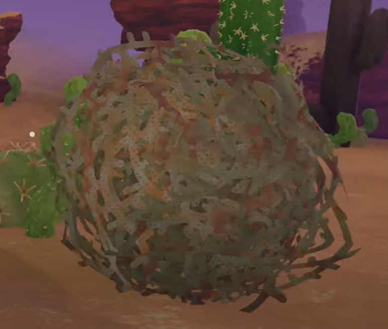
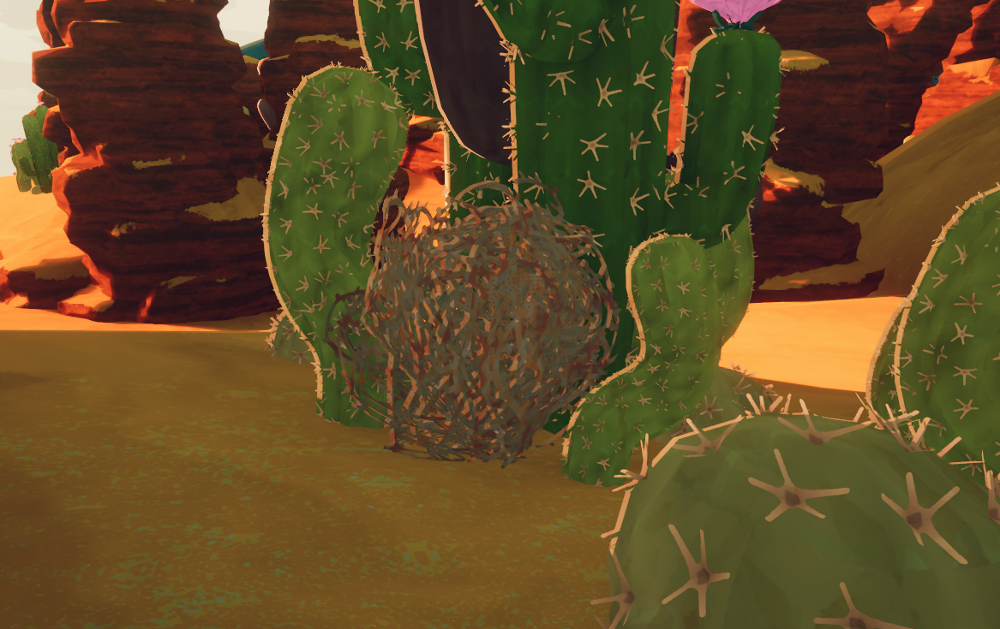

# Tumbleweed

Tumbleweed

General
Type
Environmental hazard
Biome- [Mesa](Mesa.md)

The Tumbleweed is an environmental hazard found in the [Mesa](Mesa.md) that rolls around the biome and inflicts  [Thorns](Stamina%20bar.md#Thorns) on the [Scouts](https://peak.wiki.gg/wiki/Scouts) it hits.

When a tumbleweed first spawns, it will quickly grow into its maximum size. It will then accelerate towards the nearest player, inflicting  **5−10** [Thorns](Stamina%20bar.md#Thorns) upon contact and knocking the affected player over. A higher impact velocity will deal more damage and make the fall last longer. After 15 seconds of rolling around, the tumbleweed shrinks down and finally despawns, regardless of whether or not it has hit any players during its lifetime.

## Gallery

- 
  A Tumbleweed stuck in some [Big Cacti](Big%20Cacti.md)

## Patch history

 **[1.20.a](1.20.a.md) (2025-08-11):** Introduced
 **[1.23.a](1.23.a.md) (2025-08-13):**

- Tumbleweed damage and knockback has been made more consistent.
- Tumbleweeds now deal  [Thorns](Stamina%20bar.md#Thorns) damage instead of  [Injury](Stamina%20bar.md#Injury).
- Tumbleweed damage and knockback now scales with the size of the tumbleweed.
