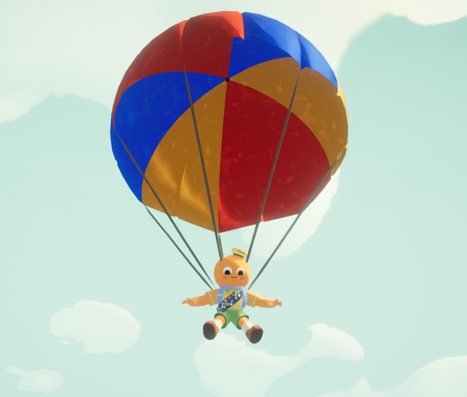
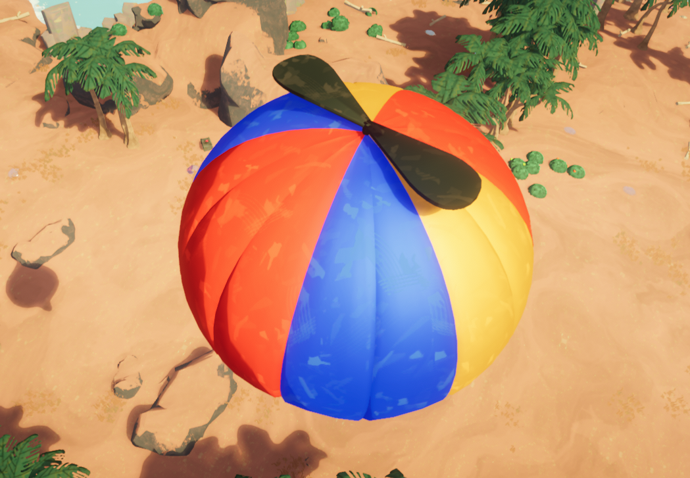
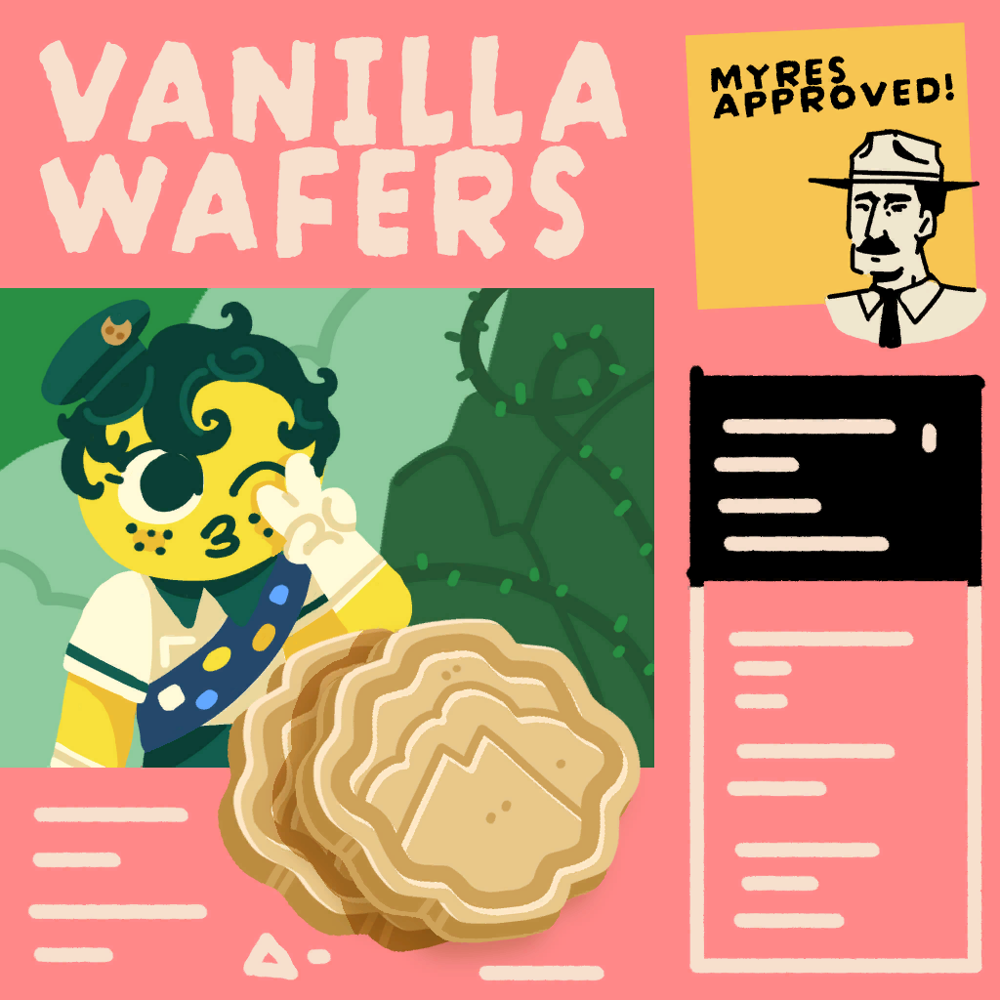
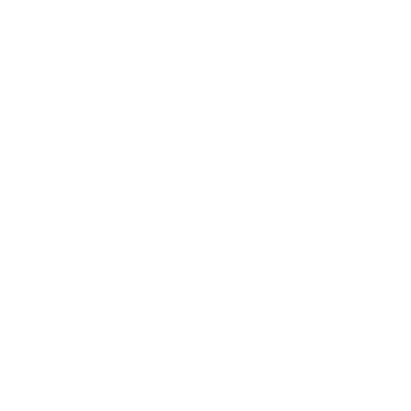
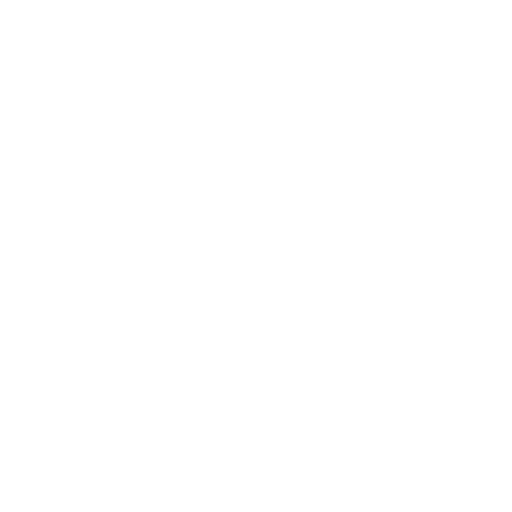
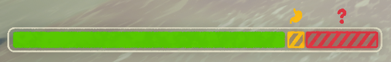
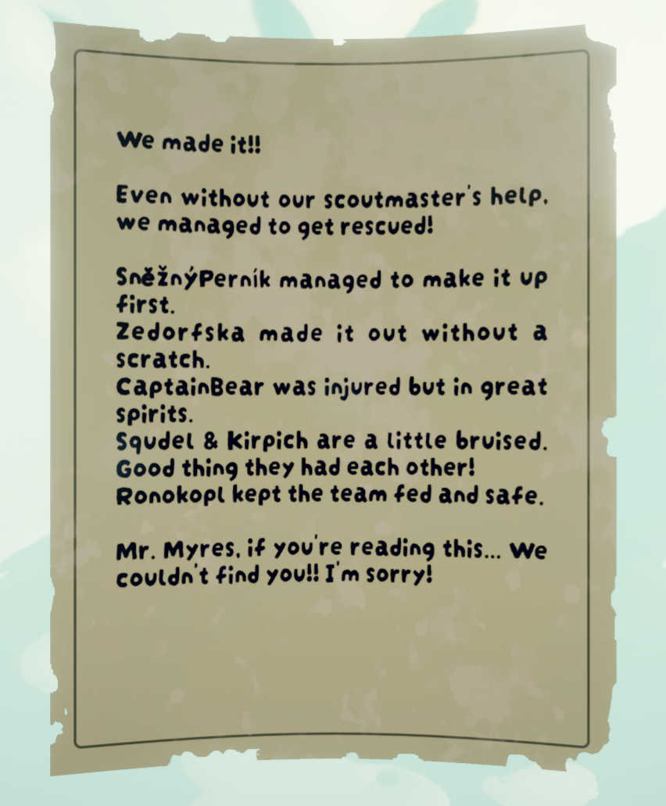
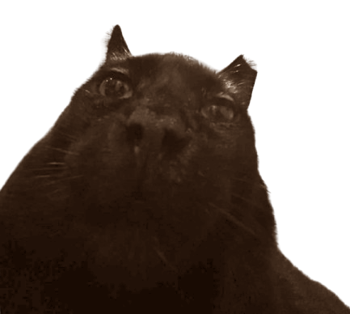
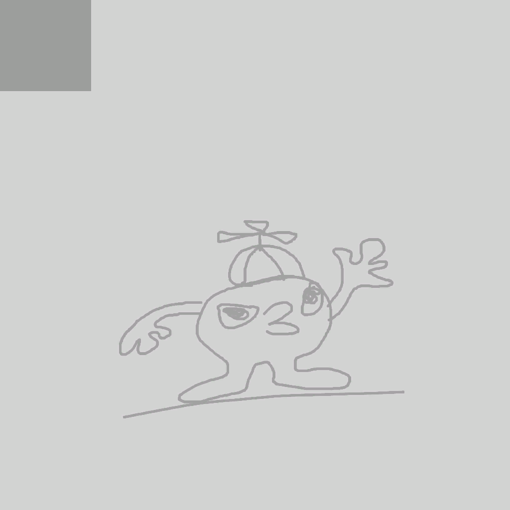

# Unused content

**Unused content** describes content found in the *[PEAK](Peak%20%28game%29.md)* files that is unobtainable through normal gameplay. This includes incomplete or unreleased items, features or files intended for testing purposes.

## Unused items

Unity prefab names are given in parentheses if they differ from the item name, which is derived from the attached `Item` script.

| Icon | Name | Description |
| --- | --- | --- |
| [Parachute.png](https://peak.wiki.gg/wiki/File%3AParachute.png) | Auto-Parachute | Blue parachute that deploys if a Scout with the parachute in their inventory starts falling, preventing fall damage similarly to the  [Parasol](Parasol.md). Consumed upon use, weighs [Weight](Stamina%20bar.md#Weight) **2.5** [Weight](Stamina%20bar.md#Weight). |
| [Bugle?.png](https://peak.wiki.gg/wiki/File%3ABugle%3F.png) | Bugle? | A silver bugle with a neon orange rope tied around the mouth of the tube with a miniature  [Strange Gem](Strange%20Gem.md) inside the tube. It was used during the [PEAK x bbno$ concert](PEAK%20x%20bbno%24%20concert.md) in patch [1.49.a](1.49.a.md) to summon bbno$, ironmouse, and Vanillamace as giant performers at the [crash site](https://peak.wiki.gg/wiki/Crash_site) in the [Shore](Shore.md) for a short concert. Each player is granted [Bonus stamina](Stamina%20bar.md#Bonus_stamina) **100** [Bonus stamina](Stamina%20bar.md#Bonus_stamina).- If used in a biome beyond the Shore, the performers would not appear, and if used in the [Caldera](Caldera.md) or later, the visuals would be entirely absent. The music and bonus stamina were applied in all biomes. |
| [Climbing Chalk.png](https://peak.wiki.gg/wiki/File%3AClimbing_Chalk.png) | Climbing Chalk | No model or texture. Reduces stamina usage while climbing by 20% for 20 seconds. |
| [Cure-All.png](https://peak.wiki.gg/wiki/File%3ACure-All.png) | Cure-Some | 1 use. Removes [Poison](Stamina%20bar.md#Poison) **100** [Poison](Stamina%20bar.md#Poison), [Injury](Stamina%20bar.md#Injury) **25** [Injury](Stamina%20bar.md#Injury), [Drowsy](Stamina%20bar.md#Drowsy) **25** [Drowsy](Stamina%20bar.md#Drowsy), [Cold](Stamina%20bar.md#Cold) **25** [Cold](Stamina%20bar.md#Cold), [Heat](Stamina%20bar.md#Heat) **25** [Heat](Stamina%20bar.md#Heat), and [Hunger](Stamina%20bar.md#Hunger) **25** [Hunger](Stamina%20bar.md#Hunger). |
| [Energy Elixir.png](https://peak.wiki.gg/wiki/File%3AEnergy_Elixir.png) | Energy Elixir | Like the  [Energy Drink](Energy%20Drink.md), but without the bonus pre-climbing time, and it triples your climbing speed. |
| [Lollipop Evil.png](https://peak.wiki.gg/wiki/File%3ALollipop_Evil.png) | Follypop ("Lollypop_Evil") | A pink version of  [Big Lollipop](Big%20Lollipop.md). Restores [Hunger](Stamina%20bar.md#Hunger) **10** [Hunger](Stamina%20bar.md#Hunger) and applies infinite stamina for **16 seconds**, but inflicts [Drowsy](Stamina%20bar.md#Drowsy) **100** [Drowsy](Stamina%20bar.md#Drowsy) at the end instead of  [Big Lollipop](Big%20Lollipop.md)'s [Drowsy](Stamina%20bar.md#Drowsy) **32.5** [Drowsy](Stamina%20bar.md#Drowsy). Weighs [Weight](Stamina%20bar.md#Weight) **2.5**. |
| [Clusterberry Green.png](https://peak.wiki.gg/wiki/File%3AClusterberry_Green.png) | Green Clusterberry ("Clusterberry_UNUSED") | Unused Green [Clusterberry](https://peak.wiki.gg/wiki/Clusterberry). Weighs [Weight](Stamina%20bar.md#Weight) **2.5**, restores [Hunger](Stamina%20bar.md#Hunger) **10** [Hunger](Stamina%20bar.md#Hunger) and removes [Poison](Stamina%20bar.md#Poison) **30** [Poison](Stamina%20bar.md#Poison). |
| [Matchbook.png](https://peak.wiki.gg/wiki/File%3AMatchbook.png) | Matchbook | A matchbox of the "Myres' Fires" brand. Weighs [Weight](Stamina%20bar.md#Weight) **2.5**. Shows the binoculars overlay when used. |
| [Megaphone.png](https://peak.wiki.gg/wiki/File%3AMegaphone.png) | Megaphone | A megaphone. Could possibly amplify the player's voice to extend its range. Weighs [Weight](Stamina%20bar.md#Weight) **0**. |
| [Propeller.png](https://peak.wiki.gg/wiki/File%3APropeller.png) | Propeller | A piece of the [crashed airplane's](https://peak.wiki.gg/wiki/Crash_site) propeller. Usage unknown. Weighs [Weight](Stamina%20bar.md#Weight) **5**. |
| [Scoutmaster's Soul.png](https://peak.wiki.gg/wiki/File%3AScoutmaster%27s_Soul.png) | Scoutmaster's Soul | No model or texture. Shatters when thrown. |
| [Six-slot Backpack.png](https://peak.wiki.gg/wiki/File%3ASix-slot_Backpack.png) | Six-slot Backpack | A  [Backpack](Backpack.md) variant with six item slots. |
| [Cursed Skull.png](https://peak.wiki.gg/wiki/File%3ACursed_Skull.png) | Skull | A version of the  [Cursed Skull](Cursed%20Skull.md) without the purple and black effects and texture, does nothing. Makes creepy noises when nearby. Weighs [Weight](Stamina%20bar.md#Weight) **2.5** [Weight](Stamina%20bar.md#Weight) |
| [FireWood.png](https://peak.wiki.gg/wiki/File%3AFireWood.png) | Stick ("FireWood") | Weighs [Weight](Stamina%20bar.md#Weight) **2.5**. Based on the name, it would've been used to create campfires. Likely replaced by the  [Portable Stove](Portable%20Stove.md) or was for a removed [Ascent](Ascents.md) modifier. |
| [Stone.png](https://peak.wiki.gg/wiki/File%3AStone.png) | Stone | A stone. Weighs [Weight](Stamina%20bar.md#Weight) **2.5**. Has code for being heated at a campfire to prevent [Cold](Stamina%20bar.md#Cold) [Cold](Stamina%20bar.md#Cold) later, but it doesn't appear to be functional. |
| [Flag Plantable Seagull.png](https://peak.wiki.gg/wiki/File%3AFlag_Plantable_Seagull.png) | Turtle Flag ("Flag_Plantable_Seagull") | A blue flag with a stylized depiction of a seagull to be placed down for an unknown use. Weighs [Weight](Stamina%20bar.md#Weight) **2.5**.- The prefab and texture names suggest it's supposed to be named "Seagull Flag" rather than "Turtle Flag". |
| [Flag Plantable Turtle.png](https://peak.wiki.gg/wiki/File%3AFlag_Plantable_Turtle.png) | Turtle Flag ("Flag_Plantable_Turtle") | A green flag with a stylized depiction of a turtle to be placed down for an unknown use. Weighs [Weight](Stamina%20bar.md#Weight) **2.5**. |
| [Scout Cookies Vanilla.png](https://peak.wiki.gg/wiki/File%3AScout_Cookies_Vanilla.png) | Vanilla Scout Cookies ("ScoutCookies_Vanilla") | Variant of  [Scout Cookies](Scout%20Cookies.md). Weighs [Weight](Stamina%20bar.md#Weight) **5**, restores [Hunger](Stamina%20bar.md#Hunger) **10** [Hunger](Stamina%20bar.md#Hunger) and gives [Bonus stamina](Stamina%20bar.md#Bonus_stamina) **10** [Bonus stamina](Stamina%20bar.md#Bonus_stamina). Can be consumed 4 times. |
| [Warp Compass.png](https://peak.wiki.gg/wiki/File%3AWarp_Compass.png) | [Warp Compass](Warp%20Compass.md) | A compass that allowed the player to teleport to a random [Scout](Scout.md). This was removed in version [1.1.a](1.1.a.md) due to bugs. It can still be obtained in-game via console commands, but using it does not do anything beyond its warp visual effect. |
| [Warpsketball.png](https://peak.wiki.gg/wiki/File%3AWarpsketball.png) | Warpsketball | A retextured version of the  [Basketball](Basketball.md). Teleports players wherever it lands like the  [Warp Fungus](Warp%20Fungus.md) and is consumed upon use, weighs [Weight](Stamina%20bar.md#Weight) **2.5** [Weight](Stamina%20bar.md#Weight). |
| [Weird Shroom.png](https://peak.wiki.gg/wiki/File%3AWeird_Shroom.png) | Weird Shroom ("Mushroom Glow") | A type of mushroom with no poisonous variety. Weighs [Weight](Stamina%20bar.md#Weight) **2.5**, can be eaten twice, and restores [Hunger](Stamina%20bar.md#Hunger) **10** [Hunger](Stamina%20bar.md#Hunger). Tries to give a glowing effect, but a necessary object on the player for the effect to work is missing. |
| [Wonderberry.png](https://peak.wiki.gg/wiki/File%3AWonderberry.png) | Wonderberry | An unused rainbow berry. Weighs [Weight](Stamina%20bar.md#Weight) **2.5**, restores [Hunger](Stamina%20bar.md#Hunger) **20** [Hunger](Stamina%20bar.md#Hunger), and gives 10 seconds of infinite stamina, similarly to a  [Big Lollipop](Big%20Lollipop.md) but without inflicting any [Drowsy](Stamina%20bar.md#Drowsy) [Drowsy](Stamina%20bar.md#Drowsy) afterwards. |

### Gallery

- 
  Scout falling with the activated Auto-Parachute
- 
  Top view of the Auto-Parachute
- 
  Vanilla Scout Cookies texture

## Unused cosmetics

| Icon | Name | Description |
| --- | --- | --- |
| [OrangeSpacesuit.png](https://peak.wiki.gg/wiki/File%3AOrangeSpacesuit.png) | Orange Spacesuit | An orange variant of the spacesuit granted by the [Aeronautics Badge](https://peak.wiki.gg/wiki/Aeronautics_Badge) [Aeronautics Badge](https://peak.wiki.gg/wiki/Aeronautics_Badge). |
| [Raccoon Hat.png](https://peak.wiki.gg/wiki/File%3ARaccoon_Hat.png) | Raccoon Hat | No model, unfinished texture. |
| [VR.png](https://peak.wiki.gg/wiki/File%3AVR.png) | VR Headset | Fully modelled and textured. |

## Other unused content

- An unused status effect called "Crab" exists in the game's source code. It's red on the [stamina bar](Stamina%20bar.md) with a question mark as its icon. It can only be inflicted through the use of console commands. This may have been used for testing the stamina bar mechanics during development.
- A  [Scroll](Scroll.md) page can be found in the files and spawned using mods, written from the perspective of [Scoutmaster Myres](Scoutmaster%20Myres.md)' scouts. It's canonicity is dubious due to its unused nature.
- Textures and models can be found for entities named "Hellephant", "ZomBear", "ZomBunny", and "My Robot Kyle". These files are from a [Unity Tutorial Project](https://assetstore.unity.com/packages/templates/tutorials/zombie-toys-chapter-1-20-243482).
- 
  Crab icon meant for the **Crab** status effect, however the in game the effect uses question mark icon (as of [1.25.a](1.25.a.md)).
- 
  The question mark icon used for the **Crab** status effect.
- 
  [Stamina bar](Stamina%20bar.md) with 20 units of **Crab** applied.
- 
  An unused  [Scroll](Scroll.md) page called `GuidebookPage_8_FirstTeams`.
- 
  A cat picture found in the game files.
- 
  Possibly a placeholder texture for the [Ancient Luggage](https://peak.wiki.gg/wiki/Ancient_Luggage) depicting a crudely drawn version of [Bing Bong](Bing%20Bong.md).

## Patch History

-  **[2.0.a](2.0.a.md) (2026-08-11):** [Flapper Hat](Cosmetics.md#Hats) made obtainable as a reward for getting the  [Wanderer Badge](https://peak.wiki.gg/wiki/Wanderer_Badge).
