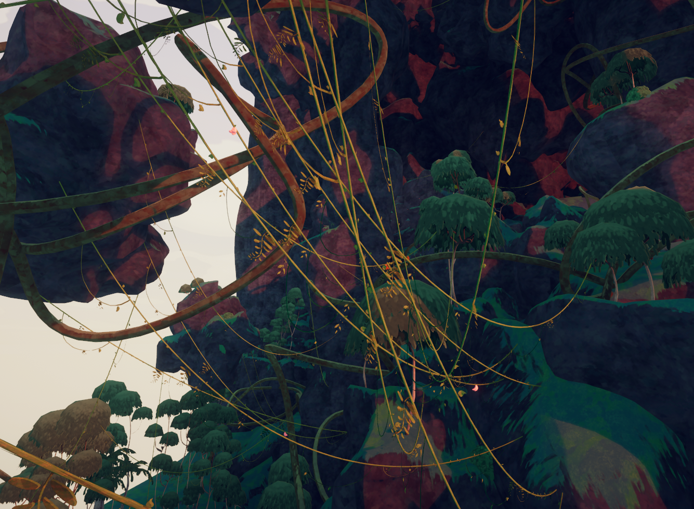
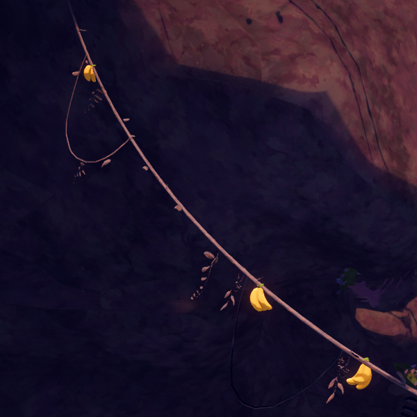

# Vines

Vines

General
Biome- [Tropics](Tropics.md)
- [Roots](Roots.md)
- [Gloom](Gloom.md)

**Vines** are climbable plants found in the [Tropics](Tropics.md), the [Roots](Roots.md), and the [Gloom](Gloom.md). They connect two points and allow for easier movement between two places. They function identically to [chains](Chain.md) in the [Caldera](Caldera.md), but unlike the chains, vines can connect two points with very large differences in altitude.

Vines use a relatively low amount of [stamina](https://peak.wiki.gg/wiki/Stamina) to climb across, and an even lower amount to hang on to without moving. It is possible to hold out and use [items](Items.md) while on a Vine, similar to a  [Piton](Piton.md). Grabbing onto a Vine while falling will **break the fall** and, if falling fast enough, cause the [Scout](Scout.md) to slide across the vine.

Vines are a useful source of [food](Food.md) due to the abundance of [Berrynanas](https://peak.wiki.gg/wiki/Berrynana) that generate on them, which can be picked up either by jumping up and grabbing them (if the Vine is close enough to the ground), or by climbing along the Vine and then picking them up or dropping them below.

## Tips

- Because you can still take fall damage once you let go of the Vine, it's advised to reach the end of it and climb down/up to safety that way instead of dropping down.
- Because Vines have a relatively large range in which they can be grabbed, you can occasionally use them to get a little bit more height before a climb even if the Vine itself just leads into the rock-face, similar to the  [Rope](Rope.md) in some situations.
- You can keep climbing into the end of the Vine and waste your [stamina](https://peak.wiki.gg/wiki/Stamina), so be aware of the end of the Vine to minimize your risk of falling.
- Using an  [Energy Drink](Energy%20Drink.md) increases the speed with which you cross Vines. This can be helpful for climbing unusually long Vines.
- It can sometimes be difficult to grab the [Berrynana](https://peak.wiki.gg/wiki/Berrynana) instead of the Vine, so make sure you're selecting the Berrynana and *not* the Vine itself before you interact. It helps to move your cursor slowly.

## Gallery

- 
  A purple vine in the [Ivy variation](Tropics.md#Variants) of the [Tropics](Tropics.md) with  [Yellow Berrynanas](Yellow%20Berrynana.md).

## Patch history

 **[1.0](1.0.md) (2025-06-16):** Introduced.
 **[1.44.a](1.44.a.md) (2025-11-13):** Fixed players not being able to grab a [piton](Piton.md) while hanging from a [vine](https://peak.wiki.gg/wiki/Vine).
 **[1.48.a](1.48.a.md) (2025-12-10):** Climbing on vines and [chains](Chain.md) should do less Weird Stuff if the game lags.
