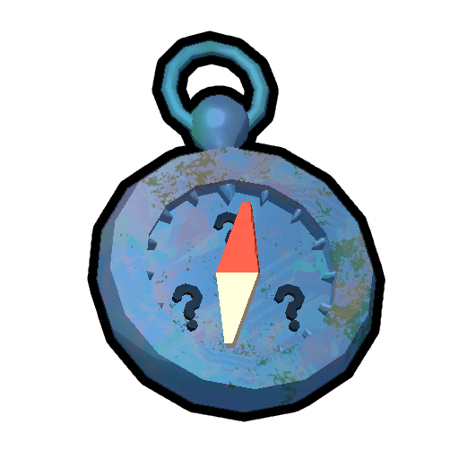

# Warp Compass

Disabled item

This item is temporarily disabled. See [patch history](#Patch_history).

Warp Compass

[Item type](Items.md)- [Equipment](Equipment.md)
- [Mystical item](https://peak.wiki.gg/wiki/Mystical_item)
Rarity
[Legendary](https://peak.wiki.gg/wiki/Legendary)
Uses
3
Weight
 **5**

The **Warp Compass** is a [mystical](https://peak.wiki.gg/wiki/Mystical) [equipment](Equipment.md) item in *[PEAK](Peak%20%28game%29.md)*. The warp compass is no longer available to acquire during regular gameplay since patch [1.1.a](1.1.a.md) due to it not behaving properly. When used, the intended result is for the compass to teleport the player to another random player. It has no effect during single-player sessions.

The item was removed the day after it was introduced due to a bug that teleported players off the map when used. It is unlikely that it will be re-added in the future.

## See also

-  [Compass](Compass.md)
-  [Pirate's Compass](Pirate%27s%20Compass.md)

## Patch history

 **[1.0](1.0.md) (2025-06-16):** Introduced.
 **[1.1.a](1.1.a.md) (2025-06-17):** Removed Warp Compass temporarily as it seems to send people to the void more often than not. While unlikely, the Warp Compass may reappear in a future update.
